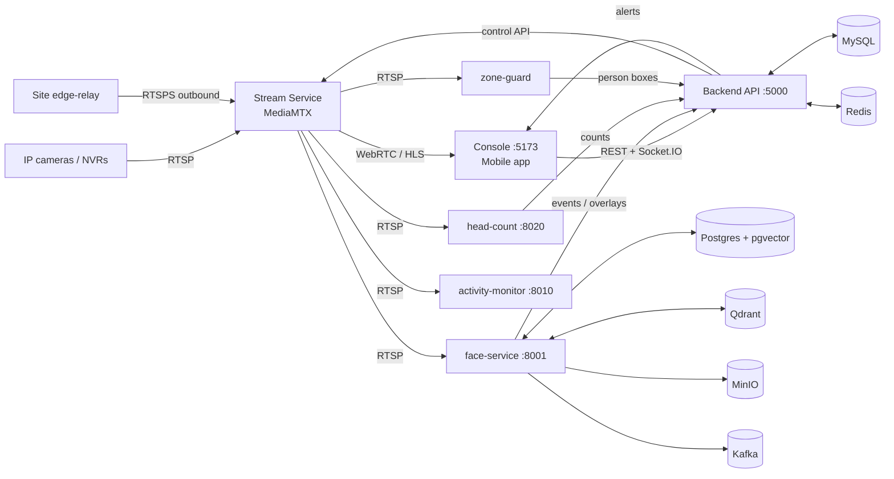

# Drishyam — AI Video Management System

Multi-tenant VMS with built-in video analytics: live view (WebRTC / HLS),
recording and playback, NVR integration, face recognition and watchlists,
cross-camera person journey, footfall and head count / occupancy, restricted
zones, activity monitoring, alerts (in-app, e-mail, mobile push) and reports.
Runs on one NVIDIA GPU host with Docker, in the cloud or on-premise.

This folder is a clean, self-contained copy of the working system (snapshot
2026-11-06): all source, every AI model weight, database schema, deployment
tooling and documentation. Nothing outside this folder is needed except
Docker images pulled from public registries. What was verified, what was left
out and why: [docs/SNAPSHOT_NOTES.md](docs/SNAPSHOT_NOTES.md).

## Quick start

```bash
git lfs install                      # weights + demo videos are LFS (see .gitattributes)
cp .env.example .env                 # set SERVICE_TOKEN (and HOST_IP for LAN access)
cp backend/.env.example backend/.env # set JWT_SECRET / JWT_REFRESH_SECRET
docker compose up -d --build         # first build ≈ 15-30 min, first AI boot ≈ 5 min

docker compose exec -e ADMIN_EMAIL=you@example.com -e ADMIN_PASSWORD='choose-a-strong-one' \
  smart-cam-backend node scripts/create-admin.js
```

Open **http://localhost:5173**, sign in, add a camera (or `--profile demo`
for a looped test camera). Full walkthrough, prerequisites and production
hardening: **[docs/SETUP.md](docs/SETUP.md)**.

## Layout

| Folder | What it is |
|---|---|
| [`backend/`](backend/) | Node 20 / Express API — the control plane: auth, tenants, cameras, NVRs, recordings, alerts, reports, licences. MySQL via Sequelize (`migrations/`, `seeders/`). Jest tests in `test/`. |
| [`frontend/`](frontend/) | React 19 + Vite operator console (Live View, Monitor Wall, Playback, AI pages, Reports, Admin console at `/admin`). |
| [`mobile/`](mobile/) | React Native + Expo mobile app (live wall, alerts, push). |
| [`ai/face-service/`](ai/face-service/) | `vms_face` (Python, FastAPI): face detection + recognition, watchlist, person journey, footfall, inference server, match + stitch workers. Postgres/pgvector + Qdrant + MinIO + Kafka. |
| [`ai/head-count/`](ai/head-count/) | Head-count / occupancy service (YOLOv8 head detector), :8020. |
| [`ai/zone-guard/`](ai/zone-guard/) | Restricted-zone person detection (YOLOv8 person boxes → backend zone engine). |
| [`ai/activity-monitor/`](ai/activity-monitor/) | Phone-use / working / attendance analytics (pose + phone detector), :8010. |
| [`ai/face-reconstruct/`](ai/face-reconstruct/) | Forensic face enhancement (CodeFormer + Real-ESRGAN), optional. |
| [`media/stream-service/`](media/stream-service/) | Drishyam Stream Service (MediaMTX 1.18.1): RTSP ingest, WebRTC/HLS egress, recording. |
| [`media/transcoder/`](media/transcoder/), [`media/sfu-bridge/`](media/sfu-bridge/) | Optional: per-camera NVENC normaliser; LiveKit SFU publisher. |
| [`models/`](models/) | Every model weight — the ones the services load, plus 15 in-house trained models not yet integrated. Catalogue: [`models/README.md`](models/README.md). |
| [`db/`](db/) | Schema snapshots (MySQL + Postgres), backup script, how migrations work. |
| [`deploy/`](deploy/) | Production nginx, site edge-relay (cameras behind a private LAN), remote-GPU bridge (WireGuard), Prometheus/Grafana, Cloudflare tunnel. |
| [`demo/`](demo/) | Demo clips + publisher for a camera-less demo (`--profile demo`). |
| [`docs/`](docs/) | Architecture, developer guides, API reference, AI design + accuracy docs, runbooks. Start at [`docs/README.md`](docs/README.md). |
| `data/` | Runtime bind mounts (recordings, optional enrolment photos). Git-ignored. |

## How the pieces talk



Video never passes through the backend: it tells the Stream Service which
camera paths to pull, and browsers and AI services read media from the Stream
Service directly. Details: [docs/HOW_IT_WORKS.md](docs/HOW_IT_WORKS.md).

## Requirements

* NVIDIA GPU (Turing or newer; developed on an RTX PRO 5000 Blackwell) with a
  driver that supports CUDA 12.8.
* Docker with GPU support: Docker Desktop + WSL2 on Windows, or Docker Engine
  + NVIDIA Container Toolkit on Linux. Compose ≥ 2.24.
* ~40 GB disk for images and models, plus recording storage.
* Git LFS if you push this folder to a Git host (several files > 100 MB).

## Licences to be aware of

InsightFace model weights (buffalo_l / buffalo_sc), CodeFormer and UTKFace are
**non-commercial** licences; Ultralytics YOLO code and weights are
**AGPL-3.0**. A commercial deployment needs licences from those owners (or
replacement models). See [models/README.md](models/README.md#licences).
