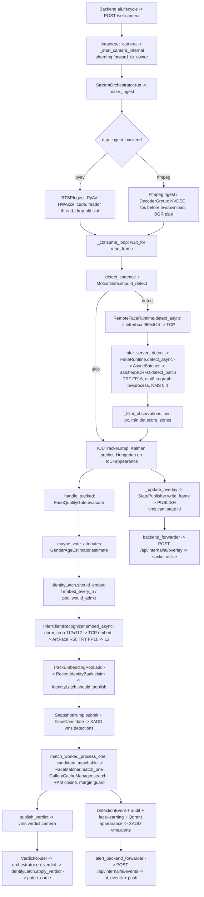

> **Study guide** (written 2026-10-20 for the AI study bundle). Paths in it are relative to that bundle: `code/vms_face/…` = this folder; `weights/osnet_x1_0_msmt17.onnx` = `vms_face/data/models/`; InsightFace packs = `models/insightface/`; `../docs/…` = `docs/…`; `../integration/backend` = `backend/`; `../integration/compose` = the root `docker-compose.yml`. Model catalogue: `models/README.md`.

# 01 - Face Recognition Engine (`vms_face`)

Study guide for the Drishyam live face-recognition engine, written from the code. Every step
is cited as `file:function`, relative to `code/vms_face/`, unless a path says otherwise. Defaults
are quoted from `config/settings.py` (the code default). Where the active compose file
(`../integration/compose/docker-compose.drisyam-original.yml`) overrides a value, both are given.
The env var for any setting is the field name in upper case (pydantic-settings, case-insensitive),
for example `insightface_rec_threshold` is set by `INSIGHTFACE_REC_THRESHOLD`.

What is in this folder:

| Path | What |
|---|---|
| `code/vms_face/` | the engine (FastAPI API, camera orchestrators, inference service, workers, eval, tests) |
| `code/smart-cam-ai-image/` | the production image: `Dockerfile` (CUDA 12.8.1 + cuDNN, Ubuntu 24.04), `requirements.txt` (onnxruntime-gpu 1.26.0, tensorrt-cu12-libs 10.16.1.11, insightface >= 0.7.3) |
| `weights/osnet_x1_0_msmt17.onnx` | OSNet x1.0 body-ReID model (256x128 in, 512-d out), used by journey body fusion |
| not shipped | InsightFace packs `buffalo_l` (SCRFD `det_10g` + ArcFace `w600k_r50` + `genderage`) and `buffalo_sc` (SCRFD `det_500m` + MobileFaceNet `w600k_mbf`). They are **non-commercial** licensed. InsightFace downloads them into `~/.insightface/models/` (compose bind-mounts `smart-cam-ai/data/insightface` there) on first run. TensorRT engines and the static ONNX re-exports are built into `~/.insightface/trt_cache/` on first start and are specific to the GPU SKU |

Bundle-level design docs live in `../docs/` (`FACE_SYSTEM_DESIGN.md`, `FACE_EDGE_REALTIME_PLAN.md`,
`FACE_LIGHTWEIGHT_TARGET.md`, `FACE_ACCURACY_BENCHMARK.md`, `FACE_RECOGNITION_RESEARCH_2026.md`,
`JOURNEY_CENTRALIZATION.md`, `DETECTION_DECISION_ALERT_FRAMEWORK.md`). The backend side is in
`../integration/backend/src/`.

---

## 1. What it does, and the process topology

`vms_face` takes each camera's RTSP stream from the Drishyam Stream Service (`mediamtx` alias,
template `rtsp://{host}:{port}/cam_{monitor_id}`, `mediamtx_rtsp_template`). It decodes a frame
every 1/`target_fps` seconds and runs the SCRFD face detector, using a cadence that depends on
what the scene needs. A Kalman/SORT tracker turns detections into tracks. Each face is gated on
quality, aligned to the 112x112 ArcFace template and embedded to a 512-d L2-normalised vector.
The best crops of a track are pooled into one template, which is matched (cosine) against the
tenant's enrolled gallery. The answer feeds a per-track **identity latch**: a known person
stops costing recognizer work after about two queries. Outputs: live boxes and names (an
ephemeral overlay), persisted `detection_events` with snapshots, watchlist/unknown alerts to
the VMS backend (in-app alert and phone push), a forensic appearance index, and cross-camera
ReID links.

### Processes in the active stack (`docker-compose.drisyam-original.yml`)

| Compose service | Command | Role | Models on GPU |
|---|---|---|---|
| `smart-cam-ai` (shard 0) | `alembic upgrade head && uvicorn vms_face.api.main:app` | API on :8001, migrations, process-wide singletons: overlay forwarder, alert forwarder, cam-state subscriber, WS fan-out, reid worker, retention worker, known-faces bootstrap. With `AI_SHARD_PRIMARY_OWNS_CAMERAS=false` it owns **no cameras** | none (remote inference) |
| `smart-cam-ai-1..4` (camera shards) | `uvicorn vms_face.api.main:app` (no alembic) | own about 11 cameras each: decode, pacing, motion gate, tracker, quality, attribute vote, latch, overlay publish, snapshots, candidate publish | NVDEC contexts, plus the on-demand `genderage` head and (if body logging is on) OSNet, both loaded locally |
| `smart-cam-infer`, `-1`, `-2`, `-3` | `python -m vms_face.workers.infer_server` (`INFER_SERVICE_ROLE=server`) | inference service on :9010 (metrics :9011). Detect and embed for every camera of every shard, with cross-camera batching. A shard picks `urls[shard_index % len(urls)]` | SCRFD batchN static export with in-graph uint8 preprocessing, ArcFace R50, 3 detector replicas (`INSIGHTFACE_RUNTIME_REPLICAS=3`) |
| `smart-cam-ai-worker` | `python -m vms_face.workers.match_worker` | consumes `vms.detections`, does the 1:N match (L3 RAM gallery, Qdrant fallback), writes `detection_events`, audit, face-learning samples and the appearance log, publishes the verdict and `vms.alerts` | none needed for matching (loads the recognizer object only for its name/threshold) |
| `journey-stitch-worker` | `python -m vms_face.workers.stitch_worker` | RQ worker: forensic journey MP4/PDF/map, CPU/FFmpeg only | none |

Infra roles:

| Store | Image | Role in the face path |
|---|---|---|
| Postgres + pgvector | `pgvector/pgvector:pg16` | `tenants`, `persons`, `face_enrollments`, `face_learning_samples`, `cameras`, `detection_events` (TimescaleDB hypertable when the extension exists), `track_links`, `audit_log`, `embeddings`/`journeys`/`journey_stops` (journey mirror with `face_vec`/`body_vec`). Migrations in `alembic/versions/0001..0006` |
| Qdrant | `qdrant/qdrant:v1.12.4` | `vms_enrolled` (gallery, source of truth) and `vms_appearance` (append-only forensic log). 512-d, Cosine, payload index on `tenant_id`/`person_id`/`camera_id`/`role` (`infra/qdrant.py`) |
| Redis | `redis:7-alpine` | Streams `vms.detections` (candidates, maxlen ~20,000), `vms.alerts`, `vms.detections.dlq`; pub/sub `vms.cam.state:{camera_id}` (overlay), `vms.verdict:{camera_id}` (latch feedback), `vms.gallery.changed`; keys `vms:shard:owners`, `vms:overlay:viewers`, `vms:gallery:version:{tenant}` |
| MinIO | `minio/minio` | `vms-snapshots` (face+body crops per candidate), `vms-enrollments`, `vms-person-tracker` (journey outputs) |
| Kafka | KRaft single node | `journey.events` spine (no-op producer when `KAFKA_BOOTSTRAP_SERVERS` is empty) |

The standalone `code/vms_face/docker-compose.gpu.yml` + `code/vms_face/Dockerfile` is an older,
self-contained layout (CUDA 12.6, ORT 1.20, `api`/`match-worker`/`reid-worker`/`retention`
roles via `docker-entrypoint.sh`). It has no inference service and no shards. The production
image is `code/smart-cam-ai-image/Dockerfile`.

---

## 2. Frame-by-frame call path



Step by step:

1. **Camera start.** The backend's `aiLifecycle.service.js` calls `POST /set-camera`
   (`api/routes/legacy.py:set_camera`). Shard 0 resolves the owner with
   `services/sharding.py:owner_of` (`ai_shard_assignment="balanced"` = sticky least-loaded map
   in the Redis hash `vms:shard:owners` via HSETNX; `"hash"` = `camera.id.int % AI_SHARD_COUNT`)
   and forwards with `forward_to_owner`. The owner calls `_start_camera_internal` and builds a
   `pipeline/orchestrator.py:StreamContext`: `target_fps` (camera row, else
   `settings.target_fps=4.0`; the `cameras.target_fps` column defaults to 8.0, and the legacy
   form clamps it to 1-12), `detection_input_size` (clamped to 320-1280), detection zones,
   footfall config.
2. **Ingest.** `pipeline/ingest.py:make_ingest` picks the backend from
   `rtsp_ingest_backend` (default `pyav`; compose `${RTSP_INGEST_BACKEND:-pyav}`).
   - PyAV: `RTSPIngest.open` uses `rtsp_transport=tcp`, `max_delay=rtsp_max_delay_sec` (1.0 s),
     `timeout=rtsp_timeout_sec` (10), and NVDEC through `av.codec.hwaccel.HWAccel(device_type="cuda")`
     when `rtsp_hwaccel="cuda"` (compose sets `cuda`; code default empty = software). Decoder
     threads are `rtsp_decode_threads=2`, or 1 with NVDEC. `_reader_loop` decodes at line rate
     into a single latest-frame slot (`rtsp_drop_old_frames=True`). `_read_frame_blocking` paces
     emission on a schedule (next due time = previous due time + period, small early
     tolerance, resync without bursting) and converts with `to_ndarray("bgr24")`. That NV12 to
     BGR conversion runs on the CPU, inside the interpreter.
   - ffmpeg: `pipeline/ingest_ffmpeg.py:FfmpegIngest._command` runs one process per camera:
     `-hwaccel cuda -hwaccel_output_format cuda -i URL -vf fps=N,hwdownload,format=nv12 -pix_fmt bgr24 -f rawvideo pipe:1`.
     With `ffmpeg_group_size>1` (default 4), `pipeline/ingest_ffmpeg_group.py:DecoderGroup` puts
     K cameras that open within `ffmpeg_group_window_sec=0.75` on one process and one CUDA
     context (`-init_hw_device cuda=gpu`). Every CUDA/NVDEC context creation goes through
     `infra/cuda_gate.py:cuda_init_gate`, a box-wide `flock` on `/vms-locks/cuda-init.lock`.
3. **Frame deadline.** `StreamOrchestrator._consume_loop` wraps `read_frame` in
   `asyncio.wait_for(timeout=pipeline_frame_timeout_sec)` (1.5 s code; 15.0 s compose). A timeout
   raises `StreamError` and the stream reopens with exponential backoff, 2 s doubling to 30 s.
4. **Cadence and motion gate.** `_detect_cadence` returns the base `detect_every_n_frames`
   (1 code; 2 compose). With `attention_scheduling=True` it returns `attention_latched_every_n=4`
   when every track is LATCHED, and `attention_unknown_every_n=2` when there are no NEW/CANDIDATE
   tracks but not all are latched. `services/motion_gate.py:MotionGate.should_detect` (off in code,
   on in compose): 160 px wide grayscale absdiff, pixel delta > 26, changed fraction >= 0.004.
   It never skips while tracks exist and never skips more than 15 frames in a row. Skipped frames
   still run the tracker (predict) and the overlay.
5. **Detect.** If `INFER_SERVICE_URL` is set, `FaceRuntimePool.get` returns
   `infra/infer_client.py:RemoteFaceRuntime`. `detect_async` letterboxes on the shard
   (`_letterbox_for_service`, which uses the same `_letterbox` as the service, so the service's
   own letterbox is a no-op) and sends the uint8 canvas over one multiplexed TCP connection
   (`infra/infer_proto.py`: `u32 header_len | u32 payload_len | JSON header | raw bytes`). The
   service, `workers/infer_server.py:InferServer._detect`, round-robins replicas and calls
   `infra/insightface_runtime.py:FaceRuntime.detect_async`. With `pipeline_batched_inference`
   (false in code, true in compose) that call goes through `infra/batcher.py:AsyncBatcher`
   (`batch_detect_max=8`, `batch_detect_window_ms=3.0`) to
   `infra/batched_scrfd.py:BatchedSCRFD.detect_batch`. Without batching it is `FaceRuntime.detect`,
   which is InsightFace `FaceAnalysis.get`. The reply is `[n,15]` float32 rows (box, score, 5x2
   landmarks), scaled back by `1/scale` in `_rows_to_observations`. If the service is down,
   frames are skipped (the tracker coasts). Local models load only after
   `infer_service_fallback_after_sec=30`.
6. **Pre-tracker filter.** `StreamOrchestrator._filter_observations` drops faces whose short
   side is below `track_min_face_px` (0, which means use `quality_min_face_px=40`) and whose
   score is below `quality_min_det_score=0.6`, then applies detection zones
   (`services/detection_zones.py:bbox_zone`). This step removed the phantom-track churn
   (`FACE_SYSTEM_DESIGN.md` §1.4, Phase 0).
7. **Track.** `services/face_tracker.py:IOUTracker.step` is SORT: a constant-velocity Kalman on
   `[cx, cy, s=w*h, r=w/h, vx, vy, vs]` (`_KalmanBox`), a cost of
   `(1-w)*(1-IoU) + w*(1-cos(track.smooth_embedding, det.embedding))` with
   `tracker_appearance_weight=0.4`, pairs with IoU < `tracker_iou_threshold=0.3` forbidden, and
   `scipy.optimize.linear_sum_assignment` to solve it. A track is born on an unmatched detection
   (id `t%08d`) and dropped when `miss_count > tracker_max_age=30` frames. Dropped tracks go to
   `dropped_last_step` for re-association.
8. **Overlay first.** `_update_overlay` draws every track with `miss_count <= cadence-1` from
   its Kalman box, with the name from `IdentityLatch.display()` and gender from
   `TrackAttributes`. `infra/detection_state.py:RedisStatePublisher.write_frame` publishes on
   `vms.cam.state:{camera_id}` at most every `overlay_publish_min_interval_sec=0.2` s while
   watched, every `overlay_unwatched_interval_sec=1.0` s while unwatched
   (`services/overlay_viewers.py:is_watched`), immediately when the scene empties, and as a 1 s
   heartbeat on an empty scene.
9. **Per face, bounded fan-out** (`pipeline_face_concurrency=8`):
   `_handle_tracked` -> `services/face_quality.py:FaceQualityGate.evaluate` (section 4) ->
   `IdentityLatch.note_face` (TTI origin) -> `_maybe_vote_attributes`
   (`infra/genderage.py:GenderAgeEstimator.estimate`, only while
   `TrackAttributes.needs_sample()` and the face is >= `attributes_min_face_px=48`) ->
   `IdentityLatch.should_embed` (LATCHED/UNKNOWN tracks only re-embed when a re-verify is due) ->
   the `embed_every_n_frames=5` per-track counter (bypassed during pool warm-up) ->
   `TrackEmbeddingPool.would_admit` (skip if the crop cannot enter the top-K).
10. **Align and embed.** With the compose backend `RECOGNIZER_BACKEND=insightface_batched` and
    remote inference, `infra/recognizers/factory.py:build_recognizer` returns
    `infra/recognizers/infer_client_rec.py:InferClientRecognizer`. It aligns on the shard
    (`infra/aligner.py:norm_crop`, a 5-point similarity transform to 112x112), batches crops
    (`infer_client_embed_window_ms=2.0`, `infer_client_embed_max=32`) and sends them to the
    service op `embed`, which is
    `infra/recognizers/batched_arcface.py:BatchedArcFaceRecognizer.embed_aligned_batch`
    (InsightFace `ArcFaceONNX.get_feat` on our TensorRT session, then L2 norm).
11. **Pool, re-associate, publish.** `IOUTracker.update_appearance` (EWMA,
    `tracker_appearance_alpha=0.7`) -> `TrackEmbeddingPool.add` (top-K=5 by quality, admission
    floor `track_pool_min_quality=0.30`) -> for a NEW track's first template,
    `services/identity_latch.py:RecentIdentityBank.claim` (cosine >= 0.70 against tracks that
    died within 30 s) -> `IdentityLatch.should_publish` (needs `hits >= track_min_hits_to_match`,
    3 code / 2 compose). Then `SnapshotPump.submit` (a bounded MinIO upload of a body-plus-context
    crop, `_crop_with_padding`: 1.0x width each side, 0.7x height above, 4.5x below), and a
    `domain/schemas.py:FaceCandidate` (pooled 512 floats as JSON plus `extra`: `face_px`,
    `blur_var`, yaw/pitch, gender, `latch_state`, `latch_reason`, optional `body_vec`/clothing
    colours) goes out through `infra/redis_bus.py:RedisBus.publish_detection` (XADD
    `vms.detections`, MAXLEN ~20,000).
12. **Match.** `workers/match_worker.py:_process_one` checks `_candidate_matchable` against the
    worker's floors (`match_min_quality`, `match_min_face_px`, `match_min_blur_var`). It then
    calls `services/face_matcher.py:FaceMatcher.match_one`, which calls
    `services/gallery_cache.py:GalleryCacheManager.search`: exact brute-force cosine over the
    tenant's L2-normed float32 matrix in RAM (`LocalGallery.search`), falling back to Qdrant if
    the cache is older than 180 s. The search is unfloored; `top_k=3` when the margin guard is on.
    The threshold is applied after the search, then the top-1 vs nearest-other-person margin check.
13. **Verdict before the DB write.** `RedisBus.publish_verdict` publishes on
    `vms.verdict:{camera_id}`, flagged `skipped` if the floors refused it. Then come the
    `DetectionEvent` row (`kind` = `match` / `unknown` / `alert` for `PersonRole.BLACKLIST`), the
    DPDP audit row for hits, `services/face_learning.py:maybe_queue_sample`,
    `FaceMatcher.log_appearance` (Qdrant `vms_appearance`) and `RedisBus.publish_alert` (XADD
    `vms.alerts`).
14. **Latch update.** `infra/verdict_bus.py:VerdictRouter` (PSUBSCRIBE `vms.verdict:*`) calls the
    owning `StreamOrchestrator.on_verdict` -> `IdentityLatch.apply_verdict`. On a
    `provisional`/`confirmed`/`identity_change`/`unlatched` transition it calls
    `StatePublisher.patch_name`, so the name appears on the next overlay frame. Time-to-identity
    is recorded in `vms_time_to_identity_seconds{kind}`.
15. **To the VMS.** `infra/backend_forwarder.py:run_backend_forwarder` (shard 0) PSUBSCRIBEs
    `vms.cam.state:*` and POSTs compact frames (`[trackId,x1,y1,x2,y2,conf%,name,gender,state]`)
    to `/api/internal/ai/overlay` for watched cameras only. It sends at most 20 boxes per frame,
    and gender only when vote confidence >= `backend_overlay_min_gender_conf=0.85`; age is never
    shown. `infra/alert_backend_forwarder.py:run_alert_backend_forwarder` reads `vms.alerts`
    (group `backend-alert-forwarder`) and forwards only `alert` (as `person.alert`, critical) and
    `unknown` (as `person.unknown`, warning) to `/api/internal/ai/events`, with a
    `backend_alert_cooldown_sec=120` cooldown keyed on (user, camera, kind, person_id or 64 px
    foot-point cell). Recognised `match` events are not forwarded as alerts.

---

## 3. Pre-processing, tensors and runtime

| Stage | Tensor / format | Details (where) |
|---|---|---|
| Decoded frame | `uint8` HxWx3 **BGR** | PyAV `to_ndarray("bgr24")` or ffmpeg `-pix_fmt bgr24` raw pipe |
| Detector input size | `(W,H) = (det_size, ceil32(det_size/aspect))` | `FaceRuntime._det_input`. `INSIGHTFACE_DET_SIZE=960` with `INSIGHTFACE_DET_ASPECT=1.7778` (compose) gives **960x544**. Code default `insightface_det_aspect=0.0` gives a 960x960 square. Pool buckets round to a multiple of 32, minimum 160 (`FaceRuntimePool._bucket`) |
| Letterbox | top-left pad, `scale=min(W/w, H/h)`, `cv2.INTER_LINEAR` | `batched_scrfd.py:_letterbox` (matches SCRFD's reference). 1920x1080 maps to 960x540 at scale 0.5 plus 4 rows of padding |
| Detector graph in (uint8 path) | `input_u8` **[N,544,960,3] uint8 BGR NHWC** | `infra/ort_session.py:ensure_u8_detector` prepends Cast -> Transpose(0,3,1,2) -> Split/Concat (BGR->RGB) -> `(x - 127.5) * (1/128)`, feeding the original `input.1` [N,3,544,960] float32. Used when `detector_u8_input=True` and the model file is the batchN export |
| Detector graph in (fallback) | `input.1` [N,3,H,W] float32 RGB | `BatchedSCRFD._preprocess`: `cv2.dnn.blobFromImage(1/input_std, mean=input_mean, swapRB=True)` (SCRFD: mean 127.5, std 128) |
| Static export | `det_10g_960x544_batchN_static.onnx` (+ `_u8.onnx`) | `ort_session.ensure_static_detector`: pins H and W, a symbolic batch `N` when batching is on, drops `value_info`, ORT BASIC-level folding. TensorRT rejects the shipped dynamic export |
| SCRFD heads | 3 FPN levels (strides 8/16/32) x {score, bbox dist, 5-pt kps dist}, `num_anchors` = 2 | `BatchedSCRFD.detect_batch`. At 960x544: (120x68 + 60x34 + 30x17) x 2 = 21,420 anchors per image. Outputs are image-major `(B*A, C)` rows |
| Alignment | 5 points -> 112x112 BGR `uint8` | `infra/aligner.py:norm_crop` -> `insightface.utils.face_align.norm_crop` (similarity transform to the ArcFace template, `warpAffine`) |
| ArcFace R50 (`w600k_r50.onnx`) | `input.1` [N,3,112,112] float32 RGB, `(x-127.5)/127.5` | `ArcFaceONNX.get_feat` (`blobFromImages`, `swapRB=True`). Output 512-d, then L2-normed in `BatchedArcFaceRecognizer._l2_norm` |
| MobileFaceNet (`w600k_mbf.onnx`, buffalo_s/sc) | same as ArcFace | resolved by `BatchedArcFaceRecognizer._resolve_model_path` |
| AdaFace IR101 (opt-in) | [1,3,112,112] float32 **BGR**, `x/127.5 - 1` | `infra/recognizers/adaface.py:_preprocess`. A different embedding space: re-enrol and use `recognizer_adaface_threshold=0.35` |
| genderage | 96x96 (TRT profile 1/8/16) | `infra/genderage.py`. InsightFace `Attribute` model aligns its own crop from the bbox. Gender 1=male, 0=female |
| OSNet body ReID | [1,3,256,128] RGB, ImageNet mean/std, out 512 | `journey/body.py:BodyEmbedder.embed`, person box estimated from the face box (`person_bbox_from_face`) |

**Runtime policy** (`infra/ort_session.py`, applied to every session including InsightFace's
own through `install_insightface_session_policy`):

- Providers, in order: `TensorrtExecutionProvider` (only when `libnvinfer.so.10` and
  `libnvonnxparser.so.10` actually `dlopen` with `RTLD_GLOBAL`; never trust
  `get_available_providers()`), then `CUDAExecutionProvider` (`arena_extend_strategy=kSameAsRequested`),
  then `CPUExecutionProvider`. `active_provider(session)` logs what really bound.
- FP16: `tensorrt_fp16=True` for detector and genderage. The recognizer runs on TRT
  (`tensorrt_recognizer=True`) in FP16 (`tensorrt_fp16_recognizer=True`; parity 0.999964 vs FP32,
  gate 0.9999).
- TensorRT profiles: recognizer `input.1` 1/16/32 x 3x112x112 (`batch_embed_max=16`,
  `tensorrt_recognizer_max_batch=32`). Detector batchN and `input_u8` 1/4/8 (`batch_detect_max=8`).
  genderage `data` 1/8/16 x 3x96x96.
- Engine cache: `tensorrt_cache_dir=/root/.insightface/trt_cache`, prefix `{stem}_{fp16|fp32}`,
  timing cache on, `tensorrt_workspace_mb=2048`. Engines are built during a warm-up run inside
  the CUDA gate (`_warm_up_session`), so no process can read a half-written engine.
- Threads: `ort_intra_op_threads=2`, `ort_inter_op_threads=1`, `ort_allow_spinning=False`,
  `opencv_threads=1`, `OMP_NUM_THREADS=1`. Executor pools (`core/executors.py`): ingest 256
  (compose 48), gpu 4, io 32 (`VMS_*_POOL_SIZE`).
- Loaded heads: `FaceRuntime.__init__` builds `allowed_modules=["detection"]`, plus
  `"recognition"` only for the legacy `insightface` backend. The aux landmark heads
  (`2d106det`, `1k3d68`) and inline genderage are filtered out *before* a session exists
  (`ort_session.get_model` hook).
- CUDA failure: `FaceRuntime._degrade_to_cpu` rebuilds on CPU and retries CUDA after
  `insightface_cuda_retry_sec=60`.

---

## 4. Post-processing and thresholds (actual defaults)

| Gate | Code default | Compose (drisyam-original) | Where / effect |
|---|---|---|---|
| SCRFD score floor `insightface_det_threshold` | 0.5 | 0.5 | applied in `BatchedSCRFD.detect_batch` (`scores >= thr`) and in `FaceAnalysis.prepare(det_thresh)`. 0.7 had cost about 20% of faces (`FACE_ACCURACY_BENCHMARK.md` §3) |
| NMS IoU | 0.4 (hard-coded `BatchedSCRFD(nms_thresh=0.4)`) | same | greedy NMS per image in letterboxed coordinates |
| Detector input `insightface_det_size` / `insightface_det_aspect` | 960 / 0.0 | 960 / 1.7778 | 960x544 tensor |
| Pre-tracker size floor `track_min_face_px` | 0 (= `quality_min_face_px`) | 0 -> 40 | `_filter_observations` |
| Pre-tracker score floor | `quality_min_det_score` 0.6 | 0.6 | `_filter_observations` |
| Quality: min face `quality_min_face_px` | 40 px short side | 40 | `FaceQualityGate.evaluate` step 1 |
| Quality: pose `quality_max_yaw_deg` / `quality_max_pitch_deg` | 45 / 30 | same | **inert on the batched/remote path**: yaw/pitch are `None` (see section 9) |
| Quality: blur `quality_max_blur_var` | 0.0 (disabled) | 0.0 | Laplacian variance on a <=64x64 gray crop; reject only if > 0 and var < value |
| Quality: brightness | 15..240 | same | mean gray of the crop |
| Composite quality score | `0.45*det + 0.25*min(1, px/max(160, 2*min_px)) + 0.20*min(1, blur/200) + 0.10*(1-|b-128|/128)` | same | pool weight, latch quality-jump input, match floor |
| Pool admission `track_pool_min_quality` | 0.30 | 0.30 | `TrackEmbeddingPool.add/would_admit` |
| Match floors `match_min_quality` / `match_min_face_px` / `match_min_blur_var` | 0.58 / 80 / 30.0 | 0.25 / 15 / 8.0 | `match_worker._candidate_matchable`. Fail means verdict `skipped`, recorded as `unknown` with similarity 0 |
| Match threshold `insightface_rec_threshold` | 0.62 | **0.45** | `settings.effective_recognizer_threshold`. AdaFace uses `recognizer_adaface_threshold=0.35` |
| Ambiguity margin `match_top1_margin` | 0.06 | 0.06 | `FaceMatcher.match_one`: top-1 minus nearest different `person_id` within top 3 < margin means `ambiguous`, `person_id=None` |
| Hot-set fast path `gallery_cache_hot_confident_margin` | +0.10 over threshold (fast path off) | off | `GalleryCacheManager.search` |
| Re-association `identity_latch_reassoc_min_cosine` | 0.70 within 30 s | same | `RecentIdentityBank.claim` |
| Gender shown on overlay `backend_overlay_min_gender_conf` | 0.85 | same | vote assertion floor is `attributes_min_agreement=0.70` |
| Face learning sample `face_learning_min_similarity/quality/face_px/blur_var` | 0.68 / 0.60 / 96 / 45 | 0.50 / 0.45 / 60 / 20 | `services/face_learning.py:maybe_queue_sample`; duplicate cut 0.985 |
| Cross-camera ReID `reid_min_similarity` | 0.55 in 600 s window | same | `workers/reid_worker.py` writes `track_links` |
| Journey ANN floor `journey_similarity_threshold` | 0.50 | same | forensic search |

Note the order of operations: the effective minimum face for recognition is the **40 px**
pre-tracker filter, not the compose `MATCH_MIN_FACE_PX=15`. The match-worker floor only bites
when it is stricter than 40.

---

## 5. Tracking, temporal logic and anti-flood rules

**L0 identity latch** (`services/identity_latch.py:IdentityLatch`, pure state, unit-tested in
`tests/test_identity_latch.py`):

```
NEW --first pool change & hits>=min_hits--> CANDIDATE --K of last N verdicts agree--> LATCHED
 |                                           |                                         |
 |                                           +--max_unknown_queries misses--> UNKNOWN  |
 +-- re-association from a track dead <30 s (cos>=0.70) --> CANDIDATE (provisional)    |
re-verify LATCHED/UNKNOWN on: quality jump >= 0.10 | timer 12 s (latched) / 20 s (unknown) | uncertain flag
LATCHED + 3 consecutive disagreeing/miss verdicts --> CANDIDATE (unlatched) or identity_change
```

| Setting | Default | Meaning |
|---|---|---|
| `identity_latch_enabled` | True | off restores "query on every pool change" |
| `identity_latch_confirm_k` / `_n` | 2 / 3 | K-of-N. The first hit is shown as **provisional**, the Kth agreeing hit makes it **confirmed** |
| `identity_latch_candidate_gap_sec` | 0.5 | at most one query per 0.5 s while CANDIDATE |
| `identity_latch_reverify_sec` | 12.0 | LATCHED re-check timer |
| `identity_latch_quality_jump` | 0.10 | re-query when best crop quality rises this much |
| `identity_latch_unlatch_after` | 3 | sticky: 3 disagreements to drop or replace a name |
| `identity_latch_max_unknown_queries` | 3 | misses before the negative latch (UNKNOWN) |
| `identity_latch_unknown_retry_sec` | 20.0 | retry budget for strangers |
| `identity_latch_reassoc_sec` / `_min_cosine` | 30.0 / 0.70 | occlusion survival |

Verdict semantics (`apply_verdict`): an `ambiguous` result is treated as a miss, except that it
does not clear a provisional name (`ambiguous_held`). A `skipped` verdict (match floors) is
ignored entirely (`on_verdict`), so it never pushes a track toward UNKNOWN.

**L1 pool** (`services/track_embedding_pool.py`): min-heap top-K=5 by composite quality. The
quality-weighted mean is re-L2-normed. `would_admit` lets the orchestrator skip the recognizer
when the crop could not displace the pool's worst member.

**Attributes** (`services/track_attributes.py:TrackAttributes`): quality-weighted gender vote.
A label is asserted after >= 3 votes with >= 0.70 weighted agreement. Sampling stops at 8 votes,
or early once >= 3 votes reach 0.90 agreement. Age is the quality-weighted mean (never drawn on
the overlay).

**Detector cadence**: base `DETECT_EVERY_N_FRAMES` (2 in compose), stretched to 4 when everyone
in view is latched and to 2 for latched strangers. The Kalman track carries the box between
detects. The motion gate skips detection on empty static scenes.

**Anti-flood** (doctrine: `../docs/DETECTION_DECISION_ALERT_FRAMEWORK.md`, "detect per frame /
decide per track / alert per identity transition"):

- Overlay boxes are ephemeral (`/api/internal/ai/overlay`, socket `ai.live`) and never become
  alerts. They go only to cameras some browser is watching (`ai.watch` ->
  `GET /api/internal/ai/viewers` -> Redis `vms:overlay:viewers`, fail-open).
- Persisted alerts get three layers: the AI-side cooldown of 120 s per (user, camera, kind,
  subject) in `alert_backend_forwarder`; the backend's open-episode fold in
  `internal.routes.js POST /ai/events` (`alertEngine.claimEventRow` increments `payload.count`
  instead of inserting); and the backend push dedup (`alertEngine.maybeAlert`; the framework doc
  §9 quotes 90 s / 600 s identity cooldowns and a burst cap of 8 per 600 s).
- Candidate volume is bounded by the latch. Measured: **1.9 candidates per track**
  (`FACE_EDGE_REALTIME_PLAN.md` §7, Phase 2 building blocks).

---

## 6. Outputs and their consumers

| Output | Producer | Transport | Consumer -> effect |
|---|---|---|---|
| Live boxes, names, state | orchestrator `_update_overlay`, `patch_name` | Redis pub/sub `vms.cam.state:{camera_id}` (+ key `vms:cam:state:{id}`, TTL 30 s) | (a) shard-0 `run_cam_state_subscriber` -> local cache -> legacy `/ws`, `/api/detections/{camera_id}`, `/api/people-count`; (b) `backend_forwarder` -> `POST /api/internal/ai/overlay` -> `ws.service.js` `toUser(userId,'ai.live')` -> `AIOverlay.jsx` |
| FaceCandidate | orchestrator | Redis Stream `vms.detections` (groups `match-workers`, `reid-workers`) | match worker; reid worker |
| Verdict | match worker | pub/sub `vms.verdict:{camera_id}` | owning orchestrator's latch |
| DetectionEvent | match worker | Postgres `detection_events` | `/logs` and `/events`. The backend `ai.controller.js:fetchVmsFaceEvents` mirrors `/logs` with the org JWT and normalises kinds to `person.match/unknown/alert` |
| Appearance point | match worker | Qdrant `vms_appearance` (payload: camera, event, ts, track, person, `body_vec`, colours, yaw/pitch, `face_px`, `quality_score`) | `/search/appearances`, `/journey/*`, reid worker |
| Alert message | match worker | Redis Stream `vms.alerts` | shard-0 `alerts_subscriber` (WS fan-out); `alert_backend_forwarder` -> `POST /api/internal/ai/events` -> `ai_events` row + `ai.event` socket + phone push |
| Snapshot | `SnapshotPump` | MinIO `vms-snapshots/{tenant}/{camera}/{track}/{ts}_{rand}.jpg`, JPEG q80 | event modal, face learning, watchlist enhance (off) |
| Face-learning sample | match worker | Postgres `face_learning_samples` | operator approve -> extra gallery vector (`/face-learning/*`) |
| Track link | reid worker | Postgres `track_links` | `/reid/*`, journey |
| Gallery change | enrollment, delete | pub/sub `vms.gallery.changed` + INCR `vms:gallery:version:{tenant}` | match worker L3 reload (debounce 1 s); edge `/edge/gallery/version` |
| Metrics | every process | `/metrics` (API), :9011 (infer) | `vms_detect_latency_seconds`, `vms_pipeline_stage_seconds{stage}`, `vms_time_to_identity_seconds`, `vms_embed_skipped_total{reason}`, `vms_motion_gate_skips_total{reason}`, `vms_loop_lag_seconds`, `vms_infer_request_seconds`, `vms_batch_size` |

Backend entry points (`../integration/backend/src/routes/internal.routes.js`, service-token
auth `X-Service-Token`): `GET /cameras` (monitorId -> userId map, refreshed every 30 s),
`GET /ai/viewers`, `POST /ai/overlay`, `POST /ai/events`.

---

## 7. Configuration knobs (most important 48)

| Setting (env = upper case) | Code default | Effect |
|---|---|---|
| `insightface_model` | `buffalo_l` | model pack (`buffalo_sc`/`buffalo_s` for edge experiments) |
| `insightface_det_size` | 960 | detector width |
| `insightface_det_aspect` | 0.0 (compose 1.7778) | rectangular input; 960x544 |
| `insightface_det_threshold` | 0.5 | SCRFD score floor |
| `insightface_rec_threshold` | 0.62 (compose 0.45) | ArcFace cosine match threshold |
| `match_top1_margin` | 0.06 | crowd ambiguity guard |
| `recognizer_backend` | `insightface` (compose `insightface_batched`) | `insightface` / `insightface_batched` / `adaface` / `remote` |
| `pipeline_batched_inference` | False (compose true) | cross-camera AsyncBatcher for detect and embed |
| `batch_detect_max` / `batch_detect_window_ms` | 8 / 3.0 | detect batching |
| `batch_embed_max` / `batch_embed_window_ms` | 16 / 2.0 | embed batching (also the TRT opt profile) |
| `insightface_runtime_replicas` | 1 (compose 3) | detector sessions per size (each has its own batcher) |
| `tensorrt_enabled` / `tensorrt_fp16` | True / True | TRT EP and FP16 for detector/genderage |
| `tensorrt_recognizer` / `tensorrt_fp16_recognizer` | True / True | TRT and FP16 for ArcFace (parity-gated) |
| `detector_static_export` / `detector_u8_input` | True / True | static batchN export; preprocessing in the graph |
| `tensorrt_cache_dir` | `/root/.insightface/trt_cache` | engines and exports, per GPU SKU |
| `infer_service_url` | "" (compose 4 services) | remote inference; comma list |
| `infer_service_timeout_sec` / `infer_service_fallback_after_sec` | 3.0 / 30.0 | per-request timeout; time before local models load |
| `ai_shard_count` / `ai_shard_primary_owns_cameras` / `ai_shard_assignment` | 1 / True / `balanced` (compose 5 / false) | camera sharding |
| `rtsp_ingest_backend` | `pyav` | `ffmpeg` = decode outside Python (native Linux) |
| `rtsp_hwaccel` | "" (compose `cuda`) | NVDEC through PyAV HWAccel |
| `ffmpeg_group_size` / `ffmpeg_group_window_sec` | 4 / 0.75 | decoder groups (one CUDA context per K cameras) |
| `rtsp_drop_old_frames` | True | latest frame wins |
| `pipeline_frame_timeout_sec` | 1.5 (compose 15.0) | read deadline before reopen |
| `target_fps` | 4.0 | default ingest rate for new cameras (camera row overrides) |
| `detect_every_n_frames` | 1 (compose 2) | base detector cadence |
| `attention_scheduling` / `attention_latched_every_n` / `attention_unknown_every_n` | True / 4 / 2 | latch-aware cadence |
| `motion_gate_enabled` | False (compose true) | skip detect on empty static scenes |
| `motion_gate_pixel_delta` / `motion_gate_min_changed_frac` / `motion_gate_max_skip_frames` | 26 / 0.004 / 15 | gate sensitivity |
| `track_min_face_px` / `quality_min_face_px` | 0 / 40 | size filter before the tracker |
| `quality_min_det_score` | 0.6 | score filter before the tracker |
| `quality_max_blur_var` | 0.0 | blur reject (disabled) |
| `tracker_iou_threshold` / `tracker_max_age` | 0.3 / 30 | association gate; frames to keep a coasting track |
| `tracker_appearance_weight` / `tracker_appearance_alpha` | 0.4 / 0.7 | DeepSORT-style term; EWMA |
| `track_pool_top_k` / `track_pool_min_quality` | 5 / 0.30 | template pool |
| `track_min_hits_to_match` | 3 (compose 2) | hits before the first candidate |
| `embed_every_n_frames` | 5 | per-track embed cadence after warm-up |
| `identity_latch_confirm_k` / `_n` | 2 / 3 | K-of-N confirm |
| `identity_latch_reverify_sec` / `identity_latch_unknown_retry_sec` | 12 / 20 | re-check timers |
| `match_min_quality` / `match_min_face_px` / `match_min_blur_var` | 0.58 / 80 / 30 (compose 0.25 / 15 / 8) | match-worker floors |
| `gallery_cache_enabled` / `gallery_cache_refresh_sec` / `gallery_cache_max_stale_sec` | True / 30 / 180 | L3 RAM gallery |
| `gallery_cache_storage` | `float32` | `int8` = 4x less RAM with float rescoring of top 32 |
| `face_attributes_enabled` / `insightface_ondemand_genderage` | True / True | track-voted gender, on-demand head |
| `attributes_min_votes` / `attributes_max_votes` / `attributes_min_agreement` | 3 / 8 / 0.70 | vote rules |
| `overlay_viewer_gating` / `overlay_publish_min_interval_sec` | True / 0.2 | publish only for watched cameras, 5 Hz |
| `backend_alert_cooldown_sec` | 120 | AI-side alert dedup |
| `journey_body_logging` | False (compose true) | OSNet body vector + clothing colours per candidate |
| `redis_stream_detections_maxlen` | 20,000 | candidate stream cap (about 20 KB per entry) |
| `retention_event_days` / `retention_snapshot_days` | 90 / 7 | DPDP retention worker |

---

## 8. Performance and accuracy already measured

All numbers were measured on the development box (RTX PRO 5000 72 GB Blackwell, Docker Desktop
on WSL2, 16 vCPU VM) unless stated. That box is explicitly *not* a capacity reference
(`FACE_SYSTEM_DESIGN.md` §5, Phase 2.5).

Model microbenchmarks (`FACE_LIGHTWEIGHT_TARGET.md` §1, CUDA EP FP32):

| Stage | Shape | ms |
|---|---|---:|
| SCRFD det_10g square | 1x3x960x960 | 7.74 |
| SCRFD det_10g 16:9 | 1x3x544x960 | 5.90 |
| ArcFace R50 batch 1 / 8 / 16 / 32 | per face | 3.82 / 0.52 / 0.42 / 0.40 |
| genderage batch 1 / 8 | per face | 1.97 / 0.17 |
| 6 real faces, per-face vs batched | per face | 3.803 vs 0.850 |

Runtime and system (`FACE_SYSTEM_DESIGN.md` §5):

- Phase 0: detector on TRT FP16 static 960x544 export: **3.56 ms vs 5.63 ms** CUDA FP32. Parity:
  max |dScore| 0.0019, max |dBox| 0.23 px. Threads per process 546 -> 102-114, RSS 4.6 -> 2.0-2.6 GB.
- Phase 1: recognizer TRT FP16 **1.77 ms/face at batch 1 vs 5.50 FP32**. Mean live embed batch
  was about 1.06, and mean detect batch 1.09 at 20 cameras. Ingest pacing fix: 4.8 -> 7.24 fps
  per camera.
- Phase 2 (inference service + 4 camera shards, 43 cameras: 37 synthetic + 6 real): **290
  frames/s, 7.08 fps/camera, detect stage 21.5 ms** (p95 <= 50 ms), service side 10.7 ms, GPU
  29-40%. In-graph uint8 preprocessing: CPU per frame 9.5 -> 5.7 ms (batch 1) and 8.8 -> 3.7 ms
  (batch 8); service per request 60 -> 16 ms. Loop-lag law: event-loop lag grows with cameras per
  process (7 cams 2 ms, 13 cams 10-16 ms, 15 cams 20-35 ms), hence about 11 cameras per shard.
  Honest planning number on that box: **about 45 cameras at 7 fps**.
- Phase 2.5: the ffmpeg backend at 43 cameras ran **301 frames/s, 7.4 fps/camera, detect 17.3 ms,
  loop lag 1.1-1.9 ms**. Decoder groups (4 office 1080p cameras): 8.1 fps each, 9.0% of a core
  per camera, 192 MB PSS per camera, 1 CUDA context instead of 4. The WSL2 dxgkrnl layer broke
  CUDA context creation around 60 cameras (a platform wall, not an engine limit).
- Motion gate: removed about 72% of eligible detect calls on 4 demo cameras
  (`FACE_EDGE_REALTIME_PLAN.md` §7). Over 4 days on 2 cameras, 84% of frames never reached the
  detector (cadence + motion, `FACE_SYSTEM_DESIGN.md` §1.4). `DETECT_EVERY_N_FRAMES=2` cut detect
  calls by 49% (`FACE_LIGHTWEIGHT_TARGET.md` §6).
- Time-to-identity: provisional / confirmed **0.47 s / 1.06 s** (Phase 1, n=15/16), re-measured
  **0.29 s / 0.93 s** on the Phase 2 layout (n=96 tracks).
- Latch economy: 1.9 candidates per track; 44 of 103 embeds suppressed on 2.5 s tracks; every
  verdict answered from the `local` tier (554 vectors, 82 ms reload).
- Edge path: `/edge/escalate` round trip 121 ms. PNG crops are vector-identical (cosine
  1.0000000). JPEG q92 drifts to 0.977-0.994, which is too much.

Accuracy:

| Test | Result | Source |
|---|---|---|
| Held-out stills, 49 persons, 147 gallery / 97 probes, thr 0.45 | det_thresh 0.7 -> 0.5: detection 0.794 -> **1.000**, TPR 0.773 -> **0.969**, F1 **0.984**, FPR 0.000 | `FACE_ACCURACY_BENCHMARK.md` §2-3 |
| AdaFace IR101/WebFace12M on the same set, thr 0.35 | TPR **0.979**, F1 0.990, FPR 0.000, median margin 0.293 vs 0.220 | `FACE_ACCURACY_BENCHMARK.md` §5 |
| 48 mated stills + 300 real office impostor crops (buffalo_l) | TPR 0.979, FPR 0.000, F1 0.990, detection 0.937, **FNIR@FPIR=1e-3 = 0.021** | `FACE_SYSTEM_DESIGN.md` §5, office test |
| Same harness, `buffalo_sc` (det_500m + w600k_mbf) | TPR 0.896, **FNIR 0.104 (5.0x teacher)**, detection 0.925 | `FACE_SYSTEM_DESIGN.md` §5, Phase 3 data point |
| Live slideshow of enrolled staff through the real pipeline | 69 known / 0 unknown, similarity p50 0.914 | `FACE_SYSTEM_DESIGN.md` §5 |
| Live office strangers vs gallery | top-1 cosine p50 0.233, p90 0.297 (empty 0.35-0.45 band); faces 42-67 px | same |
| Detector sub-stream yield | 640x360 sub-stream gives about 0 usable (>= 40 px) faces where main gives hundreds | same |

Mated probes are enrolment stills, so TPR is an upper bound. The impostor side is
production-representative.

---

## 9. Known weaknesses and concrete improvement ideas

Ordered roughly by payoff. Items marked *(code)* were found while reading the source for this
guide; the others come from the design docs.

**Correctness and accuracy**

1. *(code)* **The tracker's appearance term is dead in production.** With `insightface_batched`
   or remote inference, `FaceObservation.embedding` is `None` at `IOUTracker.step` time, so
   `cost_app` is 0 for every pair. The cost becomes `0.6*(1-IoU)` with a hard IoU >= 0.3 gate.
   At a 2-4 frame detect cadence a fast walker can fail the IoU gate and fork a track; the
   re-association bank only recovers *latched* identities. Ideas: compare the detection's
   embedding after it is computed (two-stage association); ByteTrack-style second pass on
   low-score boxes; a centre-distance or GIoU gate scaled by box size and frames since last match.
2. *(code)* **The pose gate is inert.** The batched and remote detect paths return
   `yaw_deg=pitch_deg=None`, so `quality_max_yaw_deg/pitch_deg` never reject, and the candidate's
   `yaw`/`pitch` fields that the journey fusion wants are empty. A cheap fix is a geometric yaw
   proxy from the 5 SCRFD landmarks (nose offset from the eye midpoint, normalised by eye
   distance), which costs nothing. Then drop |yaw| > 30 deg from pool admission, as
   `FACE_SYSTEM_DESIGN.md` §3.3 recommends.
3. *(code)* **The margin guard can be blinded by multi-template persons.** `LocalGallery.search`
   ranks *points*, and `match_one` asks for `top_k=3`. If the top person owns 3 or more templates
   (enrolment plus approved face-learning samples), the rival identity is never in the list and
   the guard passes. Fix: take the max score per `person_id` before the margin check
   (`top_k = 3 * max_templates`, or a per-person reduction in the matmul result).
4. *(code)* **"Tracker uncertainty" re-verify is not wired.** `IdentityLatch.uncertain` is only
   set by `adopt()` (re-association). Nothing sets it on long coasts, Kalman innovation spikes or
   box overlap between two tracks, which is when ID swaps happen. Set it when
   `miss_count >= N` before a re-match, or when two tracks' boxes overlap above an IoU.
5. *(code)* **Alerts are not latch-gated.** The latch docstring and the framework say alerts fire
   on *confirmed* transitions. In code, `match_worker` emits `kind=alert` for any single
   blacklist hit, including the first provisional one, and `alert_backend_forwarder` forwards
   `unknown` per 64 px foot-point cell, so a walking stranger crosses cells and re-arms the
   cooldown. A candidate that fails the match floors (`skipped`) is still written and published
   as `kind=unknown`, so poor crops of a *known* person can raise "unknown person" alerts. The
   backend fold absorbs part of this. The clean fix: carry `latch_state` (already
   in `extra`) and alert only on CANDIDATE->LATCHED for watchlist persons and on the
   negative-latch transition for unknowns.
6. **Quality score is a heuristic** (det score, size, Laplacian, brightness). Replace it with a
   learned face-image-quality score. OFIQ is MIT; MagFace-style feature norm is another option.
   It drives pool weighting, the latch quality jump and match floors at once.
7. **Alignment at reduced resolution.** Landmarks come from the 960x544 detector, about 0.5x of
   1080p, so landmark error is doubled when mapped back for `norm_crop`. For faces under about
   80 px, a second-pass SCRFD on a padded full-resolution crop (the `/edge/escalate` code path
   already does crop detection) gives sharper landmarks. Gate it with `eval/recognizer_parity.py`
   plus the FRVT harness.
8. **Thresholds are global.** The code default is 0.62 and compose uses 0.45. NIST (cited in
   `FACE_RECOGNITION_RESEARCH_2026.md` §4) shows false-positive rates vary 10-100x across
   demographics and cameras. Calibrate per camera from an FPIR sweep (`eval/frvt.py`) on a
   per-site impostor set.
9. **Enrolment depth.** The gallery averages 4.9 images per identity, mostly stills. Target
   3-5 pose-diverse images, and use the face-learning approval loop to add in-domain CCTV
   templates (`FACE_EDGE_REALTIME_PLAN.md` §6.3).
10. **The gallery must live in the camera's tenant.** The office test found 9,273 unknown out of
    9,282 events because the gallery sat in the wrong tenant. Add a startup check that warns when
    a camera's tenant has an empty `vms_enrolled` slice.

**Speed and embedded-level work**

11. **INT8 detector.** TensorRT PTQ INT8 of SCRFD-10G is typically within 0.3% of FP16
    (`FACE_EDGE_REALTIME_PLAN.md` §2.4). Calibrate on our own letterboxed CCTV frames and gate on
    boxes parity (±1 px, ±0.01 score). Keep the embedder FP16. INT8 for the embedder only after
    quantisation-aware training with an FNIR gate (`FACE_SYSTEM_DESIGN.md` §6).
12. **Drop the stride-8 head** for cameras whose minimum usable face is >= 40 px. Those anchors
    find 10-32 px faces, are about 60% of all anchors and most of the NMS work (§3.3).
13. *(code)* **CUDA graphs and IOBinding are not used.** `_trt_options` sets no
    `trt_cuda_graph_enable`, and there is no IOBinding. The batch-1 detector engine has a fully
    static shape, so it is a CUDA-graph candidate. Pre-allocate device input buffers and bind the
    uint8 canvas once per replica.
14. **Detect batches barely fill** (mean 1.09 at 20 cameras) because the 3 ms window rarely
    catches two cameras' detect frames together. Phase-align the per-camera cadence counters per
    service so frames arrive in waves, or raise the window to about half a frame period on large
    deployments. The batcher and TRT profile 1/4/8 are already there.
15. **Decode is the CPU bill.** PyAV converts NV12 to BGR in-interpreter, about 19 ms CPU per
    emitted frame per Phase 2 measurement. On native Linux use `RTSP_INGEST_BACKEND=ffmpeg` with
    decoder groups, then GPU-resident decode (PyNvVideoCodec or DeepStream;
    `pipeline/deepstream_bridge.py` exists but `ai_ingest_backend` is not read anywhere). Caution:
    a GPU downscale to 960x544 before download would also downscale the crop used for alignment;
    keep a full-resolution path for faces.
16. *(code)* **Side models bypass the session policy.** `journey/body.py:BodyEmbedder` builds a
    bare `ort.InferenceSession` (default threads, no CUDA gate). `genderage` loads per camera
    shard. Both create CUDA contexts in every shard. Move both behind the inference service as
    extra ops (the protocol already supports new `op` values).
17. **Bus payloads.** Candidates carry 512 floats as JSON (about 20 KB). Use float16 binary or
    msgpack (`FACE_SYSTEM_DESIGN.md` §3.4); shared-memory frames for shard-to-service (Phase 2.6b).

**Edge tiers and licensing** (`FACE_EDGE_REALTIME_PLAN.md` §2.8, §5, §6)

18. Edge tiers B-E (Orin Nano Super, RK3588, N100/N305, RPi5 + Hailo) are planned with
    SCRFD-2.5G-KPS, INT8 where native, and MobileFaceNet-class recognizers. The stock
    `buffalo_sc` measured FNIR 0.104 (5x the teacher), so the off-the-shelf small pack cannot
    ship. The shippable first shape is `RECOGNIZER_BACKEND=remote`: the edge does
    detect/track/align/latch and the server embeds (PNG crops). The cascade escalates only the
    ambiguous band.
19. **Distil on own footage.** Train a MobileFaceNet / FaceLiVTv2-S-architecture student from the
    licensed teacher on unlabeled, consented CCTV crops (QUD / AdaDistill style) with simple
    interpolation LR augmentation. Exit gate: student FNIR@FPIR=1e-3 within 1.5x the teacher,
    which is **<= 0.031** on the current probe set.
20. **Licence (binding).** InsightFace weights (SCRFD, w600k_r50, w600k_mbf) are non-commercial.
    Path A: buy the InsightFace commercial pack (`recognition-oss-pack@insightface.ai`). No code
    change, and the gallery and thresholds survive. Path B: own the weights (commercial teacher
    such as AuraFace or the licensed R50, then distil). YuNet (MIT) is the clean detector option.
    AdaFace WebFace12M weights carry the same restriction.

---

## 10. Run it standalone and test it

Paths below are inside the container (`/srv/app/face_detection/vms_face`, `PYTHONPATH=/srv/app/face_detection`).
In this bundle the same tree is `code/vms_face/`.

**Bring up the stack** (from the repo root that holds the compose file; the bundle copy is
`../integration/compose/docker-compose.drisyam-original.yml`):

```bash
docker compose -f docker-compose.drisyam-original.yml up -d \
  postgres qdrant redis minio kafka stream-service \
  smart-cam-infer smart-cam-infer-1 smart-cam-ai smart-cam-ai-1 smart-cam-ai-worker
# first start: model packs download into data/insightface; TensorRT engines build (minutes, once per GPU)
docker logs -f drisyam-original-infer | grep -E "detector ready|onnx session|tensorrt"
curl -s localhost:8001/healthz
curl -s localhost:8001/metrics | grep -E "vms_(detect_latency|time_to_identity|embed_skipped|motion_gate)"
curl -s localhost:8001/streams/debug        # per-camera latch census, decode health, provider
```

To run inference in-process (no infer service), set `INFER_SERVICE_URL=` (empty) in `.env`.
Minimal infra only: `code/vms_face/docker-compose.yml` (Postgres, Qdrant, Redis, MinIO with dev
credentials).

**One camera, headless** (`pipeline/run_stream.py`; needs Redis, Qdrant and MinIO reachable):

```bash
python -m vms_face.pipeline.run_stream \
  --tenant-id <tenant-uuid> --camera-id <camera-uuid> --camera-code CAM-01 \
  --source rtsp://<stream-service>:8554/cam_<monitor_id> --fps 8 --det-size 960
```

A file source through `RTSPIngest` does not work: the pacing drops frames that decode faster
than real time. Publish the file to the stream service with `ffmpeg -re -stream_loop -1 ... -c copy`
and read it over RTSP (`FACE_EDGE_REALTIME_PLAN.md` §7).

**Unit tests** (stdlib `unittest`; no GPU, Redis or Qdrant needed):

```bash
cd /srv/app/face_detection
python -m unittest vms_face.tests.test_identity_latch -v
python -m unittest discover -s vms_face/tests -t . -v   # latch, gallery cache, remote recognizer, cuda gate, ingest close
```

**Accuracy and parity gates** (`eval/`, in-memory; see `eval/README.md` for the
`gallery/` + `probe/` + `manifest.csv` layout, filename `{person_id}__{free}.jpg`, empty
`true_person_id` = impostor):

```bash
python -m vms_face.eval.build_eval_data --known-faces <dir> --out /tmp/eval_data --gallery-n 3
python -m vms_face.eval.harness --gallery /tmp/eval_data/gallery --probe /tmp/eval_data/probe \
  --manifest /tmp/eval_data/manifest.csv --threshold 0.45 --out /tmp/eval_data/report
#   -> summary.json (TPR/FPR/F1/detection rate + FRVT block: FNIR@FPIR=1e-3/3e-3/1e-2), report.html, outcomes.csv
python -m vms_face.eval.video_pilot --gallery <g> --videos-manifest <m.csv> --threshold 0.45 --target-fps 8 --out <dir>
python -m vms_face.eval.recognizer_parity --images <dir> --limit 12 --min-cosine 0.9999   # FP16/TRT/backend swaps
python -m vms_face.eval.remote_parity --images <dir> --server http://127.0.0.1:8001       # edge PNG path
python -m vms_face.eval.det_size_sweep --dir <dir> --sizes 960 1280 1600 2048 --tile
```

Rules that keep changes honest: run `recognizer_parity` (>= 0.9999) after any change to
alignment, preprocessing, precision or the model pack. Run the harness FNIR@FPIR=1e-3 with a
real impostor set before claiming any accuracy change. Measure capacity with a load rig of N
looped RTSP publishers until p95 detect exceeds 40 ms or frame age exceeds 250 ms
(`FACE_SYSTEM_DESIGN.md` §4). Never point a load test or a browser test at a customer NVR.
