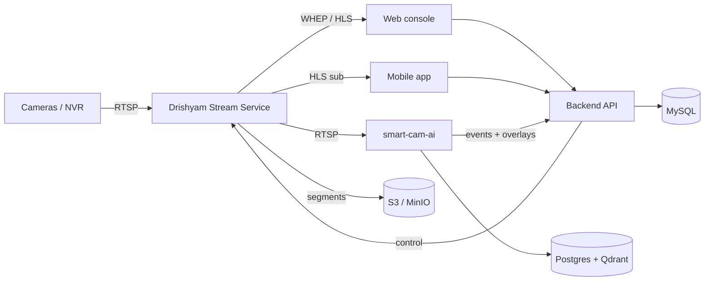

# 01 — System Overview

> For the full technical design see **[SYSTEM_DESIGN.md](./SYSTEM_DESIGN.md)**.
> This page is the orientation layer: what the product does and how the pieces fit.

---

## What is Drishyam?

Drishyam is a **multi-tenant Video Management System with integrated AI analytics**. It:

- Ingests **RTSP** from IP cameras, NVRs and DVRs (Hikvision, Dahua, CP Plus, Uniview, Axis, Bosch, Hanwha, ONVIF)
- Delivers **live video** over WebRTC (WHEP, sub-second) with HLS fallback, to a web console and a mobile app
- **Records** continuously, tiers recordings to **10 PB S3** object storage, and enforces per-camera/group/site **retention**
- Runs **AI analytics** on the same feeds — face recognition/watchlist, cross-camera person journey, restricted zones, occupancy/headcount, footfall, activity monitoring, live tracking
- Handles **subscriptions and licensing** (Stripe + Razorpay, plus admin-issued enterprise licenses)
- Deploys in the **cloud or on-premise**, and reaches cameras behind NAT/CGNAT via an **edge relay**

**Scale:** proven at 2,600+ cameras in a single deployment. Camera count is a plan/licensing
limit, not an architectural one.

---

## Who uses it

| Role | Surface | What they do |
|---|---|---|
| Operator | Web console | Live wall, playback, alerts, search |
| Field staff | Mobile app | Live tiles, single camera, push alerts |
| Account admin | Web console | Cameras, sites, users/roles, retention, AI config |
| Platform admin | `/admin` console | Cross-tenant ops, billing/licensing, system health |
| Services | REST `/api/internal` | AI service posting events and overlays |

**Tenancy:** an *organization* is an account owner plus its sub-users. All data is scoped to
the org; AI data is isolated by a per-org `tenant_id` carried in a signed JWT.

---

## Tech stack

| Layer | Technology |
|---|---|
| Web console | React 19, Vite 7, Tailwind v4, TanStack Query, Zustand |
| Mobile app | React Native 0.86, Expo SDK 57 |
| Backend API | Node.js, Express 5, Sequelize 6 |
| Media plane | **Drishyam Stream Service** (MediaMTX) — RTSP/WHEP/HLS |
| AI service | Python, FastAPI, ONNX Runtime, InsightFace (SCRFD + ArcFace/AdaFace), YOLOv8 |
| VMS database | MySQL 8.4 |
| AI database | PostgreSQL 16 + pgvector |
| Vector search | Qdrant |
| Object storage | MinIO / S3 (10 PB) |
| Cache / bus / queues | Redis 7 (+ BullMQ), Kafka |
| Ingress | Cloudflare Tunnel + nginx |
| Observability | Prometheus + Grafana |

> **Shinobi is gone.** Earlier versions used Shinobi as the VMS engine. It was replaced by
> the MediaMTX-based Drishyam Stream Service. Any doc or code still referencing Shinobi is
> legacy — see [08-shinobi-guide.md](./08-shinobi-guide.md) (deprecated).

---

## Architecture at a glance

**Two planes, deliberately separate:**

- **Control plane** — the backend owns state (cameras, users, plans, retention) in MySQL and
  *pushes configuration* to the Stream Service over its REST API.
- **Media plane** — video never passes through the backend. Browsers and phones pull directly
  from the Stream Service; access is gated by a signed, short-lived cookie validated by nginx.

**The database is the source of truth.** The Stream Service keeps no persistent config, so
background watchdog/reconcile loops continuously re-converge it to match the DB. This is why
the system self-heals after a restart or a network blip.

---

## Core concepts

| Concept | Meaning |
|---|---|
| **Camera** | One channel/stream. Identified by `monitorId`; its Stream Service path is `cam_<monitorId>`. |
| **Camera Group** | An NVR/DVR device — one IP hosting many channels. **Group credentials override camera-level ones.** |
| **Site** | A physical location grouping camera groups; supplies inherited defaults (timezone, retention). |
| **Stream Server** | One Stream Service instance in a capacity-aware pool. |
| **On-demand** | A camera only pulls RTSP when someone is watching or recording. Idle-but-reachable cameras show **STANDBY** (online) via a per-NVR TCP probe. |
| **Main vs sub stream** | Grids use the light sub-stream; single view uses main. Per-camera `auto/main/sub`. |
| **Tenant** | Per-organization AI isolation (`tenant_id` in the JWT `tid` claim). |
| **Entitlement** | `Plan.aiEnabled` + `Subscription.features` decide which AI features an account gets. |

---

## How a camera goes live

1. A camera is added (or bulk-imported); the vendor **driver registry** derives its RTSP path.
2. The backend registers path `cam_<monitorId>` on a Stream Service instance.
3. A viewer opens the camera → the on-demand RTSP pull starts.
4. The supervisor sees bitrate above the floor → state becomes **STREAMING**, DB status **online**.
5. When viewers leave, the pull closes; reachability probing keeps it **STANDBY/online**.

## How a detection becomes an alert

1. The AI orchestrator pulls the camera's sub-stream and detects/tracks faces or people.
2. Boxes stream to the console as an **ephemeral overlay** (`ai.live`) — *never persisted*.
3. Only a meaningful result (watchlist match, unknown person, zone intrusion) is written as an
   **AIEvent** and fanned out to push + email, with identity-stable dedup and cooldowns.

> That split is the anti-flood design: routine boxes are display-only; alerts are rare and
> meaningful. See [DETECTION_LOGGING_ALERTING_POLICY.md](./DETECTION_LOGGING_ALERTING_POLICY.md).

---

## Camera connectivity

| Model | When to use |
|---|---|
| **Direct RTSP** | Server can reach the camera/NVR (same LAN or routed). Simplest and preferred. |
| **DDNS** | Site has a real public IP + port-forwarding. Fails on CGNAT. |
| **Edge relay** | Site is behind NAT/CGNAT. A PC on the camera LAN pushes streams *outbound* over TLS to the cloud. |

Details and decision guide: [CAMERA_CONNECTIVITY.md](./CAMERA_CONNECTIVITY.md).

---

## Known constraint worth knowing early

Entry-level NVRs cap how many simultaneous RTSP pulls they will serve. Opening many cameras
from one weak NVR at once can jam it. Mitigations in place: on-demand pulls, sub-stream grids,
per-NVR reset/reconnect rate limits, quarantine on flapping, and focus-gated mobile tiles.
A **per-NVR concurrency cap** on source pulls is the outstanding gap — see
[SYSTEM_DESIGN.md §10](./SYSTEM_DESIGN.md).

---

## Where to go next

- **Set up locally** → [02-local-setup.md](./02-local-setup.md)
- **Find your way around the code** → [05-codebase-guide.md](./05-codebase-guide.md)
- **Understand streaming deeply** → [04-architecture.md](./04-architecture.md)
- **Call the API** → [06-api-reference.md](./06-api-reference.md)
- **Tune AI accuracy** → [AI_ACCURACY_AND_TUNING.md](./AI_ACCURACY_AND_TUNING.md)
