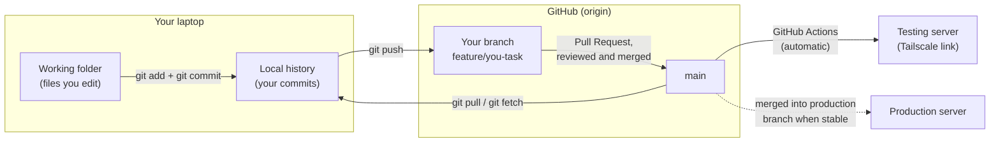
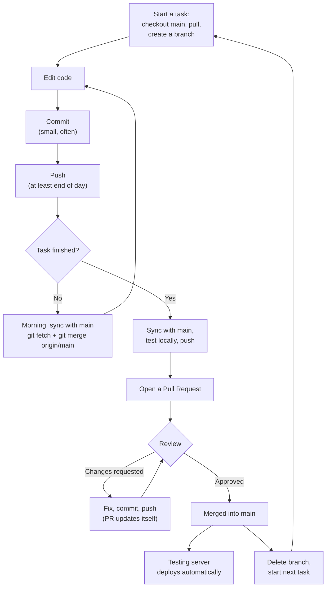
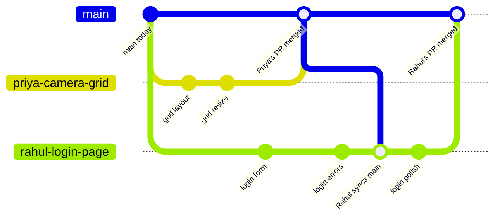
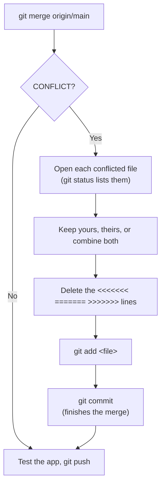

# Working on Drishyam with Git

Every command you need for a normal working day, what each one does, and why we do things in this order. Read it top to bottom once, then keep the [cheat sheet](#8-cheat-sheet) open.

Repo: `https://github.com/systoolspc-dev/Drishyamm`

> **The one rule:** code reaches the testing or production server **only through GitHub**. Nobody edits code directly on a server or copies files from old folders.

> The diagrams below are Mermaid. They render on GitHub. In VS Code, install the "Markdown Preview Mermaid Support" extension to see them in the preview.

## Contents

1. [Code lives in three places](#1-code-lives-in-three-places)
2. [Words you'll hear](#2-words-youll-hear)
3. [One-time setup](#3-one-time-setup)
4. [The daily flow](#4-the-daily-flow)
5. [Why we merge main into our branches](#5-why-we-merge-main-into-our-branches)
6. [Resolving a conflict](#6-resolving-a-conflict)
7. [Fixing common mistakes](#7-fixing-common-mistakes)
8. [Cheat sheet](#8-cheat-sheet)
9. [Team rules](#9-team-rules)

---

## 1. Code lives in three places

Your laptop has a full copy of the project. GitHub has the shared copy everyone agrees on. The servers run whatever is on GitHub. **Git commands** move code between your laptop and GitHub. **GitHub Actions** moves code from GitHub to the servers on its own.



---

## 2. Words you'll hear

| Term | Meaning |
|---|---|
| **repository (repo)** | The project folder plus its full history of changes. *Drishyamm* is our repo. |
| **clone** | Download the repo from GitHub to your laptop. Done once. |
| **commit** | A saved snapshot of your changes with a message, like a save point in a game. It stays on your laptop until you push. |
| **branch** | A separate line of work. Your branch can change freely without touching anyone else's code or `main`. |
| **main** | The official branch. It always holds the reviewed, working code and is what the testing server runs. |
| **checkout** | Switch your working folder to a branch. The files on disk change to match that branch. `git checkout -b <name>` creates a new branch and switches to it. |
| **origin** | Git's nickname for our GitHub repo. `origin/main` means "main as it is on GitHub". |
| **staging (`git add`)** | Choosing which changed files go into the next commit. |
| **push** | Upload your commits from your laptop to your branch on GitHub. |
| **fetch** | Download the latest info from GitHub **without** changing your files. Safe to run any time. |
| **merge** | Combine another branch's changes into the branch you're on. |
| **pull** | fetch + merge in one step. `git pull origin main` = download main and merge it in. |
| **pull request (PR)** | A request on GitHub to merge your branch into `main`. This is where review happens. |
| **conflict** | Two people changed the same lines. Git can't pick one, so it asks you to decide. |

---

## 3. One-time setup

```bash
# 1. Download the project (creates a Drishyamm folder)
git clone https://github.com/systoolspc-dev/Drishyamm.git
cd Drishyamm

# 2. Tell Git who you are (shows up on every commit)
git config user.name  "Your Name"
git config user.email "you@example.com"

# 3. Check it worked: you should be on main, with nothing changed
git status
```

> ⚠️ **Start from this fresh clone.** If you have Drishyam code in an old folder from the main PC or a server, don't copy it over. Bring each change in as a new branch from this clone, so it can be reviewed.

> 🔑 **Secrets:** copy each `.env.example` to `.env` and fill in local values. `.env` files are ignored by Git on purpose and must **never** be committed.

---

## 4. The daily flow

**One branch per task.** A task is one bug fix or one feature, ideally finished in a few days.



### Step 1: Start a task (get the latest main, then make your branch)

**When:** starting any new task.

```bash
git checkout main
git pull origin main
git checkout -b feature/priya-camera-grid
```

| Command | What it does |
|---|---|
| `git checkout main` | Switch to the main branch. Your folder now shows main's version of the code. |
| `git pull origin main` | Download everything merged into main since you last looked, including teammates' work. |
| `git checkout -b feature/...` | Create a new branch from here and switch to it. Everything you do now stays on this branch. |

**Why in this order?** Your branch starts as a copy of whatever main is at that moment. Pull first and you start from everyone's latest code. Skip it and you start out of date and get conflicts later.

**Branch names:** `feature/<name>-<what>` for new things, `fix/<name>-<what>` for bugs. Examples: `feature/rahul-login-page`, `fix/priya-stream-freeze`. Lowercase, hyphens, no spaces.

### Step 2: Work and save (status, add, commit, push)

**When:** throughout the day, after each small piece of work.

```bash
git status                    # what did I change?
git diff                      # show the exact lines changed
git add frontend/src/modules/live/Grid.jsx
git commit -m "camera grid: fix layout on small screens"

# first push of a new branch
git push -u origin feature/priya-camera-grid
# every push after that
git push
```

| Command | What it does |
|---|---|
| `git status` | Lists changed, new and staged files and tells you which branch you're on. Run it before every add and commit. |
| `git diff` | Shows line by line what you changed and haven't staged yet. Press `q` to exit. |
| `git add <file>` | Puts a file into the next commit. `git add .` adds everything, so check `git status` first to make sure no junk or `.env` slips in. |
| `git commit -m "..."` | Saves a snapshot of the staged files on your laptop with a message. |
| `git push -u origin <branch>` | Uploads your branch to GitHub the first time. `-u` remembers the link, so afterwards plain `git push` works. |

**Good commit messages** say what changed and where: `login: show error when password is wrong`. Avoid "changes", "update", "fix". Commit small and often.

**Why push daily even if unfinished?** Your work is backed up on GitHub if your laptop dies, and the reviewer can see progress. Pushing to your own branch never affects main or the server.

### Step 3: Stay in sync (bring main's new changes into your branch)

**When:** every morning on a task longer than a day, and **always before opening a PR**.

```bash
# commit what you have first (git won't merge over unsaved changes)
git add .
git commit -m "wip: grid resize handling"

git fetch origin              # download latest from GitHub
git merge origin/main         # mix main's new changes into your branch

# no conflicts? test the app, then:
git push
```

| Command | What it does |
|---|---|
| `git fetch origin` | Downloads what's new on GitHub (other people's merged work) without touching your files. |
| `git merge origin/main` | Takes GitHub's main and merges it into the branch you're on. You stay on your branch. Your work is kept and their work is added. |

**Why not just stay on my branch until I'm done?** Teammates merge changes into main while you work. The longer you wait, the more your branch and main drift apart and the bigger the conflicts. Syncing daily keeps every merge small. See [section 5](#5-why-we-merge-main-into-our-branches).

**Shortcut:** `git pull origin main` while on your branch does the same fetch + merge in one command.

### Step 4: Open a Pull Request

**When:** the task works on your laptop.

```bash
# final sync + push
git fetch origin
git merge origin/main
# run the app, check your feature and the pages around it, run tests
git status                    # nothing unexpected? no .env?
git push
```

Then on GitHub:

1. Open the repo. A yellow banner shows *"feature/priya-camera-grid had recent pushes"*. Click **Compare & pull request**. (Or go to **Pull requests → New pull request**.)
2. Check the direction: **base: `main` ← compare: `feature/priya-camera-grid`**.
3. Write a title and fill in the template: what changed, how you tested it, screenshots for UI changes, any new environment variables or database migrations.
4. Add the reviewer and click **Create pull request**.

### Step 5: Fix review comments on the same branch

**When:** the reviewer asks for changes.

```bash
# still on feature/priya-camera-grid
git add .
git commit -m "camera grid: address review comments"
git push
```

The open PR **updates itself** with the new commits. You don't open a new PR. If GitHub says *"This branch has conflicts"* or *"out-of-date with main"*, repeat Step 3 and push.

### Step 6: Clean up and start the next task fresh

**When:** your PR has been merged.

```bash
git checkout main
git pull origin main                        # main now includes your merged work
git branch -d feature/priya-camera-grid     # delete the old local branch
git checkout -b fix/priya-next-thing        # next task
```

Click **Delete branch** on the merged PR to remove it from GitHub too. Check your change on the testing server link once the deploy finishes, usually a few minutes after the merge.

> ⚠️ **Don't keep working on a merged branch.** We merge with "Squash and merge", so main gets your work as one new commit. Reusing the old branch afterwards causes confusing conflicts. Always start the next task from a fresh main.

> If `git branch -d` says the branch is "not fully merged" after a squash merge, use `git branch -D <branch>`, but only once you've confirmed the PR shows **Merged** on GitHub.

---

## 5. Why we merge main into our branches

**Scenario:** two people are on the frontend. Priya fixes the camera grid and Rahul builds the login page, at the same time. Priya's PR is merged first. Rahul doesn't stop work. Each morning, and before his PR, he merges main into his branch to pick up her change.



The same thing as a timeline:

```
 Day 1                Day 2                  Day 3                     Day 4
   │                    │                      │                         │
main ●──────────────────●──────────────────────●(A)───────────────────────●(B)──►
     │\                                       ▲ │                        ▲
     │ \  Priya: feature/priya-camera-grid    │ │                        │
     │  ●─────●─────●─────────────────────────┘ │  PR merged → A         │
     │     commits  push + PR                   │                        │
     │                                          │ Rahul syncs:           │
     │   Rahul: feature/rahul-login-page        ▼ git merge origin/main  │
     └────●──────●──────●──────────────────────●(now has Priya's code)──●┘
          commits                                ●──── more work ───── PR merged → B
```

"Rahul syncs main" means `git fetch origin` + `git merge origin/main`. After that, Rahul's branch has Priya's grid fix too, so he tests both together before his PR.

- **What Git does for you:** if Priya and Rahul changed different files, or different parts of the same file, Git combines them automatically. That's the usual case. A conflict happens only when both edited **the same lines**.
- **Why it matters:** Rahul finds out *on his own laptop* whether his work clashes with Priya's, instead of the clash showing up on the testing server. His PR still shows only his own changes, because Priya's are already in main.
- **He doesn't need to stop mid-work** every time someone's PR is merged. Syncing every morning and before the PR is enough.

---

## 6. Resolving a conflict

When `git merge origin/main` reports `CONFLICT in frontend/src/.../Grid.jsx`, open that file. Git has marked both versions:

```
<<<<<<< HEAD
  <Grid columns={3} gap={8} />        ← your branch
=======
  <Grid columns={4} />                 ← what's on main
>>>>>>> origin/main
```



| Step | What to do |
|---|---|
| 1. Decide | Keep yours, keep theirs, or combine both (e.g. `columns={4} gap={8}`). In VS Code, use the **Accept Current / Accept Incoming / Accept Both** buttons above the conflict. |
| 2. Remove markers | Delete every `<<<<<<<`, `=======` and `>>>>>>>` line. |
| 3. `git add <file>` | Marks the file as resolved. Repeat for each conflicted file. |
| 4. `git commit` | Finishes the merge. Git pre-fills the message, so just save and close the editor. |
| 5. Test, then `git push` | Run the app to make sure both changes still work together. |

**Not sure which version is right?** Ask the person who wrote the other change. If the merge is a mess, `git merge --abort` puts everything back to how it was before the merge, and you can try again or ask for help.

**To avoid conflicts in the first place:** keep tasks small, sync with main daily, mention big edits to shared files in the team chat, and don't reformat whole files inside a feature PR.

---

## 7. Fixing common mistakes

| Situation | Command | Notes |
|---|---|---|
| I messed up a file and want it back the way it was at my last commit | `git restore <file>` | Throws away your uncommitted changes to that file. This can't be undone. |
| I need to switch branches but I'm mid-work and not ready to commit | `git stash` … later `git stash pop` | `stash` puts your changes aside. Back on the branch, `stash pop` brings them back. |
| Typo in my last commit message, or I forgot a file | `git commit --amend -m "..."` | `git add` the forgotten file first. **Only before you've pushed** that commit. |
| What's been happening on this branch? | `git log --oneline --graph -15` | Shows the last 15 commits as a small graph. Press `q` to exit. |
| Which branch am I on? | `git branch` | The current one has a `*`. `git status` also shows it on the first line. |
| A merge went wrong and I want to back out | `git merge --abort` | Returns to the state before you ran `git merge`. |

### "I committed on main by mistake"

You can't push to main (it's protected), so nothing is broken. Move the commits to a new branch:

```bash
# on main, with your mistaken commits (commit anything unsaved first)
git branch feature/you-task          # new branch that keeps your commits
git fetch origin
git reset --hard origin/main         # put your local main back to match GitHub
git checkout feature/you-task        # continue on the new branch
```

> ⚠️ **Careful with `reset --hard` and `push --force`.** Both can permanently throw away work. Only use `reset --hard` exactly as shown above. Never use `push --force` without asking first.

---

## 8. Cheat sheet

| I want to... | Command |
|---|---|
| Start a new task | `git checkout main`<br>`git pull origin main`<br>`git checkout -b feature/name-task` |
| See what I changed | `git status` · `git diff` |
| Save my work | `git add <files>`<br>`git commit -m "area: what changed"` |
| Upload my branch (first time) | `git push -u origin feature/name-task` |
| Upload my branch (after that) | `git push` |
| Get teammates' merged work into my branch | `git fetch origin`<br>`git merge origin/main` |
| Switch to another branch | `git checkout branch-name` |
| Put unfinished work aside | `git stash` → later `git stash pop` |
| Undo changes to one file | `git restore <file>` |
| Back out of a bad merge | `git merge --abort` |
| Clean up after my PR merged | `git checkout main`<br>`git pull origin main`<br>`git branch -d feature/name-task` |

### A normal week

| Day | What you do |
|---|---|
| **Monday** | `git checkout main` → `git pull origin main` → `git checkout -b feature/rahul-login-page`. Work, commit, push at end of day. |
| **Tuesday** | Morning: `git fetch origin` + `git merge origin/main`. Work, commit, push. |
| **Wednesday** | Sync with main, test, push, open the PR. Fix review comments, push. |
| **Thursday** | PR merged. Check it on the testing link. `git checkout main` → `git pull origin main` → `git branch -d feature/rahul-login-page` → start the next task. |

---

## 9. Team rules

| ❌ Don't | ✅ Do instead |
|---|---|
| Edit code on the testing or production server, even during a demo | Make the change on a branch and open a PR. If an emergency demo fix happened on a server, commit the same fix in a PR **that same day**. |
| Work directly on `main` | Create a branch first, every time |
| Copy files from old folders, the old main PC or a server | Re-apply old changes on a new branch from a fresh clone |
| Keep a branch open for weeks | Small tasks, a PR every few days |
| Keep using a branch after it was merged | Delete it and branch again from fresh main |
| Commit `.env`, passwords, keys or large video files | Check `git status` before every commit |
| `git push --force` | Ask first. It can erase other people's work. |
| Reformat or rename whole files inside a feature PR | Do it in a separate PR so others' merges stay simple |
| Silently make a big change to a shared file (`App.jsx`, routes, `docker-compose.yml`, shared styles) | Mention it in the team chat first |

> **The short version:** pull main → create a branch → commit and push often → merge main in before the PR → open the PR → after the merge, delete the branch and start fresh.
