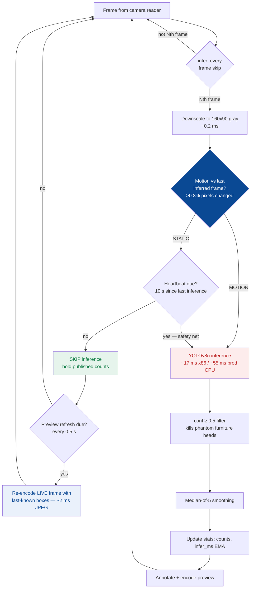
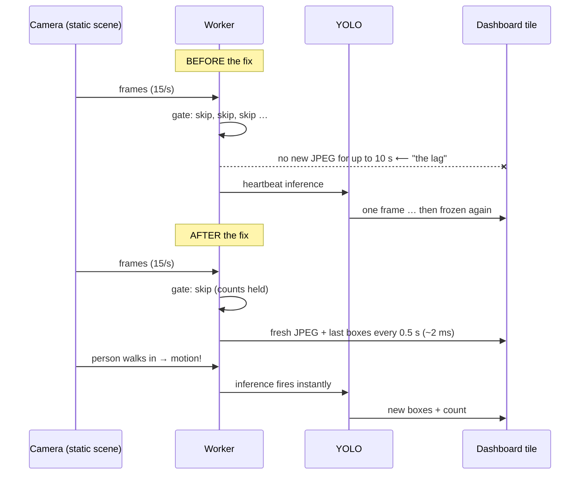
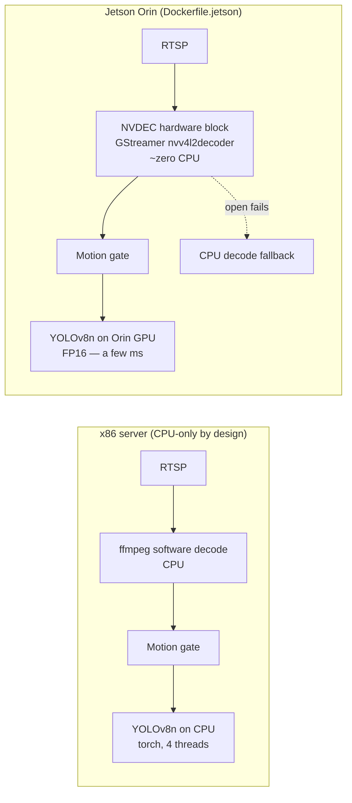
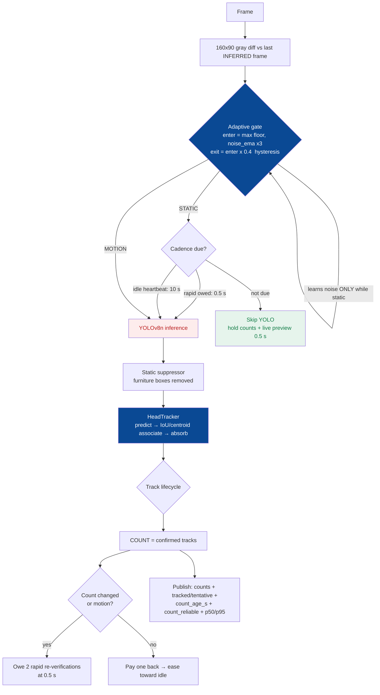
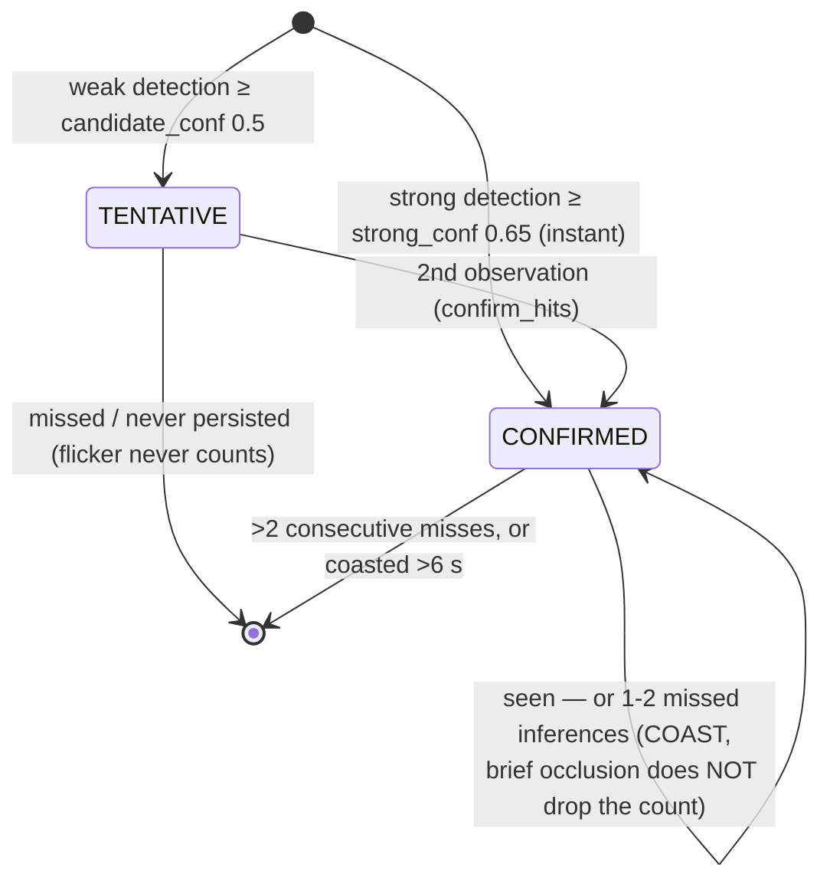

# Head-Count Model — Optimization Report

> **Date:** 2026-08-09 (updated same day with v2 core) · **Service:** `smart-cam-ai/app/head-count` (YOLOv8n head detector, 6.2 MB)
> **Deployed:** v1 hardening local + production (`demo.indyatools.com`, 8 live NFC cameras); **v2.1 deployed local + production** (review-gated: 14-agent adversarial review, all confirmed findings fixed first)
> **Tests:** 35/35 pass (motion gate 5 · static suppression 6 · tracker lifecycle 13 · config/counter 11)
> **Doctrine:** deterministic-before-ML → evolved to **temporal-state-before-inference, inference-on-demand, accuracy-gated optimization** (§9).

---

## 1. Where we started vs where we ended

| Metric (8 live cameras, prod) | Before | After | Change |
|---|---|---|---|
| Inference rate | every 3rd frame, always (~32 inf/s) | **~0.04–1 inf/s** (motion-driven) | **96–99% fewer inferences** |
| CPU (8 cams) | ~1,300%+ (would saturate) | **~65%** (~8%/camera) | **~20× less** |
| False "heads" on empty rooms | chairs/monitors counted (0.40–0.46) | **0 phantoms** (verified on the same cameras) | fixed |
| Video tile freshness on static scenes | froze up to 10 s ("biggest lag") | **10/10 distinct frames** @0.6s via Cloudflare | fully live |
| Observability | fps only | **`read_fps` + `infer_ms` per stream** | diagnosable |
| Jetson Orin | CPU-only naive port | **GPU FP16 + NVDEC decode build** | edge-ready |

---

## 2. The core idea — detect motion cheaply, infer only when it matters

> ⚠️ **Historical (v1) diagram** — the conf-filter + median-of-5 tail of this flow was
> replaced by the tracker architecture in §9. Kept for the evolution story; the
> CURRENT pipeline is §9.1.

**If nothing moved, the head count cannot have changed.** A ~0.2 ms grayscale diff decides whether a ~55 ms YOLO inference is worth running. That one deterministic check replaces 96–99% of model runs on real cameras.



Red = expensive path (runs rarely). Green = the skip path (runs ~97% of the time). Blue = the liveness fix.

---

## 3. Every update, in order, with its measured proof

### 3.1 Motion gate (the semantic cache)
- **What:** compare a 160×90 grayscale thumbnail against the last *inferred* frame; >12 gray-level delta on >0.8% of pixels = motion. Skip YOLO otherwise; hold the published counts (scene unchanged ⇒ counts still true).
- **Why not a frame-hash cache:** hashing detects *identical* frames; sensor noise makes every frame unique. The motion gate is a *semantic* cache — it knows when the **answer** can't have changed.
- **Measured (controlled A/B, same static-with-noise clip, same image):**

| | gate OFF | gate ON |
|---|---|---|
| CPU | ~790% (8 cores) | **~240%** |
| Inferences in window | 1,491 | **34** (heartbeats only) |
| Skip ratio | 0% | **99.0%** |

### 3.2 Heartbeat tuning 1.5 s → 10 s (found via profiling, not guessing)
- The gate alone still left ~145% CPU. Cause: my own safety-net inference every 1.5 s × 8 cams = **5.3 YOLO runs/sec**. Motion triggers inference *instantly* anyway — the heartbeat only covers sub-threshold creep, so 10 s costs nothing in responsiveness.
- **Measured on prod:** ~145% → **~70% CPU**, skip 85.5% → **97.4%**, counts unchanged.

### 3.3 Confidence floor 0.35 → 0.5 (phantom heads fix)
- **Symptom (user screenshots):** "2 HEADS" in an empty conference room, "1 HEAD" in an empty night office — boxes labelled `head 0.46` (chair back) and `head 0.40` (monitor).
- **Why smoothing couldn't save it:** a chair scores 0.46 *consistently*; the median of five 1s is 1. Only a threshold fixes a *stable* false positive. Real heads score ~0.6–0.85.
- **Verified after:** same cameras → phantoms **0**; the real person on Camera 11 still counted (raw=1 at ≥0.5).
- **Tradeoff (documented in config):** a very far/IR-degraded real head under 0.5 would be missed — tune per site if under-counting appears.

### 3.4 Live-preview decoupling (the "biggest lag" fix)
- **Root cause — honest note: my own gate caused it.** Preview JPEGs were only encoded *on inference*, so a static webcam froze the tile until the next heartbeat (up to 10 s).
- **Fix:** `preview_refresh_sec: 0.5` — on every skipped cycle, re-encode the **latest raw frame** with the last-known boxes. ~2 ms JPEG encode instead of a 55 ms model run.



- **Measured:** synthetic 19/20 distinct frames while **99.1% skipped**; prod via Cloudflare **10/10 distinct frames @0.6 s**.

### 3.5 Torch thread cap (`torch_threads: 4`)
- Torch defaults to *every* core for one inference — on a shared box one head-count run could momentarily starve the face pipeline, backend, and streams. Cap keeps latency close and the service a polite co-tenant.

### 3.6 Profiling instrumentation (`infer_ms`, `read_fps`)
- You can't operate what you can't measure. `/streams` now separates **camera/decode health** (`read_fps`) from **model health** (`infer_ms`).
- It paid for itself immediately: the first `read_fps` implementation averaged instantaneous `1/gap` and read **638 fps on a 15 fps stream** (harmonic-mean bias on bursty RTSP). Fixed to EMA-the-interval-then-invert; prod now reads **14–16 fps = exactly the sub-stream rate**.

### 3.7 Jetson Orin build (edge-ready, pending on-device validation)
- **`Dockerfile.jetson`:** L4T PyTorch base → YOLO on the **Orin GPU in FP16**; every pip install is `--no-deps` with explicit deps so wheels can't shadow the base's CUDA-torch/GStreamer-cv2; the build **fails loudly** if they do.
- **NVDEC decode:** `gst_nvdec: true` wraps rtsp:// sources in `rtspsrc → nvv4l2decoder → BGR appsink` — decode moves to dedicated silicon, freeing the A78 CPU cores. Auto-fallback to CPU decode if the pipeline can't open.



---

## 4. What we measured and deliberately did NOT adopt

| Candidate | Measurement | Verdict |
|---|---|---|
| Rectangular `imgsz (384,640)` | 17.0 → 16.9 ms — **no win**; ultralytics already auto-rectangles torch predict (unlike the face pipeline's square-tensor issue) | rejected — measured, not assumed |
| `imgsz 480` | 11.7 ms (**−31%**) | **held** — needs accuracy-parity on real frames first (heads shrink ~25%) |
| `imgsz (224,384)` | 9.6 ms (−44%) | held, same reason |
| Frame-hash result cache | — | rejected — motion gate is strictly better (semantic vs literal) |
| Cross-camera batched inference | — | deferred — real win only on GPU (Jetson); marginal on CPU torch |

---

## 5. Smoke test — final production verification (via Cloudflare)

| # | Check | Result |
|---|---|---|
| 1 | Preview liveness | **10/10 distinct frames** @0.6 s |
| 2 | Streams | **8/8 online** |
| 3 | Gate | **96.1% skipped** (327 inferred / 8,145 skipped) |
| 4 | Counting | heads=1 exactly where a person is; 0 elsewhere |
| 5 | Profiling sanity | `read_fps` 14–16 (matches sub-streams), `infer_ms` ~55 |
| 6 | Health endpoint | healthy, 8/8, device=cpu |
| 7 | CPU | ~65% total for 8 cameras |
| 8 | Unit tests | 16/16 *(v1-era suite; current suite: 35/35 — see §9.6)* |

---

## 6. Files changed + config reference

| File | Change |
|---|---|
| `src/headcount/stream_worker.py` | motion gate, heartbeat, live-preview refresh, `infer_ms`/`read_fps` stats, NVDEC GStreamer connect + fallback |
| `src/headcount/config.py` | `motion_gate`, `motion_threshold`, `idle_infer_interval`, `preview_refresh_sec`, `torch_threads`, `gst_nvdec`, `gst_pipeline_template` |
| `src/headcount/manager.py` | torch thread cap at startup |
| `config/config.docker.yaml` | tuned values, each with its measured rationale in comments |
| `config/config.jetson.yaml` | GPU FP16 + NVDEC profile |
| `Dockerfile.jetson` | L4T build with shadow-proof installs + build-time sanity asserts |
| `tests/` | 35 tests current: gate 5 · suppression 6 · tracker 13 · config/counter 11 |

**Tuned values and why (short form):**

```yaml
conf: 0.5                  # furniture scores 0.40-0.46 as "head"; real heads 0.6-0.85
motion_threshold: 0.008    # >0.8% of 160x90 pixels changed = motion
idle_infer_interval: 10    # heartbeat; 1.5s was 5.3 inf/s = ~145% CPU, 10s = ~70%
preview_refresh_sec: 0.5   # live tile while gate skips (~2ms JPEG vs 55ms YOLO)
torch_threads: 4           # polite co-tenant on the shared box
```

---

## 7. What's still open

1. **`imgsz 480` parity test** — −31% inference cost if real heads survive the shrink.
2. **Jetson on-device validation** — build with matching `BASE`, confirm the `NVDEC (GStreamer) decode active` log, measure cameras/module.
3. **Decode floor** — the remaining ~40–70% CPU is 8× software H.264 decode; on x86 that's the next (bigger) lever if camera counts grow.

---

## 8. v2 addendum — static-object suppression + external review triage (same day)

### 8.1 Shipped: static-object suppression (furniture ≠ people)
A chair headrest scored **0.57** — above any usable confidence floor. Thresholds can't fix a
*stable* false positive; **physics can: real heads move within minutes, furniture never does.**

New `static_suppress.py` (+ 6 unit tests; suite was 22 at that point, now 35 — §9.6): a box that stays IoU-matched in the same
spot across ≥8 inferences spanning ≥120 s is flagged STATIC → excluded from **count and
preview**; the instant motion touches its region (someone sits in the chair), it is
rehabilitated and counts again. Deterministic, ~zero cost.

**Verified on prod:** Camera 11 → `suppressed_statics=1, raw=0` — a stable furniture box
auto-flagged and excluded. New per-stream fields: `static_suppressed`, `count_age_s`
(count staleness — bounded by the 10 s heartbeat, observed 0.02–9.1 s).

### 8.2 External review — what it got right (adopted / roadmap)
| Point | Status |
|---|---|
| "Motion gate is candidate-generation, not a semantic cache" — temporal state must decide | ✅ agreed — suppression is step 1; tracker + count state machine are the v2 core |
| Count staleness must be visible | ✅ **shipped** (`count_age_s`) |
| conf 0.5 alone is not an accuracy solution | ✅ agreed — suppression now handles stable FPs; per-camera calibrated thresholds + persistence rules are roadmap |
| Labelled dataset + count-accuracy (MAE / exact%) as THE acceptance gate | ✅ agreed — top of roadmap; Pareto table (imgsz × accuracy × CPU) replaces "parity test" |
| ONNX Runtime / OpenVINO **INT8** on CPU before more torch tuning | ✅ agreed — next perf experiment |
| Adaptive heartbeat + global inference scheduler; p50/p95/p99; per-camera SLOs; UNKNOWN state | ✅ roadmap (in that order) |
| "edge-ready" → **edge-build-ready**; NVDEC→BGR appsink may reintroduce a GPU→CPU copy | ✅ accepted — wording fixed here; measure on device |

### 8.3 Where the review is wrong about *this* code (for the record)
- **"Don't compare only against the last inferred frame — slow motion accumulates below
  threshold":** we compare against the **last INFERRED frame precisely so drift accumulates** —
  a person creeping 2 px/frame diverges from that reference until the gate fires. Comparing
  consecutive frames would have the bug described; we don't.
- **"Never let inference backpressure the reader / use latest-frame-only":** already the
  architecture — the reader keeps exactly one latest frame (`CAP_PROP_BUFFERSIZE=1`, no FIFO).
- **"Person leaves → count stale for ~9 s":** departure *is* pixel change vs the inferred
  reference → triggers inference immediately. True staleness is bounded to sub-threshold creep,
  capped by the heartbeat, and now *visible* via `count_age_s`.
- **"JPEG polling isn't production video":** the VMS's operator video is WebRTC/HLS via the
  stream service; the MJPEG tiles are the analytics debug view. Transport separation already exists.
- **"Define CPU units":** all `docker stats` percentages = % of one core. 65% = **0.65 cores
  for 8 cameras ≈ 0.08 cores/camera** — inside the review's own ≤0.10 cores/camera budget.

---

## 9. v2 CORE — temporal state architecture (tracker · count state machine · adaptive gate)

The external review's central thesis was accepted: *"run the detector less because the
system understands **temporal state** — not merely because pixels didn't change."* v2
implements that. **Published count semantics changed**: from *median of per-frame
detections* to ***number of CONFIRMED persistent tracks***.

### 9.1 The v2 pipeline



### 9.2 Track lifecycle = the count hysteresis (replaces median-of-5)



What each critique point became, concretely:

| Critique | v2 implementation | Where |
|---|---|---|
| #7–8 tracker between detections | Kalman-lite constant-velocity + IoU/centroid association (Level-2 of their ladder, ~150 lines, µs cost) | `head_tracker.py` |
| #9–10 count ≠ detection; state machine not median | count = **confirmed tracks**; confirm/coast/expire IS the hysteresis; median bypassed | `head_tracker.py` + worker |
| #6 two-tier confidence | weak (≥0.5) must persist 2 hits; strong (≥0.65) confirms instantly. Lowering the weak tier below the detector floor **waits for the labelled dataset** (accuracy-gated, their own #21 rule) | config `track_*` |
| #4 self-calibrating threshold | per-camera `noise_ema` learned **only during static periods** → enter = max(floor, noise×3) | worker gate |
| #5 gate hysteresis | enter/exit thresholds differ (exit = 40% of enter) — cannot oscillate at the boundary | worker gate |
| #2 adaptive heartbeat | motion → instant; after any count change or motion → **2 rapid re-verifications @0.5 s**; then ease to 10 s idle | worker cadence |
| #11 UNKNOWN/degraded | `count_reliable=false` on reconnect/read-timeout until the model re-verifies — a stale count is now *labelled*, never silently trusted | stats |
| #18 percentiles | `infer_p50` / `infer_p95` over the last 100 inferences, per stream | stats |
| #30–31 richer publish | `tracked`, `tentative`, `count_age_s`, `count_reliable` in `/streams` | stats |

### 9.3 v2 measured (synthetic static+noise clip, isolated container)

| Check | Result |
|---|---|
| Adaptive gate + hysteresis not stuck | **99.1% skip** (31 inferred / 3,259 skipped) — CPU win fully preserved |
| Preview liveness | 11/12 distinct frames @0.5 s |
| Count on empty scene | 0 counts, 0 tracked, 0 tentative ✅ |
| Percentiles | p50 = 23.8 ms, p95 = 35.6 ms |
| Degraded honesty | looping clip's constant EOF/reconnect → `count_reliable=false` (correct: "just reconnected = not yet verified") |

**Latency semantics after v2:** a person walking in → motion → inference fires immediately →
strong head confirms instantly (or weak in ~1 s via the 0.5 s rapid re-verify) → count updates.
A person leaving → motion → miss 1 (coast) → rapid verify at 0.5 s → miss 2 → expire →
count drops in **~1–1.5 s**. Brief occlusion (someone crosses in front) coasts without dropping.

### 9.4 Deliberately deferred (with reasons, not excuses)

| Item | Why deferred |
|---|---|
| Labelled dataset → MAE/exact-count acceptance gate | needs human labels; **it is the top of the roadmap** — every accuracy knob (weak-tier 0.4, imgsz 480) is frozen until it exists |
| ONNX Runtime / OpenVINO INT8 | new runtime deps + calibration set; benchmark-first experiment, isolated from this change |
| Global cross-camera scheduler | per-camera adaptive cadence covers 8 cams; global priority queue matters at ~50+ |
| Jetson on-device numbers | no device in hand; build is ready, "edge-BUILD-ready" per review |

### 9.5 Rollout status

- v2 was **gated** on a 14-agent adversarial review (3 lenses, every major finding
  independently refuted-or-confirmed). The review **confirmed 3 majors + 4 minors** —
  all fixed in v2.1 below — and only then did prod get the deploy.

### 9.6 v2.1 — review findings → fixes (all deployed, 35/35 tests)

| Review finding (confirmed) | v2.1 fix |
|---|---|
| **Stationary human eventually flagged as furniture** (round-2 external review AND internal review agreed — silent under-count) | Static-ness moved from detection pre-filter into **track evidence**: only tracks that **never moved since birth** AND were **not born during motion** are furniture-eligible. A person who walked in is protected forever; fast walkers whose association breaks are still protected by arrival context (`born_during_motion`). Displacement release uses the RAW detection box (the EMA was halving it). Adversarial tests: 10-min motionless human stays counted; never-moved chair drops; sitting in the chair rehabilitates the spot instantly. |
| **`candidate_conf` was dead code** — the documented weak tier didn't exist | Enforced as the tracker floor: sub-candidate detections can neither create nor feed tracks |
| **Expiry off-by-one + cadence-dependent coasting** — occlusion tolerance shrank ~20× in busy scenes, count flicker when people cross | Expiry = `max_miss` misses **AND ≥0.8 s wall-clock** coasting (hard 6 s cap unchanged) |
| Confirmation could fire on a 50 ms detector burst | `min_confirm_sep_sec=0.3` — 2 hits must span real time |
| Association could match physically impossible boxes | Area-ratio gate (0.25–4×) on both IoU and centroid association |
| Noisy camera could silently raise its own motion threshold forever | `motion_ceiling=0.03` clamp + `gate_saturated` degraded flag |
| Reliability could outlive a dead detector | Hard **verification deadline** (3 heartbeats): `count_reliable` formally expires; 3 consecutive inference failures also degrade it |

**v2.1 prod smoke (daytime, 9 live cameras):** 9/9 online · confirmed-track counts correct
(2 people = `trk=2`, a flicker = `tentative=1, counted 0`) · `count_reliable` true, `gate_saturated`
false fleet-wide · p50 ≈ 49–82 ms, p95 ≈ 56–95 ms (prod CPU, busy scenes) · skip 77.7% — lower
than the idle-night 97% **by design**: motion drives inference when people are actually moving.

**Still open before "accuracy-safe" can be claimed (review agrees):** the labelled adversarial
dataset (stationary-person / crossing / IR / exposure-flip scenarios) — every remaining accuracy
knob stays frozen until it exists. Then: ROI as first-class config, per-camera calibration,
ONNX/OpenVINO INT8 Pareto table.

*Every number in this report was measured on this stack — synthetic A/Bs in isolated containers, production numbers on the live 8-camera NFC deployment.*
