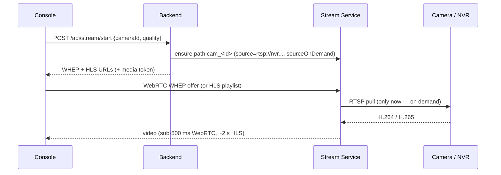
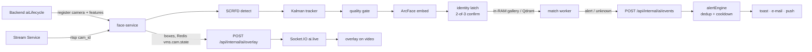

# How Drishyam works, end to end

A short tour of the five flows that matter. Each section links to the deep
reference: [SYSTEM_DESIGN.md](SYSTEM_DESIGN.md) (canonical design),
[dev/01-backend.md](dev/01-backend.md) (backend internals),
[dev/02-streaming.md](dev/02-streaming.md), [dev/03-ai-service.md](dev/03-ai-service.md),
[dev/04-frontend.md](dev/04-frontend.md), [dev/05-data-model.md](dev/05-data-model.md).

## The three rules behind the design

1. **The backend is a control plane; video never flows through it.** It tells
   the Stream Service which camera paths exist; browsers and AI services read
   media from the Stream Service directly.
2. **MySQL is authoritative; everything else re-converges to it.** Background
   loops re-add missing stream paths, re-register AI cameras and re-apply
   retention, so a restart of any one service heals itself.
3. **Detect per frame, decide per track, alert per identity transition.**
   Routine boxes ride an ephemeral overlay channel; only a confirmed change
   (a stranger appears, a watchlisted person is confirmed, a zone becomes
   occupied) becomes an alert. See
   [DETECTION_DECISION_ALERT_FRAMEWORK.md](DETECTION_DECISION_ALERT_FRAMEWORK.md).

## 1. A request through the backend

`backend/src/server.js` boots: DB connect → (dev only) `sequelize.sync()` →
HTTP + Socket.IO → background services (stream supervisor, reachability
prober, recording sync, AI lifecycle, alert engine, occupancy, retention).

A request goes **route → validator (Joi) → controller → service → model**:

```
routes/*.routes.js      URL + middleware (auth, capability, entitlement, rate limit)
validations/*.js        Joi schema for body/query
controllers/*.js        HTTP in/out only, wrapped in asyncHandler
services/*.js           business logic, external calls (Stream Service, AI, S3, SMTP)
models/*.js             Sequelize models (MySQL); migrations/ define the schema
```

Auth: short-lived access JWT + refresh token. `req.user` resolves to the org
root (sub-users share their parent's cameras); capabilities come from the
built-in role or a custom role; licensed features are gated by entitlements
(`services/entitlements.service.js`). Internal service calls
(`/api/internal/*`) use the shared `X-Service-Token`. Full walkthrough:
[dev/01-backend.md](dev/01-backend.md) §3-§7.

## 2. Live view



* Grids use the sub-stream (`cam_<id>_sub`); a single view uses the main.
* Browsers can't play H.265: the backend's on-demand transcoder publishes
  `cam_<id>_h264` (NVENC) and the player switches to it.
* After the last viewer leaves, the Stream Service holds the pull for 5 min
  (`SOURCE_CLOSE_AFTER`) so re-opening is instant and NVRs aren't hammered.
* `streamSupervisor.service.js` polls the Stream Service every 2 s and drives
  each camera through PENDING → CONNECTING → STREAMING / DEGRADED / STANDBY /
  OFFLINE / QUARANTINED; that state is what the console shows.

Reference: [SYSTEM_DESIGN.md §6](SYSTEM_DESIGN.md), [STREAMING_PIPELINE.md](STREAMING_PIPELINE.md).

## 3. Recording and playback

Recording is enabled per camera (or group/site). The Stream Service writes
segmented MP4 to `RECORDINGS_DIR`; retention is applied as MediaMTX
`recordDeleteAfter` (Camera → Group → Site → default). `recordingSync`
optionally tiers finished segments to S3. Playback serves Drishyam's own
recordings as HLS, or replays the **NVR's** recordings over RTSP into a
short-lived `pb_*` path. Reference: [SYSTEM_DESIGN.md §6.5](SYSTEM_DESIGN.md),
[12-streaming-recording-architecture.md](12-streaming-recording-architecture.md).

## 4. AI: from a frame to an alert



* The backend's `aiLifecycle.service.js` tells each AI service which cameras
  and features are enabled; nothing is analysed until enabled in the console.
* **Face** (`ai/face-service`): decode (NVDEC) → motion gate → SCRFD →
  tracker → quality gate → ArcFace 512-d → identity latch → cosine against the
  tenant's gallery (0.45). Every face appearance is also written to Postgres +
  Qdrant (`vms_appearance`) for journey search.
* **Head count** (`ai/head-count`): YOLOv8 head detector → per-camera count
  every 5 s → backend occupancy (spaces, thresholds, hysteresis) → alerts.
* **Restricted zone** (`ai/zone-guard`): YOLOv8 person boxes → overlay channel
  → backend `zoneIntrusion.service.js` (per-zone dwell FSM: 5 s to fire,
  8 s to clear, 5 min re-alert).
* **Footfall**: line crossing inside the face service (`services/footfall.py`),
  any-angle gate line.
* **Activity** (`ai/activity-monitor`): pose + phone detector → working / not
  working / on phone, attendance from face recognitions, live "who is where".
* **Alerts**: only warning/critical become `ai_events`. `alertEngine.js`
  de-duplicates by stable identity, applies per-channel cooldowns (push 90 s,
  e-mail 600 s) and an e-mail burst cap, then fans out.

Every model, its thresholds, measured accuracy and known weaknesses:
[../models/README.md](../models/README.md) and each service's `MODEL.md`.

## 5. Person journey (forensic search)

Upload a face (or pick a sighting) → embed → ANN search over `vms_appearance`
in Qdrant (tenant-filtered) → track-aware clustering → space-time fusion
(rejects impossible camera hops, fuses face + body ReID + clothing colour) →
journey graph in Postgres → `journey-stitch-worker` cuts the clips from
recordings, stitches an MP4 with burned-in timestamps + a PDF + a map →
MinIO → download link. Reference: [JOURNEY_CENTRALIZATION.md](JOURNEY_CENTRALIZATION.md).

## Where data lives

| Store | Holds |
|---|---|
| MySQL `drishyamvms` | users/orgs/roles, cameras, NVRs, groups/sites, subscriptions/licences, AI events, zones, spaces/occupancy, reports, wall layouts, audit |
| Redis | stream ownership, BullMQ queues, Socket.IO fan-out, media-token HMAC, alert dedup/cooldowns, `vms.cam.state:*` live AI state |
| Postgres `vms_face` (+pgvector) | persons, enrolments, detection events, appearances, journeys, AI cameras |
| Qdrant | face/body vectors: `vms_enrolled` (galleries), `vms_appearance` (sightings) |
| MinIO | face crops, snapshots, journey MP4/PDF artefacts |
| Kafka | `journey.events` spine |
| Disk (`RECORDINGS_DIR`) | recordings (optionally tiered to S3) |

Schemas: [../db/README.md](../db/README.md).
