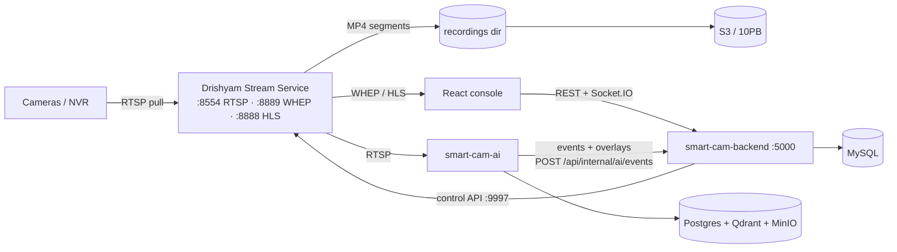

# Developer Onboarding — Day One to First Merged Change

This is the guide for an engineer who has just cloned the Drishyam monorepo and needs to be
productive today: what the system is, the two or three ideas that make the rest of the code
obvious, how to get the stack running in about an hour, how to make and verify a real change,
and the specific failures that will otherwise eat your first day. It supersedes
[`docs/02-local-setup.md`](../SETUP.md), which still describes the Shinobi-era stack
(Shinobi was removed; everything media now runs through the Drishyam Stream Service).

Everything here was checked against the code and the running stack on this machine. Where the
code and an older doc disagree, this file follows the code.

---

## 1. The system in five sentences

Drishyam is a multi-tenant Video Management System: it pulls RTSP from IP cameras and NVRs,
serves live video to a web console and a mobile app over WebRTC (with HLS fallback), records to
disk and tiers those recordings to S3 under a per-camera retention policy. A separate Python AI
service pulls the same camera streams and does face recognition, cross-camera person journey,
restricted-zone intrusion, headcount and footfall, publishing overlays and alerts back to the
backend. The Node/Express backend (`smart-cam-backend`) owns all durable state in MySQL — users,
plans, cameras, groups, sites, retention, zones — and *configures* the media engine over its REST
API; it never touches a video byte. The React console (`smart-cam-app`) talks to the backend for
control and directly to the media engine for pixels. Everything runs as one Docker Compose
stack on a GPU box, and the same stack is what ships to customers on-prem or in the cloud.

---

## 2. The mental model — three ideas

If you internalise only these three things, most of the code stops being surprising.

### 2.1 MySQL is the source of truth; the media engine is disposable

The Drishyam Stream Service (a branded MediaMTX) holds **no persistent configuration**. Every
camera path (`cam_<monitorId>`) is pushed to it at runtime by the backend over its control API on
port 9997. Kill the container and every path is gone.

That is deliberate, and it explains a large fraction of `smart-cam-backend/src/services/`. Because
the media engine's state is disposable, the backend runs a set of **reconciliation loops** that
continuously re-converge it to whatever MySQL says. You can see them all being started in
`src/server.js`:

```js
streamReconcile.start();   // DB retention/config → Stream Service, every 60s
aiLifecycle.start();       // "AI Detection Cameras" list → vms_face runtime, every 15s
streamSupervisor.start();  // path liveness → Camera.status / supervisorState, every 2s
aiEventRetention.start();  // prune the MySQL ai_events mirror
s3Retention.start();       // enforce retention on the durable S3 copy (dry-run by default)
```

The practical consequence: **do not "fix" the media engine by hand.** If a path is wrong, the
wrong thing is in the DB or in the code that derives config from the DB; the reconcile loop will
undo your manual patch within 60 seconds. Conversely, this is why the system self-heals across a
Stream Service restart or a network blip — nobody has to remember anything.

### 2.2 Video bypasses the backend entirely

There are two planes and they meet only at the point where the backend hands the browser a URL.



`GET /api/stream/start/:monitorId` (`src/controllers/stream.controller.js`) is the whole
handshake: the backend checks the camera belongs to the caller, ensures the path exists on the
Stream Service, optionally sets a short-lived per-camera cookie, and returns
`{ webrtcUrl, hlsUrl, hlsSubUrl, codec, transcoded }`. After that the browser talks to port 8889
directly. **No video ever transits Express.**

Why this matters day one:

* A "video doesn't play" bug is almost never in the backend. Check the Stream Service logs and
  whether the camera host is reachable, not `smart-cam-backend`.
* Backend CPU/RAM tells you nothing about streaming load.
* Any authorization on the media plane has to be enforced *outside* Express — that is what
  `src/utils/streamToken.js` + the nginx `auth_request` → `GET /api/stream/verify` path exists
  for (see [`docs/STREAM_SECURITY.md`](../STREAM_SECURITY.md)).

### 2.3 Cameras are pulled on demand, and "offline" usually means "idle"

The Stream Service is configured with on-demand sources: it opens the RTSP connection to a camera
only while someone is watching or recording. So `ready === false` is the **normal resting state**
of a healthy camera, not a fault.

This is scar tissue from a real incident. Turning on always-on recording for every camera opened
17–18 permanent RTSP sessions against a single entry-level NVR; its session table jammed, its
:554 stopped answering, and *every* camera behind it flipped offline. The compose file carries the
post-mortem inline next to `RECORD_SUB: "0"`, and the hard rule that came out of it is **≤6
concurrent pulls per NVR, never record-all**.

Two mechanisms exist because of that incident and you will trip over both:

| Mechanism | Where | What it does |
|---|---|---|
| Reachability prober | `services/cameraReachability.service.js` | TCP-probes each distinct NVR host every 25s. An idle-but-reachable camera is reported **STANDBY**, which the UI shows as online. Without it, every un-watched camera would read "offline". |
| Flap quarantine | `services/streamSupervisor.service.js` | After `SUPERVISOR_FLAP_LIMIT` (4) flaps in `SUPERVISOR_FLAP_WINDOW_MS` (2 min), the camera is quarantined for `SUPERVISOR_QUARANTINE_MS` (10 min). Backing off *longer* on a struggling NVR is what lets its RTSP daemon recover instead of being re-crashed. |

`deriveStatus()` in `src/controllers/cameraGroup.controller.js` encodes the rule directly, and the
comment above it names the bug it prevents (`GET /api/groups` writes status, so without the
reachability term it fought the supervisor on every poll).

---

## 3. The 60-minute path

### 3.1 Prerequisites

| Thing | Version / note |
|---|---|
| Docker Desktop + Compose v2 | The whole stack is containers. On Windows, WSL2 backend. |
| Node.js 20 | Matches `node:20-bookworm-slim` in both Dockerfiles and `node-version: 20` in CI. Needed only if you run backend/frontend outside Docker. |
| NVIDIA GPU + driver | **Required for the full stack.** `smart-cam-ai`, `smart-cam-ai-worker`, `smart-cam-transcoder`, `face-reconstruct` *and* `smart-cam-backend` all declare `gpus: all`. See §3.4 for the no-GPU path. |
| ~40 GB free disk | CUDA base image alone is large; face-reconstruct pulls ~640 MB of weights on first run. |
| A MySQL client (optional) | Handy: `docker exec drisyam-original-mysql mysql -uroot drishyamvms`. |

### 3.2 Env files — three of them, all git-ignored

Compose reads `env_file:` for two services and will **refuse to start** if the file is missing.

```bash
cp smart-cam-backend/.env.example smart-cam-backend/.env
cp smart-cam-ai/.env.example       smart-cam-ai/.env
cp smart-cam-app/.env.example      smart-cam-app/.env
cp .env.example                    .env          # root: compose interpolation only
```

Then edit `smart-cam-backend/.env`. `src/config/env.js` validates with Joi and calls
`process.exit(1)` with a readable list if anything is missing, so you will find out immediately.
The **required** ones (no defaults) are:

`DB_NAME`, `DB_USER`, `JWT_SECRET` (≥32 chars), `JWT_REFRESH_SECRET` (≥32 chars, must differ),
`STRIPE_SECRET_KEY`, `STRIPE_WEBHOOK_SECRET`, `RAZORPAY_KEY_ID`, `RAZORPAY_KEY_SECRET`,
`RAZORPAY_WEBHOOK_SECRET`.

The payment keys are required by the schema even though you will never exercise billing locally —
put obvious dummy strings there. Generate the JWT secrets properly:

```bash
node -e "console.log(require('crypto').randomBytes(48).toString('hex'))"
```

Note that compose **overrides** most infra-pointing vars in the `environment:` block
(`DB_HOST: mysql`, `REDIS_URL: redis://redis:6379`, `AI_SERVICE_URL`, `STREAM_SERVICE_*`, …), so
what you put in `.env` for those only matters when you run the backend outside Docker.

### 3.3 Bring it up — and mind the project name

**This is the single most important command in this document.** The running stack uses a
non-default compose file *and* a non-default project name; get either wrong and you will build a
second, parallel stack that fights the first one over ports and volumes.

```bash
cd /path/to/drisyam
docker compose -p drisyam-original -f docker-compose.drisyam-original.yml up -d
```

Verify you're pointed at the right one:

```bash
docker compose ls
# NAME               STATUS          CONFIG FILES
# drisyam-original   running(13)     ...\docker-compose.drisyam-original.yml
```

There is also a `docker-compose.yml` at the repo root. It defines the *same* services with
`smart-cam-*` container names and is the older/production-shaped variant. **Do not run both.**
`docker-compose.drisyam-original.yml` declares its data volumes as `external: true` pointing at
`drisyam_smart-cam-mysql-data`, `drisyam_smart-cam-ai-postgres-data`, etc. — the volumes owned by
the plain `drisyam` project. Two MySQL servers on one data directory corrupts it.

A useful side effect of `external: true`: `docker compose down -v` **cannot** delete those
volumes. Your data survives a careless teardown.

### 3.4 If you don't have an NVIDIA GPU

`gpus: all` on `smart-cam-backend` means even the API container won't start on a GPU-less
machine (`could not select device driver "" with capabilities: [[gpu]]`). Don't fight compose —
run the two Node services natively against the containerised infra:

```bash
# 1. GPU-free infrastructure only
docker compose -p drisyam-original -f docker-compose.drisyam-original.yml \
  up -d mysql redis stream-service

# 2. Point smart-cam-backend/.env at the host-published ports
#    DB_HOST=127.0.0.1  DB_PORT=3307
#    REDIS_URL=redis://127.0.0.1:6379
#    STREAM_SERVICE_API_URL=http://localhost:9997
#    STREAM_SERVICE_HLS_URL=http://localhost:8898
#    STREAM_SERVICE_RTSP_HOST=localhost

cd smart-cam-backend && npm install && npm run dev     # :5000
cd ../smart-cam-app  && npm install && npm run dev     # :5173
```

You lose face recognition, journey, headcount and transcoding. Everything else — auth, camera
CRUD, groups/sites, retention, live WebRTC, recordings, the health page — works. That is more than
enough surface for a first change.

### 3.5 First login

The seeders (`seeders/001-seed-plans.js`, `002-seed-pricing-catalog.js`, `003-seed-tier-plans.js`)
seed plans and pricing only — **no user**. Create one:

```bash
# Option A — register through the API (this is the real path)
curl -s -X POST http://localhost:5000/api/auth/register \
  -H 'Content-Type: application/json' \
  -d '{"name":"Dev User","email":"dev@example.com","password":"DevPass123"}'
```

Password policy is enforced by Joi in `src/validations/auth.validation.js`: 8–128 chars with at
least one lowercase, one uppercase and one digit. A bad payload comes back as
`{"success":false,"message":"..."}` listing every problem at once.

```bash
# Option B — the admin bootstrap script (creates/updates a platform admin)
docker compose exec -e ADMIN_EMAIL=you@example.com -e ADMIN_PASSWORD='choose-a-strong-one'   smart-cam-backend node scripts/create-admin.js
```

> The script takes the e-mail and password from the environment (no default credentials) and
> sets `is_platform_admin`, which the `/admin` console requires. The console's DEV-only demo
> login in `frontend/src/core/services/auth.js` is off unless `VITE_DEMO_EMAIL` and
> `VITE_DEMO_PASSWORD` are set — note the compose stack runs the Vite dev server, so anything
> gated only on `import.meta.env.DEV` is live there.

Then open **http://localhost:5173**, log in, and land on `/home`. Useful pages for orientation:
`/health` (Camera Health), `/live`, `/camera-setup`, `/playback`, `/admin`.

Successful login returns `{ success, user, capabilities, token, refreshToken }` — note the field
is `token`, not `accessToken`. The SPA stores it in `localStorage` under `auth_token` and
`src/core/services/api.js` attaches it as `Authorization: Bearer` plus handles silent refresh
on 401.

---

## 4. Service map

Host ports as published by `docker-compose.drisyam-original.yml`. "Core" means the stack is not
useful without it.

| Container | Host port(s) | Tier | What it is | What breaks if it's down |
|---|---|---|---|---|
| `drisyam-original-mysql` | 3307 → 3306 | core | MySQL 8.4, database `drishyamvms`. **The source of truth.** | Everything. Backend exits on boot (`sequelize.authenticate()` fails). |
| `drisyam-original-redis` | 6379 | core | Cache, BullMQ queues, cross-process stream bus, AI↔backend pub/sub | Backend still boots but logs `Using legacy setInterval workers`; supervisor leader election, alert dispatch and AI overlay bridge degrade. |
| `drisyam-original-stream-service` | 9997 (API), 9998 (metrics), 8554 (RTSP), 8898 → 8888 (HLS), 8889 (WHEP), 8189/udp (ICE), 8890 | core | The media plane. MediaMTX behind a Drishyam wrapper; network alias `mediamtx`. | All live video, all recording, all AI ingest. Backend stays up and degrades gracefully (`tryMTX()` swallows the errors). |
| `drisyam-original-backend` | 5000 | core | Express 5 API + Socket.IO + reconcile loops | Console can't log in or list anything; no reconciliation, so the Stream Service slowly drifts from the DB. |
| `drisyam-original-app` | 5173 | core | Vite dev server for the React console | The console. API keeps serving. |
| `drisyam-original-ai` | 8001 | AI | `vms_face` FastAPI — detection orchestrators, enrollment, journey, overlays | Face recognition, watchlist, zones, headcount, journey. Video and recording unaffected. |
| `drisyam-original-ai-worker` | — | AI | `vms_face.workers.match_worker` — the 1:N matching consumer | **Recognition silently dies while detection keeps working.** Boxes appear, names never do. A real past outage. |
| `drisyam-original-journey-stitch-worker` | — | AI | RQ worker: FFmpeg clip→concat→MP4 + PDF + map for forensic journeys | Journey stitch jobs queue forever. |
| `drisyam-original-ai-postgres` | 5432 | AI | Postgres 16 + pgvector — `vms_face` schema | AI service fails its Alembic upgrade and won't start. |
| `drisyam-original-ai-qdrant` | 6333, 6334 | AI | Vector search (`vms_enrolled`, `vms_appearance`) | Enrollment and 1:N matching. |
| `drisyam-original-ai-minio` | 9000, 9001 | AI | Object store for face crops, snapshots, journey artifacts | Snapshots in alerts, journey outputs. |
| `drisyam-original-kafka` | 9092 | AI | Single-node KRaft; the `journey.events` spine | Journey event durability/replay. |
| `drisyam-original-activity-monitor` | 8010 → 8000 | optional | Phone-usage / attendance analytics, own torch image | `/activity-monitoring` pages. |
| `face-reconstruct` | 8002 | optional | CodeFormer + Real-ESRGAN face enhancement | Currently dormant — the auto-enhance flags are commented out in compose. |
| `smart-cam-transcoder` | 8004 | optional | Per-camera NVENC H.265→H.264 normalisation | Cameras whose firmware emits awkward H.264/H.265; costs one NVENC slot each. |
| `smart-cam-sfu-bridge` | 8005 | optional | RTSP → LiveKit WHIP publisher (Phase 4 SFU) | Large-fanout viewing. Off unless `LIVEKIT_*` is configured. |
| `footfall-demo` | — | demo | Loops a bundled clip in as `cam_demo-entrance` | The footfall demo only. Safe to delete. |
| `cloudflared` | — | deploy | Named tunnel exposing the backend publicly | Public access only. Needs host credentials; skip locally. |

Not every service is running on a healthy dev box, and that's fine — on this machine 13 of them
are up and `transcoder`, `sfu-bridge`, `face-reconstruct`, `footfall-demo` and `cloudflared` are
not.

---

## 5. Is it healthy?

Four checks, in order. Each one isolates a layer.

```bash
# 1. Containers up, and the datastores actually healthy (not just running)
docker compose -p drisyam-original -f docker-compose.drisyam-original.yml ps

# 2. Backend liveness — process is alive
curl -s localhost:5000/api/health
# {"status":"ok","timestamp":"..."}

# 3. Backend deep diagnostic — the one that actually tells you something
curl -s localhost:5000/api/health/full
```

`/api/health/full` is the money endpoint (`src/controllers/health.controller.js`). It never
returns 5xx — it's a report, not a gate — and looks like this when everything is well:

```json
{"status":"ok","version":"1.1.0","uptime":160,
 "process":{"node":"v20.20.2","heapUsedMb":46,"rssMb":110},
 "components":{"db":{"ok":true,"latencyMs":2},
               "redis":{"ok":true,"latencyMs":2},
               "mediamtx":[{"name":"default","ok":true,"paths":38}],
               "aiService":{"ok":true,"latencyMs":11}}}
```

There are three health endpoints and they mean different things — use the right one:
`/live` never checks dependencies (a load balancer must not evict you because Redis blinked),
`/ready` returns **503** if DB *or* Redis *or* every Stream Service is down, and `/full` is the
on-call view that always returns 200.

```bash
# 4. AI service posture — auth mode, downstream, live pipeline
curl -s localhost:8001/healthz
```

`/healthz` is a *posture report*, not a thumbs-up. `auth.mode` will be `dev-bypass` locally
(`VMS_ENV=dev` + `VMS_JWT_DEV_BYPASS=true`); if it ever says `MISCONFIGURED`, every protected AI
route is returning 503. `pipeline.active_streams` tells you how many orchestrators are actually
running.

> **The AI service has no `/health`.** Probing `/health` 404s and used to make the backend report
> the AI engine down; `checkAiService()` probes `/status` and the comment in the code says why.
> When you're debugging "detection isn't working", the endpoint you want is
> `GET /streams/debug` (`api/routes/streams.py`) — it returns frames-ingested,
> observations-found and candidates-published per camera, so the break in the chain is visible in
> one curl. `/status` will not tell you that.

---

## 6. What normal startup looks like

### `smart-cam-backend`

```
$ docker compose -p drisyam-original logs -f smart-cam-backend
Sequelize CLI [Node: 20.20.2, CLI: 6.6.5, ORM: 6.37.7]
No migrations were executed, database schema was already up to date.
== 001-seed-plans: migrating =======
[nodemon] starting `node src/server.js`
info: DrishyamStreaming: engine active {"engine":"stream-service","controlApi":"http://stream-service:9997"}
info: S3Service initialized {"endpoint":"...","bucket":"...","provider":"NetForChoice 10PB"}
info: Database connection established successfully.
info: Database models synchronized.
info: socket.io initialized
info: Server running on port 5000 in development mode
info: Redis OK — registering BullMQ workers
info: queue worker registered: drishyam-s3-sync (concurrency=1)
info: queue worker registered: drishyam-watchdog (concurrency=1)
info: queue worker registered: drishyam-alert-dispatch (concurrency=8)
info: reconcile: started {"intervalMs":60000,"concurrency":8}
info: aiLifecycle: started {"intervalMs":15000}
info: cameraReachability: started {"intervalMs":25000,"timeoutMs":5000}
info: streamSupervisor: started {"pollMs":2000,"leaderElection":true}
info: cameraReachability: host state change {"host":"<nvr-ip>","port":554,"reachable":false}
```

The container's command is
`npx sequelize-cli db:migrate && (npx sequelize-cli db:seed:all || true) && npx nodemon src/server.js`.
Read that carefully: **migrations are a hard gate; seeds are not** (`|| true`). If `db:migrate`
exits non-zero, the whole chain fails, the container exits, `restart: unless-stopped` restarts it,
and you get a crash loop with the migration error scrolling past. See §9.1.

`Using legacy setInterval workers (no Redis)` instead of the BullMQ block means Redis is
unreachable — the backend deliberately degrades rather than dying, so it's easy to miss.

The last line is normal: the reachability prober reports a genuinely unreachable NVR. A private-IP
camera host will *always* be unreachable from a cloud VMS — that's a network topology problem
(needs the edge relay), not a bug to fix in code.

### `stream-service`

```
INF MediaMTX v1.18.1, linux, amd64
INF configuration loaded from /mediamtx.yml
INF [RTSP] listener opened on :8554 (TCP/RTSP)
INF [HLS] listener opened on :8888 (TCP/HTTP)
INF [WebRTC] listener opened on :8889 (TCP/HTTP), :8189 (UDP/ICE)
INF [API] listener opened on :9997 (TCP/HTTP)
INF reloading configuration (API request)          ← backend pushing paths
INF [path cam_<id>_sub] [RTSP source] started on demand
```

Lines you will see constantly and that are **not** errors: `reloading configuration (API request)`
(the backend adding/patching a path), `started on demand` / `stopped: timed out` (the on-demand
lifecycle doing its job), and `closed: no stream is available on path ...` (a viewer arrived
before the source opened — the player retries).

`ERR [RTSP source] dial tcp <nvr-ip>:554: i/o timeout` is a genuinely unreachable camera.

### `smart-cam-ai`

```
INFO  [alembic.runtime.migration] Context impl PostgresqlImpl.
INFO:     Started server process [43]
info  vms_face starting                    env=dev version=0.1.0
info  camera credential encryption: enabled (AES-256-GCM)
warn  JWT auth disabled (VMS_ENV=dev + VMS_JWT_DEV_BYPASS=true). ...
info  skipping FaceRuntime warmup (API_WARMUP_FACE_RUNTIME=false)
HTTP Request: PUT http://qdrant:6333/collections/vms_enrolled/index ... 200 OK
info  alerts subscriber starting           stream=vms.alerts
info  alert backend forwarder started      backend=http://smart-cam-backend:5000
info  system metrics poller starting       gpu_count=1 pynvml=True
```

Two things to know here:

* **uvicorn runs without `--reload`, on purpose.** With `--reload` the reloader stays alive as a
  supervisor while the child worker dies from a CUDA segfault — the port keeps accepting
  connections that then hang forever. Without it, a crash exits the process and Docker restarts
  the container. The compose comment documents the exact symptom (Boost 502, FaceLearning 502,
  no detection boxes after ~30–50 minutes).
* Consequently, **editing Python does not hot-reload.** `./smart-cam-ai/app` is bind-mounted, so
  after an edit: `docker compose -p drisyam-original restart smart-cam-ai` (and
  `smart-cam-ai-worker` if you touched the matcher).

Backend JS and frontend JSX *do* hot-reload — nodemon and Vite are both forced into polling mode
(`CHOKIDAR_USEPOLLING=true`) because inotify events don't cross a Docker-on-Windows bind mount.

---

## 7. Make your first change

**Goal:** add a `lastSeenAt` field to `GET /api/cameras/health` and show it on the Camera Health
page. It's real (operators ask "when did this camera last work?"), it's small, and it walks
through every layer you'll touch later: a Sequelize query, a response serializer, the SPA, and a
unit test.

### 7.1 Backend — two edits in one file

`smart-cam-backend/src/controllers/cameraHealth.controller.js`, inside `computeHealth(userId)`.

The camera query uses an explicit `attributes` list, so a column you don't name comes back
`undefined` with **no error**:

```js
const cameras = await Camera.findAll({
  where: { userId },
  attributes: ['id', 'monitorId', 'name', 'channel', 'groupId', 'status', 'lastSeenAt'],
  //                                                            ^^^^^^^^^^^^^ add this
```

Then add it to the row the map builds (next to `supervisorState`):

```js
    supervisorState: supervisor?.state || null,
    lastSeenAt:      c.lastSeenAt || null,
    flapCount:       supervisor?.flapCount ?? 0,
```

`lastSeenAt` already exists as a column — `models/Camera.js` declares it and migration
`016-add-camera-supervisor-fields.js` created it; the supervisor writes it on every state
transition. **No migration is needed.** (If you were adding a genuinely new column, see §7.6.)

Nodemon restarts the container process on save. Watch it:

```bash
docker compose -p drisyam-original logs -f smart-cam-backend
# [nodemon] restarting due to changes...
```

### 7.2 Verify with curl

The route is `authenticate`-guarded, so get a token first:

```bash
TOKEN=$(curl -s -X POST localhost:5000/api/auth/login \
  -H 'Content-Type: application/json' \
  -d '{"email":"dev@example.com","password":"DevPass123"}' \
  | node -pe 'JSON.parse(require("fs").readFileSync(0,"utf8")).token')

curl -s localhost:5000/api/cameras/health -H "Authorization: Bearer $TOKEN" \
  | node -pe 'JSON.parse(require("fs").readFileSync(0,"utf8")).cameras[0]'
```

You should see `lastSeenAt` in the object. If it's `undefined`, you added it to the row but not to
`attributes` — that's the trap this exercise exists to teach.

A bare `curl localhost:5000/api/cameras/health` returns **401**, which is the correct answer and a
quick way to confirm you're hitting the route you think you are.

### 7.3 Frontend — surface it

`smart-cam-app/src/core/pages/CameraHealth.jsx`. The page polls
`cameraHealthService.list()` → `GET /cameras/health` on a timer and renders one card per camera.
Find the metadata row that already renders `camera.readSinceSec` and add a sibling:

```jsx
{camera.lastSeenAt ? (
  <span className="text-xs font-semibold text-slate-500">
    last seen {new Date(camera.lastSeenAt).toLocaleString()}
  </span>
) : null}
```

Vite HMR picks it up instantly; open **http://localhost:5173/health**.

Two conventions worth copying while you're in here: the page imports its API wrapper from
`@/core/services/*` (never `axios` directly — `services/api.js` owns auth and refresh), and any
new service URL belongs in `src/core/config/endpoints.js`, never as a literal
`http://localhost:<port>` in a component.

### 7.4 Write the test

The suite is unit-only: it mocks every external boundary so it runs with no DB, no Redis and no
Stream Service. Copy the pattern from `test/cameraQuota.test.js`. Create
`smart-cam-backend/test/cameraHealth.row.test.js`:

```js
jest.mock('../src/models', () => ({ Camera: { findAll: jest.fn() }, CameraGroup: {}, Site: {} }));
jest.mock('../src/services/drishyamStreaming.service', () => ({
  api: { get: jest.fn().mockResolvedValue({ data: { items: [] } }) },
  pathName: (id) => `cam_${id}`,
}));
jest.mock('../src/services/transcoder.service',       () => ({ listActive: () => [] }));
jest.mock('../src/services/streamQuality.service',    () => ({ snapshot: () => ({}) }));
jest.mock('../src/services/streamSupervisor.service', () => ({ snapshot: () => ({ cameras: [] }) }));

const { Camera } = require('../src/models');
const { computeHealth } = require('../src/controllers/cameraHealth.controller');

test('health rows carry lastSeenAt', async () => {
  const seen = new Date('2026-08-01T10:00:00Z');
  Camera.findAll.mockResolvedValue([{ id: 'c1', monitorId: 'abc', name: 'Gate 1', status: 'online', lastSeenAt: seen }]);
  const { cameras } = await computeHealth('user-1');
  expect(cameras[0].lastSeenAt).toEqual(seen);
});
```

`computeHealth` is exported alongside `getHealth` precisely so it can be tested without Express —
follow that pattern when you add controller logic worth testing. With the Stream Service mock
returning no paths and the camera `status: 'online'`, `classify()` returns `standby` ("idle —
connects on demand"), which is the correct on-demand semantics.

### 7.5 Run the tests

```bash
cd smart-cam-backend
npx jest test/cameraHealth.row.test.js   # just yours
npm test                                 # the whole suite
```

You do **not** need a `.env` — `test/jest.setup.env.js` runs as a jest `setupFiles` entry before
any module loads and injects dummy values for every var `config/env.js` requires. It uses `??=`
so a real local `.env` never overrides it. That is what makes the suite hermetic in CI.

### 7.6 If your change does need a schema change

Sequelize models are `underscored: true` — `lastSeenAt` in JS is `last_seen_at` in MySQL. Adding a
column is two files:

1. A migration in `migrations/`, numbered next in sequence (currently 028). Make it **idempotent**
   — every existing migration guards with `describeTable()` first, e.g.
   `const cols = await queryInterface.describeTable('cameras'); if (!cols.my_col) { ... }`.
2. The attribute on the model in `src/models/`.

Watch the auto-naming trap: `flapCount24h` in `models/Camera.js` carries an explicit
`field: 'flap_count_24h'` because Sequelize's underscored conversion produces `flap_count24h`
(no underscore before digits) while the migration used the readable name. If your column mixes
letters and digits, pin `field:` explicitly.

Apply it: `docker compose -p drisyam-original restart smart-cam-backend` (the container runs
`db:migrate` on every boot), or locally `npm run db:migrate`.

### 7.7 Commit

Conventional-commit style with a scope, imperative mood, and — this repo's real convention — a
subject that names *the failure fixed*, not the code touched:

```
fix(zones): repair syntax error that silently disabled four boot subsystems
perf(wall): monitor wall tiles use the sub-stream, not full-res main
harden(recording): temp-file leaks, bounded cache, OOM guard, boot-timer lifecycle
```

Work on a branch (`harden/…`, `feat/…`, `fix/…`); the local integration branch is `master`.
Note that this checkout currently has **no git remote configured** (`git remote -v` is empty)
even though a `ghb/main` remote-tracking ref exists from an earlier push — ask before pushing.

CI (`.github/workflows/ci.yml`) runs `npm ci && npm test -- --ci` in `smart-cam-backend` as a
**hard gate**, and `npm run lint && npm run build` in `smart-cam-app` as `continue-on-error: true`
(informational until it's verified green). So: a backend test failure blocks you; a frontend lint
failure does not, but don't be the person who leaves it red.

---

## 8. The test suite — what's covered and what isn't

```bash
cd smart-cam-backend && npm test         # 16 suites, 89 tests, ~8s
```

Config is `jest.config.js`: `testEnvironment: 'node'`, `testMatch: ['**/test/**/*.test.js']`,
`clearMocks: true`, and coverage scoped to `src/services/streaming/**` +
`src/services/cameraQuota.service.js`.

**Covered** — the pure, high-consequence logic:

| Suite | What it protects |
|---|---|
| `vendors.test.js` | The per-vendor RTSP path driver registry (Hikvision/Dahua/CP Plus/Axis/…). An unknown vendor must 422, not silently produce a Hikvision path. |
| `cameraQuota.test.js` | Plan camera-limit enforcement, including "null maxCameras = unlimited". |
| `streaming.factory.test.js`, `streaming.engine.test.js` | The engine abstraction + `STREAMING_ENGINE` selection. |
| `fieldCrypto.test.js` | AES-256-GCM camera-password encryption at rest, incl. legacy plaintext passthrough. |
| `streamToken.test.js` | Per-camera media-plane token signing/verification. |
| `authenticate.test.js`, `auth.service.test.js`, `validate.test.js` | JWT middleware, token pair generation, Joi validation middleware. |
| `prodSecretGuard.test.js`, `securityHeaders.test.js` | Refusing to boot in prod with dev-default secrets; the CSP/HSTS policy. |
| `s3.streaming.test.js`, `s3Retention.test.js`, `recordingSync.internals.test.js` | Streamed multipart upload, retention dry-run/delete gating, temp-file sweeping. |
| `cameraGroup.validation.test.js`, `audit.test.js` | Group/bulk payload schemas, admin audit logging. |

**Not covered — know this before you trust a green run:**

* **No integration or HTTP-level tests.** Nothing boots Express or hits MySQL. Route wiring,
  middleware ordering, and the actual SQL are unverified by CI.
* **No frontend tests at all.** `smart-cam-app` has lint + build only.
* **No AI service tests in CI.** `smart-cam-ai` has no pytest job in `ci.yml`.
* **The reconciliation loops** (supervisor, reconcile, aiLifecycle, zoneIntrusion) — the most
  behaviourally subtle code in the repo — are untested.

> ### The suite is currently RED on this branch — and it's not your fault
>
> Two suites fail out of the box:
>
> ```
> FAIL test/streaming.engine.test.js
>   ● Cannot find module '../src/services/streaming/MediaMTXEngine'
> FAIL test/streaming.factory.test.js
>   ● expected "mediamtx", received "stream-service"
> ```
>
> Commit `5fe136d refactor(streaming): rename MediaMTX service -> Drishyam Streaming Service`
> renamed `MediaMTXEngine.js` → `StreamServiceEngine.js` and changed `engineName` from
> `'mediamtx'` to `'stream-service'`, but did not update the two tests. Note the registry **key**
> is still `mediamtx` (`ENGINES = { mediamtx: () => new StreamServiceEngine() }`) — only the
> instance's `engineName` changed. Fixing these two files is an excellent second commit: update
> the `require` path and the two expected strings. Until then, `npm test` reports
> **2 failed, 87 passed**; anything worse than that is you.

---

## 9. Common day-one failures

### 9.1 Backend crash-loops on a half-applied migration

**Symptom:** `drisyam-original-backend` restarts every ~10 seconds. `docker logs` shows a
Sequelize error and never reaches `Server running on port 5000`.

**Why:** the container command is `db:migrate && (db:seed:all || true) && nodemon src/server.js`.
Migrations are a hard gate — a non-zero exit kills the whole chain, the container exits,
`restart: unless-stopped` brings it back, and it fails identically forever.

The nasty variant is a **partially applied** migration. MySQL DDL is not transactional, so a
migration that does several `addColumn`/`addIndex` calls can succeed halfway and then throw.
`SequelizeMeta` is only written on full success, so the migration re-runs — but its own
idempotency guards now see the columns it already created and skip the work that never happened.
Look at `025-add-rbac-user-fields.js`:

```js
if (!cols.username) {
  await queryInterface.addColumn('users', 'username', { ... });
  await queryInterface.addIndex('users', ['username'], { unique: true, name: 'users_username_unique' });
}
```

If `addColumn` succeeds and `addIndex` fails (duplicate values make the unique index impossible),
the re-run sees `cols.username` and skips **both** — the migration then "succeeds" with the index
permanently missing.

**Fix:**

```bash
# See where it stopped
docker compose -p drisyam-original logs --tail=80 smart-cam-backend
docker exec drisyam-original-mysql mysql -uroot -N \
  -e "SELECT name FROM drishyamvms.SequelizeMeta ORDER BY name DESC LIMIT 5;"

# Compare against what's really there, then fix by hand
docker exec drisyam-original-mysql mysql -uroot -e "DESCRIBE drishyamvms.users;"
docker exec drisyam-original-mysql mysql -uroot -e "SHOW INDEX FROM drishyamvms.users;"
```

Apply the missing DDL manually, or (only on a throwaway dev DB) drop the offending object and
delete the row from `SequelizeMeta` so the migration replays cleanly. Never hand-edit
`SequelizeMeta` on anything shared.

### 9.2 MySQL "Too many keys specified; max 64 keys allowed"

**Symptom:** every write to `users` fails; the API 500s or crash-loops. This took down a live
customer trial.

**Why:** the backend used to call `sequelize.sync({ alter: true })` on boot. `alter` re-derives
the schema from the models, and because `models/User.js` declares `unique: true` on both `email`
and `username`, **every boot added another auto-named unique index** — `email_2`, `email_3`, …
A day of frequent restarts crossed MySQL's hard 64-keys-per-table limit and the table became
unwritable.

`src/server.js` is now fixed — bare `sync()` only creates tables that don't exist:

```js
// Sync models — only create tables that don't exist (no alter, avoids MySQL 64-key limit)
if (config.env === 'development') { await sequelize.sync(); }
```

**But the residue is still in the volume.** On this machine right now:

```
$ SELECT index_name FROM information_schema.statistics
    WHERE table_schema='drishyamvms' AND table_name='users' GROUP BY index_name;
PRIMARY, email, email_2 … email_10, username, username_2 … username_10,
users_email, users_username_unique, users_parent_user_id_idx, custom_role_id
→ 25 of the 64 keys already consumed
```

**Fix:** drop the duplicates —

```sql
ALTER TABLE drishyamvms.users DROP INDEX email_2;   -- repeat for _3 … _10, username_2 … _10
```

**Prevention:** never reintroduce `alter: true`. If a model changes, write a migration. If you see
`sync({ alter: true })` in a diff, that is a blocking review comment.

### 9.3 Ports already in use

`Error: bind: address already in use` on `up`. The usual culprits:

| Port | Clashes with |
|---|---|
| 5432 | A locally installed PostgreSQL. Most common one. |
| 6379 | A local Redis or another compose stack. |
| 3307 | The *other* compose file (`docker-compose.yml`) — see §3.3. Note it deliberately uses 3307, not 3306, to avoid a host MySQL. |
| 9000/9001 | Portainer, another MinIO. |
| 5000 | On Windows, sometimes reserved by the system; also a common default for other dev servers. |
| 8889/8189-udp | Another WebRTC stack. |

```bash
# Windows
netstat -ano | findstr :5432
# Linux/macOS
lsof -i :5432
```

Fix by stopping the other thing, or edit the **host side** of the mapping only
(`"5433:5432"`) — never the container side, because service-to-service URLs inside the compose
network use the container port (`postgres:5432`). Precedent: the unrelated `codestory-postgres`
container on this machine publishes 5433 for exactly this reason.

### 9.4 A new npm dependency doesn't exist inside the container

**Symptom:** you added a package to `package.json`, rebuilt, and the container still throws
`Cannot find module 'x'`.

**Why:** both Node services mount `node_modules` as a **named volume** on top of the bind mount:

```yaml
volumes:
  - ./smart-cam-backend:/app
  - smart-cam-backend-node-modules:/app/node_modules
```

Docker populates a named volume from the image **only when the volume is first created**. Every
later `docker compose build` updates the image but the stale volume keeps shadowing
`/app/node_modules`.

**Fix:**

```bash
# Install into the live volume (fastest)
docker compose -p drisyam-original exec smart-cam-backend npm install

# Or blow the volume away and let it repopulate from the rebuilt image
docker compose -p drisyam-original -f docker-compose.drisyam-original.yml stop smart-cam-backend
docker volume rm drisyam-original_smart-cam-backend-node-modules
docker compose -p drisyam-original -f docker-compose.drisyam-original.yml up -d --build smart-cam-backend
```

Same story for `drisyam-original_smart-cam-app-node-modules`.

### 9.5 The backend exits immediately with "Environment validation failed"

Exactly what it says — `src/config/env.js` runs Joi over `process.env` and `process.exit(1)`s
with the full list. Almost always a missing `JWT_SECRET`/`JWT_REFRESH_SECRET` (must be ≥32 chars)
or one of the payment keys. See §3.2.

There's a second, sharper guard: `config/prodSecretGuard.js` refuses to boot when
`NODE_ENV=production` and a secret still looks like the sample value. If you set
`NODE_ENV=production` locally "just to test something", expect to be blocked. Don't — several
behaviours change (rate limits tighten from 100 to 10 auth attempts, `sync()` is skipped, cookies
go `secure`).

### 9.6 Backend up, console up, but every camera shows offline

Work outward, not inward:

1. `curl -s -u <user>:<pass> localhost:9997/v3/paths/list` — does the Stream Service know about
   the paths at all? (Credentials are the `authInternalUsers` pair from `stream-service.yml`.)
2. `docker compose -p drisyam-original logs stream-service | grep "RTSP source"` — `dial tcp …
   i/o timeout` means the camera host is genuinely unreachable from the container.
3. Is the host a **private LAN address**? A cloud-hosted VMS cannot reach `10.x`/`192.168.x`. That
   is a topology problem requiring the edge relay — see
   [`docs/CAMERA_CONNECTIVITY.md`](../CAMERA_CONNECTIVITY.md). It has been mistaken for a VMS bug
   more than once.
4. Remember §2.3: on-demand cameras are legitimately not `ready` until someone watches them. The
   Camera Health page distinguishes `standby` ("idle — connects on demand") from `offline`
   ("no RTSP data and camera unreachable"). Read the `reason` string; it was written to answer
   this exact question.

### 9.7 Detection boxes appear but nobody is ever recognised

`smart-cam-ai-worker` is not running. Detection happens in the API's orchestrators; the 1:N match
against the gallery happens in `vms_face.workers.match_worker`. Losing the worker fails silently —
you keep getting boxes forever with no names.

```bash
docker compose -p drisyam-original -f docker-compose.drisyam-original.yml up -d smart-cam-ai-worker
```

---

## 10. Gotchas that will cost you a day

**The compose file hardcodes an absolute Windows path to another checkout.** Three services mount
recordings from `c:/Users/systo/Desktop/drisyam-clean/drisyam/mediamtx-recordings` — *not* the
`mediamtx-recordings/` directory next to the compose file you're editing. On any other machine
those mounts either fail or silently create an empty directory, and recordings/playback/journey
stitching quietly return nothing. Grep the compose file for `drisyam-clean` before your first
`up` and repoint all three occurrences (`stream-service`, `smart-cam-backend`, `smart-cam-ai`,
plus `journey-stitch-worker`) at your own path.

**HLS is published on host port 8898, not 8888.** The mapping is `"8898:8888"`, and compose sets
`STREAM_SERVICE_HLS_URL: http://localhost:8898` to match — but `config/env.js` still defaults
`MEDIAMTX_HLS_URL` to `http://localhost:8888`. Run the backend outside Docker without overriding
it and every HLS URL you hand the browser points at a closed port. WebRTC (8889) and the control
API (9997) map 1:1, so only HLS bites.

**Three tables exist only because `sync()` created them.** `restricted_zones`, `alert_emails` and
`mail_config` have models but **no migration** (verified: nothing under `migrations/` mentions
those table names). `sequelize.sync()` runs only when `config.env === 'development'`. So a
`NODE_ENV=production` deployment onto a fresh database gets a backend that boots fine and then
500s the moment anyone opens Alerts, SMTP settings, or Restricted Zones. If you touch any of
those features, writing the missing migrations is the right first move.

**Two compose files, one set of data volumes.** Covered in §3.3 and worth repeating: the
`drisyam-original` project's datastore volumes are `external: true` aliases of the plain
`drisyam` project's volumes. Running both stacks simultaneously points two MySQL servers at one
data directory.

**`sequelize.sync()` is skipped in production but migrations are not.** So dev and prod can drift
in *opposite* directions: dev gets tables migrations never created (above), and prod gets only
what migrations created. If something works locally and 500s on a server, "is there a migration
for it?" is the first question.

**Sequelize `attributes` lists fail silently.** Several controllers restrict `attributes` for
performance. A field you forget to list comes back `undefined` — no error, no warning, just a
missing key in the JSON. This is the #1 cause of "I added the field and it's not in the response".

**`GET /api/groups` writes to the database.** Listing groups recomputes and persists camera and
group status. It is not a read-only endpoint, it can race the supervisor, and hammering it from a
script has real side effects.

**The camera password field auto-encrypts and auto-decrypts.** `models/Camera.js` defines a
getter/setter pair around `fieldCrypto`, so `camera.password` in JS is always plaintext while the
column holds `enc:v1:` ciphertext when `CAMERA_CRED_KEY` is set. Two consequences: never `JSON`-
dump a raw Camera instance into a response you haven't audited, and never write a raw SQL
`UPDATE` against `cameras.password` — it will bypass the setter and store plaintext.

**A default Basic-Auth credential pair for the Stream Service control API is committed** in
`stream-service.yml` under `authInternalUsers`, and mirrored as `MEDIAMTX_API_USER` /
`MEDIAMTX_API_PASS` defaults in `config/env.js` and in the transcoder's compose env. In
`docker-compose.drisyam-original.yml` port 9997 is published on **all** interfaces (`"9997:9997"`),
not loopback-only as in the other compose file. Fine on a laptop; must be rotated and re-bound to
`127.0.0.1` before anything is exposed. Treat both as known defaults, not secrets.

**`docs/09-troubleshooting.md` is dangerously stale.** It documents the Shinobi era and contains
real RTSP credentials and customer IPs in its examples. Don't follow it, and don't copy from it.
The current equivalents are §9 here and [`docs/04-architecture.md`](../04-architecture.md) §9.

**Vite reads env twice.** `smart-cam-app/.env` is bind-mounted into the container *and* compose
sets `VITE_API_BASE_URL` in the container environment. When those disagree you will chase ghosts.
Either way, Vite only reads env at dev-server start — restart the container after changing either.

**AI thresholds live in compose, not in code.** `INSIGHTFACE_DET_THRESHOLD`,
`INSIGHTFACE_REC_THRESHOLD`, `MATCH_MIN_FACE_PX`, `FACE_LEARNING_*` and friends are set in
`docker-compose.drisyam-original.yml` with a paragraph of rationale above each. If recognition
behaves differently than the code's defaults suggest, read the compose file — and if you retune
one, you must change it in **both** `smart-cam-ai` and `smart-cam-ai-worker` or the tracker and
the matcher will disagree.

**Alerting has a deliberate two-tier design; don't collapse it.** Per-frame detection boxes go to
the console as an **ephemeral** `ai.live` overlay and are never persisted. Only debounced state
transitions (watchlist hit, unknown dwell, zone intrusion) become `AIEvent` rows and fan out to
email/push. The first implementation persisted everything and wrote 10k alert rows in one session.
Before you add any new alert, read
[`docs/DETECTION_LOGGING_ALERTING_POLICY.md`](../DETECTION_LOGGING_ALERTING_POLICY.md) — it is the
canonical doctrine (K-of-N confirm, hysteresis, per-*identity* cooldown, burst cap).

---

## 11. Everyday commands

```bash
export C="docker compose -p drisyam-original -f docker-compose.drisyam-original.yml"

$C ps                                  # what's up
$C logs -f smart-cam-backend           # follow one service
$C logs --tail=100 smart-cam-ai        # last 100 lines
$C restart smart-cam-ai                # required after ANY Python edit
$C up -d --build smart-cam-backend     # rebuild one service
$C exec smart-cam-backend sh           # shell in

docker exec drisyam-original-mysql mysql -uroot drishyamvms -e "SHOW TABLES;"
docker exec drisyam-original-redis redis-cli ping

curl -s localhost:5000/api/health/full          # backend + deps
curl -s localhost:8001/healthz                  # AI posture
curl -s localhost:8001/streams/debug            # per-camera AI pipeline stats
curl -s localhost:5000/api/metrics              # Prometheus scrape

cd smart-cam-backend && npm test                # unit suite
cd smart-cam-backend && npm run db:migrate      # apply migrations locally
cd smart-cam-app     && npm run lint            # what CI lints
```

---

## 12. Where to go next

Read in this order once you're running:

| When you need to… | Read |
|---|---|
| Understand the whole design | [`docs/SYSTEM_DESIGN.md`](../SYSTEM_DESIGN.md) — canonical; update it first when a subsystem changes |
| Get the product-level orientation | [`docs/01-overview.md`](../01-overview.md) |
| Find where to change X | [`docs/05-codebase-guide.md`](../05-codebase-guide.md) — the monorepo map |
| Understand streaming and recording properly | [`docs/04-architecture.md`](../04-architecture.md), then [`docs/12-streaming-recording-architecture.md`](../12-streaming-recording-architecture.md) |
| Call or extend the API | [`docs/06-api-reference.md`](../06-api-reference.md); the served spec is `GET /api/openapi.yaml` |
| Look up any env var | [`docs/07-env-variables.md`](../07-env-variables.md) |
| Tune AI accuracy | [`docs/AI_ACCURACY_AND_TUNING.md`](../AI_ACCURACY_AND_TUNING.md) |
| Add an alert of any kind | [`docs/DETECTION_LOGGING_ALERTING_POLICY.md`](../DETECTION_LOGGING_ALERTING_POLICY.md) — non-negotiable |
| Work on cameras/NVRs | [`docs/CAMERA_CONNECTIVITY.md`](../CAMERA_CONNECTIVITY.md), [`docs/cctv-cameras/NVR-INTERFACE.md`](../cctv-cameras/NVR-INTERFACE.md) |
| Follow Node service conventions | [`docs/BACKEND-TEMPLATE.md`](../BACKEND-TEMPLATE.md) |
| Ship it | [`docs/11-deployment.md`](../SETUP.md), [`docs/GO_LIVE.md`](../GO_LIVE.md) |

Deprecated, do not build on: [`docs/08-shinobi-guide.md`](../04-architecture.md),
[`docs/09-troubleshooting.md`](../09-troubleshooting.md), [`docs/02-local-setup.md`](../SETUP.md)
(superseded by this file).

### Documentation rules for this repo

* Write from the code, not from memory. These docs went stale before because they described
  Shinobi long after it was replaced.
* `SYSTEM_DESIGN.md` is the source of truth for architecture — change it first, then the
  deep-dive docs.
* **Never commit a real credential, token, customer IP or hostname.** Document the variable name.
  Sweep for `rtsp://user:pass@` and `admin@` before you commit.
* When you learn something the hard way, add it to §9 or §10 here. The gotchas section is the
  highest-value part of this file and it only grows from real scars.
