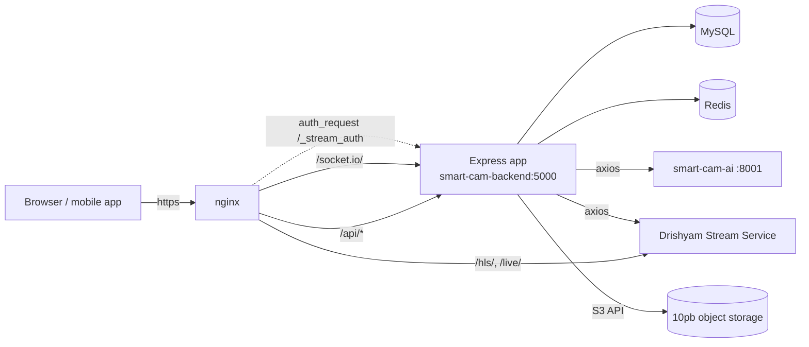
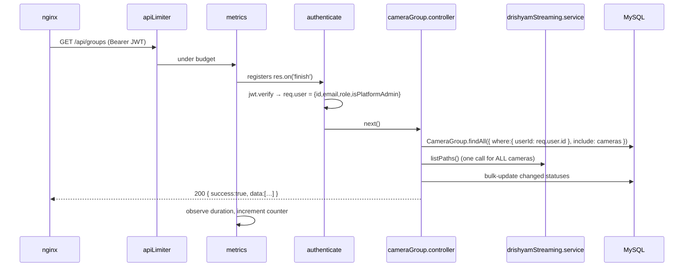
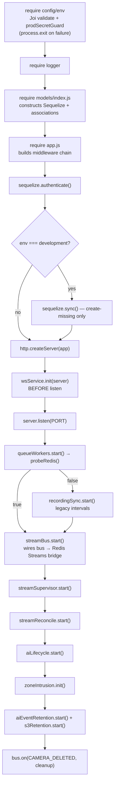
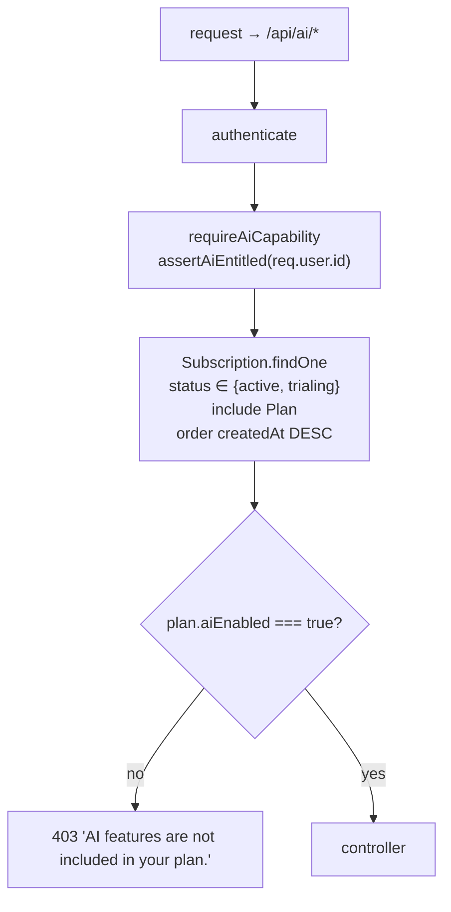
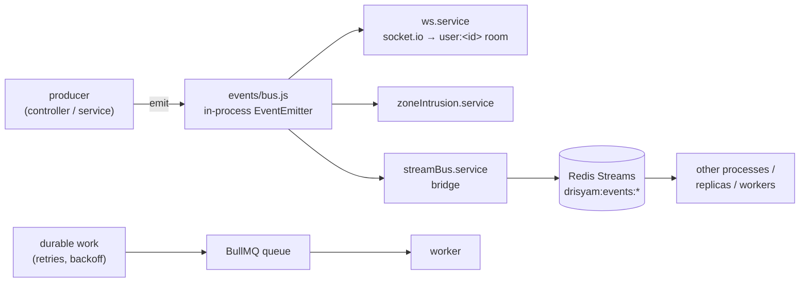

# Backend Developer Guide — `smart-cam-backend`

This document is for engineers who need to **change** the Drishyam VMS backend: the Node/Express
API at `smart-cam-backend/` that fronts MySQL, brokers every request from the operator console and
the mobile app, and drives the media and AI services. It explains the mental model first, then the
request lifecycle, boot order, layering, auth, entitlements, encryption, events, background work,
and finishes with task recipes ("How do I…") and the traps that will cost you a day. Everything
here was read out of the code at `smart-cam-backend/src/`; where the code and its comments
disagree, or where something is a known gap, that is called out explicitly rather than smoothed over.

---

## 1. The mental model

Three ideas make the rest of the backend obvious.

### 1.1 This service is a control plane. Video never flows through it.

The backend never touches RTP, never muxes, never serves a video segment. It **configures** the
Drishyam Stream Service (a renamed MediaMTX) over its HTTP config API, and then hands the browser
URLs that point at the *stream service*, not at Node:

```js
// smart-cam-backend/src/controllers/stream.controller.js
const { webrtcUrl, hlsUrl, hlsSubUrl, provider, codec, transcoded } =
  await streamService.startStream(camera, { quality });
res.json({ ok: true, monitorId, webrtcUrl, hlsUrl, hlsSubUrl, ... });
```

`GET /api/stream/start/:monitorId` is an *authorization + provisioning* call, not a data call. It
checks that this user owns the camera, ensures a path named `cam_<monitorId>` exists on the stream
service, optionally mints a media-plane cookie, and returns URLs. The browser then talks to the
stream service directly through nginx (`/hls/`, `/live/`). The one deliberate exception is
`GET /api/groups/:groupId/recordings/stream`, which proxies S3 bytes with Range support so the
browser never sees a bucket URL.

The practical consequence: **backend CPU/RAM is essentially independent of camera bitrate**. If
something is slow, it is a database query, an axios call to the stream service / AI service, or a
background loop — not video.

### 1.2 MySQL is authoritative. Background loops re-converge everything else.

Every other system in the deployment (stream service paths, AI runtime camera set, retention
policy, S3 objects) is treated as **derived state that drifts**. The backend's job is to write the
truth to MySQL immediately, apply it to the outside world best-effort, and run a reconciler that
keeps re-applying it forever.

You can see the doctrine literally in the code. Camera creation commits the DB transaction *first*,
then provisions the stream service outside the transaction:

```js
// smart-cam-backend/src/controllers/cameraGroup.controller.js
// (Stream Service is provisioned AFTER commit; the DB is the source of truth and
//  the watchdog re-adds any path that didn't land.)
const { group, cameras } = await sequelize.transaction(async (t) => { ... });
await Promise.all(channelConfigs.map(({ monitorId, rtspPath }) =>
  tryMTX(() => streamingService.addCamera(monitorId, { host, port, path: rtspPath, ... }))));
```

`tryMTX()` swallows stream-service failures on purpose — a media engine outage must not block
camera onboarding. The reconcilers close the loop:

| Loop | File | Cadence | Reconciles |
|---|---|---|---|
| `runWatchdog` | `services/recordingSync.service.js` | 2 min (BullMQ) | DB cameras ↔ stream-service paths, both directions (adds missing, deletes orphans) |
| `streamReconcile` | `services/streamReconcile.service.js` | 60 s + debounced trigger | effective retention (`recordDeleteAfter`) drift |
| `streamSupervisor` | `services/streamSupervisor.service.js` | 2 s | data-plane health → `Camera.status` + supervisor columns |
| `aiLifecycle` | `services/aiLifecycle.service.js` | 15 s | `Camera.settings.ai.enabled` ∧ plan entitlement ↔ AI service running set |
| `recordingSync.runSync` | `services/recordingSync.service.js` | 5 min (BullMQ) | local recording segments → S3 |
| `aiEventRetention` / `s3Retention` | same-named services | 6 h / 24 h | prune `ai_events`; prune durable S3 copies |

If you add a new piece of externally-held state, **assume it will drift** and write the reconciler
at the same time as the write path. Otherwise a stream-service restart silently un-does your feature.

### 1.3 Degrade, never crash.

Redis, the stream service, the AI service, S3 and SMTP are all optional at runtime. Look at what
happens when Redis is missing: `queues/workers.js` PINGs Redis with a 2 s timeout *before* BullMQ
touches it (so its reconnect loop can't spam the log), returns `false`, and `server.js` falls back
to `recordingSync.start()`'s legacy `setInterval` path. `streamBus.start()` logs a warning and
becomes a no-op. `config/redis.js` gives up after 3 attempts and returns `null` from every helper.

The only two hard dependencies are **environment validation** (`config/env.js` calls
`process.exit(1)` on a Joi failure or a production secret problem) and **MySQL**
(`sequelize.authenticate()` failing exits the process).

---

## 2. Map of the codebase

```
smart-cam-backend/
├── src/
│   ├── server.js            # process bootstrap: DB, HTTP, WS, queues, background loops, shutdown
│   ├── app.js               # the Express middleware chain (no listen() here — testable)
│   ├── config/              # env (Joi-validated) + prodSecretGuard, database, logger, redis,
│   │                        #   cors, securityHeaders
│   ├── routes/              # 23 route modules + index.js — URL shape + middleware only
│   ├── controllers/         # HTTP-aware handlers: parse req, call services, shape res
│   ├── services/            # all business logic + every outbound integration
│   ├── models/              # Sequelize models; index.js builds the singleton + associations
│   ├── middleware/          # authenticate, requireCapability, requireAiCapability, adminAuth,
│   │                        #   serviceAuth, validate, asyncHandler, errorHandler, rateLimiter
│   ├── utils/               # AppError, constants (RBAC), fieldCrypto, aiTenant, streamToken, audit
│   ├── validations/         # Joi schemas (auth, payment, shinobi)
│   ├── validators/          # Joi schemas (cameraGroup)  ← yes, two directories. See Gotchas.
│   ├── queues/              # BullMQ registry (index.js) + worker registration (workers.js)
│   └── events/bus.js        # in-process EventEmitter + the EVENTS name registry
├── migrations/              # sequelize-cli, numbered 001…028
├── seeders/                 # plans + pricing catalogue (re-run on every container boot)
├── test/                    # jest unit tests, hermetic (no DB / no stream service)
└── docs/openapi.yaml        # curated core contract, served raw at GET /api/openapi.yaml
```

Rough scale: ~156 JS files, ~22.6k lines under `src/` (~21.6k excluding the one-off `src/scripts/`
diagnostics). The three biggest files are
`controllers/ai.controller.js` (~1.6k), `services/recordingSync.service.js` (~970) and
`controllers/cameraGroup.controller.js` (~940) — those are where most of the accumulated behaviour
lives.

---

## 3. Request lifecycle, end to end

### 3.1 The path



nginx (`nginx.conf` at the repo root) does four things that matter to backend code:

1. **It is the only client the backend sees.** `app.set('trust proxy', 1)` makes Express read
   `X-Forwarded-For`, otherwise `express-rate-limit` would bucket every user under the gateway IP.
2. `client_max_body_size 20m` on `/api/` — larger than any Express body limit below, so a too-large
   body is rejected by *Express* with a readable error, not by nginx with a bare 413.
3. `location ~ ^/api/auth/(login|forgot-password|reset-password)` gets a tighter `limit_req` zone —
   credential stuffing is stopped at the edge before it reaches the Node rate limiter.
4. `/_stream_auth` is an `internal` location that subrequests `GET /api/stream/verify`, forwarding
   `X-Original-URI` and the browser's cookies. It is **commented out by default** in `/hls/` and
   `/live/`; enabling it is a two-step change (set `STREAM_URL_SECRET`, uncomment `auth_request`).

### 3.2 The middleware chain, in order

From `smart-cam-backend/src/app.js`, top to bottom. The order is load-bearing — the "why" column
is the part worth remembering.

| # | Middleware | Why it must be here |
|---|---|---|
| 1 | `app.set('trust proxy', 1)` | Every downstream consumer of `req.ip` (rate limiter, audit log, error log) is wrong without it. |
| 2 | `securityHeaders` (helmet) | Headers must be on the response even when a later middleware throws — helmet sets them synchronously on the way *in*. |
| 3 | `cors(corsOptions)` | Must precede body parsing so a preflight `OPTIONS` short-circuits before anyone tries to parse a body. |
| 4 | **conditional** `express.json` | See below — this is the interesting one. |
| 5 | **conditional** `express.urlencoded` | Skipped for the raw-audio talkback route only. |
| 6 | `app.use('/api', apiLimiter)` | Before routes, so a flood is rejected before it can touch MySQL. |
| 7 | `app.use('/api', metrics.httpMiddleware())` | Before routes so it can register `res.on('finish')` on the way in. |
| 8 | `GET /api/openapi.yaml` | Deliberately above the router and unauthenticated. |
| 9 | `app.use('/api', routes)` | The router tree. |
| 10 | 404 handler | `next(new AppError('Route … not found.', 404))` — routes through the same error path as everything else, so 404s get the same JSON shape and the same log line. |
| 11 | `errorHandler` | **Last.** Express identifies an error handler by arity (4 args); anything registered after it would never see errors. |

### 3.3 Why body parsing is per-route

This is the single most surprising block in `app.js`, and every clause is scar tissue:

```js
app.use((req, res, next) => {
  if (req.originalUrl === '/api/payment/webhook') return next();      // needs raw body for HMAC
  if (req.originalUrl.startsWith('/api/internal/')) return next();    // router installs json({limit:'2mb'})
  if (/\/api\/cameras\/[^/]+\/talk\/audio$/.test(req.originalUrl)) return next(); // raw G.711 µ-law
  if (req.originalUrl.startsWith('/api/person-tracker/')) return express.json({ limit: '5mb' })(req, res, next);
  express.json({ limit: '10kb' })(req, res, next);
});
```

- **Payment webhook** — Stripe/Razorpay signatures are computed over the exact bytes. Parsing to
  JSON and re-serializing changes them, so verification fails. `payment.routes.js` installs
  `express.raw({ type: 'application/json' })` on that route only.
- **`/api/internal/*`** — AI workers post detections with bbox arrays and base64 snapshots.
  `internal.routes.js` opens with `router.use(express.json({ limit: '2mb' }))`.
- **Talkback audio** — `POST /api/cameras/:monitorId/talk/audio` carries raw µ-law bytes; the
  controller reads the request stream itself. Both parsers are skipped.
- **`/api/person-tracker/*`** — journey search payloads carry full candidate + sighting arrays;
  at low similarity thresholds these exceed 100 KB.
- **Everything else: 10 KB.** That is a deliberately tight default. If you add an endpoint that
  legitimately needs more, add a clause here rather than raising the global limit.

### 3.4 Inside a route

Taking `GET /api/groups` as the canonical example:



Two things to notice. First, `router.use(authenticate)` at the top of `cameraGroup.routes.js`
covers every route in the file — that pattern (`router.use(authenticate)` once) is used by most
route modules. Six attach it per-route instead: `auth.routes.js`, `payment.routes.js` and
`stream.routes.js` because they genuinely mix public and private endpoints (login/register,
the raw webhook, `GET /stream/verify`), plus `shinobi.routes.js`, `subscription.routes.js` and
`user.routes.js`, which are fully authenticated and simply predate the `router.use` convention.
`health.routes.js` and `metrics.routes.js` are unauthenticated by design; `internal.routes.js`
uses `serviceAuth` instead.

Second, **`GET /api/groups` writes to the database.** It derives status from a single stream-service
`listPaths()` call plus the reachability prober and persists any change. That is why
`deriveStatus()` includes the reachability term:

```js
// smart-cam-backend/src/controllers/cameraGroup.controller.js
function deriveStatus(readyNames, cam) {
  return (readyNames.has(streamingService.pathName(cam.monitorId)) ||
          reachability.isReachable(cam.host) === true) ? 'online' : 'offline';
}
```

On-demand paths only report `ready` while someone is watching. Without the reachability term this
read endpoint would mark every idle-but-healthy camera offline on each 30-second poll and fight the
supervisor — the historical "flip-flop bug".

---

## 4. Boot order (`src/server.js`)



### What depends on what, and why

**`config/env` must be the first require.** It calls `dotenv.config()`, validates with Joi, and then
runs `productionSecretProblems()` from `config/prodSecretGuard.js`, which refuses to boot in
production with dev-default secrets (either JWT secret matching
`/^dev-|change-me|placeholder|xxxx|secret-key-must-be/i`, the two JWT secrets being equal,
`MEDIAMTX_API_PASS` still set to the sample `drishyam123`, an empty `DB_PASSWORD`, or a
placeholder `STRIPE_SECRET_KEY`). Both failure
paths `process.exit(1)` — so if the process dies instantly with no stack, read stderr, not the logs.
The guard logic lives in its own pure module precisely so `test/prodSecretGuard.test.js` can assert
it without triggering `process.exit`.

**`sequelize.sync()` runs only in development, and only in create-missing mode.** The comment is
explicit: no `alter`, because MySQL's 64-key-per-table limit trips on repeated alters. In production
the Dockerfile runs `npx sequelize-cli db:migrate && (npx sequelize-cli db:seed:all || true)` before
`node src/server.js`, so **migrations are the only schema mechanism that matters in prod**.

**`wsService.init(server)` must precede `server.listen()`.** socket.io attaches an `upgrade` handler
to the `http.Server`. If `listen()` ran first, a client racing the boot could complete a TCP
connection and send an HTTP `Upgrade` against a server with no upgrade listener, and the handshake
would fail. Attaching first makes the race impossible.

**`streamBus.start()` must precede `streamSupervisor.start()`.** `streamBus.startBridge()` subscribes
to every mapped `EVENTS.*` on the in-process EventEmitter and mirrors it to a Redis Stream. The
supervisor starts emitting `STREAM_READY` / `STREAM_OFFLINE` within its first 2-second tick. Wire
the bridge late and those first transitions are visible in-process but never reach other processes.
The comment in `server.js` says exactly this: *"Must start BEFORE the supervisor so its bridge is wired."*

**Background work starts inside the `listen` callback, not before it.** So `/api/health/live`
answers as soon as the socket is open, even while BullMQ is still probing Redis.

**`bus.on(EVENTS.CAMERA_DELETED, …)` is registered in `server.js`, not in a service.** It is
cross-cutting cleanup that spans three modules — supervisor state, quality state, and the FFmpeg
transcoder — and putting it in any one of them would create an import cycle:

```js
bus.on(EVENTS.CAMERA_DELETED, ({ monitorId }) => {
  try { streamSupervisor.forget(monitorId); } catch (_) {}
  try { streamQuality.forget(monitorId); } catch (_) {}
  try { transcoder.stopTranscoder(monitorId); } catch (_) {}
  for (const name of [ transcoder.transcodedPathName(monitorId), … ])
    try { streamingService.deletePathByName(name).catch(() => {}); } catch (_) {}
});
```

Without the `stopTranscoder` call an orphaned FFmpeg keeps republishing to `cam_<id>_h264`, so the
watchdog deletes the path and FFmpeg immediately recreates it — a zombie stream that reappears after
every delete.

### Shutdown

`SIGTERM`/`SIGINT` → `server.close()` → stop the interval loops → `await streamSupervisor.stop()`
(releases the Redis leader lock) → `streamBus.stop()` → `queues.shutdown()` → `sequelize.close()`.
A 10-second `setTimeout` force-exits if any of that hangs. `unhandledRejection` and
`uncaughtException` both filter *transient network errors* (`EPIPE`, `ECONNRESET`, `ETIMEDOUT`,
`ENOTFOUND`, `ECONNREFUSED`, "socket hang up") down to a warning — with hundreds of cameras and four
external services, an unfiltered handler would restart the process several times an hour.

---

## 5. The layered pattern

```
route  →  validator  →  controller  →  service  →  model
```

| Layer | Owns | Must NOT |
|---|---|---|
| **route** (`src/routes/*.routes.js`) | URL shape, HTTP verb, which middleware runs | contain logic; touch models |
| **validator** (`src/validations/`, `src/validators/`) | Joi schema for the request body | know about HTTP or the DB |
| **controller** (`src/controllers/`) | read `req`, enforce ownership, call services, shape `res` | contain reusable domain logic, call axios directly for a *shared* integration |
| **service** (`src/services/`) | domain logic and every outbound integration (stream service, AI, S3, SMTP, Redis) | know about `req`/`res` |
| **model** (`src/models/`) | schema, associations, hooks, field-level crypto | contain workflow |

### Route

Routes are declarative. Middleware order inside a route is: rate limiter → `authenticate` →
capability/entitlement gate → `validate` → controller.

```js
// smart-cam-backend/src/routes/manageUsers.routes.js
router.use(authenticate, requireCapability(CAPABILITIES.MANAGE_USERS));
router.post('/users', ctrl.createUser);
```

### Validator

`middleware/validate.js` accepts either a bare Joi schema (applied to `req.body`) or
`{ body, query, params }`. It always runs with `abortEarly: false, stripUnknown: true` and
**writes the coerced value back**. `stripUnknown` is why the schema must be complete — a field
missing from the schema is silently deleted before the controller sees it. `validators/cameraGroup.validation.js`
carries that warning in a comment.

### Controller

A controller is `asyncHandler(async (req, res) => { … })`. It owns exactly three things:
pulling values off `req`, **scoping the query to the caller**, and shaping the response.

```js
// smart-cam-backend/src/controllers/restrictedZone.controller.js
const remove = asyncHandler(async (req, res) => {
  const n = await RestrictedZone.destroy({ where: { id: req.params.id, userId: req.user.id } });
  if (!n) return res.status(404).json({ success: false, message: 'Zone not found.' });
  res.json({ success: true, removed: n });
});
```

Note the pattern: **ownership is expressed as a `where` clause, not as a fetch-then-compare.** A
row belonging to another tenant yields a 404, never a 403 — we don't confirm the id exists.

### Service

Services are stateful singletons with a `start()`/`stop()` pair when they run a loop, and pure
functions otherwise. Two conventions worth copying:

**Lazy model loading breaks require cycles.** Many services are required by `models/` indirectly, so
they defer:

```js
let _models = null;
const loadModels = () => (_models ||= require('../models'));
```

**Everything external is best-effort with bounded retry.** `recordingRetention.applyRetention()`
retries a stream-service PATCH 3× with linear backoff and then gives up with a warning, because
`streamReconcile` will pick up the drift on its next pass anyway.

### Model

Models are `(sequelize) => sequelize.define(…)` factories, wired together by
`models/index.js`, which constructs the singleton and then walks every model calling `associate()`.
The whole app imports from `require('../models')` and never constructs Sequelize itself.

### Where the codebase deviates from the pattern (be aware before you "fix" it)

- **Only 4 of 23 route modules use `validate`** (auth, cameraGroup, payment, shinobi). Everywhere
  else, validation is hand-rolled inside the controller (see `restrictedZone.controller.js` above,
  or `manageUsers.controller.js`'s `MIN_PASSWORD` checks). Adding a schema to an existing route is
  a behaviour change — `stripUnknown: true` will start deleting fields the controller reads.
- **`controllers/ai.controller.js` and `controllers/personTracker.controller.js` are proxies**, so
  they contain axios calls directly rather than delegating to a service. That is a deliberate
  exception for pass-through endpoints.
- **`middleware/authorize.js` is dead code** — a role-based factory that nothing imports.

---

## 6. Authentication and identity

### 6.1 Access vs refresh tokens

`services/auth.service.js` is the only module that mints tokens.

| | Access token | Refresh token |
|---|---|---|
| Secret | `JWT_SECRET` | `JWT_REFRESH_SECRET` (must differ — enforced in prod by `prodSecretGuard`) |
| Lifetime | `JWT_EXPIRES_IN`, default `15m` | `JWT_REFRESH_EXPIRES_IN`, default `7d` |
| Claims | `{ id, email, role, isPlatformAdmin }` | `{ id }` only |
| Storage | client-side only, never in the DB | row in `refresh_tokens` with `expiresAt`, `isRevoked` |
| Verified by | `middleware/authenticate.js`, `ws.service.js` handshake | `authService.verifyRefreshToken` (signature **and** DB row) |

**Rotation is single-use.** `POST /api/auth/refresh-token` verifies, then *immediately revokes* the
presented token before issuing a new pair:

```js
// smart-cam-backend/src/controllers/auth.controller.js
const decoded = await authService.verifyRefreshToken(token);
await authService.revokeRefreshToken(token);          // single-use rotation
const user = await User.findByPk(decoded.id);
if (!user || !user.isActive) throw new AppError('User not found or deactivated.', 401);
const { accessToken, refreshToken: newRefreshToken } = await authService.generateTokenPair(user);
```

`revokeAllUserTokens(userId)` is called on password change and on password reset, forcing re-login
on every device. There is **no rotation-reuse detection** (presenting an already-revoked token gets
a plain 401; it does not invalidate the whole family) and **no cleanup job for expired rows** —
`refresh_tokens` grows monotonically.

### 6.2 What `req.user` actually is

```js
// smart-cam-backend/src/middleware/authenticate.js
const decoded = jwt.verify(token, config.jwt.secret);
req.user = decoded; // comment says { id, email, role }; the token also carries isPlatformAdmin
```

The in-file comment is stale — `authService.generateAccessToken` signs
`{ id, email, role, isPlatformAdmin }`, and `adminAuth` depends on that fourth claim.

`req.user` is **the decoded JWT, not a database row**. It has no `parentUserId`, no `scope`, no
`customRole`, and it reflects the user as they were when the token was issued — up to 15 minutes
stale. Anything that needs fresh or fuller data must load it: `requireCapability` does exactly that
and hangs the result on `req.dbUser`.

`authenticate` also accepts `?token=` as a fallback, for elements like `<video src>` that cannot set
headers. See Gotchas — this leaks tokens into nginx access logs.

### 6.3 The capability model

`src/utils/constants.js` defines four assignable tiers plus a legacy `user` alias, and seven
capabilities:

| Role | `view_live` | `view_playback` | `ack_alerts` | `manage_cameras` | `use_ai` | `manage_users` | `manage_settings` |
|---|:-:|:-:|:-:|:-:|:-:|:-:|:-:|
| `admin` | ✓ | ✓ | ✓ | ✓ | ✓ | ✓ | ✓ |
| `user` (legacy) | ✓ | ✓ | ✓ | ✓ | ✓ | ✓ | ✓ |
| `manager` | ✓ | ✓ | ✓ | ✓ | ✓ | | |
| `operator` | ✓ | ✓ | ✓ | | | | |
| `viewer` | ✓ | ✓ | | | | | |

An account can also define **custom roles** (`roles` table, `Role.capabilities` JSON array). The
resolution rule is "custom overrides tier":

```js
function resolveCapabilities(user) {
  const custom = user && user.customRole;
  if (custom && Array.isArray(custom.capabilities)) return custom.capabilities;
  return ROLE_CAPABILITIES[user && user.role] || [];
}
```

`middleware/requireCapability.js` deliberately re-loads the user (with `customRole`) on every
request instead of trusting the JWT, so a role change, scope change, or deactivation takes effect
immediately rather than after token expiry.

> **⚠ Read section 12.1 before you rely on this.** `requireCapability` is currently applied in
> exactly one route module out of 23.

### 6.4 The five guards

| Guard | File | Applied in | Checks |
|---|---|---|---|
| `authenticate` | `middleware/authenticate.js` | every non-public route | `JWT_SECRET` signature |
| `adminAuth` | `middleware/adminAuth.js` | `routes/admin.routes.js` | `req.user.isPlatformAdmin === true` |
| `requireAiCapability` | `middleware/requireAiCapability.js` | `ai.routes.js`, `personTracker.routes.js` | plan entitlement (§7) |
| `requireCapability(cap)` | `middleware/requireCapability.js` | `manageUsers.routes.js` | RBAC capability, freshly loaded |
| `serviceAuth` | `middleware/serviceAuth.js` | `internal.routes.js` | constant-time compare against `SERVICE_TOKEN` |

`adminAuth` deserves a note. Every self-registered account owner is `role: 'admin'` — a plain role
check on `/api/admin/*` would expose every tenant's users, cameras and revenue to any trial signup.
`isPlatformAdmin` is a separate boolean column that self-registration cannot set (`register` writes
only `name`, `email`, `password`, `role`) and that is minted into the access token so the guard needs
no DB round-trip.

`serviceAuth` fails **closed** on misconfiguration: an unset `SERVICE_TOKEN` returns a 500 and
disables all internal routes rather than allowing them. One route escapes it:
`POST /api/internal/stampede-alert` is registered *above* `router.use(serviceAuth)` because the
stampede detector cannot set headers, so it authenticates on `?token=<SERVICE_TOKEN>` instead.
Anything you add below that line is covered; anything above it is not.

### 6.5 Org scoping: `parentUserId` → org root

A sub-user created through Settings → Manage Users gets `parentUserId` = the account owner's id.
The organisation root is therefore:

```js
// smart-cam-backend/src/models/User.js
User.prototype.accountOwnerId = function () { return this.parentUserId || this.id; };
```

This is used for two different purposes:

**(a) Account-scoped administration.** `manageUsers.controller.js` scopes every query to
`accountId(req)`, so an admin sees the owner plus every user whose `parentUserId` is the owner, and
nothing else. `ownedUser()` 404s on anything outside the account.

**(b) AI tenant derivation.** `utils/aiTenant.js` maps the org root to a stable tenant UUID and
mints a short-lived HS256 JWT the AI service verifies:

```js
const AI_TENANT_NAMESPACE = '6f9a1c2e-1b3d-5e7f-8a9b-0c1d2e3f4a5b';   // never change this
function orgRootId(user) { return String(user?.parentUserId || user?.id || ''); }
function aiTenantId(user) { return uuidv5(`drisyam-org:${orgRootId(user)}`, AI_TENANT_NAMESPACE); }
```

The `tid` claim is what makes each organisation's face watchlist isolated: `smart-cam-ai` scopes
every Person, Qdrant vector, MinIO crop and DetectionEvent by it, and the live recognition pipeline
picks its gallery from `Camera.tenant_id`. **Changing `AI_TENANT_NAMESPACE` re-maps every org to a
new tenant and orphans all enrolled faces.** The secret is `AI_JWT_SECRET`, falling back to
`SERVICE_TOKEN` then `JWT_SECRET` so a single-box deployment needs no extra wiring; when no usable
secret exists, `mintAiToken` returns `null` and the caller degrades to service-token-only headers
(the AI service's dev-bypass path).

`aiAuthHeader(user)` is used by `ai.controller.js`, `personTracker.controller.js` and
`services/alertEngine.js`. See Gotchas §12.2 — no call site passes a real `User` instance: the two
proxies pass `req.user` (the JWT), `alertEngine` passes a synthetic `{ id: evt.userId }`, and the AI
lifecycle helper falls back to `{ id: camera.userId }`. None of those carry `parentUserId`, so
sub-users currently derive their *own* tenant rather than the org's.

### 6.6 Media-plane tokens

`utils/streamToken.js` closes a different hole: the stream service serves reads anonymously, so a
leaked `cam_<monitorId>` URL is watchable forever. `startStream` mints
`HMAC-SHA256(monitorId:userId:expires, STREAM_URL_SECRET)` and sets it as an httpOnly cookie
`st_<monitorId>`; nginx's `auth_request` validates it via `GET /api/stream/verify`, which parses the
cookie by hand (no `cookie-parser` dependency) and returns 204 or 401. Note that both call sites
today (`startStream`, `adminStartStream`) call `sign(monitorId)` with no `userId`, so the `userId`
component is the empty string: the token is **camera-bound and time-bound, not user-bound**. The
per-user binding is supported by `sign()`/`verify()` but not yet wired up.

The whole mechanism is **inert unless `STREAM_URL_SECRET` is set** (`enabled()` requires ≥16 chars) —
`verify` returns 204 and the cookie is never minted. Enabling it requires both the env var *and*
uncommenting `auth_request /_stream_auth;` in the `/hls/` and `/live/` blocks of `nginx.conf`.

---

## 7. Entitlements: how AI is gated

There are two independent axes. **Capabilities** say what a *user* may do; **entitlements** say what
the *account's plan* includes. AI needs both.



`services/entitlements.service.js` exposes four functions:

| Function | Used by | Purpose |
|---|---|---|
| `getAiEntitlement(userId)` | `assertAiEntitled` | boolean |
| `assertAiEntitled(userId)` | `requireAiCapability` | throws `AppError(…, 403)` |
| `getEntitlements(userId)` | `auth.controller` register/login/me | `{ aiEnabled, features }` for the SPA |
| `getAiEntitledUserIds()` | `aiLifecycle.service` | one query returning a `Set` of entitled userIds |

**`Plan.aiEnabled`** is the tier switch: `false` = "Basic VMS" (video management only), `true` =
"AI+VMS". Seeder `003-seed-tier-plans.js` creates both trial plans idempotently and back-fills
`ai_enabled` on the pre-existing catalogue, because migration `027` defaults the new column to `false`.

**`Subscription.features`** is per-account curation *within* an entitled plan: `null` means every AI
feature the tier allows; a JSON array means only those keys. It lets one AI+VMS account be scoped to,
say, `["face_detection","person_tracker"]` without minting a bespoke plan.

Two enforcement points, and you need both:

1. **The route gate.** `router.use(requireAiCapability)` at the top of `ai.routes.js` and
   `personTracker.routes.js` — a Basic VMS account gets 403 even via curl.
2. **The runtime reconciler.** `aiLifecycle.service.js` intersects the per-camera flag with the
   entitled set every 15 seconds:

```js
const enabled = isAiEnabled(camera) && aiUserIds.has(camera.userId);
if (enabled && !isRunning)  await postAiForm('/set-camera', camera.monitorId);
else if (!enabled && isRunning && stopUnselected) await postAiForm('/stop-camera', camera.monitorId);
```

Without step 2 a downgrade would leave `settings.ai.enabled` stale-true and the AI orchestrators
would keep burning GPU for an account that no longer pays. With it, a downgrade stops detection
within one reconcile pass.

`auth.controller.capabilitiesFor()` additionally strips `use_ai` from the capability list returned
to the SPA when the plan lacks AI — that is **UX correctness only**; the comment says so, and the
route gate is the real boundary.

The parallel mechanism for camera counts is `services/cameraQuota.service.js`
(`assertCameraQuota(userId, addingCount)`), called *before* any write in `createGroup`,
`updateGroup`'s add-channels branch, and bulk import — it used to be checked afterwards, which left
orphaned groups and stream-service paths behind when the limit was hit.

---

## 8. Encryption at rest (`utils/fieldCrypto.js`)

AES-256-GCM applied through Sequelize getters/setters, so callers never see it:

```js
// smart-cam-backend/src/models/Camera.js
password: {
  type: DataTypes.STRING(512),
  set(value) { this.setDataValue('password', fieldCrypto.encrypt(value)); },
  get()      { return fieldCrypto.decrypt(this.getDataValue('password')); },
},
```

`camera.password` reads back as plaintext; `camera.update({ password })` writes ciphertext. Nothing
in `cameraGroup.controller.js` or `streamRouter.service.js` knows encryption exists.

**Three design decisions worth understanding:**

1. **Fail-open migration window.** With `CAMERA_CRED_KEY` unset, `encrypt()` is a passthrough and
   `decrypt()` returns the value unchanged. Existing plaintext rows keep working, and enabling the
   key is a gradual rollout: new writes encrypt, old rows re-encrypt the next time they are saved.
2. **Tagged, self-describing ciphertext.** Values are prefixed `enc:v1:` followed by
   base64(`nonce ‖ ciphertext ‖ tag`). `decrypt()` can therefore tell an encrypted value from legacy
   plaintext and only decrypts the former. A tagged value encountered with the key *unset* **throws** —
   deliberately, so you get a loud failure instead of scrambled bytes being pushed into an RTSP URL.
3. **GCM, not CBC.** Authenticated, so tampering with a stored credential is detected.

The key is `CAMERA_CRED_KEY` = base64 of exactly 32 bytes (`openssl rand -base64 32`). A wrong
length or invalid base64 logs an error and **disables encryption** rather than crashing. The scheme
mirrors `smart-cam-ai/vms_face/core/crypto.py` so both stores are compatible.

**Encrypted columns today:** `cameras.password`, `camera_groups.password`, `mail_config.password`.
**Not encrypted:** `mediamtx_servers.api_pass` (stream-service API credentials are stored plaintext).

---

## 9. Error handling conventions

### `AppError` + `asyncHandler`

```js
class AppError extends Error {
  constructor(message, statusCode) { super(message); this.statusCode = statusCode; this.isOperational = true; … }
}
const asyncHandler = (fn) => (req, res, next) => Promise.resolve(fn(req, res, next)).catch(next);
```

Every controller is wrapped in `asyncHandler`; every deliberate failure is
`throw new AppError(message, status)`. There should be no `try/catch` in a controller except around
a call whose failure is *not* fatal to the request (e.g. the best-effort email send in
`forgotPassword`).

Express 5 forwards rejected promises from handlers automatically, so `asyncHandler` is technically
redundant on the newest Express — keep using it anyway for consistency and because it is what every
existing file does.

### What the client actually sees

`middleware/errorHandler.js` normalises everything into `{ success: false, message }` and applies
one rule that matters:

```js
// 5xx bodies return a generic message; intentional 4xx AppErrors keep their human-readable text.
const safeMessage = statusCode >= 500 ? 'Internal Server Error' : message;
res.status(statusCode).json({ success: false, message: safeMessage });
```

The stack is **never** returned — independent of `NODE_ENV`, so a box that accidentally boots in dev
mode still leaks nothing. Stacks go to `logs/error.log` via winston, with `method`, `url`, `ip` and
`userId` attached, at `error` level for 5xx and `warn` for 4xx.

Sequelize and JWT errors are translated before that rule applies:

| Thrown | Status | Client message |
|---|---|---|
| `AppError(msg, 4xx)` | as given | `msg` |
| `SequelizeValidationError` | 400 | joined validation messages |
| `SequelizeUniqueConstraintError` | 409 | `A record with this <field> already exists` |
| `JsonWebTokenError` | 401 | `Invalid token` |
| `TokenExpiredError` | 401 | `Token expired` |
| anything else | 500 | `Internal Server Error` |

**Response-shape inconsistency to be aware of:** most endpoints return `{ success, data }`, but the
stream and internal routes return `{ ok: true, … }`, and `restrictedZone.controller.js` returns
`{ success, zones }`. There is no single envelope. Match the neighbouring endpoints in the file you
are editing rather than "fixing" a shape the frontend already depends on.

### Auditing

`utils/audit.js` writes a separate append-only JSON-lines file (`logs/audit.log`, 20 MB × 20) with
`{ action, actor:{userId,email,role,ip,userAgent}, target, outcome, ...meta }`. It is
fire-and-forget and swallows its own errors — an audit write must never fail the operation it
records. Currently used at exactly three sites: `user.password.reset` and `user.password.changed`
(`auth.controller.js`) and `user.status.toggled` (`admin.controller.js`). Add a call for any
new sensitive action; do not put secrets in `meta`.

---

## 10. Events

There are **three** distinct fan-out mechanisms. Picking the wrong one is a common mistake.



### 10.1 In-process bus — `src/events/bus.js`

For same-node notifications that need no durability: UI fan-out, cache invalidation, cleanup.
Event names live in a frozen `EVENTS` registry with the payload shape documented next to each name:

| Event | Payload | Emitted by |
|---|---|---|
| `camera.created` | `{ camera, userId }` | `cameraGroup.controller` |
| `camera.deleted` | `{ monitorId, userId, groupId }` | `cameraGroup.controller`, `shinobi.controller` |
| `group.created` / `group.deleted` | `{ group, userId }` / `{ groupId, userId }` | `cameraGroup.controller` |
| `stream.ready` / `stream.offline` | `{ monitorId, cameraId, userId, fromState, toState, bpsIn, ready, reason, reasonCode, serverName, at }` | `streamSupervisor` |
| `ai.event.detected` | `{ event, userId }` — the full persisted row | `internal.routes`, `zoneIntrusion.service` |
| `ai.live.overlay` | `{ userId, frame }` — **ephemeral, never persisted** | `internal.routes` |
| `camera.updated`, `recording.synced`, `ai.alert.triggered` | declared in `EVENTS`, mapped in `streamBus`, consumed by `ws.service` — but **nothing emits them today** | — |

That last row matters: `ws.service` has a live listener for `ai.alert.triggered`, yet `alertEngine`
delivers push/email directly and never emits it, so the `ai.alert` socket channel is currently dead.
Same for `recording.synced` and `camera.updated`. If you need one of them, add the `emit()` at the
producer — the consumer side is already wired.

`ai.live.overlay` is the important one to understand. Routine face boxes ride this channel at frame
rate and are dropped after fan-out; only meaningful detections go to `/ai/events` and become
`ai_events` rows. That separation is what stops the alert flood — routing overlay frames through the
persisted path once produced ~10k spurious alert rows.

Use the `on()` helper rather than raw `bus.on()`. It wraps the handler so a throw is logged instead
of propagating (see Gotchas §12.5).

### 10.2 Cross-process bus — `src/services/streamBus.service.js`

Redis **Streams**, not pub/sub, and the reasoning is written into the file: pub/sub drops messages
when no subscriber is online, which is unacceptable for camera state changes that drive alerting.
Streams persist (capped with `XADD MAXLEN ~ 50000`), consumer groups give at-least-once delivery,
and a restarted worker resumes from its last delivered id.

Three streams: `drisyam:events:camera`, `drisyam:events:ai`, `drisyam:events:recording`. Each entry
is one flat field pair `["event", JSON.stringify({ type, ts, payload })]` so consumers in any
language parse exactly one field.

`subscribe(stream, group, consumer, handler)` **ACKs only on success**; a throwing handler leaves the
entry in the pending-entries list so a sibling consumer picks it up after the visibility timeout, and
a periodic `XAUTOCLAIM` reclaims entries from dead consumers.

### 10.3 WebSocket fan-out — `src/services/ws.service.js`

socket.io, authenticated by the same access-token JWT in the handshake (`auth: { token }`), joining
each socket to a `user:<userId>` room. **Always emit with `toUser(userId, …)`, never `broadcast()`** —
the room boundary *is* the multi-tenancy boundary here.

`init()` subscribes the bus to the socket layer, so most features need no socket code at all: emit
on the bus and the client receives it. The overlay handler strips heavy base64 person crops before
fan-out (the browser only needs bboxes; the crops exist for the zone engine).

Client channels: `stream.status`, `ai.event`, `ai.alert`, `ai.live`, `recording.synced`.

---

## 11. Background work

### BullMQ (`src/queues/`)

`queues/index.js` is the registry; `queues/workers.js` registers processors and repeatable jobs at
boot. Queue names are Redis key prefixes — **renaming one is a breaking change**, and BullMQ
disallows `:` in names.

| Queue constant | Name | Concurrency | Processor |
|---|---|---|---|
| `S3_SYNC` | `drishyam-s3-sync` | 1 | `recordingSync.runSync()` every 5 min |
| `WATCHDOG` | `drishyam-watchdog` | 1 | `recordingSync.runWatchdog()` every 2 min |
| `TRANSCODE` | `drishyam-transcode` | 32 (`TRANSCODER_QUEUE_CONCURRENCY`) | `transcoder.ensure*Transcoder()` |
| `ALERT_DISPATCH` | `drishyam-alert-dispatch` | 8 | **stub** |
| `AI_EVENT_INGEST` | `drishyam-ai-events` | 4 | **stub** |
| `SNAPSHOT` | `drishyam-snapshot` | 2 | **stub** |

Defaults: 3 attempts, exponential backoff from 5 s, `removeOnComplete` after 1 h/1000 jobs.
`scheduleRepeatable` uses a stable `jobId: repeat:<jobName>` so N boots do not produce N schedules.

`isEnabled()` is the flag producers consult. It is set `true` **only** after a successful Redis PING
*and* worker registration, so when Redis is down every producer takes its legacy in-process path
instead of enqueueing into the void.

The transcode worker's concurrency is deliberately *above* the transcoder's own `MAX_CONCURRENT` cap
so the queue is not the limiter — `ensurePathTranscoder` still performs the fast capacity reject
(`{ spawned: false, reason: 'capacity' }`). Producers that need the result use
`job.waitUntilFinished(getQueueEvents(name))`.

### Interval loops

Loops that are cheap, node-local, or need sub-second cadence stay on timers:
`streamSupervisor` (2 s), `aiLifecycle` (15 s), `streamReconcile` (60 s), `aiEventRetention` (6 h),
`s3Retention` (24 h). Conventions to copy: a `_running` re-entrancy guard, `setTimeout` chaining
rather than `setInterval` where a slow cycle must not stack, and `.unref()` so a pending timer never
holds the process open during shutdown.

### Leader election

Only one instance may drive the supervisor. `streamSupervisor.acquireLeader()` uses
`SET drisyam:supervisor:leader <instanceId> PX 15000 NX`, refreshed each tick, and
`streamReconcile` gates its periodic backstop on `streamSupervisor.isLeader()` (defaulting to `true`
when the supervisor module is unavailable, so a single-instance box always works). Event-triggered
reconciles are *not* leader-gated.

---

## 12. Gotchas

### 12.1 RBAC is UI-deep, not a server boundary — verified

`requireCapability` is imported by **exactly one route module**, `routes/manageUsers.routes.js`, out
of 23. `grep -rn "requireCapability" src/routes/` returns a single file. Nothing else in the API
checks `view_live`, `view_playback`, `ack_alerts`, `manage_cameras` or `manage_settings`.

Concretely: a user with `role: 'viewer'` holds a valid JWT, and
`POST /api/groups`, `DELETE /api/groups/:id` and `POST /api/restricted-zones` will all accept it.
`PUT /api/ai/cameras/:id/settings` accepts it too, though that one is still gated on the *account's*
plan by `requireAiCapability` — a plan check, not a role check. The console hides those controls,
which is where the protection currently comes from.

The related fact is that `User.scope` (`{ siteIds, groupIds }`) is **stored and never enforced**.
`grep -rn "siteIds" src/` matches only `manageUsers.controller.js` (which writes and normalises it)
and `models/User.js` (which declares the default) — no read path anywhere filters on it.

**If you are hardening this:** add `requireCapability(...)` to each route module, then fix the
scoping described in §12.2 — the two changes are coupled, because today a sub-user's queries return
nothing anyway.

### 12.2 Resource queries scope to `req.user.id`, not the account owner

`User.prototype.accountOwnerId()` exists and is used only by `manageUsers.controller.js` /
`manageRoles.controller.js`. Every resource controller scopes directly:

```js
CameraGroup.findAll({ where: { userId: req.user.id }, … })   // cameraGroup.controller.js
Camera.findOne({ where: { userId: req.user.id, monitorId } }) // stream.controller.js
```

Cameras created by an account owner carry `userId = <owner id>`. A sub-user provisioned through
Manage Users has a different `id`, so **a sub-user sees zero cameras, zero groups, zero zones and
zero AI events**. Verify this before designing anything on top of sub-users. The fix is to resolve
the account owner once per request (a small middleware that sets `req.accountId`) and scope on that,
narrowing by `User.scope` afterwards.

The same root cause affects the AI tenant. `aiAuthHeader(req.user)` is called at every proxy site,
but `req.user` is the JWT — it has no `parentUserId` — so `orgRootId()` returns the caller's own id.
The comment in `ai.controller.js` (*"`user` carries parentUserId so sub-users map to the org"*) is
true only if a **full `User` instance** is passed, which no call site does today.

### 12.3 `middleware/validate.js` cannot write back `req.query` on Express 5

Express 5 defines `req.query` as a getter with **no setter** (`defineGetter(req, 'query', …)` in
`express/lib/request.js`; the installed version is 5.2.1). `validate.js` does `req[source] = value`
for each of `body`, `query`, `params`. For `body` and `params` that works. For `query` the
assignment silently fails in sloppy mode — validation still *rejects* bad input, but the coerced /
`stripUnknown`-cleaned object is discarded and the controller reads the original query.

No route uses a `{ query: … }` schema today — all 13 `validate` call sites (across the four route
modules that use it) pass a bare Joi object, which the middleware applies to `req.body` — so nothing
is broken right now. If you add one, read the values off your own validated object rather
than trusting `req.query`.

### 12.4 The Prometheus route label is the *router-relative* path

`metrics.httpMiddleware()` labels with `req.route?.path || req.baseUrl || 'unknown'`. Inside a mounted router,
`req.route.path` is the sub-path — `GET /api/groups/:groupId` is labelled `/:groupId`, and
`GET /api/sites/:id` is labelled `/:id`. Different routers therefore collide in the same label
value. Also note the two comments disagree: `metrics.service.js` says "mount AFTER the router",
`app.js` says "must come before routes". `app.js` is right — the middleware must run on the way in
to register `res.on('finish')`, and `req.route` is read *inside* that callback, after routing has
completed.

### 12.5 The event bus does not isolate listener failures

`events/bus.js` registers `bus.on('error', …)` under a comment calling it a "catch-all for listener
errors". It is not. Node's `'error'` channel only fires when someone explicitly emits `'error'`, and
nothing does. A synchronous throw inside a `bus.on(EVENTS.X, handler)` listener propagates back
through `bus.emit()` into whoever emitted — usually a request handler, turning a background failure
into a 500 on an unrelated request.

Use the exported `on(eventName, handler)` helper, which wraps the handler in try/catch. Where raw
`bus.on` is used (`server.js`, `streamBus.startBridge`), each listener body already has its own
`try {} catch (_) {}`.

### 12.6 `?token=` puts JWTs in the access log

`authenticate` falls back to `req.query.token`, and `nginx.conf`'s JSON `log_format` includes
`"uri":"$request_uri"`. Any request authenticated that way writes a valid 15-minute access token
verbatim into `/var/log/nginx/access.log`. Prefer the `Authorization` header; use `?token=` only for
elements that genuinely cannot set headers, and treat the access log as sensitive.

### 12.7 `raw: true` bypasses `fieldCrypto`

Sequelize getters do not run on `raw: true` queries or on `sequelize.query()`. Today no raw query
selects a password column — `streamReconcile` and `recordingRetention` use `raw: true` but restrict
`attributes` to retention fields. If you add `password` to one of those attribute lists you will
silently get `enc:v1:…` ciphertext and build an unusable RTSP URL. Symptom: the stream service
reports auth failure on a camera whose credentials are demonstrably correct.

### 12.8 Deleting a group does not cascade to cameras

`camera_groups → cameras` FK is `ON DELETE SET NULL`. `deleteGroup` therefore destroys the camera
rows explicitly *before* destroying the group:

```js
const removedCount = await Camera.destroy({ where: { groupId: group.id } });
await group.destroy();
```

Relying on the FK leaves orphan rows with `groupId = null` that the supervisor keeps polling forever
— this is exactly how 17 rows from a decommissioned NVR survived a delete. Any new delete path must
do the same.

### 12.9 Two validation directories

`src/validations/` (auth, payment, shinobi) and `src/validators/` (cameraGroup) both exist and both
hold Joi schemas. There is no semantic difference; it is drift. Pick the one the neighbouring route
already imports.

### 12.10 Weak defaults baked into `config/env.js`

`MEDIAMTX_API_PASS`, `LIVEKIT_API_KEY` and `LIVEKIT_API_SECRET` all have working dev defaults in the
Joi schema. `prodSecretGuard` catches only the stream-service one; the LiveKit pair boots in
production with its sample values and no complaint. `config/env.js` also hardcodes a production S3
endpoint and bucket as fallbacks, so a deployment with `S3_*` unset will quietly point at them.
Set every one of these explicitly in production, and extend `productionSecretProblems()` when you
add a new credentialed integration.

### 12.11 `sequelize.sync()` in dev vs migrations in prod

Development boots run `sequelize.sync()` (create-missing tables only, never `alter`). Production runs
`sequelize-cli db:migrate`. A model change without a migration therefore **works on your laptop and
fails in prod**. Always write both.

Also: the container runs `db:seed:all` on every boot with `|| true`, so seeders must be idempotent —
`003-seed-tier-plans.js` shows the pattern (SELECT, then UPDATE-or-INSERT).

### 12.12 Rate-limit skips you should know about

`apiLimiter` skips `/internal/*` entirely (service calls burst during incidents and authenticate
via `X-Service-Token`) and skips any `GET` whose path contains `/snapshot` or `/thumbnail` (a face
gallery fires 50+ image reads at once and used to exhaust the budget → 429 → broken images). The
budget is 5000 req/15 min per IP, and behind Docker/nginx **all browser traffic shares one gateway
IP** — the localhost skip effectively never matches in a container deployment.

### 12.13 Health-check semantics

`/api/health` (shallow, always 200) is declared **before** `router.use('/health', healthRoutes)` in
`routes/index.js` on purpose — otherwise a bare `/api/health` would fall into the deep router and
404 on `/`. `/api/health/ready` returns 503 if MySQL **or** Redis **or** every stream server is
unreachable, so pointing a load balancer at it in a Redis-less deployment takes the instance out of
rotation permanently. Use `/api/health/live` for liveness and `/full` (never 5xx, diagnostic only)
for dashboards.

---

## 13. How do I…

### 13.1 …add an endpoint

Worked example: `GET /api/sites/:id/summary`.

1. **Service first** — `src/services/site.service.js` (create it if absent) gets a pure function
   that takes ids and returns data. No `req`, no `res`.
2. **Controller** — `src/controllers/site.controller.js`:

```js
const getSummary = asyncHandler(async (req, res) => {
  const site = await Site.findOne({ where: { id: req.params.id, userId: req.user.id } });
  if (!site) throw new AppError('Site not found.', 404);          // ownership as a where-clause
  res.json({ success: true, data: await siteService.summarize(site) });
});
module.exports = { …, getSummary };
```

3. **Route** — `src/routes/site.routes.js` (the file already does `router.use(authenticate)`):

```js
router.get('/:id/summary', site.getSummary);
```

4. **Validation**, only if there is a body: add a schema under `src/validations/` and insert
   `validate(schema)` between `authenticate` and the controller. Remember `stripUnknown: true`.
5. **Capability gate**, if the action is privileged:
   `requireCapability(CAPABILITIES.MANAGE_SETTINGS)` — see §13.4.
6. **Body size**, if the payload can exceed 10 KB: add a clause to the conditional parser in
   `app.js`.
7. **Document** it in `smart-cam-backend/docs/openapi.yaml` if it belongs to the core contract.

**Verify:**

```bash
cd smart-cam-backend && npm run dev
TOKEN=$(curl -s localhost:5000/api/auth/login -H 'Content-Type: application/json' \
  -d '{"email":"…","password":"…"}' | jq -r .token)
curl -s localhost:5000/api/sites/<id>/summary -H "Authorization: Bearer $TOKEN" | jq
# negative test — another tenant's id must 404, not 403:
curl -s -o /dev/null -w '%{http_code}\n' localhost:5000/api/sites/<other-tenant-id>/summary \
  -H "Authorization: Bearer $TOKEN"
```

### 13.2 …add a model + migration

1. **Model** — `src/models/Widget.js`, factory shape, `underscored: true`, explicit `tableName`:

```js
module.exports = (sequelize) => {
  const Widget = sequelize.define('Widget', {
    id:     { type: DataTypes.UUID, defaultValue: DataTypes.UUIDV4, primaryKey: true },
    userId: { type: DataTypes.UUID, allowNull: false },
    name:   { type: DataTypes.STRING(120), allowNull: false },
  }, { tableName: 'widgets', underscored: true, indexes: [{ fields: ['user_id'] }] });
  Widget.associate = (models) => { Widget.belongsTo(models.User, { foreignKey: 'userId', as: 'user' }); };
  return Widget;
};
```

2. **Register** it in `src/models/index.js` — the `require(...)(sequelize)` line **and** the
   `models` object. Missing the second means `associate()` never runs.
3. **Migration** — `migrations/029-create-widgets.js`, numbered next in sequence. Copy the
   idempotent helper from `020-add-retention-days.js` for column adds:

```js
async function addColumnIfNotExists(qi, table, column, def) {
  const desc = await qi.describeTable(table).catch(() => null);
  if (!desc || desc[column]) return;
  await qi.addColumn(table, column, def);
}
```

4. **UUID foreign keys need care.** `Sequelize.UUID` renders as `CHAR(36) BINARY`, which collides
   with the existing `CHAR(36) utf8mb4_unicode_ci` columns on `users`/`cameras` and trips MySQL
   errno 150 at `sync()` time. That is why `AIEvent.userId` and `Camera.mediamtxServerId` carry a
   comment saying the `references` is *omitted on purpose* and the constraint is added by a
   migration with the right collation. Follow that pattern.
5. **Column naming**: `underscored: true` maps `flapCount24h` → `flap_count24h` (no underscore before
   digits). `Camera` pins `field: 'flap_count_24h'` explicitly to match the migration. Check any
   camelCase field ending in digits.

**Verify:**

```bash
cd smart-cam-backend
npm run db:migrate
npm run db:migrate:undo   # a migration you cannot roll back is not finished
npm run db:migrate
mysql -e "SHOW CREATE TABLE widgets\G" <db>
```

### 13.3 …add a background job

**Choose the mechanism first.**

| Use BullMQ when | Use an interval loop when |
|---|---|
| the work must survive a restart | the work is a cheap idempotent reconcile |
| it needs retries / backoff | it must run faster than ~10 s |
| multiple replicas must not duplicate it | it is node-local (in-memory state) |
| you want it visible in a queue dashboard | Redis may legitimately be absent |

**BullMQ recipe:**

1. Add the name to `QUEUE_NAMES` in `src/queues/index.js` (letters/digits/`-`/`_` only; the name is
   a Redis key prefix, so never rename it later).
2. Register the worker in `src/queues/workers.js` inside the `try` block, with an explicit
   concurrency:

```js
registerWorker(QUEUE_NAMES.WIDGET_REBUILD, async (job) => {
  if (job.name === 'run') await widgetService.rebuild(job.data);
}, { concurrency: 2 });
await scheduleRepeatable(QUEUE_NAMES.WIDGET_REBUILD, 'run', {}, 15 * 60 * 1000);
```

3. Producers must check `queues.isEnabled()` and fall back to an inline path, matching
   `transcoder.requestTranscode`.

**Interval-loop recipe:** export `start()` / `stop()`, guard re-entrancy with a `_running` flag,
chain with `setTimeout` (not `setInterval`) if a slow cycle must not stack, call `.unref()`, gate
the periodic pass on `streamSupervisor.isLeader()` if it writes shared state, and then wire it into
`server.js` inside the `listen` callback **and** into the `shutdown()` handler. `aiEventRetention.service.js`
is the smallest complete example.

**Verify:** `curl -s localhost:5000/api/metrics | grep drisyam_queue_depth`, and watch
`logs/combined.log` for the `queue scheduled:` / `queue worker registered:` lines at boot.

### 13.4 …add a capability check

1. If the capability does not exist, add it to `CAPABILITIES` in `src/utils/constants.js` **and** to
   `CAPABILITY_LABELS` (the Manage Users → Roles editor renders from that map) **and** to the
   relevant tiers in `ROLE_CAPABILITIES`.
2. Apply the middleware in the route module — for a whole module:

```js
const requireCapability = require('../middleware/requireCapability');
const { CAPABILITIES } = require('../utils/constants');
router.use(authenticate, requireCapability(CAPABILITIES.MANAGE_CAMERAS));
```

   or per route: `router.post('/', authenticate, requireCapability(CAPABILITIES.MANAGE_CAMERAS), ctrl.create);`
3. `requireCapability` attaches `req.dbUser` (the fresh `User` with `customRole` loaded). Use it —
   it is the only place a controller gets a real `User` instance rather than the JWT payload.
4. For plan-tier gating rather than RBAC, use `requireAiCapability` (or call
   `assertAiEntitled(userId)` directly inside a service).

**Verify** with three tokens — an admin (200), a `viewer` (403), and no token at all (401):

```bash
for T in "$ADMIN_TOKEN" "$VIEWER_TOKEN" ""; do
  curl -s -o /dev/null -w "%{http_code}\n" -X POST localhost:5000/api/groups \
    -H "Authorization: Bearer $T" -H 'Content-Type: application/json' -d '{"name":"x","host":"1.2.3.4"}'
done
```

### 13.5 …emit and consume an event

**Emit** — add the name to `EVENTS` in `src/events/bus.js` with a comment documenting the payload
shape, then:

```js
const { emit, EVENTS } = require('../events/bus');
emit(EVENTS.WIDGET_REBUILT, { widgetId: w.id, userId: req.user.id });
```

Keep the payload small and JSON-serialisable — it may be mirrored to Redis.

**Consume in-process** — use the wrapping helper, never raw `bus.on`:

```js
const { on, EVENTS } = require('../events/bus');
on(EVENTS.WIDGET_REBUILT, async ({ widgetId, userId }) => { … });   // errors logged, never rethrown
```

Handlers must be idempotent (Redis-Streams delivery is at-least-once) and must not assume ordering.

**Push it to the browser** — add one line to `ws.service.init()`:

```js
on(EVENTS.WIDGET_REBUILT, ({ userId, widgetId }) => toUser(userId, 'widget.rebuilt', { widgetId }));
```

`toUser` is a no-op before `init()`, so emitting during boot is safe.

**Make it cross-process** — add the event to `EVENT_TO_STREAM` in
`src/services/streamBus.service.js`, mapping it to one of the three streams. The bridge picks it up
automatically. To consume in another process:

```js
await streamBus.subscribe(streamBus.STREAMS.CAMERA, 'my-consumer-group', `replica-${process.pid}`,
  async (id, evt) => { if (evt.type === EVENTS.WIDGET_REBUILT) await handle(evt.payload); });
```

Throwing from the handler intentionally leaves the entry unacked so a sibling retries it.

**Verify:**

```bash
redis-cli XLEN drisyam:events:camera
redis-cli XREVRANGE drisyam:events:camera + - COUNT 5
# browser console:  socket.on('widget.rebuilt', console.log)
```

---

## 14. Testing and local verification

`npm test` runs jest against `test/**/*.test.js`. The suite is **hermetic**: `test/jest.setup.env.js`
runs as a `setupFiles` entry and injects dummy env vars *before* any module loads, so
`config/env.js`'s Joi validation passes with no local `.env` (it uses `??=`, and `dotenv.config()`
never overrides already-set vars). Tests mock external boundaries — no MySQL, no stream service, no
Redis.

Existing suites cover exactly the pure logic worth protecting: `fieldCrypto`, `streamToken`,
`prodSecretGuard`, `authenticate`, `validate`, `audit`, `auth.service`, `cameraQuota`,
`cameraGroup.validation`, `securityHeaders`, `s3Retention`, S3 range streaming, `vendors`, the
streaming engine + factory, and `recordingSync` internals. **There are no HTTP-level
integration tests**, so route wiring, middleware order and ownership scoping are unverified by CI.
When you add a controller, add a unit test for the service function it calls.

Useful local commands:

```bash
cd smart-cam-backend
npm run dev                       # nodemon
npm test
npm run db:migrate                # sequelize-cli, config from .sequelizerc → src/config/database.js
npm run db:seed
npm run smoke:retention           # scripts/smoke-retention.js — end-to-end retention check

curl -s localhost:5000/api/health/full | jq '.components'
curl -s localhost:5000/api/metrics | grep -E 'drisyam_(camera_state|queue_depth|http_requests_total)'
tail -f logs/combined.log logs/error.log logs/audit.log
```

---

## 15. Configuration reference

Names only — never commit values. `smart-cam-backend/.env` is gitignored and untracked; `.env.example`
is the template. Full schema with defaults: `src/config/env.js`.

**Required (boot fails without them):** `DB_NAME`, `DB_USER`, `JWT_SECRET` (≥32 chars),
`JWT_REFRESH_SECRET` (≥32 chars, must differ from `JWT_SECRET` in prod), `STRIPE_SECRET_KEY`,
`STRIPE_WEBHOOK_SECRET`, `RAZORPAY_KEY_ID`, `RAZORPAY_KEY_SECRET`, `RAZORPAY_WEBHOOK_SECRET`.

| Group | Variables |
|---|---|
| Runtime | `NODE_ENV`, `PORT` |
| Database | `DB_HOST`, `DB_PORT`, `DB_NAME`, `DB_USER`, `DB_PASSWORD`, `DB_SSL`, `DB_SSL_REJECT_UNAUTHORIZED` |
| Auth | `JWT_SECRET`, `JWT_EXPIRES_IN`, `JWT_REFRESH_SECRET`, `JWT_REFRESH_EXPIRES_IN` |
| CORS | `CORS_ORIGINS` (comma-separated), `FRONTEND_URL` |
| Stream service | `STREAM_SERVICE_API_URL` / `_API_USER` / `_API_PASS` / `_WEBRTC_URL` / `_HLS_URL` / `_INTERNAL_HLS_URL` / `_RTSP_HOST` / `_RTSP_PORT` / `_RECORDINGS_DIR` (legacy `MEDIAMTX_*` names still honoured as fallback) |
| Recording | `RECORDING_SEGMENT_DURATION`, `RECORDING_STITCH_BELOW_SEC`, `DEFAULT_RETENTION_DAYS` |
| Retention loops | `RECONCILE_ENABLED`, `RECONCILE_INTERVAL_MS`, `RECONCILE_CONCURRENCY`, `RECONCILE_DEBOUNCE_MS`, `RETENTION_APPLY_RETRIES`, `RETENTION_APPLY_BACKOFF_MS`, `RETENTION_APPLY_CONCURRENCY`, `AI_EVENT_RETENTION_DAYS`, `AI_EVENT_RETENTION_INTERVAL_MS` |
| S3 / durable copy | `S3_ENDPOINT`, `S3_REGION`, `S3_ACCESS_KEY`, `S3_SECRET_KEY`, `S3_BUCKET`, `S3_RETENTION_ENABLED`, `S3_RETENTION_DELETE`, `S3_RETENTION_GRACE_DAYS`, `S3_RETENTION_INTERVAL_MS`, `S3_RETENTION_MAX_DELETE_PER_RUN` |
| Supervisor | `SUPERVISOR_POLL_MS`, `SUPERVISOR_MIN_BPS`, `SUPERVISOR_DEGRADED_AFTER_MS`, `SUPERVISOR_OFFLINE_AFTER_MS`, `SUPERVISOR_FLAP_WINDOW_MS`, `SUPERVISOR_FLAP_LIMIT`, `SUPERVISOR_QUARANTINE_MS`, `SUPERVISOR_LEADER_TTL_MS` |
| Redis / queues | `REDIS_URL`, `STREAM_BUS_MAXLEN`, `TRANSCODER_QUEUE_CONCURRENCY` (queue worker, default 32), `TRANSCODER_MAX` (real FFmpeg cap, default 8) |
| AI | `AI_SERVICE_URL`, `AI_JWT_SECRET`, `AI_JWT_ISSUER`, `AI_JWT_AUDIENCE`, `ACTIVITY_SERVICE_URL`, `AI_LIFECYCLE_RECONCILE_MS`, `AI_MINIO_ENDPOINT`, `AI_MINIO_KEY`, `AI_MINIO_SECRET`, `AI_MINIO_BUCKET` |
| Service auth | `SERVICE_TOKEN` |
| Crypto | `CAMERA_CRED_KEY` (base64, exactly 32 bytes), `STREAM_URL_SECRET`, `STREAM_URL_TTL_SEC` |
| WebRTC | `TURN_URI`, `TURN_URI_TLS`, `TURN_SHARED_SECRET`, `TURN_TTL_SEC`, `LIVEKIT_WS_URL`, `LIVEKIT_API_KEY`, `LIVEKIT_API_SECRET`, `LIVEKIT_TOKEN_TTL_SEC` |
| Email | `EMAIL_HOST`, `EMAIL_PORT`, `EMAIL_SECURE`, `EMAIL_USER`, `EMAIL_PASS`, `EMAIL_FROM` |
| Alerts | `ALERT_PUSH_COOLDOWN_SEC`, `ALERT_EMAIL_COOLDOWN_SEC`, `ALERT_EMAIL_WINDOW_SEC`, `ALERT_EMAIL_MAX_PER_WINDOW` |
| Limits | `ENFORCE_CAMERA_LIMITS`, `FREE_TIER_MAX_CAMERAS`, `STREAMING_ENGINE` |

`config/env.js` `.unknown(true)`, so anything not in the schema passes through and is read directly
via `process.env` by the service that owns it. That is why the table above is longer than the Joi
schema.

---

## 16. Data model reference

All tables are `underscored` (snake_case columns). Only `users` is `paranoid` (soft delete).

| Model | Table | Notes |
|---|---|---|
| `User` | `users` | UUID pk, bcrypt cost **13**, soft delete, `parentUserId` (org), `customRoleId`, `scope` JSON, `isPlatformAdmin` |
| `Role` | `roles` | custom per-account role: `{ userId, name, capabilities[] }`, unique `(user_id, name)` |
| `RefreshToken` | `refresh_tokens` | single-use rotation, `isRevoked`, `expiresAt` |
| `PasswordReset` | `password_resets` | 48-byte token, 1 h expiry, `usedAt` |
| `Plan` | `plans` | `maxCameras`, `maxStorage`, `price`, `billingCycle`, **`aiEnabled`** |
| `Subscription` | `subscriptions` | status enum, period window, **`features`** JSON (per-account AI curation) |
| `Payment` | `payments` | Stripe + Razorpay |
| `Site` | `sites` | `settings` JSON holds `retentionDays` (bottom of the retention hierarchy) |
| `CameraGroup` | `camera_groups` | one NVR/device: `host`, `deviceType`, `totalChannels`, **encrypted `password`**, `retentionDays`, `streamQuality` |
| `Camera` | `cameras` | `monitorId` VARCHAR(24) (`DataTypes.STRING(24)`) — the stream-service path key, used as `cam_<monitorId>`; **encrypted `password`**; supervisor columns (`supervisorState`, `bpsIn`, `lastSeenAt`, `flapCount24h`, `quarantineUntil`); `settings` JSON holds all per-camera AI config |
| `StreamServer` | `mediamtx_servers` | pool member: `apiUrl`/`apiUser`/`apiPass` (**not** encrypted), `capacityCams`, `currentCams` |
| `AIEvent` | `ai_events` | `trackId` is **VARCHAR(64)**, not int — AI track ids are strings like `t00000047`; `snapshotKey` points at S3 |
| `RestrictedZone` | `restricted_zones` | per user + monitorId, polygon or rect, dwell/schedule/allowed |
| `DeviceToken` | `device_tokens` | Expo push tokens |
| `AlertEmail` | `alert_emails` | per-recipient priority + alert-type routing |
| `MailConfig` | `mail_config` | admin SMTP settings, **encrypted `password`** |
| `PricingCatalog`, `License`, `LicenseResource`, `LicenseFeature`, `Quote` | as named | admin billing / licensing console |

Effective recording retention resolves **Camera → Group → Site → `DEFAULT_RETENTION_DAYS` (30)** and
is applied as the stream service's `recordDeleteAfter`, expressed as `<days*24>h` because Go
durations have no `d` unit (`recordingRetention.retentionToMediamtx`).

---

## 17. Known rough edges

Collected in one place so they are easy to triage. Details and evidence are in §12.

1. **RBAC is not enforced server-side** except for `manage_users`. `User.scope` is stored and never
   read. (§12.1)
2. **Sub-users cannot see the account's resources** — every resource query scopes to `req.user.id`
   rather than `accountOwnerId()`. The AI tenant has the same bug for the same reason. (§12.2)
3. **No refresh-token reuse detection and no expiry cleanup** — `refresh_tokens` grows forever.
4. **No HTTP-level tests.** Middleware order, route wiring and ownership scoping are unverified by CI.
5. **Three BullMQ workers are stubs** (`alert-dispatch`, `ai-events`, `snapshot`) — alerting
   currently runs inline through `alertEngine.maybeAlert()` off the ingest path, with no retry.
6. **`middleware/authorize.js` is dead code.**
7. **Response envelopes are inconsistent** (`{success,data}` vs `{ok,…}` vs `{success,zones}`).
8. **Two Joi schema directories** (`validations/` and `validators/`).
9. **`mediamtx_servers.api_pass` is plaintext** while camera and SMTP credentials are encrypted.
10. **LiveKit dev-default credentials are not caught by `prodSecretGuard`,** and `config/env.js`
    hardcodes a production S3 endpoint/bucket as a fallback.
11. **`validate.js` cannot write back `req.query` on Express 5** — latent, no route uses it yet. (§12.3)
12. **Legacy surface still mounted**: `/api/shinobi/*` and the `shinobi` config block survive from
    the pre-stream-service era; `config/env.js` calls the values "no longer used by any active service".
    (The controller itself already writes through `drishyamStreaming.service`; only the optional
    best-effort `shinobi.service` calls still point at the old engine.)
13. **Three declared events are never emitted** — `camera.updated`, `recording.synced` and
    `ai.alert.triggered` are in `EVENTS`, mapped in `streamBus`, and have live `ws.service`
    listeners, but no producer emits them. The `ai.alert` socket channel is therefore dead. (§10.1)
