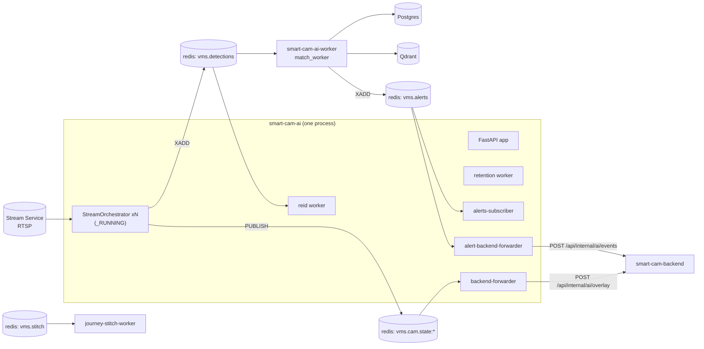
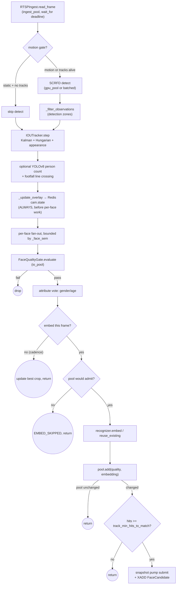
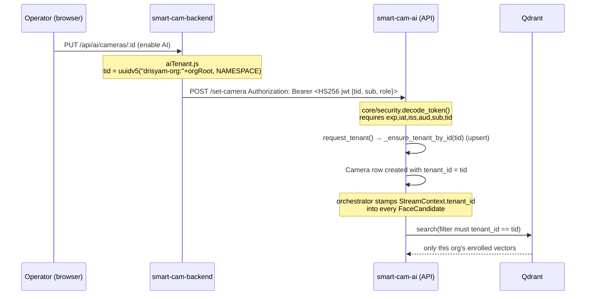
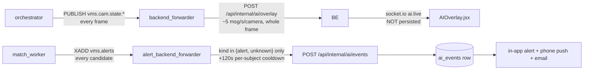

# The AI Service — `smart-cam-ai` / `vms_face`

This document is for engineers who need to **change** the face-recognition service: add an
analytic, swap a model, chase a "detection isn't working" ticket, or tune accuracy for a
site. It covers the layered Python package at `smart-cam-ai/app/face_detection/vms_face/`,
the three processes it runs as in the deployed stack, how frames become identities, and the
specific traps that have cost people a day. Everything here was read out of the code at
`harden/critical-fixes`; where the code and the shipped `README.md` disagree, the code wins
and the disagreement is called out.

Sibling docs: `smart-cam-ai/app/face_detection/vms_face/README.md` (operator/roadmap view),
`SERVICES.md` (per-component scorecard), `DETECTION_STRATEGY.md` (accuracy programme),
`docs/DETECTION_LOGGING_ALERTING_POLICY.md` (the canonical anti-flood doctrine).

---

## 1. Mental model

Three ideas explain almost every design decision in this service. If you internalise them
you can derive the rest of the file layout, the threading, and the failure modes.

### 1.1 One orchestrator per camera; nothing is global except the model

`StreamOrchestrator` (`pipeline/orchestrator.py`) is a per-camera object that owns an RTSP
connection, a tracker, a motion gate, a snapshot pump and a face-concurrency semaphore. It
runs as a single `asyncio` task. Cameras never share tracker state, never share a
back-pressure budget, and never share a reconnect backoff.

```python
# pipeline/orchestrator.py — one semaphore per orchestrator, deliberately not global
self._face_sem = asyncio.Semaphore(max(1, int(settings.pipeline_face_concurrency)))
```

The comment on that line states the reason: a global cap would let one busy camera starve
every quiet camera. The same reasoning produced the three named thread pools in
`core/executors.py` — `ingest` (256 threads, RTSP I/O), `gpu` (4 threads, inference
dispatch), `io` (32 threads, MinIO/OpenCV). Before the split, one stalled camera consumed a
slot that the GPU could have used.

The one genuinely shared thing is the ONNX runtime, keyed by detection input size:

```python
# infra/insightface_runtime.py
class FaceRuntimePool:
    _pool: "dict[int, FaceRuntime]" = {}
    _lock = threading.Lock()
```

`FaceRuntimePool.get()` is what keys the dict: it clamps the requested size to `>= 160` and
rounds it **up to the nearest multiple of 32** (SCRFD anchors are stride-aligned), so you
never end up with one runtime per unique pixel count. A 4K parking-lot camera at
`det_size=1280` and a doorway at `det_size=640` get *different* `FaceRuntime` instances, each
serialising its own `detect()` behind its own lock, so they dispatch in parallel.
`Camera.detection_input_size` is what selects the bucket.

### 1.2 Redis Streams decouple *seeing* from *recognising*

The orchestrator never touches Qdrant and never queries the gallery. It produces
`FaceCandidate` messages onto the Redis stream `vms.detections` and forgets about them.

```
orchestrator ── XADD vms.detections ──▶ match-workers group ──▶ Qdrant + Postgres + vms.alerts
                                   └──▶ reid-workers  group ──▶ track_links
```

This is the single most important structural fact about the service:

* **Detection is latency-critical, matching is not.** A GPU stall in the matcher cannot
  drop a frame; it just grows the stream.
* **Two consumer groups read the same stream independently.** `match-workers` does 1:N
  identification; `reid-workers` does cross-camera linking. Adding a third consumer of every
  detection is a new group name, not a new pipeline.
* **Workers are stateless and killable.** Redis' consumer-group machinery (`XAUTOCLAIM`,
  `XACK`, and the `vms.detections.dlq` dead-letter stream) covers crashes.
* A separate, *non-durable* channel carries the live overlay: `PUBLISH vms.cam.state:<id>`
  plus a `SETEX vms:cam:state:<id>` snapshot with a 30 s TTL, so a late subscriber can
  resync with one `GET`. See `infra/redis_bus.py` and `infra/detection_state.py`.

### 1.3 Every query is scoped by the JWT `tid` claim — never by a parameter

`core/security.py` defines the token contract. The `tid` claim is **required** by the
decoder, and `api/deps.py` is the only place that turns it into a tenant:

```python
# api/deps.py
def current_tenant_id(p: Principal = Depends(current_principal)) -> uuid.UUID:
    """Tenant scope of the current request — derived from the JWT claim, not
    a query string."""
    return p.tenant_id
```

That UUID becomes a mandatory Qdrant payload filter in `infra/qdrant.py::QdrantStore.search`:

```python
must = [FieldCondition(key="tenant_id", match=MatchValue(value=str(tenant_id)))]
```

There is no code path where a caller supplies its own `tenant_id` to a search. On the live
side the scope comes from `Camera.tenant_id`, stamped into the `FaceCandidate` by the
orchestrator's `StreamContext`. Cross-tenant reads return **404, not 403**, so a caller
cannot probe whether a person or camera exists in someone else's tenant (see
`api/routes/streams.py`, `api/routes/cameras.py`, `api/routes/persons.py::_person_or_404`).
Writes that must stay idempotent return a no-op instead of a 404 for the same reason
(`persons.py::forget_person`).

Section 8 traces the whole chain from the backend's token mint to the Qdrant filter, and
lists the two places in the legacy router where this rule is deliberately relaxed.

---

## 2. Where the code runs

The deployed stack (`docker-compose.drisyam-original.yml`) runs **one image**,
`drisyam/smart-cam-ai:latest`, as **three processes**:

| Container | Command | What it hosts |
|---|---|---|
| `smart-cam-ai` | `alembic upgrade head && uvicorn vms_face.api.main:app` | REST + WS API, **all per-camera orchestrators**, reid worker, retention worker, both backend forwarders, alerts subscriber, cam-state subscriber, footfall flusher, known-faces bootstrap |
| `smart-cam-ai-worker` | `python -m vms_face.workers.match_worker` | 1:N matching, `detection_events`, appearance log, `vms.alerts` |
| `journey-stitch-worker` | `python -m vms_face.workers.stitch_worker` | RQ worker: FFmpeg clip → concat → MP4 + PDF (no GPU) |

The API process is doing far more than serving HTTP. `api/main.py`'s `lifespan` starts every
background task, and orchestrators live in a process-local dict:

```python
# api/routes/streams.py
_RUNNING: dict[uuid.UUID, tuple[asyncio.Task, StreamOrchestrator]] = {}
```



**Consequence you will hit:** restarting the API kills every running stream, because the
orchestrator tasks live in that process. The deployed compose compensates with
`RESTART_ONLINE_STREAMS_ON_STARTUP: "true"`, which makes `_reconcile_streams()` re-launch
every camera whose row is `enabled=true` **and** `status=ONLINE`. The package default for
that setting is `False` (safer on a laptop; catastrophic on a demo box).

---

## 3. The layers and what belongs in each

The rule is a strict one-way dependency: `api` and `workers` → `services` and `pipeline` →
`infra` → `domain`/`core`/`config`. Nothing in `infra` imports from `services`; nothing in
`services` imports FastAPI.

| Layer | Owns | Examples | Does **not** contain |
|---|---|---|---|
| `config/` | One pydantic-settings class, all env parsing, cross-field validation | `settings.py`, `Settings.assert_consistent()` | Anything importable-with-side-effects |
| `core/` | Process-wide primitives: logging, metrics, tracing, JWT, crypto, thread pools | `security.py`, `executors.py`, `metrics.py`, `crypto.py` | Business rules |
| `domain/` | SQLAlchemy models, pydantic DTOs, enums, custom column types | `models.py`, `schemas.py`, `types.py::EncryptedString` | I/O |
| `infra/` | Adapters to *one* external system each | `qdrant.py`, `redis_bus.py`, `postgres.py`, `minio_store.py`, `insightface_runtime.py`, `person_detector.py`, `recognizers/` | Policy ("should we match this?") |
| `services/` | Pure-ish business logic, unit-testable | `face_quality.py`, `face_tracker.py`, `track_embedding_pool.py`, `face_matcher.py`, `enrollment.py`, `face_learning.py`, `motion_gate.py`, `detection_zones.py`, `reid.py` | HTTP, Redis wiring |
| `pipeline/` | The per-camera loop and its entrypoints | `orchestrator.py`, `ingest.py`, `run_stream.py`, `deepstream_bridge.py` | Route handlers |
| `api/` | FastAPI routers + dependency wiring | `main.py`, `deps.py`, `routes/*.py` | Inference math |
| `workers/` | Long-running consumers, one `python -m` entrypoint each (`run_worker()` / `run_retention_worker()`; the RQ stitch worker uses `main()`) | `match_worker.py`, `reid_worker.py`, `retention_worker.py`, `stitch_worker.py` | Shared mutable state |
| `journey/` | Forensic reconstruction: search, cluster, fuse, render, persist | `search.py`, `fusion.py`, `video.py`, `recordings.py`, `pdf.py` | Live-pipeline concerns |
| `eval/` | Offline accuracy measurement, no infra | `harness.py`, `frvt.py`, `metrics.py` | Anything that touches Qdrant |
| `alembic/` | Migrations (`0001`…`0006`) | | |

Two conventions worth knowing before you add a file:

* **Adapters are process-wide singletons behind a `get_*()` function**, guarded by a lock
  (`get_bus()`, `get_qdrant_enrolled()`, `get_recognizer()`, `get_person_detector()`,
  `FaceRuntimePool.get()`). If your new adapter is expensive, follow the pattern.
* **`get_person_detector()` returns `None` when misconfigured** rather than raising. Every
  optional model follows this: a missing ONNX file degrades the feature, it does not kill
  the orchestrator.

---

## 4. The live pipeline, stage by stage

All of this is `StreamOrchestrator.run()` → `_consume_loop()` → `_handle_tracked()`.



### 4.1 Ingest — `pipeline/ingest.py`

PyAV, not `cv2.VideoCapture`: lower CPU on RTSP, real PTS, and the ability to set FFmpeg
options. `open()` sets `rtsp_transport=tcp`, `reorder_queue_size=500`,
`fflags=+discardcorrupt+genpts+nobuffer`, `err_detect=ignore_err` and an 8 MB socket buffer
— all scar tissue from real MediaMTX logs full of `RTP packets lost` and `invalid FU-A
packet`.

Two behaviours matter more than the options:

* **Drop-old-frames reader thread** (`rtsp_drop_old_frames`, default on). A dedicated thread
  decodes at line rate and parks the newest frame in a single slot; `read_frame()` pops it.
  Without this, PyAV queues stale frames whenever the orchestrator is slower than the source
  and the video visibly falls behind real time. `_latest_dropped_count` counts overwrites
  and surfaces as `decode.frames_dropped_old` in `/streams/debug` — non-zero means the
  orchestrator is slower than line rate, which is fine, but tells you where the bottleneck is.
* **Throttling state lives on `self`, not on the generator.** The docstring records the bug:
  an earlier revision called `next(iter(frames()))` per read, which restarted the throttle
  every call, so `target_fps` was silently ignored and the GPU burned at source FPS.

Every frame pull is wrapped by the orchestrator in
`asyncio.wait_for(..., timeout=settings.pipeline_frame_timeout_sec)`. On timeout it
increments `FRAMES_DROPPED{reason="rtsp_stall"}`, sets `STREAM_HEALTHY=0` and raises
`StreamError`, which reopens the stream with exponential backoff (2 s → 30 s).

### 4.2 Motion gate — `services/motion_gate.py` (off by default)

A ~0.2 ms grayscale frame-difference check that skips the SCRFD call entirely. It is
recall-neutral because of three explicit rules, all in `should_detect()`:

1. Never skip while `active_tracks > 0` — a person standing perfectly still keeps their
   track alive, so only already-empty scenes are gated.
2. Never skip more than `motion_gate_max_skip_frames` (15 ≈ 2 s at 8 fps) in a row.
3. Any measured motion re-enables detection on the *next* frame, because the check runs
   every frame.

Deliberately simpler than MOG2: no model to warm up, and gradual lighting change never
exceeds the per-frame delta so it does not rot.

### 4.3 Detect — `infra/insightface_runtime.py`

`FaceRuntime` wraps insightface `FaceAnalysis` with a per-instance lock. Three things are
non-obvious:

* **`allowed_modules` is computed, not fixed.** The 106-point and 3D-68 landmark heads
  (~150 MB) are not loaded because nothing reads them — SCRFD's own `kps` supplies the
  5 points the recognizer aligns on. The `genderage` head is also excluded from
  `FaceAnalysis.get()` by default, because the orchestrator now calls it on demand
  (§4.7).
* **CUDA failures self-heal.** `_is_cuda_failure()` sniffs the exception message for
  `CUDA`/`CUBLAS`/`cuDNN` tokens; only those degrade to CPU. Genuine bugs propagate, on
  purpose — the comment says a real bug hidden behind a CPU-fallback latch is far harder to
  debug. `_maybe_repromote_cuda()` retries CUDA after `insightface_cuda_retry_sec`.
  `vms_runtime_degraded` and `detector_degraded_to_cpu` in `/streams/debug` expose the state.
* **The pose head is often absent.** `_record_pose_capability()` probes once on the first
  non-empty detect and sets the `vms_detector_pose_available` gauge. When it is 0, the
  quality gate's yaw/pitch filter is silently a no-op — this is a documented accuracy gap,
  not a bug you can fix in the gate.

`detect()` also accepts a per-call `det_thresh` override, restored in `finally` under the
same lock. That is how forensic query photos get a permissive floor (`journey/embed.py` uses
0.30) while the live pipeline keeps its strict one.

**Batched detect** (`pipeline_batched_inference`) coalesces in-flight frames across cameras
into one ONNX call via `infra/batcher.py::AsyncBatcher` + `infra/batched_scrfd.py`, which
re-implements SCRFD's letterbox/decode/NMS against the already-loaded `app.det_model`. It
latches itself off permanently (`_batched_unavailable`) if the detector is not SCRFD or
insightface's internals moved. It is **incompatible with the default recognizer** — see §12.

### 4.4 Detection zones — `services/detection_zones.py`

Operator-drawn line / box / polygon shapes, stored normalised 0..1 in
`Camera.config_json["detection_zones"]` so they survive a resolution change. `bbox_zone()`
tests the face bbox *centroid* (for `target="person"` it tests the bottom edge — feet).

The filter runs **before** `tracker.step()`:

```python
observations = self._filter_observations(frame, observations)
tracked = self._tracker.step(observations)
```

That ordering matters: an out-of-zone face is invisible to the tracker, so a person walking
into a zone gets a **brand-new track**, and therefore pays the `track_min_hits_to_match`
warm-up again. If you ever need continuity across the zone boundary, you must filter after
tracking, not before.

### 4.5 Tracking — `services/face_tracker.py`

Despite the class name `IOUTracker` (kept because every caller imports it), this is SORT
with a DeepSORT-style appearance term:

* Constant-velocity Kalman filter on `[cx, cy, s, r]`.
* Cost matrix `= (1-w)·(1-IoU) + w·(1-cosine)` where `w = tracker_appearance_weight` (0.4),
  solved with `scipy.optimize.linear_sum_assignment`.
* Appearance similarities come from a single matmul over the tracks/detections that *have*
  embeddings, written back into the dense matrix by boolean mask — not a T×D Python loop.
* **IoU gates everything.** `cost[iou < iou_threshold] = 1e9`, so appearance can refine an
  assignment but can never create a physically implausible one.
* `update_appearance()` exists because on the AdaFace path `FaceObservation.embedding` is
  `None` at `step()` time; the orchestrator feeds the embedding back after the recognizer
  runs, otherwise the appearance term would stay empty for the track's whole life.

### 4.6 Quality gate — `services/face_quality.py`

The gate is the first precision guard and the cheapest. It runs on the `io_pool` (it is
cv2-bound) and rejects in this order, each with a `vms_quality_rejects_total{reason=...}`
label: **too small → low det_score → extreme pose → blurry → brightness**. Survivors get a
composite score:

```python
composite = 0.45*det_score + 0.25*size_score + 0.20*blur_score + 0.10*bright_score
```

That score is the currency of the whole downstream system: it weights the embedding pool, it
weights the gender/age vote, it decides which crop becomes the snapshot, and the match
worker re-checks it against `match_min_quality`.

The Laplacian and mean are computed on a 64×64 downsample of the crop when it is bigger than
96 px — both metrics are robust to that, and it is ~10× cheaper on large faces.

> **Naming trap:** the setting is called `quality_max_blur_var` but it is used as a
> *minimum*: `if self.max_blur_var > 0 and blur_var < self.max_blur_var: reject`. Default is
> `0.0`, i.e. **blur rejection is off by default**.

### 4.7 Attribute vote — `services/track_attributes.py` + `infra/genderage.py`

buffalo_l's genderage head is a per-crop classifier; on a real CCTV crop its output flips
between Male and Female frame to frame. Publishing that makes the overlay flicker and any
demographic count meaningless. The fix is the same shape as the embedding pool: each
quality-passing observation casts a vote weighted by `verdict.score`, and a label is asserted
only after `attributes_min_votes` votes with `attributes_min_agreement` of the weighted mass
on one side. Until then the label is `None` and the UI shows nothing.

Cost is bounded: `attrs.needs_sample()` stops sampling at `attributes_max_votes`, or earlier
at 90 % agreement (`_EARLY_STOP_AGREEMENT`). That turns genderage from O(faces × frames)
into O(1) per track — track it with `vms_genderage_calls_total` vs `vms_detections_total`.
It is also the *only* way gender works under batched inference, since the batched SCRFD path
never runs attribute heads.

### 4.8 Embed gating and the pre-embed pool guard

Two independent gates decide whether the recognizer runs at all.

```python
# 1. cadence — per TRACK, not per frame index
warm_up = pool.size < pool.top_k
tf.track.frames_since_last_embed += 1
if not warm_up and tf.track.frames_since_last_embed < embed_every_n:
    self._tracker.update_quality(...); return
```

A new track embeds on every quality-passing frame until its pool is full (so a new identity
can be matched within ~`min_hits` frames), then drops to every Nth. The counter is
**track-local** on purpose: the old `frame.seq % N` gate fired on the same frames for every
track, bursting the GPU and leaving it idle in between.

```python
# 2. pre-embed pool guard
if tf.observation.embedding is None and not pool.would_admit(verdict.score):
    EMBED_SKIPPED.labels(camera_id=..., reason="pool_saturated_lower_quality").inc(); return
```

If the pool is full and this crop cannot beat its worst member, the pooled embedding cannot
change, so running the recognizer is pure waste. Note the `embedding is None` condition: on
the default `insightface_arc` backend the embedding already came free from detection, so
**this guard never fires in the default configuration** (§12).

### 4.9 Track embedding pool — `services/track_embedding_pool.py`

The biggest accuracy lever in the service that does not involve changing models. A min-heap
of the K highest-quality embeddings for one track; `pooled()` returns the quality-weighted
average, re-L2-normed (the mean of unit vectors is not a unit vector, and Qdrant cosine
requires normed input).

Why: even a good recognizer misses a known face on 30–50 % of CCTV frames due to blur,
occlusion, pose or compression. Matching against the pooled vector recovers most of them.

Two guards live here:

* `track_pool_min_quality` (0.30) — a hard floor. A track that only ever produced quality-0.2
  crops publishes **nothing** rather than a garbage pooled embedding, because a garbage
  embedding produces confident-looking *wrong* matches downstream, which is worse than
  silence.
* `add()` returns `True` only when the pool actually changed, and the orchestrator returns
  early when it did not — no point re-querying Qdrant for an unchanged vector.

### 4.10 Publish

Only after `pool` changed **and** `tf.track.hits >= settings.track_min_hits_to_match` does the
orchestrator emit. It writes a deterministic snapshot URI, hands the crop to the bounded
`SnapshotPump` (fire-and-forget; on overflow the *oldest* queued upload is dropped, because
freshness beats completeness for live evidence), and XADDs a `FaceCandidate`:

```python
candidate = FaceCandidate(
    tenant_id=..., camera_id=..., track_id=tf.track.track_id,
    bbox=[...], det_score=..., quality_score=verdict.score,
    embedding=pooled.tolist(),          # the POOLED vector, not this frame's
    snapshot_uri=f"s3://{bucket}/{key}",
    extra={"camera_code":…, "face_px":…, "blur_var":…, "yaw":…, "gender":…, "pool_size":…},
)
await self._bus.publish_detection(candidate.model_dump(mode="json"))
```

The `_crop_with_padding()` helper pads far more **below** the face than above (defaults
0.7× above, 4.5× below, 1.0× sideways) so the snapshot shows the person's posture and
context, not a floating head — operator feedback, and the face stays at the top of the crop
so watchlist face-enhancement still works.

> **Behavioural subtlety:** because publishing is gated on *pool improvement*, a person who
> stands still in front of a camera for two minutes generates a burst of candidates while
> their pool fills, then goes quiet. `detection_events` is a log of "we learned something
> new about this track", **not** a per-frame presence log. If you need continuous presence,
> use the cam-state overlay or the people-count block, not `detection_events`.

### 4.11 Overlay, snapshots and people counting

`_update_overlay()` runs **before** the per-face fan-out, so the UI gets boxes within one
detect+track latency even when a crowded frame makes the quality/embed work slow. It
publishes `boxes` (tracks observed *this* frame, all named `"Unknown"`) plus
`active_tracks` (tracks the Kalman filter is keeping alive through a blink) and
`persons_present` (YOLO count, when enabled).

`infra/detection_cache.py` turns that into the `people` block, taking
`max(persons_present, visible_faces)` as the total and applying a 2 s rolling **max**
(`_COUNT_SMOOTH_WINDOW_SEC`). Use `smoothed_total` in any UI: the raw `total` drops to 0 for
~125 ms whenever the detector misses one frame.

Names arrive later and asynchronously: `infra/alerts_subscriber.py` tails `vms.alerts` inside
the API process and calls `cache.patch_name(camera_id, track_id, name, conf)`. Subsequent
per-frame writes carry the now-known name forward. That is why a box says "Unknown" for the
first second and then flips to a name.

---

## 5. The workers

| Worker | Consumes | Produces | Runs where | Failure policy |
|---|---|---|---|---|
| `match_worker` | `vms.detections`, group `match-workers` | `detection_events`, `audit_log`, `face_learning_samples`, Qdrant appearance point, `vms.alerts` | own container | DLQ + `XAUTOCLAIM` |
| `reid_worker` | `vms.detections`, group `reid-workers` | `track_links` | inside the API process (`reid_worker_enabled=True`) | best-effort, acks always |
| `retention_worker` | wall clock (hourly) | deletions in Postgres / MinIO / Qdrant | inside the API process | per-target try/except, never fatal |
| `stitch_worker` | RQ queue `vms.stitch` | MP4 + PDF in MinIO, `journeys` + `journey_stops` rows, `journey.events` | own container | job hash records `failed_reason` |

### 5.1 Match worker — `workers/match_worker.py`

The identity brain. Per candidate:

1. **Matchability pre-filter** — `_candidate_matchable()` checks `match_min_quality`,
   `match_min_face_px` and `match_min_blur_var`. A candidate that fails is *not* discarded;
   it is processed as a miss (`MatchResult(person_id=None, similarity=0.0)`) so the event row
   still exists. Skipping the Qdrant call is the point.
2. **1:N with a margin guard** — `services/face_matcher.py::match_one`:

   ```python
   floor = max(0.0, self._threshold - self._margin) if self._margin > 0 else self._threshold
   results = await self._enrolled.search(
       tenant_id=…, vector=…,
       top_k=3 if self._margin > 0 else 1,     # neighbours only when the guard is on
       score_threshold=floor,
   )
   ...
   if rival is not None and (top["score"] - rival["score"]) < self._margin:
       return MatchResult(person_id=None, similarity=top["score"], ambiguous=True)
   ```

   It deliberately searches *below* the threshold so it can see a rival identity sitting just
   under it. In a dense scene two enrolled people can both land near a live face; asserting
   the top one is a coin flip, so below `match_top1_margin` (0.06) the answer is "unknown".
   The outcome is visible as `vms_matches_total{outcome="ambiguous"}`.
3. **One Postgres transaction** for the `Person` lookup, the `DetectionEvent` insert, the
   DPDP audit row (only on a hit — misses are already in `detection_events`), and the
   face-learning sample.
4. **Event kind**: `UNKNOWN` when no person, `ALERT` when `person.role == BLACKLIST`, else
   `MATCH`.
5. **Appearance upsert outside the transaction**, so a Qdrant hiccup cannot roll back the
   event. It forwards `body_vec`, `upper_color`, `yaw`, `face_px`, `quality_score` into the
   payload so forensic body fusion has something to work with.
6. **Publishes to `vms.alerts` for every candidate**, including plain matches. Downstream
   consumers decide what is worth persisting (§9).

Resilience is worth reading before you touch it: `_safe_process` routes any exception onto
`vms.detections.dlq` with the error string and original entry id, then ACKs — poison messages
no longer disappear silently. `_autoclaim_loop` reclaims entries idle in a dead consumer for
longer than `match_worker_autoclaim_min_idle_ms` (60 s).

### 5.2 ReID worker — `workers/reid_worker.py` + `services/reid.py`

Joins its **own** consumer group so it sees every candidate rather than competing with the
matchers. For each candidate it searches the appearance collection within
`reid_window_sec` (600 s), above `reid_min_similarity` (0.55), excluding same-camera hits
newer than `reid_same_camera_dedup_sec` (30 s) — those are intra-camera tracks the local
Kalman tracker should already have merged, so linking them would double-count.

Matches become `track_links` rows, unique on `(a_track, a_camera, b_track, b_camera)` so
re-emission is a no-op. Connected components of that undirected graph are a global identity;
`services/reid.py::expand_global_identity` walks it for the journey map.

The worker is explicitly best-effort: it acks on failure, relying on the redundancy of
multi-frame fusion to give the next candidate another chance.

### 5.3 Retention worker — `workers/retention_worker.py`

DPDP Act 2023 housekeeping, hourly, idempotent. Prunes `detection_events` older than
`retention_event_days` (90), `audit_log` older than `retention_audit_log_days` (365), MinIO
snapshots older than `retention_snapshot_days` (7) using the object's `last_modified` (not
the key's timestamp), and appearance points via Qdrant's range delete on `occurred_at_ts`
— those reuse `retention_event_days`, there is no separate appearance setting.
Each target is independently wrapped in try/except: one failing store never stops the others.

`QdrantStore.delete_older_than()` counts before and after and returns the real delta, but
`_prune_appearance_qdrant()` throws that number away and does a bare `.inc()`. So
`vms_retention_deleted_total{target="appearance_qdrant"}` counts **sweeps, not points** —
unlike the other three targets, which increment by their actual row/object counts. Worth
fixing if you ever chart it; don't read it as a volume.

### 5.4 Stitch worker — `workers/stitch_worker.py`

RQ (not Redis Streams — it needs job status, retries and a 30-minute timeout). Given a list
of `Sighting`s it extracts one clip per sighting from `/recordings`, burns in a label,
concatenates, uploads the MP4, renders a PDF, persists a `Journey` + `JourneyStop` rows and
emits a `journey.stitched` Kafka event.

Three budget guards, each solving a real "the video is 25 minutes long" complaint:
`stitch_max_clips` (12 highest-confidence stops, re-sorted chronologically),
`clip_max_sec` (20 s per stop), `stitch_max_total_sec` (600 s overall). It is idempotent on
RQ retry: a job already `done` with a `journey_id` returns immediately, otherwise a retry
would mint a duplicate Unknown person and a duplicate journey.

It also calls `get_object_store().ensure_bucket(...)` in `main()` because it never runs the
FastAPI lifespan that normally creates buckets.

---

## 6. Enrollment and the gallery

### 6.1 The single-image path — `services/enrollment.py`

```
decode → detect (max_faces=1, largest) → quality gate → embed via the *configured recognizer*
       → upload crop to MinIO → Qdrant upsert → FaceEnrollment row → audit_log
```

Two details are load-bearing.

**Embedding must go through `Recognizer`, not the detector.** `enroll_image` calls
`self._recognizer.reuse_existing(obs.embedding)` first and falls back to
`self._recognizer.embed(frame, obs.landmark_5)`. This is what keeps gallery vectors in the
same embedding space as live queries. Bypassing it — e.g. grabbing `obs.embedding`
directly — would silently poison the gallery the moment someone switches to AdaFace.

**`_decode_image()` is PIL-first, and every upload surface funnels through it.** The comment
records both bugs it fixes: EXIF orientation (a portrait iPhone photo decodes sideways under
`cv2.imdecode`, SCRFD finds nothing, and the user reports "clear photo but no face
detected") and HEIC/HEIF, which cv2 cannot read at all. Enrollment, journey search, face
search and `/api/embed/face` all use it, so both fixes land product-wide.

### 6.2 The lockstep Postgres ↔ Qdrant write

Ordering is **Qdrant first, Postgres second**, and the code says why:

```python
# Upsert into Qdrant first, then write the DB row referencing it.
# On DB failure we'll have an orphan vector — Phase 4 adds a janitor.
point_id = uuid.uuid4()
await self._qdrant.upsert(point_id=point_id, vector=embedding.tolist(),
                          tenant_id=person.tenant_id, person_id=person_id,
                          payload={"full_name":…, "role":…, "source":…, "recognizer":…})
enrollment = FaceEnrollment(person_id=person_id, qdrant_point_id=point_id, …)
```

The `qdrant_point_id` column is the join key, and it is `unique=True`. The chosen failure
mode is an **orphan vector** (a Qdrant point with no DB row) rather than a **dangling row**
(a DB enrollment whose vector does not exist). An orphan vector can still match — mildly
wrong. A dangling row means a person appears enrolled in the UI and is never recognised —
much worse, and much harder to diagnose. There is no janitor yet; that is a real gap.

`repair_enrollment_vector()` is the recovery path: it re-embeds an image and upserts to the
**existing** `qdrant_point_id`, preserving the row. `known_faces_bootstrap` calls it when it
finds a DB enrollment whose Qdrant point has vanished (e.g. after a collection rename).

### 6.3 Bulk paths

| Path | Endpoint / entry | Tenant | Person name from | Idempotency |
|---|---|---|---|---|
| ZIP of folders | `POST /upload-dataset` (legacy router) | caller's JWT `tid` | parent folder name, else filename stem | none — re-uploading adds more embeddings |
| On-disk folder | `services/known_faces_bootstrap.py`, run from the API lifespan | **default tenant only** | filename with a trailing `_<n>` stripped | `FaceEnrollment.source = "bootstrap:<file>:<sha256[:8]>"` |
| Single photo | `POST /upload` (legacy) or `POST /persons/{id}/enrollments` | caller's JWT `tid` | form field / existing person | none |

Adding *more* embeddings per person is desirable — recall improves — so the lack of
idempotency on the upload paths is not a bug. The bootstrap path is idempotent because it
runs on every API boot.

The bootstrap deliberately uses a **permissive quality gate**
(`max_yaw_deg=180`, `max_pitch_deg=180`) because the `known_faces/` folder holds curated
photos where a slightly off-axis subject is fine, whereas the live gate exists to stop bad
CCTV detections polluting the gallery.

### 6.4 Supervised face learning — `services/face_learning.py`

The live pipeline can strengthen the gallery with real CCTV-condition crops without
retraining anything. When the match worker sees a **confirmed** match that is also high
quality, it writes a `face_learning_samples` row with `status="pending"`. Pending rows do
**not** affect recognition. An operator approves via
`POST /face-learning/samples/{id}/approve`, which upserts the embedding into the enrolled
collection with `source="auto-learning"` and creates a `FaceEnrollment`.

Seven independent brakes stop this from becoming a self-poisoning loop:
`face_learning_min_similarity` (0.68), `..._min_quality` (0.60), `..._min_face_px` (96),
`..._min_blur_var` (45.0), `max_samples_per_track` (6), `max_pending_per_person` (100), and a
near-duplicate check (`cosine >= 0.985` against the last 50 samples for that person). The
deployed compose loosens the first four to `0.50 / 0.45 / 60 / 20.0` in **both** the
`smart-cam-ai` and `smart-cam-ai-worker` blocks; because `maybe_queue_sample` runs *in the
worker*, the worker's copy is the one that actually decides, and the two blocks have to be
kept in sync by hand.

This is the intended fix for "the studio photo matches but live CCTV crops don't" — you
enrich the gallery with the camera's own conditions instead of loosening the threshold.

---

## 7. The two Qdrant collections

`infra/qdrant.py` runs one `QdrantStore` per collection, both 512-D cosine.

| | `vms_enrolled` | `vms_appearance` |
|---|---|---|
| Setting | `qdrant_collection_enrolled` | `qdrant_collection_appearance` |
| One point per | enrolled face image (`FaceEnrollment`) | detection event |
| Size | thousands | millions, growing linearly with camera-hours |
| Write rate | operator-driven, rare | ~1/s/camera, sustained |
| Read pattern | 1:N, top-1..3, latency-critical, on the live path | forensic scan, top-K up to 5000, time-windowed |
| Payload | `person_id`, `full_name`, `role`, `source`, `recognizer` | `camera_id`, `event_id`, `occurred_at_ts`, `track_id`, `person_id?`, body/pose extras |
| Lifecycle | deleted by right-to-erasure | pruned by the retention worker (`delete_older_than`) |
| Written by | `services/enrollment.py`, `services/face_learning.py` | `services/face_matcher.py::log_appearance` (match worker) |

**Why they must stay separate.** The read patterns diverge sharply: the gallery wants a
small, hot, replicated index optimised for p99 latency on the live path; the appearance log
wants a large, time-partitioned, prunable index where a 200 ms forensic query is fine.
Merging them means the live 1:N search pays HNSW costs proportional to millions of forensic
points, and time-based pruning has to skip enrolled vectors. The lifecycles are also
different — the retention worker range-deletes appearance points wholesale, which would be
catastrophic against a shared collection.

Both share the same payload indexes (`tenant_id`, `person_id`, `camera_id`, `role`,
`occurred_at_ts`), and `ensure_collection()` validates an existing collection's vector size
and distance against settings, raising rather than silently ranking wrong.

The appearance write is best-effort (`log_appearance` catches, logs and returns `None`), and
gated on `qdrant_appearance_enabled` + `match_worker_appearance_log`.

---

## 8. Multi-tenancy: from `tid` to a Qdrant filter



**The backend side** (`smart-cam-backend/src/utils/aiTenant.js`): tenancy is per
*organisation*, not per user. The org root is `user.parentUserId || user.id`, and the tenant
UUID is a deterministic `uuidv5` of it against a fixed namespace constant. The comment is
emphatic that the namespace must never change — doing so re-maps every org to a new tenant
and orphans every enrolled face.

**The AI side**: `decode_token()` validates signature, `iss`, `aud`, `exp` and *requires*
`tid`; a token without it is rejected, not defaulted. `api/deps.py::current_tenant_id` is the
only supplier of tenant scope for protected routes. `legacy.py::request_tenant` upserts the
tenant row on first contact (`_ensure_tenant_by_id`) because the backend mints a `tid` for an
org that may never have touched the AI before.

**Scope is never a parameter.** The docstring on `current_tenant_id` is explicit that routes
which used `tenant_id: uuid.UUID = Query(...)` were migrated to the dependency. Cross-tenant
access returns 404 (`streams.py`, `cameras.py`) or an idempotent no-op
(`persons.py::forget_person`, which also audits `cross_tenant_attempt: True`).

### Where the rule is relaxed — read this before you assume isolation

Three legacy-router surfaces intentionally look across tenants, because they serve the
no-JWT live preview:

```python
# api/routes/legacy.py::_lookup_camera_by_monitor_id
# Matched by `code` across ALL tenants: the code is the backend's globally
# unique monitorId, and this powers the no-JWT live-preview endpoints
rows = await session.execute(select(Camera).where(Camera.code == monitor_id))
```

* `GET /api/detections/{monitor_id}`, `WS /ws?camera_id=`, `POST /stop-camera` — resolve
  through `_lookup_camera_by_monitor_id`, i.e. by `code` across all tenants.
* `GET /api/cameras/{monitor_id}/snapshot.jpg` and `/mjpeg` don't resolve a camera at all:
  they read the process-local `SnapshotCache`, which the orchestrator keys by
  `camera_code`. No DB lookup, no tenant check — anyone who can reach the legacy router
  and guess a monitorId gets that camera's live JPEG.
* `GET /status` selects **every** `Camera` row with no tenant filter.
* `GET /api/people-count` aggregates the process-local cache across all cameras.

`GET /logs` *is* tenant-scoped, with a comment naming the cross-tenant alert leak of
2026-07-29 that forced the fix. Tenant-sensitive aggregation for customer-facing pages is
done in `smart-cam-backend`, not here. If you add a new legacy endpoint that returns
anything richer than a bounding box, scope it.

**Dev bypass.** `dev_bypass_allowed()` is `settings.vms_env == "dev" and
settings.vms_jwt_dev_bypass`. It cannot be enabled in stage/prod regardless of the flag.
When on, unauthenticated requests bind to the *default* tenant and the legacy router accepts
calls with no `X-API-Key`. `/healthz` reports `auth.mode` as `dev-bypass` / `jwt` /
`MISCONFIGURED`, and the API logs a loud banner at boot. The deployed compose runs with
`VMS_ENV=dev` + `VMS_JWT_DEV_BYPASS=true`.

---

## 9. The two emission channels back to the backend

This is the anti-flood design, and it is the part most likely to be broken by a
well-intentioned change.



| | Ephemeral overlay | Persisted alerts |
|---|---|---|
| Module | `infra/backend_forwarder.py` | `infra/alert_backend_forwarder.py` |
| Source | Redis pub/sub `vms.cam.state:*` | Redis stream `vms.alerts` |
| Backend endpoint | `POST /api/internal/ai/overlay` | `POST /api/internal/ai/events` |
| Backend behaviour | emits socket `ai.live` and **drops it** | writes an `ai_events` row, then push/email |
| Rate control | whole-frame throttle, `backend_overlay_min_interval_sec` = 0.2 s per camera | per-`(user, camera, kind, subject)` cooldown, `backend_alert_cooldown_sec` = 120 s |
| Volume shape | O(cameras × 5/s), constant | O(distinct subjects), bursty |
| Loss tolerance | total — a dropped frame is invisible | one dropped alert = one missed notification |

The module docstring records exactly why the split exists:

> An earlier version POSTed one persisted `ai_events` row per box, which flooded the alerts
> panel with "warning" rows. Live overlay boxes are display-only and must never become
> alerts.

Note what is **not** forwarded: `kind == "match"` — a recognised, non-blacklisted person.
Routine recognition rides the overlay channel only. Persisting a row per recognised face is
precisely what flooded the panel once.

Two more details in the overlay forwarder that look arbitrary and aren't:

* **A "cleared" frame always bypasses the throttle.** `is_clear_edge` lets the first
  empty-box frame through immediately, otherwise a box would linger on screen for up to
  200 ms after the person left.
* **Age is never sent, and gender only above `backend_overlay_min_gender_conf` (0.85)** —
  higher than the AI's own assertion floor of 0.70, because a wrong M/F on a live face reads
  worse to an operator than no label at all.

---

## 10. How do I…

### 10.1 …add a new analytic

Decide first which of the three shapes it is. Getting this wrong is the main source of pain.

| Shape | Example | Where it goes |
|---|---|---|
| **Per-frame, cheap, drives a count/overlay** | person count, motion, line crossing | `infra/<model>.py` + a call in `_consume_loop`, surfaced through `_update_overlay` |
| **Per-face, changes what gets published** | occlusion/mask classifier, head pose | `services/<name>.py`, called from `_handle_tracked` before the embed gates |
| **Per-candidate, needs identity or history** | loitering, tailgating, cross-camera rules | a **new worker** with its **own consumer group** on `vms.detections` |

For the third shape — which is usually the right answer — the recipe is:

1. Copy `workers/reid_worker.py` as the skeleton. It is the smallest complete example:
   own consumer group, semaphore, heartbeat, ack-in-`finally`, `run_worker(stop)` signature.
2. Add `<name>_consumer_group` to `config/settings.py`. **Do not reuse `match-workers`** —
   sharing a group means you and the matcher split the stream and each sees half the
   detections.
3. Consume via the generic iterator, which already exists:
   ```python
   async for entry_id, payload in bus.consume_detections_as(settings.my_consumer_group, consumer):
       candidate = FaceCandidate.model_validate(payload)
   ```
4. Persist to your own table (add an Alembic revision in `alembic/versions/`) — do not widen
   `detection_events`.
5. If it should alert, **publish to `vms.alerts` with a new `kind`** and add that kind to
   `_KIND_MAP` in `infra/alert_backend_forwarder.py`. Do not POST the backend directly; you
   would bypass the cooldown and re-create the flood.
6. Register it: either add a `background.append(asyncio.create_task(run_my_worker(stop_signal)))`
   in `api/main.py`'s lifespan (cheap, in-process) or a new compose service reusing
   `drisyam/smart-cam-ai:latest` with `command: ["python","-m","vms_face.workers.my_worker"]`
   (anything GPU- or CPU-heavy).
7. Add metrics to `core/metrics.py` following the `vms_*_total` / `vms_*_seconds` naming.

**Verify:** `docker compose -p drisyam-original logs -f <service>` should show your worker's
startup line; `curl localhost:8001/metrics | grep vms_my_` should show non-zero counters
within a minute of a person walking past a camera.

For the per-frame shape, mirror `infra/person_detector.py` exactly: module-level singleton,
`get_*()` returns `None` when disabled or the model file is missing, run every N frames on
`get_gpu_pool()`, cache the last value between runs so the UI doesn't blink.

### 10.2 …add a new recognizer backend

The seam is the `Recognizer` protocol in `infra/recognizers/base.py` — three methods:

```python
class Recognizer(Protocol):
    embedding_dim: int
    name: str
    def embed(self, frame_bgr, landmarks_5) -> np.ndarray | None: ...
    def reuse_existing(self, existing) -> np.ndarray | None: ...
    async def embed_async(self, frame_bgr, landmarks_5) -> np.ndarray | None: ...
```

Steps:

1. Add `infra/recognizers/<name>.py`. Copy `adaface.py`: ONNX Runtime session, `norm_crop`
   alignment from `infra/aligner.py` using the 5-point landmarks, an `AsyncBatcher` for
   `embed_async`, and **L2-normalise the output** (Qdrant cosine assumes it).
2. Return `None` from `reuse_existing()` unless your model is genuinely the same one that
   produced the detector's embedding. Returning the ArcFace vector from a non-ArcFace
   recognizer silently mixes embedding spaces.
3. Register it in `infra/recognizers/factory.py::build_recognizer`, raising
   `ConfigurationError` when its model path is missing.
4. Add a threshold setting and wire it into `Settings.effective_recognizer_threshold()`.
   **Do not reuse `insightface_rec_threshold`.** ArcFace same-identity cosines sit around
   0.55–0.70; AdaFace's sit around 0.30–0.45. One shared threshold guarantees one backend is
   wrong.
5. If your model is not 512-D, give it its **own Qdrant collection** — the protocol docstring
   says so, and `ensure_collection()` will refuse to reuse a collection with a different
   vector size.
6. If the model cannot be driven by the batched SCRFD path, extend
   `Settings.assert_consistent()` the way the insightface case is handled.

**Then re-enroll everything.** Embeddings from different models are not comparable; a
gallery built with ArcFace is meaningless to AdaFace. See §12.

**Verify:** `python -m vms_face.eval.harness --recognizer <name> ...` (§10.3) against the same
probe set you ran the incumbent on, and compare FNIR @ FPIR=1e-3, not TPR.

### 10.3 …run the eval harness

`eval/harness.py` is deliberately infra-free: no Qdrant, no Postgres, no Redis. Pure NumPy
cosine over an in-memory gallery, so the number you get measures the *model*, not the
deployment.

```bash
# inside the container (the models and CUDA live there)
docker compose -p drisyam-original exec smart-cam-ai \
  python -m vms_face.eval.harness \
    --gallery /srv/data/eval/gallery \
    --probe   /srv/data/eval/probe \
    --manifest /srv/data/eval/manifest.csv \
    --threshold 0.45 \
    --recognizer insightface \
    --out /srv/data/eval/report_arcface
```

* **Gallery layout**: a **flat** folder (`load_gallery` does not recurse), one file per
  image, named `{person_id}__{anything}.jpg` — `alice__angle1.jpg`, `alice__angle2.jpg`,
  `bob__1.png`. The person id is everything before the first `__`; files whose stem starts
  with `unknown__` are skipped, because those belong in the probe set. All images for a
  person are averaged into a centroid embedding and re-normed.
* **Probe layout**: either a `manifest.csv` with `path,true_person_id,scenario,camera` (leave
  `true_person_id` empty for an open-set unknown; `path` is resolved relative to the CSV),
  or filenames shaped `{id_or_unknown}__scenario=X__camera=Y.jpg`. `--probe` is a **required**
  option that must point at an existing directory even when you pass `--manifest` — the
  manifest wins for the record list, but typer still validates the flag.
* **Read the FRVT block, not the TPR.** `eval/frvt.py` computes **FNIR @ FPIR = 1e-3** — the
  fraction of enrolled people missed, at the threshold where at most 1 in 1000 unknowns
  produces any match. It removes the threshold from the argument and maps directly to "false
  alerts per 1000 strangers". `write_reports()` emits JSON + text + HTML into `--out`.
* **Your probe set must be open-set.** Roughly 30 % of probes should be people who are *not*
  enrolled; real surveillance always is, and a closed-set score flatters every model.

A/B two recognizers by running it twice with `--recognizer` and diffing the JSON. There is no
CI gate on this yet (roadmap item O2) — running it before and after any change to detection,
quality gating or recognition is currently a manual discipline.

### 10.4 …enroll faces in bulk

**Preferred — ZIP upload, correct tenant:**

```bash
# folder-per-person inside the zip: Alice/1.jpg, Alice/2.jpg, Bob/x.png
curl -X POST http://localhost:8001/upload-dataset \
     -H "Authorization: Bearer $ORG_JWT" \
     -F "file=@people.zip"
# → {"ok":true,"tenant":"<uuid>","persons":12,"enrolled":47,"skipped":3,"by_person":{...},"errors":[...]}
```

Sub-folder name becomes the person's name; loose images at the archive root use their
filename stem. Bad images are counted and skipped, never fatal — each failure rolls back only
its own row. The JWT decides the tenant, which decides whose gallery the live pipeline will
match against.

**On-disk folder, default tenant only:** drop files into `$KNOWN_FACES_DIR`
(`/srv/app/face_detection/vms_face/data/known_faces` in the deployed compose) named
`<Person Name>_<n>.jpg`, then `POST /reload-known-faces`. Check the result with
`GET /known-faces-status`. This path always writes to the **default** tenant — it predates
per-org tenancy and is the wrong tool for a customer.

**Verify either way:** `GET /faces` (with the same JWT) returns each person and their image
count. If a name shows `images: 0`, the images were rejected — the API log line
`known_faces: skipped` or the `errors[]` array names the reason (`no face detected` vs
`face quality rejected: <reason>`).

More images per person is strictly better for recall; there is no dedup penalty.

### 10.5 …debug "detection isn't working"

Work outside-in. Each step has a distinct symptom.

**Step 0 — is auth even letting the call through?**

```bash
curl -s localhost:8001/healthz | jq '.auth, .pipeline'
```

`auth.mode: "MISCONFIGURED"` means every protected route returns 503, and the backend
translates that to a 502 the user sees as "AI service is not reachable".

**Step 1 — is the orchestrator running and is anything flowing?** This is the single most
useful endpoint in the service:

```bash
curl -s localhost:8001/streams/debug | jq
```

| Symptom in `/streams/debug` | Diagnosis |
|---|---|
| `streams: []` | `/set-camera` never started an orchestrator. Look for a 401/exception on the start path in the API log. |
| `task_done: true` + `task_exception` | The orchestrator crashed; the exception names the stage. |
| `frames_ingested_total: 0` after 10 s | RTSP unreachable. Confirm with `python -m vms_face.tools.probe_rtsp rtsp://mediamtx:8554/cam_<id> --duration 15`. |
| `decode.decode_success_pct` well under 95 | Camera/network packet loss, upstream of this service. Force TCP at the camera, lower bitrate, tighten GOP. |
| `frames > 0` but `observations_total: 0` | The detector finds nothing. Raise `Camera.detection_input_size`, or lower `INSIGHTFACE_DET_THRESHOLD` — the deployed stack runs it at **0.7**, well above the 0.5 default. |
| `observations > 0` but `candidates_published_total: 0` | Quality gate or pool guard. Check `vms_quality_rejects_total` (by reason) and `vms_embed_skipped_total`. |
| `runtime.detector_degraded_to_cpu: true` | CUDA failed. `vms_runtime_cuda_failures_total` + GPU driver. |
| Everything healthy, no boxes in the UI | Not the pipeline. See step 3. |

**Step 2 — is anything being recognised?** If candidates are published but everyone is
"Unknown", the break is in the match worker, not the pipeline:

```bash
docker compose -p drisyam-original logs --tail=200 smart-cam-ai-worker
curl -s localhost:8001/metrics | grep -E 'vms_matches_total|vms_queue_depth|vms_dlq_depth'
```

A **missing match-worker container** presents exactly as "detection works, recognition
doesn't" — the overlay draws boxes (the orchestrator publishes those itself) but no name ever
arrives, because names only come from `vms.alerts`. `vms_queue_depth` climbing without bound
is the tell. `outcome="ambiguous"` climbing means the margin guard is firing — two enrolled
people look alike at your threshold.

**Step 3 — boxes exist in the AI but not in the main player.** That is the forwarder, not the
pipeline. Look for `backend forwarder started (ephemeral overlay)` at API boot. If instead
you see `backend forwarder OFF: BACKEND_URL / SERVICE_TOKEN not set`, the overlay bridge
never started and no box can ever reach `AIOverlay.jsx`. Also confirm the camera's
`monitorId` appears in `GET /api/internal/cameras` on the backend — the forwarder silently
drops frames for a `camera_code` it cannot map to a `userId`.

**Do not use `/status` for this.** It reports orchestrator liveness only and will happily say
`running: true` for a camera producing zero observations.

---

## 11. Tuning knobs that matter

Canonical defaults live in `config/settings.py`; `.env` and the compose `environment:` block
are overrides. Change one at a time and re-run §10.3.

### Throughput / cost

| Setting | Default | Effect of lowering | Trade-off |
|---|---|---|---|
| `TARGET_FPS` | 8.0 | Linear GPU + ingest CPU saving | Re-id misses on fast walk-throughs; fewer chances to match per second |
| `INSIGHTFACE_DET_SIZE` / `Camera.detection_input_size` | 960 | ~50 % less detect compute at 640 | Small/distant faces disappear entirely. Set **per camera**: 960–1280 on car parks, 640 on doorways |
| `EMBED_EVERY_N_FRAMES` | 5 | Linear reduction in recognizer calls after warm-up | Slower pool saturation → slower first confident match |
| `PIPELINE_FACE_CONCURRENCY` | 8 | Less peak GPU contention in crowded frames | Crowded frames serialise; per-frame latency rises |
| `MOTION_GATE_ENABLED` | false | 70–95 % of detect calls skipped on quiet cameras | ~1 frame extra latency when motion starts in an empty scene |
| `BATCH_DETECT_MAX` / `BATCH_EMBED_MAX` | 8 / 16 | (raising) 3–5× detect throughput across cameras | +`BATCH_*_WINDOW_MS` latency; requires a non-insightface recognizer |
| `MATCH_WORKER_CONCURRENCY` | 32 | Fewer in-flight Postgres/Qdrant connections | Lower match throughput; pair with PgBouncer before raising |

### Precision / recall

| Setting | Default | Deployed | Raising it | Lowering it |
|---|---|---|---|---|
| `INSIGHTFACE_DET_THRESHOLD` | 0.5 | **0.7** | Kills phantom tracks on textured walls and foliage | Detects more small/dark faces, and more noise |
| `INSIGHTFACE_REC_THRESHOLD` | 0.62 | **0.45** | Fewer false identifications | More live matches — and more **wrong** ones |
| `MATCH_TOP1_MARGIN` | 0.06 | (default) | More "ambiguous → unknown" in crowds; safest | 0 disables the crowd guard entirely |
| `QUALITY_MIN_FACE_PX` | 40 | (default) | Fewer, better crops; less GPU | Tiny faces enter the pool and degrade it |
| `MATCH_MIN_FACE_PX` | 80 | **15** | Skips Qdrant on faces too small to identify | Small faces get identified — unreliably |
| `MATCH_MIN_QUALITY` | 0.58 | **0.25** | Only good crops query the gallery | Bad crops query it |
| `MATCH_MIN_BLUR_VAR` | 30.0 | **8.0** | Rejects motion-blurred crops | Accepts them |
| `TRACK_POOL_TOP_K` | 5 | (default) | Better fused query vector | Noisier query; FNIR@FPIR=1e-3 worsens ~1–2 % per K dropped |
| `TRACK_POOL_MIN_QUALITY` | 0.30 | (default) | Guarantees pool quality; some tracks publish nothing | Garbage pools → confident wrong matches |
| `TRACK_MIN_HITS_TO_MATCH` | 3 | **2** | Fewer single-frame flukes | Names appear ~1 frame sooner |
| `ATTRIBUTES_MIN_AGREEMENT` | 0.70 | (default) | Gender asserted less often, more reliably | Flickering M/F labels |

### Operational

| Setting | Default | Deployed | Why you'd change it |
|---|---|---|---|
| `PIPELINE_FRAME_TIMEOUT_SEC` | 1.5 | **15.0** | On-demand MediaMTX pulls take ~6 s to open and long-GOP cameras take seconds more to reach a keyframe; 1.5 s caused a reopen loop. Raising it **masks bad cameras** — fix the camera GOP instead |
| `RESTART_ONLINE_STREAMS_ON_STARTUP` | false | **true** | Without it, an API restart silently kills every stream |
| `LEGACY_SINGLE_ACTIVE_CAMERA` | true | **false** | `true` stops every other camera on each `/set-camera` — fine for the old single-camera demo, wrong for production |
| `CACHE_BACKEND` | `redis` | (default) | `local` disables the cam-state subscriber **and both backend forwarders** |
| `RETENTION_*_DAYS` | 90 / 7 / 365 | (default) | Storage vs forensic window |

---

## 12. Gotchas

**The deployed configuration loosens matching well below the code defaults.** In
`docker-compose.drisyam-original.yml`, both `smart-cam-ai` and `smart-cam-ai-worker` set
`INSIGHTFACE_REC_THRESHOLD: "0.45"` (default 0.62), `MATCH_MIN_FACE_PX: "15"` (default 80),
`MATCH_MIN_QUALITY: "0.25"` (default 0.58), `MATCH_MIN_BLUR_VAR: "8.0"` (default 30.0), and
`TRACK_MIN_HITS_TO_MATCH: "2"` (default 3). Each was a deliberate demo-driven decision with a
comment explaining it, but the *combination* means a 15-pixel, blurry, quality-0.25 face is
allowed to claim an identity at cosine 0.45. **This materially raises false-identification
risk**, and the compose comment itself says to tighten it "once the gallery is enriched with
auto-learned CCTV-quality enrollments". If you are asked why the system named the wrong
person, start here — and prefer fixing it by enriching the gallery via the face-learning
queue (§6.4) over loosening further. Detection went the *other* way
(`INSIGHTFACE_DET_THRESHOLD: "0.7"` vs 0.5) to kill phantom tracks, so tightening detection
and loosening matching are independent decisions with independent consequences.

**Changing the recognizer invalidates the entire gallery.** ArcFace and AdaFace embeddings
live in different vector spaces; a cosine between them is meaningless, not merely lower.
Flipping `RECOGNIZER_BACKEND` on a populated deployment does not produce degraded matching —
it produces near-random matching, with the threshold still "working". Every person must be
re-enrolled, which for the auto-learned samples means re-approving them. The thresholds move
too (`effective_recognizer_threshold()` exists precisely because one number cannot serve
both). Treat a recognizer swap as a data migration with a re-enrolment plan, not a config
change.

**The AI ingests the MAIN stream even though a sub-stream URL exists and nothing consumes
it.** `_resolve_or_create_camera` builds the RTSP URL from
`mediamtx_rtsp_template = "rtsp://{host}:{port}/cam_{monitor_id}"` — the full-resolution path.
Meanwhile `smart-cam-backend`'s `GET /api/internal/cameras` already returns a `rtspSub` field
(`internal.routes.js` → `getRtspEgressUrl(monitorId, true)` → `rtsp://…/cam_<id>_sub`,
non-null only when the vendor registry's `deriveSubPath()` can derive a sub-path from the
camera's main RTSP path), and `smart-cam-ai/.env` even defines an `AI_PREFER_SUBSTREAM=true`
variable — but `grep -r 'rtspSub\|AI_PREFER_SUBSTREAM' smart-cam-ai/app` returns nothing. The forwarders read only `monitorId`
and `userId` from that response. Consequences: the AI decodes full-resolution H.264 in
software for every camera (the dominant CPU cost per camera), and it holds a second
full-resolution RTSP session against the same NVR that the live viewer is already pulling
from — the exact pressure that caused the NVR session-table jam documented in the compose
comments. Wiring the sub-stream in is a genuinely high-value change; the catch is that
`INSIGHTFACE_DET_SIZE`/`QUALITY_MIN_FACE_PX` are tuned for main-stream pixel sizes and must be
re-tuned, and small/distant faces will be lost.

**Two backend code paths call `/set-camera`, and only one sends the tenant JWT.**
`ai.controller.js::reconcileAiRuntime` sends `...aiAuthHeader(authUser)` plus `target_fps`,
`detection_input_size` and `detection_zones`. But `aiLifecycle.service.js::postAiForm`, which
runs on a 15-second timer from `server.js`, sends **only** `monitor_id` with no
`Authorization` header. Under dev-bypass that resolves to the *default* tenant, so a camera
first started by the reconciler is created under the default tenant with global defaults and
no zones — and can end up as a **second** `cameras` row with the same `code` under a
different tenant. `_lookup_camera_by_monitor_id` has an explicit workaround for exactly this
("prefer whichever is actually RUNNING an orchestrator"). Symptom: a camera detects faces
but never matches anyone in the org's watchlist, because it is querying the default tenant's
gallery.

**The pre-embed pool guard never fires on the default recognizer.** The condition is
`if tf.observation.embedding is None and not pool.would_admit(...)`. With
`insightface_arc`, `FaceAnalysis.get()` already produced the embedding, so the branch is
dead. The README's "30–60 % fewer recognizer calls" applies to the AdaFace path only. There is
nothing to save on the ArcFace path — the embedding is free — but do not expect
`vms_embed_skipped_total` to move in the default deployment, and do not "fix" it by removing
the `is None` check: that would skip pooling a free embedding.

**Batched inference is incompatible with the default recognizer, and it fails at startup, not
at runtime.** `Settings.assert_consistent()` raises if `PIPELINE_BATCHED_INFERENCE=true` with
an insightface-family `RECOGNIZER_BACKEND`, because the batched SCRFD path bypasses
`FaceAnalysis.get()` and therefore never populates `FaceObservation.embedding` — the combo
would silently produce zero matches. The check runs in the API lifespan, `match_worker`,
and `run_stream`, so the whole stack refuses to boot rather than half-working.

**`quality_max_blur_var` is a minimum, and it is disabled by default.** `0.0` means "do not
check blur". The composite quality score still includes a blur term, so blurry crops score
low and lose the pool competition — but nothing hard-rejects them at the gate. `MATCH_MIN_BLUR_VAR`
in the match worker is the real blur brake, and the deployed value is 8.0.

**The pose filter is probably inert.** `quality_max_yaw_deg` / `quality_max_pitch_deg` only
apply when `obs.yaw_deg` is not `None`, and many shipped buffalo_l builds do not populate the
pose head. `FaceRuntime._record_pose_capability()` logs a warning once and sets
`vms_detector_pose_available` to 0. If that gauge reads 0, off-axis crops are entering the
embedding pool unfiltered and you cannot fix it by tightening the thresholds.

**`/status` and `/api/people-count` are not tenant-scoped.** They read every camera row and
the whole process-local cache respectively. Do not build a customer-facing feature directly
on them; the backend performs the org filtering for the headcount page.

**`GET /streams/debug` requires a JWT (or dev bypass) and is tenant-scoped.** Under dev-bypass
it shows only the default tenant's cameras — so if a camera was started with an org JWT, a
bare `curl` may show `streams: []` while the stream is perfectly healthy. Cross-check with
`/status`, which has no filter.

**Snapshot loss is by design.** `SnapshotPump` drops the *oldest* queued upload on overflow
and does not retry failures ("freshness > completeness for live evidence"). A `FaceCandidate`
therefore carries a `snapshot_uri` that may point at an object that never landed in MinIO.
Every consumer must tolerate a 404 there. `vms_snapshot_queue_dropped_total` is the signal
that MinIO is too slow.

**`asyncio.create_task` without a strong reference appears in three hot paths** —
`match_worker._autoclaim_loop`, `backend_forwarder.run_backend_forwarder` (the `_post_overlay`
fire-and-forget), and the orchestrator's footfall configure. CPython may garbage-collect a
task with no live reference mid-flight. It has not been observed to bite in practice here
(each is short-lived and referenced by the event loop while pending), but if you see
occasional silently-vanished overlay POSTs or unclaimed pending entries, this is the first
place to look.

**Alerts are acked even when forwarding fails.** `alert_backend_forwarder` acks inside a
`finally`, so a failed `POST /api/internal/ai/events` drops that alert permanently. The
group is also created at `$`, so a restart never replays the backlog. Both are deliberate
("best-effort — a failed POST drops one alert rather than blocking the stream") but mean the
AI is not a durable alert store; the backend's `ai_events` table is.

**The unknown-person cooldown keys on `track_id`.** In `_build_body`'s caller the dedup
subject is `person_id or track_id or "any"`, and unknowns have no `person_id`. Since a new
track id is minted every time a person re-enters frame, the 120 s AI-side cooldown does not
collapse repeated unknown sightings. The second layer — `smart-cam-backend/src/services/alertEngine.js`
with its per-identity cooldowns (push 90 s, email 600 s) and burst caps — is what actually
keeps the panel clean. If you disable or bypass the backend's alert engine, expect a flood.

**`API_WARMUP_FACE_RUNTIME=false` does not save memory in this deployment.** Both
`/set-camera` and `/streams/{id}/start` declare `rt: FaceRuntime = Depends(runtime)`, and
`deps.runtime()` calls `FaceRuntime.shared()`. The first camera start therefore loads
buffalo_l into the API process regardless — which is correct, because orchestrators run
in-process here. The ~600 MB saving described in the README only materialises in the
multi-process deployment where the API never starts a stream.

**The `insightface` pip package drags in CPU-only `onnxruntime`.** The Dockerfile
uninstalls both runtimes and reinstalls `onnxruntime-gpu==1.20.1` with `--no-deps`, pinned
because ≥1.27 ships CUDA-13 wheels that will not load on the `cuda:12.8` base. If you touch
`requirements.txt` and the GPU goes idle at ~0.3 fps, this is why.

**Secrets in the deployed compose are placeholders.** `VMS_JWT_SECRET` defaults to a literal
dev string, MinIO uses the default root credentials, and Postgres uses a trivial password —
all inline in `docker-compose.drisyam-original.yml`. They are acceptable only because the
stack is dev-mode and unexposed. Any move to `VMS_ENV=prod` must rotate all of them, set
`LEGACY_API_KEY`, and provision `VMS_CAMERA_CRED_KEY` (without it, camera passwords inside
`rtsp_url` are stored plaintext — the API logs a warning at boot saying exactly that).

---

## 13. Quick reference

**Endpoints you will actually use**

| Endpoint | Auth | Purpose |
|---|---|---|
| `GET /healthz` | none | Auth posture, Redis reachability, active stream count |
| `GET /metrics` | none | Prometheus |
| `GET /streams/debug` | JWT / dev-bypass, tenant-scoped | Per-camera pipeline diagnosis |
| `POST /set-camera` | `X-API-Key` / dev-bypass **and** a principal (`request_tenant`) — so an org JWT is mandatory once dev-bypass is off | Start an orchestrator (legacy compat, form-encoded) |
| `POST /stop-camera` | `X-API-Key` / dev-bypass only — no tenant needed | Stop it without deleting the camera |
| `GET /status` | `X-API-Key` / dev-bypass; **not** tenant-scoped | AiFeed engine pill |
| `GET /logs` | same + principal; tenant-scoped | Event timeline |
| `POST /upload`, `POST /upload-dataset` | `X-API-Key` / dev-bypass + principal; the JWT `tid` picks the gallery | Enroll one photo / a ZIP |
| `GET /faces`, `DELETE /faces?name=` | same | Watchlist list / delete |
| `GET /api/detections/{monitor_id}`, `WS /ws?camera_id=` | `X-API-Key` / dev-bypass (WS also accepts `?api_key=`); no tenant | Live overlay (cross-tenant lookup by code) |
| `GET /api/cameras/{id}/snapshot.jpg`, `/mjpeg` | `X-API-Key` / dev-bypass; no tenant | Preview that bypasses HLS entirely |
| `POST /search/by-image`, `POST /search/appearances` | JWT | 1:N gallery search / forensic appearance search |
| `POST /api/embed/face` | JWT | Raw query embedding (person-tracker contract) |
| `POST /journey/search`, `/cluster`, `/stitch` | JWT | Forensic journey reconstruction |
| `GET /face-learning/samples`, `POST .../approve` `.../reject` | JWT | Supervised gallery enrichment |
| `POST /persons/{id}/forget` | JWT | DPDP right-to-erasure across Postgres + both Qdrant collections + MinIO |

**Redis keys and streams**

| Name | Kind | Producer → Consumer |
|---|---|---|
| `vms.detections` | stream, maxlen ~200k | orchestrator → `match-workers`, `reid-workers` |
| `vms.detections.dlq` | stream, maxlen ~50k | match worker → humans |
| `vms.alerts` | stream, maxlen ~50k | match worker → alerts-subscriber, `backend-alert-forwarder`, `WS /ws/alerts` |
| `vms.cam.state:<camera_id>` | pub/sub channel | orchestrator → cam-state subscriber, backend forwarder |
| `vms:cam:state:<camera_id>` | key, TTL 30 s | latest-snapshot resync for late subscribers |
| `vms.stitch` | RQ queue | journey API → stitch worker |

**Postgres tables** (`domain/models.py`, migrations `0001`–`0006`): `tenants`, `persons`,
`face_enrollments`, `face_learning_samples`, `cameras`, `camera_edges`, `detection_events`
(TimescaleDB hypertable when the extension is present), `embeddings` (pgvector mirror),
`track_links`, `audit_log`, `footfall_minute_buckets`, `journeys`, `journey_stops`.

**MinIO buckets**: `vms-snapshots` (live crops, 7-day retention), `vms-enrollments` (gallery
images), `vms-person-tracker` (journey MP4/PDF artefacts).
