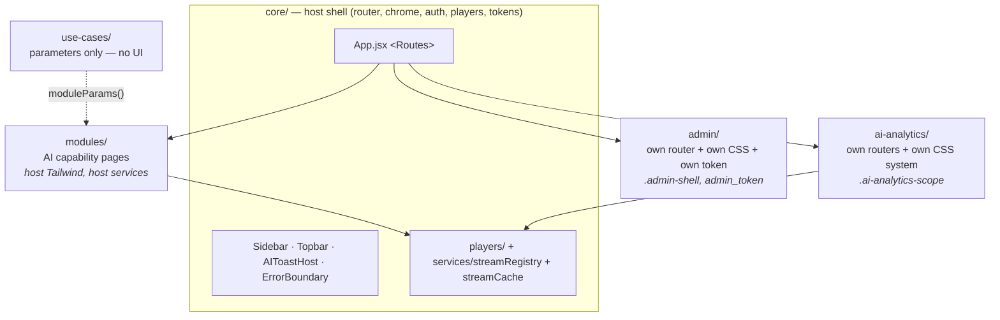
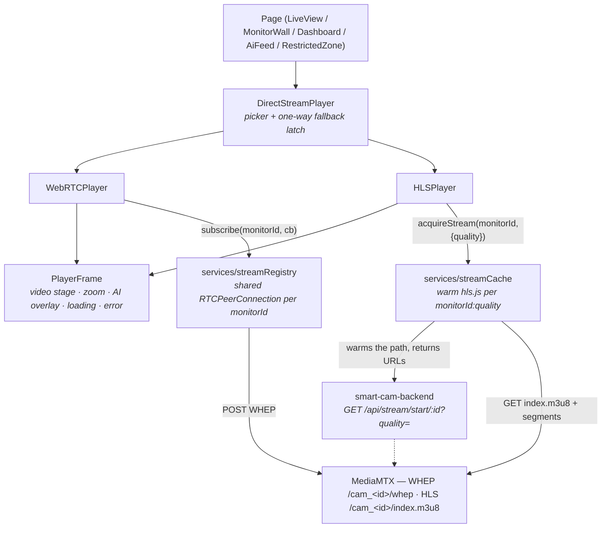
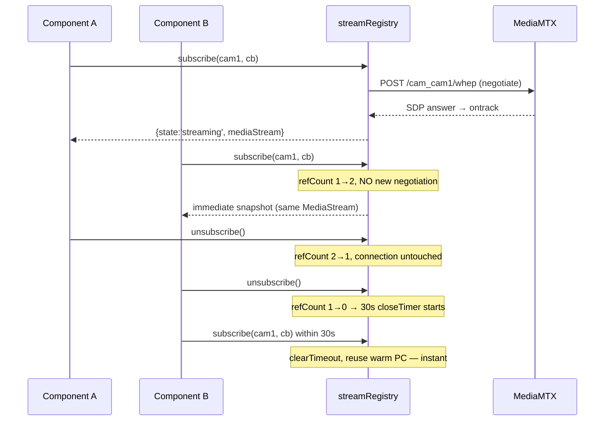

# Frontend Developer Guide — `smart-cam-app` (the operator console)

This is the working guide for engineers who need to **change** the Drishyam operator console: the React SPA at `smart-cam-app/` that security operators actually sit in front of. It covers the shell architecture, how routes and pages are registered, the video-player stack (the part that will bite you), how live streams are shared globally instead of per-component, state management, the Tailwind / scoped-CSS split, and a set of task recipes. Everything here was read out of the source; where the code is doing something surprising, the reason is spelled out, and where it is doing something wrong, that is said plainly in **Gotchas** or **Known rough edges**.

Sibling docs: `docs/12-streaming-recording-architecture.md` (what MediaMTX is doing on the other side of the wire), `docs/06-api-reference.md` (backend endpoints), `smart-cam-app/src/README.md` (a shorter, product-shaped version of the layer model below).

---

## 1. The mental model

Three ideas explain almost everything in this codebase. If you internalise them you can predict where any given file lives and why it looks the way it does.

### Idea 1 — a VMS host shell with three semi-independent suites mounted inside it

`core/` is the **host**: the router, the sidebar/topbar chrome, the auth store, the HTTP client, the video players, the design tokens. It is the "base VMS" — the thing every customer gets whether or not they bought any AI.

Three other trees are **mounted inside** that host and are deliberately *not* merged into it:

| Tree | What it is | Own routing? | Own styling? | Own HTTP client? |
|---|---|---|---|---|
| `modules/` | AI capabilities written once (face, footfall, person-tracking, alerts, ai-feed, headcount, reports, employee-productivity) | no — flat routes in `App.jsx` | no — host Tailwind | no — `@/core/services/*` |
| `ai-analytics/` | An imported analytics product (ANPR, Weapon, Aggression, Fire, Crowd, Face Watchlist, Restricted Zone, Productivity) | **yes** — each module ships a `*Router.jsx` | **yes** — `.ai-analytics-scope` design system | mostly yes — `ai-analytics/core/services/apiClient.js` |
| `admin/` | The internal back-office (customers, licences, pricing, live ops monitor) | **yes** — `AdminApp.jsx` nested `<Routes>` | **yes** — `.admin-shell` in `admin.css` | **yes** — `admin/services/api.js` with a separate `admin_token` |

`use-cases/` is a fourth thing and not a suite at all: it is a **parameter catalogue**. A vertical (retail, campus, school, hostel, hospitality, bank, corporate) is "which modules + what numbers", never forked module code.



The practical consequence: **a change in `core/` can break all three suites; a change inside a suite should never leak out.** The two suites that brought their own CSS are the ones that leak, and section 9 is about exactly that.

### Idea 2 — a live stream is a global resource, not component state

The single most important non-obvious design decision: **no page or component owns an `RTCPeerConnection`.** Transport lives in module-scope singletons:

- `core/services/streamRegistry.js` — one WebRTC (WHEP) connection per `monitorId`, refcounted, with a 30 s grace window after the last subscriber unmounts.
- `core/services/streamCache.js` — one warm `hls.js` instance per `monitorId:quality`, LRU-capped at 32.

Both survive every mount/unmount in the SPA; only a full page reload clears them. React components subscribe and render; they never negotiate. This exists because the old design (a PC per mount) meant every route change triggered a fresh WHEP negotiation plus a MediaMTX source-on-demand cold start — **3–6 seconds of black screen on every navigation**, per the header comment in `streamRegistry.js`.

### Idea 3 — two competing design systems live in one document, separated only by a class

The host is Tailwind v4 + shadcn primitives (`core/ui/`) with CSS-variable tokens in `src/index.css`. `ai-analytics/analytics.css` is a 13,931-line **auto-generated** stylesheet from a different product, mechanically prefixed with `.ai-analytics-scope`. `admin/admin.css` is a third system prefixed with `.admin-shell`.

Both scoped systems are plain, *unlayered* CSS, while Tailwind v4 emits its utilities inside `@layer utilities`. In the native cascade, **unlayered declarations beat layered ones regardless of specificity**. That single fact is the source of the console's most expensive recurring bug (section 9.2).

---

## 2. Where things live

```
smart-cam-app/
├── index.html                 # loads Material Symbols font + /src/main.jsx
├── vite.config.js             # base '/d-app/' in prod, @ alias, watcher ignores
├── src/
│   ├── main.jsx               # providers: Router → QueryClient → Theme → Tooltip
│   ├── App.jsx                # THE route table (~310 lines, one flat <Routes>)
│   ├── index.css              # Tailwind import + design tokens (:root / .dark)
│   ├── core/                  # host shell
│   │   ├── config/endpoints.js    # every service URL, read from import.meta.env
│   │   ├── services/              # api (axios+JWT), auth, socket, ai, streamRegistry, streamCache…
│   │   ├── players/               # DirectStreamPlayer, WebRTCPlayer, HLSPlayer, PlayerFrame, WebRTCStream, AIOverlay, ZoomIndicator
│   │   ├── hooks/                 # useQueries, useDashboardStats, useStreamConnection, useAdaptivePlayback, useNetworkClass, useDigitalZoom
│   │   ├── store/                 # zustand: authStore, notificationStore
│   │   ├── layout/                # Sidebar (the nav registry), Topbar, ProtectedRoute, AIToastHost, ErrorBoundary
│   │   ├── ui/                    # shadcn primitives (button, card, dialog, table, tabs…)
│   │   ├── lib/utils.js           # cn() + playerQuality()
│   │   └── pages/                 # LiveView, MonitorWall, Playback, CameraSetup, Dashboard, Settings, auth…
│   ├── modules/               # AI capability pages
│   ├── ai-analytics/          # imported analytics suite + analytics.css
│   ├── admin/                 # back-office sub-app + admin.css
│   ├── use-cases/             # vertical parameter presets
│   └── pages/                 # ⚠ one stale orphan — see Known rough edges
```

Every import uses the `@/` alias → `src/` (`vite.config.js` `resolve.alias`, mirrored in `jsconfig.json` for editor resolution).

---

## 3. Boot sequence

`src/main.jsx` is short and every line matters:

```jsx
createRoot(document.getElementById('root')).render(
  <StrictMode><BrowserRouter><QueryClientProvider client={queryClient}>
    <ThemeProvider><TooltipProvider><App /></TooltipProvider></ThemeProvider>
  </QueryClientProvider></BrowserRouter></StrictMode>
);
```

Before that it runs an IIFE that adds `icons-ready` to `<html>` once `document.fonts.ready` resolves (with a 1.5 s failsafe). The analytics scope keeps Material Symbols `visibility: hidden` until then so operators never see a flash of raw ligature text like `crisis_alert`.

The `QueryClient` defaults are deliberately generous — `staleTime: 60_000`, `gcTime: 10 * 60_000`, `refetchOnWindowFocus: false`, `refetchOnReconnect: 'always'`, `retry: 1`. Navigating Cameras → Playback → Cameras inside a minute does zero refetching. Anything that genuinely needs freshness overrides `staleTime`/`refetchInterval` at the call site (`useGroups({ refetchInterval: 15_000 })` in `LiveView`, 30 s in `MonitorWall`).

`App.jsx` renders, in order:

1. `<AIToastHost />` — global realtime toast layer, mounted **outside** the router so it survives every navigation.
2. `<ErrorBoundary>` wrapping the whole `<Routes>` — a class component (React has no hook equivalent) that shows a recovery panel instead of a white screen.

> **Note:** `AIToastHost` sits *outside* `ErrorBoundary`. A render error inside the toast layer takes down the entire app rather than showing the recovery panel. Listed again under Known rough edges.

---

## 4. Routing and page registration

### 4.1 There is exactly one route table

All operator routes are declared in a single flat `<Routes>` in `src/App.jsx`. There is no route-manifest file, no per-module registration hook. Every page is `React.lazy()`-imported at the top of the file, so each route is its own chunk.

Three wrapper shapes exist, and picking the right one *is* the registration decision:

```jsx
// App.jsx
const wrap = (page) => (
  <AppLayout sidebarOpen={sidebarOpen} onToggleSidebar={handleToggle}>{page}</AppLayout>
);
// AI-analytics pages render inside the host chrome but need their own scoped
// design system (.ai-analytics-scope supplies the --color-* tokens + classes).
const ai = (page) => wrap(<div className="ai-analytics-scope">{page}</div>);
```

| Shape | Renders | Use for |
|---|---|---|
| `<ProtectedRoute>{wrap(<Page />)}</ProtectedRoute>` | sidebar + topbar + `<Suspense>` spinner | almost every page — core, modules |
| `<ProtectedRoute>{ai(<Page />)}</ProtectedRoute>` | same chrome, plus the `.ai-analytics-scope` wrapper div | anything under `ai-analytics/` |
| bare `<ProtectedRoute><Suspense>…` | no chrome at all | `/monitor-wall` (full-screen control room), `/admin/*` (own shell) |

`AppLayout` is a fixed-`<aside>` sidebar plus a content `<div>` whose `marginLeft` is driven by `sidebarOpen` (272 px / 64 px), persisted to `localStorage['sidebar-open']`.

### 4.2 Sub-routes: splat routes for AI suites

The AI-analytics modules own their internal navigation, so `App.jsx` hands them a splat and gets out of the way:

```jsx
<Route path="/ai-analytics/vehicle/*" element={<ProtectedRoute>{ai(<ANPRRouter />)}</ProtectedRoute>} />
```

`ANPRRouter.jsx` then declares its own nested `<Routes>` with relative paths (`index`, `watchlist`, `profile/:plate`, …) inside a `<div className="page-content">` — `page-content` being an `analytics.css` class, not a Tailwind one.

### 4.3 Sub-navigation: the `?tab=` convention

Several "pages" are really tab shells that switch components on a search param, not on a route: `Playback` (`nvr` | `recordings` | `timeline` | `timelapse`) and `CameraSetup` (`sites` | `devices` | `cameras` | `ai-detection`). Old URLs are preserved as redirects:

```jsx
<Route path="/cameras" element={<ProtectedRoute><Navigate to="/camera-setup?tab=cameras" replace /></ProtectedRoute>} />
<Route path="/gallery" element={<ProtectedRoute><Navigate to="/playback?tab=recordings" replace /></ProtectedRoute>} />
```

Both shells normalise unknown tab values to the first tab and drop the param entirely for the default tab (`setActive` deletes `tab` when you pick `nvr`/`sites`). Follow that pattern rather than inventing a new one.

### 4.4 Auth gating

`ProtectedRoute` is four lines: read `isAuthenticated` from the zustand auth store, else `<Navigate to="/login" replace />`. `isAuthenticated` is seeded from `localStorage['auth_token']` at store-creation time. There is **no route-level role or entitlement check anywhere** — see §11.5.

The catch-all is `<Route path="*" element={<Navigate to="/login" replace />} />`. A typo'd path therefore looks like a logout, not a 404.

### 4.5 Nav is a separate registry

Adding a `<Route>` does **not** add a sidebar entry. `core/layout/Sidebar.jsx` holds a hand-maintained `NAV_GROUPS` array (Overview / Operations / AI Intelligence / AI Analytics) plus `BOTTOM`. Each item is `{ to, label, icon, feature?, optIn?, children?, needsParam?, hideParam?, hideFor?, end? }`. Route and nav can and do drift on purpose: `/compute-cost` is routed but its nav entry is commented out ("Compute Cost (billing) hidden per product decision"), and Pricing is parked one step further — `core/pages/Pricing.jsx` still exists but *both* its route in `App.jsx` and its `BOTTOM` nav entry are commented out, so the path is unreachable.

---

## 5. The player architecture

### 5.1 The stack



### 5.2 Why the protocol players are separate files

They were one component. It collapsed. The header of `DirectStreamPlayer.jsx` names the failure: a single component holding both engines would flip WebRTC → HLS on a hiccup, HLS would then hit its own error, the component would flip back, and the two engines thrashed against each other ("the old collapse") while both held transport open.

The fix has two halves:

1. **Physical separation.** `WebRTCPlayer` contains no `hls.js` import and no URL fetching. `HLSPlayer` contains no `RTCPeerConnection` and never talks to `streamRegistry`. Neither can accidentally drive the other.
2. **A one-way latch in the parent.** `DirectStreamPlayer` holds `fellBack` state. `WebRTCPlayer` calls `onFallback()` **at most once** (guarded by `firedFallbackRef`), the parent latches to HLS, and there is no path back for that camera. The latch resets only when `monitorId`, `resolvedMode` or `quality` changes.

```jsx
// DirectStreamPlayer.jsx
const [fellBack, setFellBack] = useState(false);
useEffect(() => { setFellBack(false); }, [monitorId, resolvedMode, quality]);
const useHls = resolvedMode === 'hls' || fellBack;
```

### 5.3 What `PlayerFrame` owns vs what the protocol player owns

`PlayerFrame` is the shared visual shell. It exists so the two engines stay genuinely independent without duplicating chrome.

| Owned by `PlayerFrame` | Owned by the protocol player |
|---|---|
| the `<video>` element itself (via the `videoRef` passed down) | creating/destroying the engine and attaching media to that ref |
| digital zoom stage — wheel/pinch zoom, drag-pan, `ZoomIndicator` (`useDigitalZoom`, 1×–8×) | deciding `state`: `'loading' \| 'playing' \| 'error'` |
| `AIOverlay` bounding boxes (rendered only when `state === 'playing'`) | the `error` string and the `onRetry` handler |
| the "Connecting to camera…" spinner and the "Stream Unavailable" + Retry panel | corner badges / quality gear / volume button, passed in as `children` |

Note the interaction that catches people: `controls={controls && !(digitalZoom && zoom.isZoomed)}`. Native video controls are suppressed while zoomed so the control bar doesn't eat drag-pan gestures.

### 5.4 Mode resolution — the exact rules

```jsx
// DirectStreamPlayer.jsx
const forceWebrtc = mode === 'webrtc';
const wantHls = !forceWebrtc && (mode === 'hls' || forceHls || quality === 'low');
const resolvedMode = wantHls ? 'hls' : 'webrtc';
```

| Props | Player mounted | Notes |
|---|---|---|
| `mode="webrtc"` | `WebRTCPlayer` | **wins over everything**, including `quality="low"` and `forceHls` |
| `mode="hls"` or `forceHls` | `HLSPlayer` | legacy `forceHls` kept for old call sites |
| `quality="low"` (no explicit mode) | `HLSPlayer` | the sub-stream is an HLS path |
| nothing / `mode="auto"` | `WebRTCPlayer` | falls back to HLS on its own |

`mode="webrtc"` wins on purpose: WHEP forwards RTP directly and sidesteps MediaMTX's HLS muxer, which black-screens on some cameras' frame reordering. Every multi-tile view in the app passes it.

WebRTC hands off to HLS in exactly two situations, both in `WebRTCPlayer`:

1. `typeof RTCPeerConnection === 'undefined'` — browser can't do WebRTC at all; hand off immediately.
2. The registry reports `state === 'offline'` **with an error** — i.e. the registry's own retry loop already failed.

It never hands off on slowness, on a black-but-connected stream, or on a stall.

### 5.5 What the `quality` prop actually does

`quality` is `'auto' | 'high' | 'low'` and it is **only consumed by `HLSPlayer`**. Two things happen with it:

1. It is part of the `streamCache` key and is sent to the backend: `GET /api/stream/start/:monitorId?quality=low`. Server-side (`smart-cam-backend/src/services/stream.service.js`) this decides whether to warm the camera's native sub-channel (`cam_<id>_sub`, derived from the main RTSP path by the vendor registry), and whether to fall back to a capped low-bitrate transcode.
2. Client-side it picks which returned URL to load:

```jsx
// HLSPlayer.jsx
const pickHlsUrl = ({ hlsUrl, hlsSubUrl, masterUrl }) =>
    activeQuality === 'low'  ? (fallbackToMainRef.current ? hlsUrl : (hlsSubUrl || hlsUrl))
  : activeQuality === 'high' ? hlsUrl
  : (masterUrl || hlsUrl);
```

`fallbackToMainRef` flips to `true` after a fatal HLS error on a `low` stream, so a broken sub-channel degrades to the main stream instead of retry-looping.

`masterUrl` (the ABR master playlist) is currently **always `null`** — `stream.controller.js` hardcodes `const masterUrl = null;` because a single-variant master adds nothing and hls.js has misbehaved on nested masters. So `quality="auto"` resolves to `hlsUrl` today.

`playerQuality(camera, dflt)` in `core/lib/utils.js` maps the camera's *saved* preference onto this prop:

```js
export function playerQuality(camera, dflt) {
  switch (camera?.streamQuality) {
    case 'sub':  return 'low';
    case 'main': return 'high';
    case 'auto': return 'auto';
    default:     return dflt;   // unset → inherit the view's bandwidth default
  }
}
```

It lives in `core/lib/utils` specifically so `LiveView`'s grid and `MonitorWall` cannot drift on what "this camera is set to Sub" means. Both call `playerQuality(camera, 'low')` for tiles. For the single/focused view `LiveView` calls `playerQuality(selectedCamera, 'high')` (so a camera pinned to Sub stays on Sub) while `MonitorWall`'s focus overlay passes a bare `quality="high"` — a small inconsistency; prefer the `playerQuality(...)` form in new code.

### 5.6 `WebRTCStream` — the other player

`core/players/WebRTCStream.jsx` is a second, thinner WebRTC player used by `modules/footfall/Footfall.jsx` and `modules/headcount/HeadCount.jsx`. It renders a bare `<video>` (no `PlayerFrame`, no zoom, no overlay), subscribes via the `useStreamConnection` hook, and adds one thing `WebRTCPlayer` does not have: a **stall watchdog** that polls `video.currentTime` every second and calls `reconnect()` if it hasn't advanced for `STALL_WINDOW_MS` (8 s). It reports transitions through `onStateChange` so those pages can swap in an MJPEG fallback from the AI service.

Choose:

- **`DirectStreamPlayer`** — anything an operator watches. Default choice.
- **`WebRTCStream`** — you need a raw video surface to draw your own overlay on and want the stall watchdog.
- **`DirectStreamPlayer` with `mode="hls"`** — you specifically need the quality gear or Safari-native HLS and never want WebRTC. Prefer this over importing `HLSPlayer` yourself: nothing outside `core/players/` imports `HLSPlayer`, `WebRTCPlayer` or `PlayerFrame` directly today, and keeping that true is what stops the two engines being wired up in new combinations.
- **Raw `hls.js`** — only `core/pages/NvrPlayback.jsx` does this, because NVR playback is a transient on-demand path, not a persistent camera path, so neither cache belongs.

### 5.7 `DirectStreamPlayer` props reference

| Prop | Default | Effect |
|---|---|---|
| `monitorId` | — | required; the camera key everywhere |
| `mode` | `undefined` (= auto) | `'webrtc'` forces WHEP; `'hls'` forces HLS |
| `forceHls` | `false` | legacy alias for `mode='hls'` |
| `quality` | `'auto'` | HLS path only — see §5.5 |
| `muted` | `true` | keep `true` for autoplay; Chrome throws `NotAllowedError` on unmuted autoplay → black frame |
| `controls` | `true` | native `<video>` controls; pass `false` for tiles |
| `qualityControl` | `true` | HLS only — shows the gear menu. Mutually exclusive with the "LIVE · HLS" badge |
| `volumeToggle` | `false` | adds the mute/unmute button |
| `aiOverlay` | `true` | `AIOverlay` bbox layer; **turn off for tiles** |
| `digitalZoom` | `true` | zoom/pan stage; **turn off for tiles** |
| `className` | `''` | applied to the outer frame div |

---

## 6. `streamRegistry` — the shared-connection model

`core/services/streamRegistry.js` (~380 lines) is the highest-consequence file in the frontend. Read it before touching anything that shows video.

### 6.1 Refcounting and the grace timer

A module-scope `Map` keyed by `monitorId` holds one entry per camera: `{ pc, mediaStream, state, error, refCount, subscribers, closeTimer, epoch, negotiating }`. `state` is `'connecting' | 'streaming' | 'offline'`.



`GRACE_MS = 30_000` is the only real knob, and the header comment explains the trade: too short loses the benefit, too long holds a MediaMTX path nobody is watching. 30 s comfortably covers operator paging behaviour.

Two correctness mechanisms guard the async work:

- **`epoch`** — incremented on every `negotiate()`. Every `await` boundary re-checks `if (epoch !== entry.epoch) return;`, so a superseded negotiation cannot resurrect a connection that was closed or mutate an entry that moved on.
- **`negotiating`** — prevents two concurrent negotiations on the same entry (e.g. a stall watchdog firing while the retry loop is already running).

On ICE `failed`/`disconnected`/`closed` the entry goes `offline`, notifies, and retries after `RETRY_AFTER_FAIL_MS` (4 s) **only while `refCount > 0`**. If everyone navigated away at the same moment ICE died, it just closes.

### 6.2 Why pages must not own the PeerConnection

Beyond the 3–6 s black screen already mentioned, component-owned PCs break in three ways this design fixes:

- **Duplicate pulls.** Two components showing the same camera (a wall tile and a focus overlay, or a page plus a modal) would each open a WHEP session, and MediaMTX would open two RTSP pulls off the recorder. Entry-level NVRs serve only a handful of concurrent sessions; the July 2026 flood incident (`docs/` incident notes: 17 concurrent pulls jammed one Hikvision NVR and knocked *all* its cameras offline) is exactly this failure at scale.
- **StrictMode double-mount.** In dev, React mounts, unmounts and remounts effects. A component-owned PC negotiates twice on every page load; the registry's refcount + grace window absorbs it.
- **No shared recovery.** When the registry reconnects, *every* subscriber gets the new `MediaStream` through its callback. Per-component PCs each have to detect and recover independently.

**Rule: never construct `RTCPeerConnection` in a component.** Use `subscribe()` or `useStreamConnection()`. And **always call the returned unsubscribe on unmount** — forgetting leaks a refcount and the stream stays open until reload.

### 6.3 Background-tab suspension and staggered resume

`refCount` only drops on **unmount**. Backgrounding a tab keeps everything mounted, so without extra logic a hidden 36-tile wall holds 36 WebRTC sessions and 36 RTSP pulls open indefinitely, for nobody — competing with operators who are actually looking.

```js
const HIDDEN_SUSPEND_MS = 20_000;   // grace before suspending a hidden tab
const RESUME_STAGGER_MS = 200;      // delay between re-negotiations on resume
```

On `visibilitychange` → hidden, a 20 s timer starts; if it fires, `suspendAll()` bumps every entry's `epoch`, closes the PCs, sets `state = 'connecting'` (so players show their reconnecting affordance) and notifies — but **keeps the entries**, because the subscribers are still mounted. The 20 s delay means alt-tabbing for a few seconds causes no churn.

On resume, `resumeAll()` re-negotiates each entry that still has subscribers with `i * 200 ms` spacing. Bringing 36 tiles back simultaneously is precisely the connection storm the per-NVR limits exist to prevent, so the stagger is not cosmetic. Each staggered callback re-checks `if (suspended || entry.refCount <= 0 || entry.pc) return;` because the tab may have been hidden again in the meantime.

### 6.4 Registry API

| Export | Use it for |
|---|---|
| `subscribe(monitorId, cb) → unsubscribe` | the only way to watch a stream. `cb` fires immediately with a snapshot, then on every change |
| `reconnect(monitorId)` | force a fresh WHEP negotiation — used by stall watchdogs. No-op if the monitor has no registry entry, or a negotiation is already in flight. Note it checks for an *entry*, not for subscribers: a camera still inside its 30 s grace window will renegotiate |
| `setPlayoutDelayHint(monitorId, seconds)` | jitter-buffer hint on every receiver. Chromium-only, silently no-ops elsewhere. **Last call wins** across pages — accepted, since the most recently active adapter has the freshest network info |
| `preWarm([monitorIds])` | subscribe + immediately unsubscribe, so the 30 s grace window keeps a connection warm for a click that hasn't happened yet. *Currently no call sites.* |
| `inspect()` | diagnostics array (`state`, `refCount`, `hasMediaStream`, `closingIn`, `epoch`). Handy from the console |

ICE servers come from `core/services/turnCredentials.js`, which de-dupes in-flight requests, caches until 60 s before expiry, negative-caches "TURN not configured" for 5 minutes, and **never throws** — it falls back to a public STUN server so streaming never blocks on TURN availability.

### 6.5 `streamCache` — the HLS half

Keyed `` `${monitorId}:${quality}` ``, so the same camera at `low` and `high` are separate warm instances. `acquireStream()` de-dupes concurrent calls through an `inFlight` map and returns `{ webrtcUrl, hlsUrl, hlsSubUrl, masterUrl, hls, fresh }`. `fresh === true` means the caller must attach and load; `false` means reattach a running instance (instant camera switching).

`MAX_CACHED_STREAMS = 32` with LRU eviction was added after a real leak: every camera opened on *any* page left its `hls.js` instance alive forever, because `releaseAllStreams()` only ran on `LiveView`. `enforceCap()` never evicts an **attached** instance (`entry.hls?.media` truthy) — that would kill a visible tile.

The `hls.js` config in `createHlsInstance()` is heavily tuned, and each value is scar tissue:

| Setting | Value | Why |
|---|---|---|
| `liveSyncDurationCount` | `3` | was `1` — below hls.js's own default — leaving zero jitter cushion, so any NVR hiccup stalled playback. **The single biggest anti-stutter lever.** |
| `liveSyncOnStallIncrease` | `0.1` | hls.js adds this to the target latency on *every* stall and never resets it without recreating the player (hls.js #6350). At the 1.0 s default it ratchets one-way to 4 s+; at 0.1 s the drift is self-healing |
| `maxLiveSyncPlaybackRate` | `1.5` | catch up to live by gently speeding up rather than seeking — a seek is a visible jump |
| `manifestLoadingMaxRetry` | `6` (8 s timeout, 1 s delay) | MediaMTX's HLS muxer takes 1–4 s to warm after a path becomes ready; fewer retries and the player gives up before the first segments land |
| `autoStartLoad` | `false` | loading starts explicitly on `MANIFEST_PARSED` |
| `xhrSetup` | JWT only on `/api/stream/master/` | variant playlists and segments hit MediaMTX directly; adding a Bearer header there would only trigger a CORS preflight without changing access |

---

## 7. Adaptive playback

`useAdaptivePlayback` measures stall pressure on the actual `<video>` element plus the hls.js error stream, and moves between three regimes:

| Profile | `maxBufferLength` | `liveSyncDurationCount` | `playoutDelayHint` |
|---|---|---|---|
| `smooth` | 6 | 3 | 0.1 s |
| `bumpy` | 12 | 6 | 0.3 s |
| `choppy` | 20 | 10 | 0.5 s |

The asymmetry is the interesting part: it **promotes on the first stall** (frame freezes are highly visible) but **demotes only after 60 s of clean playback**. That biases toward smoothness for the minute after a stall, which is the common shape of an NVR with bursty fragment timing.

`useNetworkClass` reads `navigator.connection` (`saveData`, `effectiveType`, `downlink`, `rtt`) and maps `fast|medium|slow → smooth|bumpy|choppy` via `CLASS_TO_PROFILE`, so a session on a bad network *starts* in the right regime instead of thrashing there after the first stall. With no Network Information API (Safari) it returns `'fast'` — deliberately optimistic, so healthy clients aren't pessimistically degraded.

For WebRTC the hook pushes `playoutDelayHint` through the `setPlayoutDelayHint` callback (which routes to the registry-owned PC) rather than touching a `pcRef`; the `pcRef` branch is legacy for any component that still owns its own PC.

---

## 8. State: TanStack Query vs Zustand vs localStorage

| Kind of state | Tool | Where |
|---|---|---|
| Anything the server owns — cameras, groups, recordings, AI events, health, storage | **TanStack Query** | `core/hooks/useQueries.js`, `useDashboardStats.js`, or a `useQuery` at the page |
| Cross-page UI/session state — who is logged in, the notification list, the active vertical | **Zustand** | `core/store/authStore.js`, `core/store/notificationStore.js`, `modules/employee-productivity/useCaseStore.js` |
| Per-page ephemeral state — selected camera, open modal, search text | `useState` | in the page |
| Operator preferences that must survive reload | `localStorage`, read lazily in `useState(() => …)` | see table below |
| Live transport | neither — the registries in §6 | `core/services/stream*.js` |

**The test:** if a second browser tab would want the same answer, it's server state → Query. If it's about *this* session's UI, it's Zustand or `useState`.

### 8.1 TanStack Query conventions

Query keys are centralised in `core/hooks/useQueries.js`:

```js
export const queryKeys = {
  cameras: ['cameras'],
  camera: (id) => ['cameras', id],
  groups: ['groups'],
  groupRecordings: (groupId, date) => ['recordings', 'group', groupId, date],
  // …
};
```

Every mutation invalidates rather than hand-patching the cache:

```js
export function useSetCameraQuality() {
  const qc = useQueryClient();
  return useMutation({
    mutationFn: ({ groupId, monitorId, streamQuality }) =>
      cameraGroupService.setCameraQuality(groupId, monitorId, streamQuality),
    onSuccess: () => qc.invalidateQueries({ queryKey: queryKeys.groups }),
  });
}
```

`useGroups()` is the workhorse — thirteen call sites across pages and hooks. It returns groups with cameras nested, and most camera lists in the app are `groups.flatMap(g => g.cameras || [])`. `useDashboardStats()` is the pattern to copy for a page that needs several endpoints reduced into one shape: it owns all the fetches and returns a single memoised object, so no two panels double-fetch `/ai/events`.

### 8.2 Zustand stores

- `useAuthStore` — `{ user, token, isAuthenticated }` plus `login/logout/register/updateUser/updateProfile/…`. `login()` and `register()` also call `connectSocket()`; `logout()` calls `disconnectSocket()`. Note that `user` carries the entitlement fields (`aiEnabled`, `features`) the backend attaches to the auth response.
- `useNotificationStore` — the notification-bell history, capped at 60 and mirrored into `localStorage['drishyam.notifications']` so it survives reloads.
- `useUseCaseStore` — which vertical Activity Monitoring is currently showing (`localStorage['activity-use-case']`, default `'retail'`).

### 8.3 localStorage keys in use

| Key | Owner |
|---|---|
| `auth_token`, `refresh_token`, `user`, `group_key` | `core/services/auth.js`, cleared by `api.js` on hard 401 |
| `admin_token`, `admin_user` | `admin/` — a **separate** session from the operator one |
| `theme` | `ThemeContext` (adds/removes `.dark` on `<html>`) |
| `sidebar-open`, `sidebar-groups` | `App.jsx` / `Sidebar.jsx` |
| `monitorWall.layout|filter|rotate|audio|onlineOnly` | `MonitorWall` |
| `drishyam.notifications` | notification store |
| `activity-use-case` | use-case store |
| `drishyam-theme` | `ai-analytics/providers/ThemeProvider.jsx` — a **second, separate** theme key |

### 8.4 HTTP and realtime

`core/services/api.js` is the axios instance: `baseURL = API_URL`, a request interceptor attaching `Bearer ${localStorage.auth_token}`, and a response interceptor implementing **silent refresh** — on a 401 that isn't itself the refresh call, it POSTs `/auth/refresh-token`, queues concurrent 401s in `failedQueue`, replays them with the new token, and on refresh failure clears storage and hard-navigates to `/login`. Tokens starting with `demo.` are exempt from forced logout (dev-only demo session).

`core/services/socket.js` is a socket.io singleton with `auth: { token }`, `transports: ['websocket']`, infinite reconnection. Subscribe with the helper that returns its own unsubscribe:

```js
useEffect(() => {
  const off = onSocket('ai.event', handler);
  return off;
}, []);
```

Channels currently consumed by the frontend: `ai.event` (persisted AI events → toasts + bell), `ai.live` (ephemeral per-frame boxes → `AIOverlay`, never persisted, never alerts), `stream.status` (camera online/offline transitions).

`AIToastHost` implements the client half of the anti-flood doctrine (mirrored from the backend email throttle): dedup on a **stable identity** subject, never the volatile `trackId`; `PER_SUBJECT_COOLDOWN_MS = 120_000` per identity+camera+type; a rolling `BURST_MAX = 6` per minute across all subjects; camera toasts fire only on genuine online↔offline **transitions**. Without this, a person standing in view produced dozens of toasts and bell rows per minute.

---

## 9. Styling

### 9.1 The host system

Tailwind v4 through `@tailwindcss/vite` (no `tailwind.config.js` — configuration is CSS-first in `src/index.css` via `@theme` / `@theme inline`). Semantic tokens live as CSS variables under `:root` and `.dark`; the brand accent is `#F7983A` (`--primary`). Dark mode is a `.dark` class on `<html>`, toggled by `core/context/ThemeContext.jsx`.

`core/ui/` holds shadcn "new-york" primitives, and `cn()` in `core/lib/utils.js` is `twMerge(clsx(...))` — always use it when composing conditional class strings so conflicting utilities resolve last-wins instead of both applying.

Use semantic tokens (`bg-background`, `text-foreground`, `border-border`) for anything that must theme. Use explicit colours **only** for surfaces that are always dark regardless of theme — the toasts do this deliberately, and the comment says why: `text-foreground` is near-black in light theme, which is invisible on a dark toast.

### 9.2 The `.ai-analytics-scope` trap

**Symptom.** You add an AI-analytics page, write it with Tailwind, and every `p-*`, `m-*`, `px-*`, `space-y-*` utility is silently ignored. Colours, flex and grid still work, so it looks like a spacing bug rather than a CSS-system conflict. You start adding `!important` or inline styles.

**Cause.** `analytics.css` opens with:

```css
.ai-analytics-scope *, .ai-analytics-scope *::before, .ai-analytics-scope *::after {
  box-sizing: border-box; margin: 0; padding: 0;
}
```

That rule wins over Tailwind for two independent reasons, both verifiable in the built bundle (`dist/assets/index-*.css`):

1. **Cascade layers.** Tailwind v4 emits `@layer theme, base, components, utilities`. In the built CSS the `utilities` layer closes at byte 178,256 and the scope reset sits at 186,047 — *outside any layer*. Unlayered declarations beat layered ones **regardless of specificity**.
2. **Source order.** `main.jsx` imports `index.css` first; `App.jsx` (imported after) pulls `analytics.css` and then `ai-analytics-overrides.css`. Even at equal specificity, later wins.

So `.p-4` never had a chance. The blast radius is exactly the three properties the reset sets — `box-sizing`, `margin`, `padding` — which is why the failure reads as "spacing is broken" rather than "CSS is broken".

**Fixes, in order of preference.**

1. **Use the analytics design system.** Inside the scope, `analytics.css` already provides `.card`, `.stat-card`, `.btn`, `.btn-primary`, `.page-content`, `.card-grid-2/3/4`, `.truncate`, plus the whole `--color-*` / `--radius-*` / `--shadow-*` token set. This is what most existing AI pages do.
2. **Ship a prefixed scoped `<style>` block.** This is what `ai-analytics/components/RestrictedZone/index.jsx` does — a `RZ_CSS` template string rendered as `<style>{RZ_CSS}</style>` inside the component, with every selector `.rz2`-prefixed so it can't escape. It wins because the block is emitted *in the body*, after the stylesheets imported in `App.jsx`, so at the equal specificity of one class (`.rz2-card` vs `.ai-analytics-scope *`, both `0,1,0`) source order decides. The file's own header comment calls this "specificity beats the reset" — it's really source order, but the pattern is the right one. Copy it for any page that must look like the host app while living inside the scope.
3. **Inline `style={{}}`.** Used by `ai-analytics/components/Productivity/index.jsx`. Wins everything, costs you tokens and responsive variants. Fine for small dynamic bits (bar widths, state colours).
4. **Don't put it in the scope at all.** If a page doesn't need the analytics look, register it with `wrap()` instead of `ai()` and write plain Tailwind.

Persistent tweaks go in `ai-analytics/ai-analytics-overrides.css`, **not** in `analytics.css` — the latter is auto-generated (header: "AUTO-GENERATED — do not edit by hand … Regenerate with Temp/scope-css.js") and hand edits are lost on regeneration. The overrides file is loaded after, so equal-specificity rules there win.

### 9.3 The admin system

`admin.css` scopes everything under `.admin-shell`, which is `position: fixed; inset: 0; z-index: 100`. That is a full-viewport takeover: when `/admin/*` renders, the operator chrome is completely covered. It has its own token set (orange `#ff6b00` primary) and, again, is unlayered CSS that will beat Tailwind utilities inside it.

### 9.4 Module-level CSS

A couple of module pages ship their own stylesheet (`modules/ai-feed/ai-event.css`) or a component-local `<style>` string — `RZ_CSS` in `ai-analytics/components/RestrictedZone/index.jsx`, `LM_CSS` in `admin/components/LiveMonitor.jsx`. Both are acceptable when a page needs a coherent look that Tailwind utilities would make unreadable — but keep every selector prefixed so it can't escape.

---

## 10. HOW DO I…

### 10.1 …add a page

1. Create the component. Put it in `core/pages/` if it's base-VMS functionality, `modules/<capability>/` if it's an AI capability, `ai-analytics/components/<Module>/` if it belongs to the analytics suite.
2. Lazy-import it at the top of `src/App.jsx`:
   ```jsx
   const ZoneAudit = lazy(() => import('@/modules/zone-audit/ZoneAudit'));
   ```
3. Register the route with the right wrapper:
   ```jsx
   <Route path="/zone-audit" element={<ProtectedRoute>{wrap(<ZoneAudit />)}</ProtectedRoute>} />
   ```
   Use `ai(...)` instead of `wrap(...)` if it lives in `ai-analytics/`. Use neither if it's a full-screen view like `/monitor-wall`.
4. Add a nav entry to `NAV_GROUPS` in `core/layout/Sidebar.jsx` — a route alone gives no navigation. Pick a semantic lucide icon; add `feature: 'zone_audit'` if it should be entitlement-gated (§10.5).
5. If it needs sub-navigation, prefer the `?tab=` shell pattern (`Playback.jsx`) over nested routes, unless it's an `ai-analytics` module — those get a splat route and their own `*Router.jsx`.

**Verify:** the route loads its own JS chunk (Network tab shows a separate `.js` on first visit), the sidebar highlights correctly (`NavLink` active state), and a hard reload on the deep URL still works (SPA fallback).

### 10.2 …add a live video tile correctly

For a **grid or wall of tiles**:

```jsx
import DirectStreamPlayer from '@/core/players/DirectStreamPlayer';
import { playerQuality } from '@/core/lib/utils';

<DirectStreamPlayer
  monitorId={camera.monitorId}
  mode="webrtc"                        // sidestep the HLS muxer
  quality={playerQuality(camera, 'low')} // view default = sub-stream
  muted
  controls={false}
  qualityControl={false}               // gear belongs on single view
  aiOverlay={false}                    // per-frame boxes × N tiles = wasted work
  digitalZoom={false}                  // pan/zoom on a thumbnail is noise
  className="w-full h-full"
/>
```

For a **single / focused view**:

```jsx
<DirectStreamPlayer
  monitorId={selectedCamera.monitorId}
  mode="webrtc"
  quality={playerQuality(selectedCamera, 'high')}
  muted            // start muted or Chrome blocks autoplay → black frame
  volumeToggle     // let the operator turn sound on
  controls={false}
  aiOverlay={faceDetect}   // opt-in, off by default so the image stays clean
  className="w-full h-full"
/>
```

Rules, in priority order:

- **Always pass `playerQuality(camera, 'low')` for multi-tile views**, never a bare `'high'` or `'auto'`. A main-stream tile is roughly 8× the bitrate of a sub-stream tile, and a wall multiplies that by the tile count. A 6×6 wall on main streams is ~36× the bandwidth of the same wall on sub-streams.
- **Never render a player for an offline camera.** An offline camera means a doomed negotiation, a 4 s retry loop, and a wasted MediaMTX path. `MonitorWall` does this properly — `isOnline ? <DirectStreamPlayer …/> : <offline placeholder>`. `LiveView`'s `GridTile` does **not** check status; it only gates the "add to grid" button on `camera.status === 'online'`, so a camera that goes offline while pinned to the grid keeps a live player mounted. Copy MonitorWall, not LiveView.
- **Give the container a size.** The player is `absolute inset-0` / `w-full h-full`; a parent with no height renders a zero-height video.
- **Don't key on anything that changes per render.** Some pages pass `key={cam.monitorId}` deliberately to force a remount when the camera changes; a key that changes on every render remounts the player continuously and defeats the whole registry.

**Verify:** open DevTools → `chrome://webrtc-internals` and confirm you have **one** peer connection per distinct camera, not one per tile; then run `inspect()` from `streamRegistry` in the console and check `refCount` matches the number of visible tiles.

### 10.3 …call a new API endpoint

1. **Never** read `import.meta.env` or hardcode a host in a page. All bases live in `core/config/endpoints.js` (`API_BASE`, `API_URL`, `AI_BASE`, `AI_WS`, `WHEP_BASE`, `PERSON_TRACKER_BASE`). Add a new base there if you're adding a new service.
2. Add the call to the right service module in `core/services/` (`ai.js` for AI, `cameraGroup.js` for groups/cameras, `site.js`, `recordings.js`, …). Services return unwrapped data, not axios responses:
   ```js
   // core/services/ai.js
   zoneAuditList(params = {}) {
     return api.get('/ai/zone-audit', { params }).then((r) => r.data?.data ?? null);
   },
   ```
3. Wrap it in a query hook so caching and invalidation are consistent — either a shared hook in `core/hooks/useQueries.js` (add its key to `queryKeys`) or a `useQuery` in the page for page-specific data.
4. Auth is automatic: the axios interceptor attaches the JWT and handles silent refresh. Nothing to do at the call site.

Two exceptions that will bite you:

- **`` can't send an `Authorization` header.** For authed images the codebase uses a backend byte-relay with the token in the query string — see `aiService.snapshotSrc(uri)`.
- **CSV/file downloads** are best as a direct browser navigation, so services expose a URL builder rather than fetching bytes — see `aiService.footfallExportCsvUrl(params)`.

**Verify:** the request carries `Authorization: Bearer …`, and a deliberately expired token produces one refresh call followed by a replay of the original request (not a logout).

### 10.4 …add an AI analytics page

1. Create the component under `src/ai-analytics/components/<Module>/`.
2. Decide routing shape:
   - single page → register directly with `ai(<Page />)` in `App.jsx`;
   - multi-page module → add a `<Module>Router.jsx` with its own `<Routes>` (relative paths, wrapped in `<div className="page-content">`) and register a splat route `path="/ai-analytics/<slug>/*"`.
3. **Style it inside the scope** using one of the four options in §9.2. Do not assume Tailwind spacing works.
4. Data: use `@/core/services/api` (the shared axios instance) or the suite's own `ai-analytics/core/services/apiClient.js` — both send the same `auth_token`. Prefer the core one for new code; the suite client is a plain `fetch` wrapper with no refresh handling.
5. Add the sidebar entry under the `AI Analytics` group with a `feature:` tag. The sidebar is the only way in — the old Analytics Hub landing page was removed, and `/ai-analytics` now redirects to Home.

**Be honest about data.** Several analytics modules are still demo surfaces backed by files in `ai-analytics/data/` and bundled `.webm` clips: **ANPR, Crowd Monitoring, Face Watchlist (the analytics copy), GIS** and parts of Weapon/Aggression. **Productivity** and **Restricted Zone** are wired to the real backend. Check which side of that line you are on before wiring a demo page into a customer-visible flow.

**Verify:** the page renders with correct spacing (not everything jammed to the top-left), and navigating away and back doesn't leak analytics styles into the host chrome.

### 10.5 …gate a feature by entitlement

Entitlements ride on the login/refresh response and land on `user` in the auth store:

- `user.aiEnabled === false` → Basic VMS plan; the entire `AI Intelligence` and `AI Analytics` groups are dropped.
- `user.features === null` → full AI account; everything shows.
- `user.features === ['person_tracker', 'restricted_zone', …]` → curated account.

The rule lives in one function in `Sidebar.jsx`:

```js
const allowed = (item, isAiGroup) => {
  if (item.optIn) return !!features && features.includes(item.feature);
  if (!features) return true;                     // full account
  if (item.feature) return features.includes(item.feature);
  return !isAiGroup;   // untagged: VMS-core shows, generic AI hidden
};
```

To gate a new page: add `feature: 'my_feature'` to its `NAV_GROUPS` item, and have ops add `my_feature` to the account's `Subscription.features` on the backend. Add `optIn: true` as well if the item should appear **only** for accounts that explicitly list it (used to surface Restricted Zone under AI Operations for one curated account without duplicating it for everyone).

There is a second, orthogonal gate for verticals: `needsParam` / `hideParam` / `hideFor` on child items, resolved against `moduleParams(useCase, 'employee-productivity')`. Zone Coverage only appears when the active vertical defines a `zones` param — which only `retail` does. That is why `use-cases/retail/index.js` carries `zones: { counterUnattendedSec: 300 }`.

> **This gating is navigation-only.** The route stays reachable by typing the URL. The backend enforces the *plan* level (`requireAiCapability` on `/api/ai/*` and `/api/person-tracker/*` → 403 for Basic VMS), but there is **no per-feature backend check**. Treat frontend entitlements as merchandising, not security.

**Verify:** log in as a curated account and confirm the item appears/disappears; then confirm the underlying API returns data (or a deliberate 403) rather than relying on the nav being hidden.

### 10.6 …point the app at a different backend

Edit `.env` (dev) or `.env.production` (build), never the pages. `npm run build` is plain `vite build`, which defaults to `--mode production` and therefore picks up `.env.production`; `node check-env.mjs` prints exactly which `VITE_*` values a production build will bake in — run it before shipping. Variables consumed: `VITE_API_BASE_URL`, `VITE_AI_BASE_URL`, `VITE_STREAM_SERVICE_WEBRTC_BASE` (legacy alias `VITE_MEDIAMTX_WEBRTC_BASE`), `VITE_SHINOBI_URL` (legacy).

Note that production builds set Vite `base: '/d-app/'` — the built JS/CSS are served from `/d-app/`, because a static marketing site owns `/` and `/assets/*` on the same host. The React Router `basename` stays `/`, so operator routes like `/login` remain root-relative. Production builds also strip `console.log/debug/info` (`esbuild.pure`) while keeping `console.error/warn` for support.

### 10.7 …debug a black tile

Work down the stack in this order:

1. **Is the camera online?** `useGroups()` data → `camera.status`. If it's `offline`, the problem is upstream (reachability/supervisor), not the player.
2. **Which player mounted?** WebRTC shows a green "LIVE · WebRTC" pill; HLS shows a blue "LIVE · HLS" pill *only when `qualityControl` is false* (otherwise you see the gear instead).
3. **Is there a peer connection?** `chrome://webrtc-internals`, or `inspect()` from the registry in the console. `state: 'streaming'` with a black picture means the transport is fine and the **codec** is the suspect — see the H.265 gotcha below.
4. **Did WebRTC hand off?** Look for the HLS badge/gear on a tile you configured as WebRTC. If so the registry's retry loop failed; check the WHEP POST in the Network tab (`/cam_<id>/whep`, expect 201 with an SDP answer).
5. **HLS side:** watch for repeated `GET …/index.m3u8` 404/500. MediaMTX's muxer takes 1–4 s to warm on an on-demand path; the retry config allows for that, but a persistent 500 usually means the source path never became ready.

---

## 11. Gotchas

**`quality` does nothing on the WebRTC path.** `mode="webrtc"` wins over `quality="low"` in `DirectStreamPlayer`, and `WebRTCPlayer` doesn't accept a `quality` prop at all. Every grid in the app passes both, so today `playerQuality(camera, 'low')` only takes effect **if that tile falls back to HLS**. The intent (tiles pull sub-streams) is right and the prop is correct to keep, but do not assume a WebRTC wall is on sub-streams — it is not.

**The registry hardcodes the main WHEP path.** `streamRegistry.negotiate()` builds `` `${WHEP_BASE}/cam_${monitorId}/whep` `` and completely ignores the `webrtcUrl` the backend returns from `/api/stream/start/:id`. That URL can legitimately point at `cam_<id>_sub` (when the backend prefers the sub-stream because the uplink can't carry main) or `cam_<id>_h264` (the transcoded sidecar for H.265 cameras). Consequences: (a) the WebRTC path never uses the sub-stream even when the backend decided it should; (b) **an H.265 camera on the WebRTC path negotiates successfully and renders black**, because the browser can't decode the stream and ICE is perfectly happy — so the "give up and fall back to HLS" trigger never fires. The admin console works around this in `admin/components/LiveMonitor.jsx` by extracting the real path from the returned `webrtcUrl` and appending `/whep`; the operator console does not.

**`aiOverlay` and `digitalZoom` default to `true`.** Forget to disable them on tiles and every tile mounts a socket subscription plus a pointer-event zoom stage. Every existing tile passes `aiOverlay={false} digitalZoom={false}`.

**`releaseAllStreams()` is global.** `LiveView` calls it on unmount, which destroys **every** cached `hls.js` instance for **every** camera, not just the ones LiveView used. Leaving LiveView therefore cold-starts HLS everywhere else. (The 32-entry LRU in `streamCache` was added precisely because this was the *only* cleanup path and everything else leaked.)

**Forgetting `unsubscribe()` leaks a stream forever.** `refCount` never returns to zero, the grace timer never starts, and the WHEP session plus its RTSP pull stay open until a full page reload. On an NVR with a small session cap this eventually starves cameras that operators *are* watching.

**Multi-tile pages that ask for `quality="high"`.** `modules/ai-feed/AiFeed.jsx` renders its camera grid with `quality="high"`. On the WebRTC path this is currently moot (see the first gotcha), but the moment any of those tiles falls back to HLS it pulls a main stream per tile.

**Tailwind spacing silently dies inside `.ai-analytics-scope`.** Covered at length in §9.2. If padding/margin classes "don't work", check whether your component is under `ai(...)`.

**Never hand-edit `ai-analytics/analytics.css`.** It is generated. Put persistent tweaks in `ai-analytics/ai-analytics-overrides.css`.

**Two independent theme keys.** The host uses `localStorage['theme']` via `core/context/ThemeContext`; the analytics suite ships its own provider using `localStorage['drishyam-theme']`. They both toggle `.dark` on `<html>` and can disagree.

**Two independent auth sessions.** `/admin/*` uses `admin_token`/`admin_user` and its own `fetch` client with no refresh logic. Logging out of the operator app does not log you out of admin, and vice versa.

**`.admin-shell` is `position: fixed; inset: 0`.** Anything rendered under `/admin/*` covers the whole viewport by CSS, not by routing.

**The catch-all redirects to `/login`, not a 404.** A mistyped route looks like a session expiry. Check `App.jsx` before debugging auth.

**`components.json` aliases point at paths that don't exist.** It says `"components": "@/components"`, `"ui": "@/components/ui"`, `"utils": "@/lib/utils"`, but the real locations are `@/core/ui` and `@/core/lib/utils`. Running `npx shadcn add <component>` will drop files into a new, wrong directory. Add primitives by hand into `core/ui/` or fix the aliases first.

**Autoplay: start muted.** Chrome throws `NotAllowedError` on unmuted autoplay and you get a black frame with no error surfaced. All players default `muted={true}` and expose `volumeToggle`; the mute toggle calls `v.play()` again after unmuting for the same reason.

**Vite's watcher ignore list is load-bearing on Docker/Windows.** `CHOKIDAR_USEPOLLING` is on in the container, so without the `ignored` list in `vite.config.js` the watcher `stat()`s every file under the project root on every poll interval, over a 9P bind mount — including the ~475 MB of demo MP4s in `public/demos/`. That destabilises the WSL2 VM. The list is exactly four entries — `node_modules`, `.git`, `dist`, `public/demos` — so anything else heavy you drop under the project root (a recordings mount, a model cache) is *not* covered. Don't remove those entries; add to them.

**`console.log` is stripped from production builds.** If you're debugging a production bundle, use `console.warn`/`console.error` — the others are removed by `esbuild.pure`.

---

## 12. Known rough edges

Honest inventory. None of these is blocking, all are traps for the unwary.

| Item | Detail |
|---|---|
| **Hardcoded demo credentials in source** | `core/services/auth.js` contains a `DEMO_ACCOUNT` object with a real-looking email **and plaintext password**, gated by `import.meta.env.DEV` so it is stripped from production bundles. It is still committed to the repo and should be moved to an env var or deleted, and the account's password rotated. |
| **`AIToastHost` renders outside `ErrorBoundary`** | A render error in the toast layer takes the whole app down instead of showing the recovery panel (`App.jsx`). |
| **`src/pages/AttendanceReport.jsx` is a stale orphan** | It imports `@/services/ai`, a path that no longer exists (the module moved to `@/core/services/ai`). It isn't routed — `App.jsx` uses `@/modules/employee-productivity/AttendanceReport` — so it never breaks the build, but it will waste someone's afternoon. Delete it. |
| **Dead modules still in the tree** | All with zero importers: `core/players/ShinobiEmbedPlayer.jsx`, `core/services/livekit.js`, `core/services/payment.js`, `src/App.css` (Vite template leftover), and `ai-analytics/_App.reference.jsx` — which is itself unreferenced and is the only thing importing the *other* `ai-analytics/App.css`. Don't confuse the two `App.css` files. |
| **Shinobi shim is load-bearing dead code** | `core/services/shinobi.js` documents itself as legacy — MediaMTX is the canonical stream service — but `useCameras`/`useCamera` in `useQueries.js` still route through it and `core/pages/Cameras.jsx` still calls `useCameras()`. `authStore.logout()` also calls `shinobiService.clearCache()`, and `core/pages/Help.jsx` still describes Shinobi to operators (stale user-facing copy). The removal list is written out in the "Note on Shinobi" comment block in `core/config/endpoints.js`. |
| **`preWarm()` has no call sites** | Written for the demo pre-warm flow, currently unused. Useful if you want a click-to-view page to feel instant. |
| **`masterUrl` is always null** | The backend hardcodes it, so `quality="auto"` is effectively `hlsUrl`. The ABR code path in `HLSPlayer`/`streamCache` is dormant, not dead — leave it. |
| **`App.jsx` is 110 `<Route>` entries in a 311-line file** | Mostly the vertical-specific `activity-monitoring/*` pages (campus / school / hostel / hospitality / bank). A data-driven route table would shrink it substantially, but it is at least all in one place today. |
| **No tests** | There is no test runner configured in `package.json`. Verification is manual (or Playwright driven ad hoc, per the MCP tooling used during development). |

---

## 13. Quick reference

```bash
cd smart-cam-app
npm run dev        # vite dev server on :5173
npm run build      # production build (mode=production → .env.production, base /d-app/)
npm run preview    # serve the built bundle
npm run lint       # eslint (flat config, react-hooks + react-refresh)
node check-env.mjs # print the VITE_* values a production build will bake in
```

| I need to change… | Open… |
|---|---|
| a route | `src/App.jsx` |
| the sidebar / nav gating | `src/core/layout/Sidebar.jsx` |
| which service URL is used | `src/core/config/endpoints.js` + `.env*` |
| WebRTC connection lifetime, grace window, tab suspension | `src/core/services/streamRegistry.js` |
| hls.js tuning, warm-instance cache | `src/core/services/streamCache.js` |
| which protocol a view uses | the `mode`/`quality` props at the call site, then `src/core/players/DirectStreamPlayer.jsx` |
| the player's loading/error/zoom chrome | `src/core/players/PlayerFrame.jsx` |
| what "camera is set to Sub" means | `playerQuality()` in `src/core/lib/utils.js` |
| design tokens, dark mode | `src/index.css` + `src/core/context/ThemeContext.jsx` |
| AI-analytics look | `src/ai-analytics/ai-analytics-overrides.css` (never `analytics.css`) |
| toast/bell throttling | `src/core/layout/AIToastHost.jsx` |
| query caching defaults | `src/main.jsx` (`QueryClient`) and `src/core/hooks/useQueries.js` |
