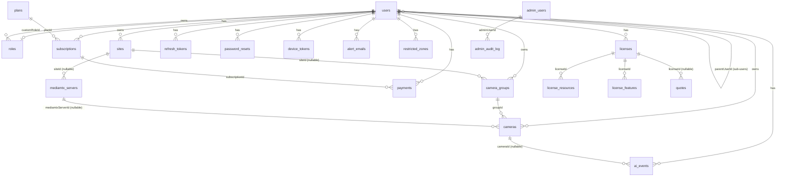

# Data Model & Migrations

This is the reference for every persistent store in the Drishyam monorepo: the MySQL schema behind `smart-cam-backend`, the Postgres schema behind `smart-cam-ai/vms_face`, the two Qdrant collections, the MinIO buckets, and the two independent migration systems that manage them. It is written for engineers who need to **change** the schema — add a column, add a table, backfill data, or recover a deployment whose migrations have gone sideways. Every claim below is traceable to a file in the repo; where the code and its own comments disagree, or where the schema has drifted from the models, that is called out explicitly rather than smoothed over.

---

## 1. The mental model

Three ideas explain almost everything else.

**Idea 1 — There are two databases, and they never join.** MySQL holds *VMS state*: who the customer is, what cameras they own, what plan they bought, what the stream supervisor last observed. Postgres holds the *AI domain*: enrolled people, face embeddings' metadata, detections, journeys. No query, ORM association, or foreign key crosses the boundary. The two are stitched together at the **application layer** by exactly two identifiers, described in §2.

**Idea 2 — In MySQL, `user_id` is the tenant key; in Postgres, `tenant_id` is.** Every MySQL row that belongs to a customer carries `user_id`, and that id is the **account owner** — a sub-user's rows are owned by their parent (`User.prototype.accountOwnerId()` in `smart-cam-backend/src/models/User.js` returns `parentUserId || id`). Every Postgres row carries `tenant_id`, derived deterministically from that same account-owner id. Two scoping words, one org.

**Idea 3 — Schema authority is split, and that is the source of most pain.** The backend has *migrations* (`smart-cam-backend/migrations/*.js`, run by `sequelize-cli`) **and** a `sequelize.sync()` call at boot (`src/server.js:41-44`). Four tables exist only because of `sync()`. MySQL DDL is not transactional, so a half-applied migration leaves the database ahead of `SequelizeMeta` and the container crash-loops. Read §7 and §9 before you write your first migration — they are the difference between a five-minute change and a lost afternoon.

---

## 2. The two databases and the boundary between them

| | MySQL (`drishyamvms`) | Postgres (`vms_face`) |
|---|---|---|
| Owner service | `smart-cam-backend` (Node/Express/Sequelize) | `smart-cam-ai/app/face_detection/vms_face` (FastAPI/SQLAlchemy) |
| Migration tool | `sequelize-cli`, ledger table `SequelizeMeta` | `alembic`, ledger table `alembic_version` |
| Migration dir | `smart-cam-backend/migrations/` | `smart-cam-ai/app/face_detection/vms_face/alembic/versions/` |
| Model dir | `smart-cam-backend/src/models/` | `.../vms_face/domain/models.py` (single file) |
| Tenant column | `user_id` (account-owner UUID) | `tenant_id` (derived UUIDv5) |
| Image (compose) | `mysql:8.4` | `pgvector/pgvector:pg16` |
| Extras | — | `pgvector` (required), `timescaledb` (optional) |
| Companion stores | S3/MinIO for recordings + event JPEGs | Qdrant (vectors), MinIO (crops, journey artifacts), Redis (streams) |

Neither database can see the other. `docker-compose.drisyam-original.yml` runs them as separate services (`mysql`, `postgres`) with separate volumes.

### 2.1 Link #1 — `Camera.monitorId` ⇄ `cameras.code`

The backend mints a camera's identity as a 24-character hex string:

```js
// smart-cam-backend/src/controllers/cameraGroup.controller.js:230
const monitorId = uuidv4().replace(/-/g, '').slice(0, 24);
```

That string is:

- stored as `cameras.monitor_id VARCHAR(24)`, unique per account via the `(user_id, monitor_id)` index;
- used verbatim as the Stream Service path name (`cam_<monitorId>`), which is why the AI's RTSP template is `rtsp://{host}:{port}/cam_{monitor_id}` (`settings.mediamtx_rtsp_template`);
- **stored again on the Postgres side as `cameras.code`** when the AI auto-creates its own camera row (`api/routes/legacy.py::_resolve_or_create_camera`, keyed on `(tenant_id, code)` with `ON CONFLICT DO NOTHING`);
- echoed back as `camera_code` in every Redis cam-state message, which the overlay bridge maps back to a `monitorId`:

```python
# smart-cam-ai/.../infra/backend_forwarder.py:26
- `camera_code` in the cam-state payload IS the backend's `monitorId`.
```

So: **`monitorId` (MySQL) === `code` (Postgres) === Stream Service path suffix.** Three names, one value. If you rename a camera path, you break all three.

Note the type asymmetry: MySQL declares `STRING(24)`, Postgres declares `String(64)`. The Postgres side is deliberately looser because the legacy `/set-camera` route accepts any operator-supplied monitor id.

### 2.2 Link #2 — org → `tenant_id` (UUIDv5, deterministic)

The AI service is multi-tenant and has no idea what a "user" is. The backend tells it, per request, by minting a short-lived HS256 JWT whose `tid` claim is the org's tenant UUID.

```js
// smart-cam-backend/src/utils/aiTenant.js
const AI_TENANT_NAMESPACE = '6f9a1c2e-1b3d-5e7f-8a9b-0c1d2e3f4a5b';
function orgRootId(user) { return String(user?.parentUserId || user?.id || ''); }
function aiTenantId(user) {
  const root = orgRootId(user);
  return root ? uuidv5(`drisyam-org:${root}`, AI_TENANT_NAMESPACE) : null;
}
```

```mermaid
flowchart LR
  A["MySQL users row<br/>(sub-user)"] -->|parentUserId| B["org root = account owner id"]
  A2["MySQL users row<br/>(account owner)"] -->|id| B
  B -->|uuidv5 'drisyam-org:{root}'| C["tenant_id UUID"]
  C -->|JWT claim tid| D["FastAPI current_tenant_id"]
  D --> E["Postgres rows<br/>WHERE tenant_id = ?"]
  D --> F["Qdrant filter<br/>payload.tenant_id"]
  D --> G["MinIO key prefix<br/>{tenant_id}/…"]
```

Why UUIDv5 rather than a `tenant_id` column on `users`? Because it needs **no migration and no synchronisation** — the mapping is a pure function, stable across restarts, token refreshes and even a database restore. The cost is that the namespace constant is now load-bearing:

> **Do not change `AI_TENANT_NAMESPACE`.** Changing it re-maps every organisation to a fresh tenant UUID and orphans every enrolled face, every Qdrant point and every MinIO crop. The comment in the file says exactly this; believe it.

On the AI side, the tenant row is created lazily and race-safely on first use (`_ensure_tenant_by_id` in `api/routes/legacy.py`), so there is no provisioning step.

When no JWT secret is configured (`config.aiJwt.secret` shorter than 32 chars), `mintAiToken` returns `null`, the `Authorization` header is omitted, and the AI falls back to `dev_bypass_allowed()` → the shared `drisyam-default` tenant. That fallback is the "everyone shares one watchlist" behaviour; it is gated on `VMS_ENV=dev` **and** `VMS_JWT_DEV_BYPASS=true` (`api/deps.py::current_principal`), and fails closed with a 503 in prod if the secret is missing.

---

## 3. MySQL: the VMS core

### 3.1 Entity-relationship diagram



`pricing_catalog` and `mail_config` are standalone (no FKs). `mail_config` is a single-row singleton.

### 3.2 Conventions that apply everywhere

- **Primary keys** are UUIDv4 rendered by MySQL as `CHAR(36) BINARY` (that is what `Sequelize.UUID` compiles to on the MySQL dialect). Migrations from 007 onward spell the type literally as `const CHAR36 = 'CHAR(36) BINARY'` so a Sequelize upgrade can't silently change it under us. `mail_config.id` is an `INTEGER` (always `1`) and `admin_audit_log.id` is a `BIGINT AUTO_INCREMENT` — those are the only exceptions.
- **Column naming** is snake_case in the database, camelCase in JS. `define: { timestamps: true, underscored: true }` in `src/config/database.js` makes this automatic — every table gets `created_at` / `updated_at`.
- **Soft deletes** exist on `users` only (`paranoid: true` → `deleted_at`). Everything else is a hard delete.
- **Charset** is `utf8mb4` / `utf8mb4_unicode_ci` on all tables created from migration 007 onward.
- **`references` is deliberately omitted from several model definitions.** The FK is added in the migration instead. Both `AIEvent.js` and `Site.js` carry the reasoning; the practical rule is: **if you see a UUID column with no `references` in a model, look for the FK in the migration — do not "fix" it by adding `references`.** Doing so re-triggers the errno-150 class of failure at `sync()` time.

### 3.3 Identity, RBAC, auth

#### `users` — `src/models/User.js`, migrations 001, 025, 026, 027

The account. Also the sub-user, via self-reference.

| Column | Type | Notes |
|---|---|---|
| `id` | UUID PK | |
| `name` | STRING(100) | |
| `username` | STRING(100) unique, nullable | Added at 025 for RBAC sub-users. Admins keep logging in by email. |
| `email` | STRING(255) unique, **nullable** | Relaxed from NOT NULL at 025 — a username-only sub-user may have no email. |
| `password` | STRING(255) | bcrypt, cost **13** (`BCRYPT_ROUNDS`). Hashed in `beforeCreate` / `beforeUpdate` hooks, so never hash before assigning. Existing rows keep their embedded cost and still verify. |
| `role` | ENUM | `admin \| manager \| operator \| viewer \| user`. `user` is a legacy alias treated as full access (`ROLE_CAPABILITIES` in `src/utils/constants.js`). Widened from `('admin','user')` at 025. |
| `scope` | JSON, nullable | `{ siteIds: [], groupIds: [] }`. NULL or empty arrays = **no restriction**. Nullable on purpose so pre-RBAC rows didn't need a NOT NULL alter. |
| `parentUserId` | UUID, nullable | The account owner. NULL means *this user is the account owner*. |
| `customRoleId` | UUID, nullable | Points at `roles`. When set it **overrides** the built-in tier (`resolveCapabilities()`). |
| `isPlatformAdmin` | BOOLEAN, default false | Gates the cross-tenant `/api/admin/*` console. Added at 027. Self-registration cannot set it — the register handler writes only name/email/password/role. Minted into the access JWT so `adminAuth` needs no DB round-trip. |
| `groupKey`, `apiKey` | STRING(255) | Legacy Shinobi carry-overs. |
| `isActive`, `emailVerified` | BOOLEAN | |
| `deleted_at` | DATE | Soft delete. |

**Non-obvious semantics.** Resource queries scope to `accountOwnerId()`, *then* narrow by `scope`. A sub-user does not own rows; their parent does. If you write a new resource query, copy that two-step or you will leak a sibling's cameras.

#### `roles` — `src/models/Role.js`, migration 026

Account-defined custom roles. `(user_id, name)` unique. `capabilities` is a JSON array of strings from `CAPABILITIES` (`view_live`, `view_playback`, `ack_alerts`, `manage_cameras`, `use_ai`, `manage_users`, `manage_settings`). Built-in tiers stay in code — this table only holds the extra roles an admin creates.

#### `refresh_tokens`, `password_resets`

Both are `(id, user_id, token unique, expires_at, …)`. `refresh_tokens` adds `is_revoked`; `password_resets` adds `used_at` and a static `PasswordReset.generateToken()` (48 random bytes hex).

> `password_resets` **has no migration.** It exists only because `sequelize.sync()` creates it. See §9.2.

### 3.4 Billing and entitlement

#### `plans` — `src/models/Plan.js`, migrations 002, 027

| Column | Notes |
|---|---|
| `name` | unique |
| `maxCameras`, `maxStorage` | quota (`maxStorage` is BIGINT bytes) |
| `price`, `billingCycle` | DECIMAL(10,2); `monthly \| yearly` |
| `stripeProductId`, `stripePriceId`, `razorpayPlanId` | gateway linkage |
| **`aiEnabled`** | **BOOLEAN, default false** |

`aiEnabled` is the **authoritative AI gate for the whole product.** `false` = "Basic VMS" (video management only); `true` = "AI+VMS". It is resolved by `src/services/entitlements.service.js`, which finds the user's most recent `active`/`trialing` subscription and reads `sub.plan.aiEnabled`. That one boolean drives:

- `capabilitiesFor()` in `auth.controller.js` — strips `use_ai` from the returned capability list;
- the `requireAiCapability` middleware — a Basic-plan account gets a 403 on every AI route even via `curl`, not just a hidden nav item;
- `getAiEntitledUserIds()` — one query feeding the runtime reconcile loop that **stops detection** for downgraded accounts.

Because migration 027 defaults the new column to `false`, seeder `003-seed-tier-plans.js` back-fills `ai_enabled=true` on the pre-existing paid tiers. If you add a plan by hand, set `ai_enabled` explicitly or AI silently disappears for that customer.

#### `subscriptions` — `src/models/Subscription.js`, migrations 003, 028

`(userId, planId, status, currentPeriodStart, currentPeriodEnd, stripeSubscriptionId, razorpaySubscriptionId, features)`. Indexed on `user_id` and `status`.

**`features` (JSON, nullable) has a load-bearing NULL.**

```js
// entitlements.service.js:47-52
const aiEnabled = sub?.plan?.aiEnabled === true;
let features = null;                       // null = ALL AI features the tier allows
if (aiEnabled && Array.isArray(sub?.features) && sub.features.length) {
  features = sub.features;                 // curated subset
}
```

- `NULL` → every AI feature the plan tier allows. This is the default AI+VMS behaviour.
- A non-empty JSON array of feature keys → **only** those (e.g. `face_detection`, `person_tracker`, `crowd_monitoring`, `restricted_zone`).
- An **empty array** falls back to "all" because of the `.length` check. If you want "no features", set `plans.ai_enabled = false` — do not set `features = []`.

This exists so one AI+VMS account can be scoped to a subset without minting a bespoke plan per customer.

#### `payments` — migration 004

`(userId, subscriptionId?, amount, currency='INR', gateway, gatewayPaymentId, status)`. Indexed on `user_id` and `gateway_payment_id`.

#### `licenses`, `license_resources`, `license_features`, `quotes` — migration 018

The enterprise (non-self-serve) billing model, driven from the admin console.

- `licenses`: `status` (`draft|trial|active|suspended|expired|terminated`), `term` (`trial_30|trial_60|trial_90|monthly|annual|biennial|triennial`), `startDate`/`endDate` (DATEONLY), `mrr`/`arr`/`setupFee`/`discountPct`, `licenseKey` (TEXT — intended to hold a signed JWT), `createdByAdminId`.
- `license_resources`: rows, not JSON, so quotas are queryable — `(licenseId, sku, quota, used, unitPriceSnapshot)`. The price snapshot freezes the rate at sale time.
- `license_features`: `(licenseId, featureKey, enabled, configJson)`.
- `quotes`: `lineItems` JSON, totals, `status` (`draft|sent|accepted|rejected|expired|converted`), optional `licenseId` for a converted quote.

#### `pricing_catalog` — `src/models/PricingCatalog.js`, migration 017

One row per pricing primitive. `sku` unique; `category` ENUM `camera|storage|compute|ai_feature|support|one_time|discount`; `unit` is a free string (`per_camera_month`, `per_gb_month`, `per_gpu_hour`, `flat_month`, `one_time`, `multiplier`); `unitPriceInr` is explicitly pinned with `field: 'unit_price_inr'` to match the name migration 017 creates. (No comment in the file explains why; `underscored` would derive the same name, so the mapping is belt-and-braces rather than load-bearing.)

### 3.5 Physical topology: sites, servers, groups, cameras

This is the part you will touch most, and the part with the most non-obvious semantics.

```
Site  ──►  CameraGroup (an NVR/DVR at one IP)  ──►  Camera (one channel on it)
  │                                                    │
  └──►  StreamServer  ◄────────────────────────────────┘  (mediamtxServerId)
```

#### `sites` — `src/models/Site.js`, migration 010

`(userId, name, slug, address, timezone='Asia/Kolkata', latitude, longitude, settings JSON, status)`. `(user_id, slug)` unique.

`settings` is the top of the inheritance chain: `settings.retentionDays` is the site-level recording retention default. Migration 010's comment explains why there is no `orgs` table — most customers are single-org, and an `orgId` column can be added later as nullable without touching existing rows.

#### `mediamtx_servers` — `src/models/StreamServer.js`, migration 011

The pool of Stream Service instances. Table name is still `mediamtx_servers`; the model class was renamed to `StreamServer` during the rebrand but **the table was not**, and neither was `Camera.mediamtxServerId`.

| Column | Notes |
|---|---|
| `siteId` | nullable — **NULL means the global/default pool** (the env-configured instance) |
| `hostname`, `apiUrl`, `apiUser`, `apiPass` | internal control plane the backend calls |
| `hlsUrl`, `webrtcUrl` | public URLs the **browser** hits |
| `rtspInternalHost`, `rtspInternalPort` (8554) | internal egress the AI worker subscribes to |
| `capacityCams` (200), `currentCams` | `currentCams` is maintained by the router on add/remove so server selection never has to `COUNT(*)` the cameras table. `StreamServer.prototype.headroom()` is `capacity - current`. |
| `status` | `online \| offline \| draining` |

Because `currentCams` is a denormalised counter, it **can drift** if a camera is deleted by a path that skips the router. Treat it as a hint for placement, not a source of truth for billing.

#### `camera_groups` — `src/models/CameraGroup.js`, migrations 007, 009, 012, 015, 020, 021, 023

One row per **physical recorder** (NVR/DVR), not per camera. `(user_id, host)` unique — one account cannot register the same recorder IP twice.

| Column | Notes |
|---|---|
| `host`, `port` (554), `httpPort` (80) | RTSP + ISAPI/HTTP endpoints of the device |
| `username`, `password` | **The credentials that actually get used** — see below |
| `deviceType` | Model says `STRING(32)`, default `hikvision`. Validated at the controller layer against the vendor driver registry (`services/vendors`), *not* as a DB enum, so adding a vendor needs no migration — **but see §9.5, the underlying column is still an ENUM.** |
| `totalChannels` | how many channels the recorder exposes |
| `status` | `online \| offline \| unknown` |
| `siteId` | nullable, FK added at migration 012 |
| `retentionDays` | UNSIGNED, nullable. NULL = inherit from site → global. |
| `streamQuality` | ENUM `auto \| main \| sub`, nullable. NULL = inherit. |
| `latitude`, `longitude` | added at 015 |

**Credential precedence — the thing that surprises people.** A `Camera` has its own `username`/`password` columns, but almost every consumer prefers the **group's**:

```js
// src/services/recordingSync.service.js:628-629  (same in playback.controller.js:91-92)
username: group?.username ?? camera.username,
password: group?.password ?? camera.password,   // model getter decrypts
```

Why: all channels behind one NVR authenticate with **one** account on the recorder. Per-camera creds only make sense for standalone IP cameras with no group. So if a customer changes the NVR password, you update the **group**, not 18 cameras — and conversely, setting a per-camera password on a grouped camera does nothing. The ISAPI probe paths (`deviceProbe.controller.js`, `talkback.service.js`) use `group.username` / `group.password` unconditionally.

#### `cameras` — `src/models/Camera.js`, migrations 005, 007, 009, 012, 016, 019, 020, 021, 023

One row per channel. `(user_id, monitor_id)` unique; indexed on `group_id`.

**Identity & connection**

| Column | Notes |
|---|---|
| `monitorId` | STRING(24) — see §2.1 |
| `type` | STRING(20), default `h264`. Drives whether a transcode path is needed. |
| `host`, `port` (554), `path` | RTSP source. `path` is the channel path on the recorder. |
| `channel` | INTEGER — channel number on the NVR (1 → `ch101`, 2 → `ch201`, …) |
| `username`, `password` | usually overridden by the group (above) |
| `groupId` | nullable FK to `camera_groups` |
| `mediamtxServerId` | nullable; **no `references` in the model on purpose**, FK added at migration 012 |
| `s3Path` | `recordings/{userId}/{groupName}/{cameraName}/` |
| `width`, `height`, `fps` (30) | probed profile |

**Encrypted credentials.** `password` is `STRING(512)` (widened at migration 023) with transparent AES-256-GCM via `src/utils/fieldCrypto.js`:

```js
password: {
  type: DataTypes.STRING(512),
  set(value) { this.setDataValue('password', fieldCrypto.encrypt(value)); },
  get() { return fieldCrypto.decrypt(this.getDataValue('password')); },
}
```

The scheme is deliberately fail-open during rollout: with `CAMERA_CRED_KEY` unset, `encrypt()` is a passthrough and `decrypt()` returns the value unchanged, so legacy plaintext rows keep working and re-encrypt the next time they are saved. Ciphertext is self-describing (`enc:v1:` prefix + base64 of nonce‖ct‖tag). A tagged value **with the key unset throws** rather than returning scrambled bytes. The AI side mirrors this scheme for `cameras.rtsp_url` (`domain/types.py::EncryptedString` + `VMS_CAMERA_CRED_KEY`).

> Because the getter decrypts, **`camera.password` in JS is always plaintext.** Never log it, and never `JSON.stringify` a raw Camera instance into an API response.

**Inheritance columns**

`retentionDays` and `streamQuality` are both nullable overrides. The resolution order is implemented in `src/services/recordingRetention.service.js`:

```
Camera.retentionDays → Group.retentionDays → Site.settings.retentionDays → DEFAULT_RETENTION_DAYS (env, 30)
```

and pushed to the Stream Service as `recordDeleteAfter` in Go duration form — `retentionToMediamtx()` returns `` `${days*24}h` `` because Go durations have no `d` unit. `streamQuality` resolves `Camera → Group → 'auto'`; picking `sub` is the main lever for cutting ingest at large camera counts.

**Supervisor health fields (migration 016, extended at 019)**

These are written by `streamSupervisor.service.js` on every state transition. They are *observations*, not configuration — never set them from a controller.

Rows are written **only on a state transition**, not on every tick — so each value is "as of the last transition", not a live sample.

| Column | Meaning |
|---|---|
| `supervisorState` | ENUM `pending, connecting, streaming, degraded, offline, quarantined, standby` |
| `bpsIn` | UNSIGNED — ingress bitrate at the moment of the last transition |
| `lastSeenAt` | last transition into a **publicly-online** state. `publicStatus()` maps `streaming`, `degraded` **and `standby`** to `online`, so a camera that only ever reaches `standby` still gets `lastSeenAt` stamped. It is *not* "last time the Stream Service reported `ready=true`" — don't use it as a last-known-good-stream signal. |
| `lastOfflineAt` | last public online → offline transition (drives alerting); `quarantined` counts as offline |
| `flapCount24h` | incremented on `STREAMING → non-STREAMING`. **Despite the name and migration 016's comment, nothing decays it** — no code resets it on a 24 h boundary, so it is a lifetime counter. The rolling window that actually triggers quarantine is the in-memory `entry.flaps` array (`SUPERVISOR_FLAP_WINDOW_MS`, 120 000 ms default, 4 in compose via `SUPERVISOR_FLAP_LIMIT`). Treat the column as a "has this camera ever been unstable" hint. |
| `quarantineUntil` | if non-NULL, the supervisor backs off until this timestamp; cleared on the transition out of `quarantined` |

Two details matter:

1. **`standby` was added by migration 019 to fix a real outage class.** Cameras are pulled on demand, so an idle camera never reaches `ready=true` and the whole wall looked offline. `standby` means "the host is reachable per the `cameraReachability` prober, but nothing is pulling the path" — a *healthy* state. Before 019 existed, the supervisor's attempt to persist `'standby'` failed with MySQL's `Data truncated for column 'supervisor_state'`, so the state silently never stuck.
2. **`flapCount24h` pins its column name explicitly** (`field: 'flap_count_24h'`). Sequelize's `underscored` mode would map `flapCount24h` → `flap_count24h` (no underscore before digits), which does not match the migration. If you add another `<name><digits>` column, pin it the same way.

Quarantine exists because many cameras share one recorder. Reconnecting all of them at once exceeds the NVR's session cap and knocks *healthy* channels offline; backing a flapper off for 10 minutes (`SUPERVISOR_QUARANTINE_MS` in compose) lets the recorder's RTSP daemon recover instead of re-crashing.

**`settings` (JSON, nullable)** — per-camera AI/feature config, kept as JSON precisely so it can evolve without migrations. Documented shape: `{ ai: { enabled, fps, detectors, behaviors, faceWatchlist }, abr: { enabled } }`. `sites.settings` is the same idea one level up, and it is a live inheritance level (`recordingRetention.service.js` reads `site.settings.retentionDays`).

> `camera_groups.settings` is a trap. Migration 009 adds the column to **both** `cameras` and `camera_groups`, but `CameraGroup.js` never declares it — so `group.settings` is `undefined` through the ORM, and nothing in `src/` reads it. If you want a group level in a settings chain, add the attribute to the model first; don't assume it already works because the column exists.

### 3.6 Events, alerting and zones

#### `ai_events` — `src/models/AIEvent.js`, migrations 008, 022

The backend's **mirror** of AI detections. The AI service keeps its own authoritative `detection_events` in Postgres; this MySQL table is what the operator UI reads.

| Column | Notes |
|---|---|
| `userId`, `cameraId`, `monitorId` | `cameraId` nullable (`ON DELETE SET NULL`); resolved from `(userId, monitorId)` if the worker didn't supply it |
| `eventType` | STRING(64) — e.g. `tripwire.entry`, `person.unknown`, `zone.intrusion` |
| `severity` | ENUM `info \| warning \| critical` |
| `ts` | event time (not `created_at`) |
| `bbox` | JSON `[x1,y1,x2,y2]` in inference-frame pixels |
| `trackId` | **model says `STRING(64)`; migration 008 created `INTEGER` — see §9.4** |
| `confidence` | FLOAT |
| `payload` | JSON — `matchedName`, `action`, `zoneId`, … |
| `snapshotKey` | S3 key of the evidence JPEG. **Image bytes never go into MySQL** — `internal.routes.js` base64-decodes the incoming snapshot and uploads it to S3 at `ai/events/{userId}/{monitorId}/{iso-ts}.jpg` before insert, best-effort (an S3 hiccup does not fail ingest). |
| `acknowledgedAt` | set by an operator acknowledging the alert |

Indexes: `(user_id, ts)`, `(camera_id, ts)`, `(monitor_id, ts)`, `(event_type)`, plus migration 022's `ix_ai_events_user_severity_ts` and `ix_ai_events_user_ack`. The latter two close the "unacknowledged alerts for me" and "critical alerts for me" queries, which were full scans; `user_id` leads both so the index also enforces tenant scoping at the storage layer.

**This table is the one that grows without bound**, so `src/services/aiEventRetention.service.js` prunes it: rows older than `AI_EVENT_RETENTION_DAYS` (default 90) are deleted every 6 h in 5000-row batches so one huge `DELETE` can't hold a long table lock. Set the env to `0` to disable.

> **Not everything the AI sees lands here.** Routine per-frame boxes ride an *ephemeral* channel (`POST /api/internal/ai/overlay` → socket `ai.live`, never persisted). Only debounced, alert-worthy events go to `/api/internal/ai/events` and become rows. That split is what stopped the alert flood; if you add a new detector, put its per-frame output on the overlay channel, not here.

#### `device_tokens` — migration 024

One row per mobile device. `token` is an Expo push token, unique (`ux_device_tokens_token`). `platform` ENUM `ios|android|web`. `disabled` is flipped by the push sender when Expo reports `DeviceNotRegistered`, so dead tokens stop consuming sends. Alerts fan out to every enabled token belonging to the event's user.

#### `alert_emails` — `src/models/AlertEmail.js`, **no migration**

The email analogue of `device_tokens`. `(user_id, email)` unique (`uq_alert_emails_user_email`).

- `minSeverity` ENUM `warning|critical` is the **per-recipient priority gate**: a recipient set to `critical` gets only critical; `warning` gets warning + critical; `info` never emails anyone.
- `eventTypes` JSON, nullable — which categories this recipient receives (`watchlist | unknown | intrusion | weapon | fire | crowd | other`). **NULL or empty = all categories.**

#### `mail_config` — `src/models/MailConfig.js`, **no migration**

Singleton (`id` INTEGER default 1) SMTP config managed by a platform admin. `provider` is `gmail | webmail | custom`. `password` is TEXT, encrypted through the same `fieldCrypto` as camera creds.

#### `restricted_zones` — `src/models/RestrictedZone.js`, **no migration**

One row per no-entry area per camera; many zones per camera and per user are just many rows. Keyed for the AI intrusion engine by `(user_id, monitor_id)`.

| Column | Notes |
|---|---|
| `shape` | `polygon \| rectangle` |
| `points` | JSON `[{x,y}, …]`, **normalised 0..100** (not pixels) |
| `rect` | JSON `{x,y,w,h}`, also 0..100 |
| `priority`, `schedule` | STRING; `schedule` default `always` |
| `armWindow` | JSON `{from,to}` — named `armWindow` because `window` is a reserved word |
| `dwellSec` (5), `alertOnEntry` | the L3 debounce parameters |
| `allowed` | JSON array of person categories that pass through |
| `enabled` | BOOLEAN |

Normalised coordinates mean a zone survives a resolution change on the camera; if you add a new geometry field, keep the same 0..100 convention or the overlay and the engine will disagree.

### 3.7 Platform-admin tables (no Sequelize models)

`admin_users` (migration 013) and `admin_audit_log` (migration 014) exist in the schema but have **no model file and no code reading them** (`grep -rn 'admin_users' smart-cam-backend/src/` returns nothing). The cross-tenant console is instead gated by `users.isPlatformAdmin` (migration 027). Treat 013/014 as dormant schema: they cost nothing, but do not assume they are populated.

- `admin_users`: `(email unique, name, password_hash, role ENUM superadmin|support|billing|readonly, mfa_enabled, mfa_secret, last_login_at, last_login_ip, status)`
- `admin_audit_log`: `BIGINT` auto-increment PK, `(admin_user_id FK, action, resource_type, resource_id, payload JSON, ip, user_agent, ts)` with indexes on `(admin_user_id, ts)`, `(resource_type, resource_id)`, `(action, ts)`.

---

## 4. Postgres: the AI domain

All of it lives in one file — `smart-cam-ai/app/face_detection/vms_face/domain/models.py` — and is migrated by six Alembic revisions.

### 4.1 The tenant scoping rule

**Every AI table carries `tenant_id`, and every read must filter on it.** The tenant comes from the verified JWT, never from a query parameter:

```python
# api/deps.py
def current_tenant_id(p: Principal = Depends(current_principal)) -> uuid.UUID:
    """Tenant scope of the current request — derived from the JWT claim, not
    a query string."""
    return p.tenant_id
```

Routes follow two patterns, both visible in `api/routes/persons.py`:

- **filter on read** — `select(Person).where(Person.tenant_id == tenant_id)`
- **verify on fetch-by-id** — `_person_or_404(p, tenant_id)` raises 404 (not 403) when `p.tenant_id != tenant_id`, so a cross-tenant id probe cannot even confirm existence.
- **reject on write** — a create body carrying a mismatched `tenant_id` gets a 403 (`"tenant_id does not match token"`).

Only `tenants.id`, `persons ↔ tenants` and `cameras ↔ tenants` have real FKs to `tenants`. Everything else carries a bare indexed `tenant_id` UUID column — cheap, and it keeps `detection_events` hypertable-friendly.

### 4.2 Table reference

| Table | Revision | Purpose |
|---|---|---|
| `tenants` | 0001 | `(id, name unique, created_at)`. Rows are created lazily on first authenticated use. |
| `persons` | 0001 | The Global Person ID. `(tenant_id, external_id)` unique — `external_id` is the customer's own key (roll number, employee id). `role` ENUM `student\|staff\|faculty\|visitor\|blacklist\|unknown`. `metadata` JSON is mapped as `metadata_json` in Python because `metadata` collides with SQLAlchemy's declarative attribute. |
| `face_enrollments` | 0001 | One image-derived embedding per row. `qdrant_point_id` (unique) is the **link to the enrolled Qdrant collection**; `snapshot_uri` is the MinIO key. `source` is `upload \| auto-enroll \| import`. Cascade-deleted with the person. |
| `cameras` | 0001, +0006 | `(tenant_id, code)` unique — `code` is the backend's `monitorId`. `rtsp_url` is an `EncryptedString`. `target_fps` (8.0) and `detection_input_size` (960) are per-camera runtime knobs. Revision 0006 added spatial topology: `lat`, `lng`, `building`, `floor`, `orientation` (degrees, 0=N). |
| `detection_events` | 0001, +0003 | One row per emitted detection/match. `kind` ENUM `detection\|match\|unknown\|alert\|health`. `track_id` is a **string** (`"t00000047"`), never an int. Indexed on tenant, camera, track, person, kind, `occurred_at`. Converted to a TimescaleDB hypertable by 0003 *if the extension exists*. |
| `audit_log` | 0002 | Append-only DPDP record. `(actor, actor_kind, action, target_type, target_id, reason, metadata, occurred_at)`. The docstring is the requirement: log every 1:N query, every enrollment, every deletion, with operator identity and reason. Human searches are logged at 100%; automated 1:N queries are sampled *when they produce hits* — the moment biometric data binds to an identity. |
| `track_links` | 0003 | Cross-camera ReID edges from the ReID worker. Directed `(a, b)` where `a` is the older sighting — **traverse undirected** when forming a transitive global identity. `uq_track_link_pair` on `(a_track_id, a_camera_id, b_track_id, b_camera_id)` makes re-emission a no-op. |
| `face_learning_samples` | 0004 | Operator-reviewed CCTV crops proposed for gallery enrichment. Deliberately **separate from `face_enrollments`** — a sample only becomes trusted gallery data after explicit approval. `status` defaults `pending`. `event_id` is unique (one sample per event). |
| `footfall_minute_buckets` | 0005 | Per-camera, per-minute line-crossing aggregate. Composite PK `(camera_id, bucket_minute)` so writes are `INSERT … ON CONFLICT DO UPDATE` and the service never reads first. Per-minute is the coarsest bucket that still renders "spike in the last 10 minutes"; at 100 cameras × 1440 min/day ≈ 144k rows/day, plain btrees suffice. |
| `camera_edges` | 0006 | Directed adjacency `(from_camera, to_camera)` PK with `t_min_sec` (1) / `t_max_sec` (300) transit window and a `prob` prior. Powers the multiplicative time/space gate: a physically impossible transition **vetoes** a high appearance score. |
| `embeddings` | 0006 | pgvector mirror keyed by `detection_id`. `face_vec` / `body_vec` are `Vector(512)` with HNSW cosine indexes. Qdrant stays the ANN hot path; this table exists for transactional joins against `detection_events` and as a durable rebuild source. `face_vec` is NULL when no usable face was in the crop. |
| `journeys` | 0006 | A reconstructed cross-camera movement. `mode` = `forensic` (upload→search→fuse) or `live` (folded incrementally). `graph` is JSONB `{nodes:[{camera_id,t}], edges:[{from,to,prob}]}`. `video_uri` / `report_uri` point at MinIO artifacts. `status` = `building\|ready\|failed`. |
| `journey_stops` | 0006 | One clustered camera visit, ordered by `seq`; `(journey_id, seq)` unique. |

`FACE_DIM = BODY_DIM = 512` are declared **twice** — in `domain/models.py` and again in `alembic/versions/0006_journey.py`. They must also match `settings.qdrant_vector_size`. Three places, one number.

### 4.3 TimescaleDB is optional, and the code knows it

Revision `0003_track_links_and_timescaledb` wraps the hypertable conversion in a `DO $$ … $$` block gated on `pg_extension`:

```sql
IF EXISTS (SELECT 1 FROM pg_extension WHERE extname = 'timescaledb') THEN
  PERFORM create_hypertable('detection_events','occurred_at',
    chunk_time_interval => INTERVAL '1 day', migrate_data => true, if_not_exists => true);
  -- + 7-day compression policy, 90-day chunk-level retention
ELSE
  RAISE NOTICE 'timescaledb extension not present; detection_events stays a regular table';
END IF;
```

The compose image is `pgvector/pgvector:pg16`, which does **not** ship Timescale — so in practice `detection_events` is a regular table and retention is enforced by `workers/retention_worker.py` (`DELETE … WHERE occurred_at < cutoff`, `retention_event_days` default 90). To enable Timescale later: `CREATE EXTENSION timescaledb;` then re-run `alembic upgrade head` — the DO block is idempotent.

`pgvector` is *not* optional: 0006 runs `CREATE EXTENSION IF NOT EXISTS vector` before creating any `Vector` column. The downgrade deliberately does **not** drop the extension.

### 4.4 What the retention worker actually deletes

`workers/retention_worker.py`, driven by `RETENTION_*` settings:

| Target | Setting | Default |
|---|---|---|
| `detection_events` rows | `retention_event_days` | 90 |
| `audit_log` rows | `retention_audit_log_days` | 365 |
| MinIO snapshot objects | `retention_snapshot_days` | 7 |
| Qdrant appearance points | `retention_event_days` | 90 (range delete on `occurred_at_ts`) |

Snapshots are pruned by MinIO's `last_modified`, not by parsing the timestamp out of the key.

---

## 5. Qdrant: two collections, and why

`infra/qdrant.py` wraps one `QdrantStore` per collection. Both use `size = settings.qdrant_vector_size` (512) and `Distance.Cosine` on L2-normed embeddings, with payload indexes on `tenant_id`, `person_id`, `camera_id`, `role` (all KEYWORD) and `occurred_at_ts` (INTEGER).

| | `vms_enrolled` (`qdrant_collection_enrolled`) | `vms_appearance` (`qdrant_collection_appearance`) |
|---|---|---|
| Contents | the gallery — one point per `face_enrollments` row | the appearance log — one point per detection event |
| Size profile | small, hot, replicated | large, time-partitioned |
| Written by | `services/enrollment.py` | `services/face_matcher.py::log_appearance`, called from `workers/match_worker.py` |
| Payload | `tenant_id`, `person_id`, `full_name`, `role`, `source`, `recognizer` | `tenant_id`, `person_id?`, `camera_id`, `event_id`, `track_id?`, `occurred_at`, `occurred_at_ts`, plus fusion signals (`body_vec`, `upper_color`, `lower_color`, `yaw`, `pitch`, `face_px`, `quality_score`) |
| Used for | live 1:N recognition | forensic / journey search |
| Pruned by | never (deleted with the person) | `delete_older_than()` on `occurred_at_ts` |
| Toggle | always on | `QDRANT_APPEARANCE_ENABLED` (default true) |

Splitting them is deliberate: sharing one collection is "architecturally wrong above ~1M points" (the comment above the two collection settings in `config/settings.py:34`), because the hot gallery would be dragged into the same shard/segment lifecycle as a fast-growing time-series log.

Three operational facts worth knowing:

1. **Every `search()` injects `tenant_id` as a mandatory filter.** There is no unscoped search path.
2. **Schema drift is fatal and loud.** `_validate_collection_schema()` raises at startup if a pre-existing collection's vector size or distance doesn't match settings, with the message *"partial migrations corrupt search results."* This is why you cannot just bump `QDRANT_VECTOR_SIZE`.
3. **Switching recognizer backend invalidates the gallery.** AdaFace and ArcFace embeddings are not interchangeable (`settings.py` says so explicitly, and thresholds differ: `insightface_rec_threshold` 0.62 vs `recognizer_adaface_threshold` 0.35). Changing `RECOGNIZER_BACKEND` requires re-enrolling every face.

Enrollment writes to Qdrant **first**, then inserts the `face_enrollments` row (`services/enrollment.py:95-118`). The comment is honest about the consequence: a DB failure leaves an orphan vector, and the janitor to clean those up is not written yet.

---

## 6. MinIO / S3 bucket layout

| Bucket (setting) | Default | Key layout | Written by |
|---|---|---|---|
| `minio_bucket_snapshots` | `vms-snapshots` | `{tenant_id}/{camera_id}/{track_id}/{YYYYMMDDTHHMMSS}_{rand8}.jpg` | `pipeline/orchestrator.py::_snapshot_key` via the bounded `SnapshotPump` |
| `minio_bucket_enrollments` | `vms-enrollments` | `{tenant_id}/{person_id}/{YYYYMMDDTHHMMSS}_{rand8}.jpg` | `services/enrollment.py` |
| `minio_bucket_output` | `vms-person-tracker` | `videos/{job_id}.mp4`, `reports/{job_id}.pdf` | `workers/stitch_worker.py`, `journey/pdf.py` |

Buckets are created idempotently by `ObjectStore.ensure_buckets()` at API startup, and `put_bytes()` self-heals a `NoSuchBucket` error by creating the bucket and retrying — necessary because the stitch worker never runs the API lifespan.

**The tenant is the first path segment** of both snapshot and enrollment keys, which is what makes per-tenant deletion (`persons.py` prefix-delete on person removal) a cheap prefix scan.

References are stored as `s3://{bucket}/{key}` URIs in `detection_events.snapshot_uri`, `face_enrollments.snapshot_uri`, `journeys.video_uri` / `report_uri`. Parse them with `ObjectStore.parse_s3_uri()`; don't split on `/` by hand.

The backend's own S3 usage is separate and lives in MySQL as plain keys, not URIs: `ai_events.snapshot_key` = `ai/events/{userId}/{monitorId}/{iso-ts}.jpg`, and `cameras.s3_path` = `recordings/{userId}/{groupName}/{cameraName}/`.

---

## 7. Migrations

### 7.1 Two systems, same rules

| | Backend (MySQL) | AI (Postgres) |
|---|---|---|
| Tool | `sequelize-cli` v6 | `alembic` |
| Config | `.sequelizerc` → `src/config/database.js` | `alembic.ini` + `alembic/env.py` (reads `settings.postgres_dsn`) |
| Ledger | `SequelizeMeta` (filename strings) | `alembic_version` (single revision id) |
| Ordering | **lexicographic filename** — `001-`, `002-`, … | **explicit `down_revision` chain** |
| Per-migration transaction | ❌ MySQL DDL is not transactional | ✅ `env.py` wraps `run_migrations()` in `context.begin_transaction()` |
| Naming | `NNN-kebab-description.js` | `NNNN_snake_description.py` |

Both are append-only ledgers of *what has already run*. That gives the one rule that matters:

> **A migration is immutable once merged.** Every deployed environment has already recorded it as applied and will never re-run it. Editing the file changes only fresh databases, and silently creates two schemas that claim to be the same version. To change something a merged migration did, write a **new** migration.

The corollary for the backend: **never renumber or insert between existing numbers.** `SequelizeMeta` stores filenames, so renaming `022-…js` orphans the old row and re-runs the new name against a schema that already has the change.

### 7.2 The ordering rule

- **Backend:** the next migration is `029-…`. Sequelize sorts filenames as strings, so keep the three-digit zero-padded prefix. `010` sorts after `009` only because of the padding.
- **AI:** the next revision sets `down_revision = "0006_journey"` and picks a new `revision` id. Alembic follows the chain, not the filename. Two people creating a revision from the same head produces a *branch*, which Alembic refuses to `upgrade head` until you merge it (`alembic merge`).

### 7.3 How the containers run them at boot

**Backend** — `smart-cam-backend/Dockerfile`:

```dockerfile
ENV NODE_ENV=development
CMD ["sh", "-c", "npx sequelize-cli db:migrate && (npx sequelize-cli db:seed:all || true) && node src/server.js"]
```

and `docker-compose.drisyam-original.yml` overrides the command with the same sequence plus `nodemon`. Note two things: migrations **gate** server start (a failing migration means no backend), while seeds are explicitly allowed to fail (`|| true`) because `db:seed:all` re-runs on every boot and the seeders are written to be idempotent.

**AI** — the API container runs migrations inline:

```yaml
command: ["sh","-c","alembic upgrade head && uvicorn vms_face.api.main:app --host 0.0.0.0 --port ${PORT:-8001}"]
```

The container image also has a `bootstrap` role (`docker-entrypoint.sh`) intended as an init container — `cd /app/vms_face && alembic upgrade head && python -m vms_face.bootstrap` — which additionally ensures the Qdrant collection, MinIO buckets and the default tenant. The current compose does **not** use it; see §9.6 for the race that creates.

### 7.4 Running them by hand

```bash
# Backend (from smart-cam-backend/)
npm run db:migrate            # sequelize-cli db:migrate
npm run db:migrate:undo       # roll back the last one
npm run db:seed               # db:seed:all
npx sequelize-cli db:migrate:status   # what's applied vs pending

# In the running container
docker compose -p drisyam-original exec smart-cam-backend npx sequelize-cli db:migrate

# AI (from smart-cam-ai/app/face_detection/vms_face/)
alembic upgrade head
alembic current                 # the applied revision
alembic history --verbose       # the chain
alembic downgrade -1

# In the running container (the entrypoint has an `alembic` role that cd's for you)
docker compose -p drisyam-original exec smart-cam-ai \
  sh -c "cd /app/vms_face && alembic current"
```

`npm run db:reset` (`undo:all && migrate && seed:all`) exists and is a **development-only** command — it drops every table.

### 7.5 The `sync()` overlap you must understand

`src/server.js`:

```js
// Sync models — only create tables that don't exist (no alter, avoids MySQL 64-key limit)
if (config.env === 'development') {
  await sequelize.sync();
}
```

`sequelize.sync()` with no options issues `CREATE TABLE IF NOT EXISTS` per model and adds any missing model-declared indexes. It **does not** add columns to existing tables and **does not** change column types. Two consequences:

1. Four tables — `password_resets`, `alert_emails`, `mail_config`, `restricted_zones` — have **no migration at all** and exist purely because `sync()` created them.
2. `NODE_ENV=development` is set in the Dockerfile *and* in the deployed `.env`, so `sync()` runs in the "production" demo deployment too. That is currently the only reason password reset, alert emails, SMTP config and restricted zones work at all.

> **This is a latent outage.** The day someone sets `NODE_ENV=production` — which is the correct thing to do, and which `src/config/env.js` fully supports — those four tables stop being created on a fresh database and four features 500. The fix is to write migrations for them (§8.2) *before* flipping the env, not after.

---

## 8. How do I…

### 8.1 …add a column

Two edits, always in this order.

**1. Write the migration.** Copy the idempotent helper that most column-adding migrations from 009 onward use (009, 012, 015, 016, 020, 021, 023, 025, 026 — 027 and 028 are the ones that skipped it, and §9.1 is what that cost):

```js
// smart-cam-backend/migrations/029-add-camera-vendor-profile.js
'use strict';
async function addColumnIfNotExists(queryInterface, table, column, definition) {
  const desc = await queryInterface.describeTable(table).catch(() => null);
  if (!desc || desc[column]) return;
  await queryInterface.addColumn(table, column, definition);
}
module.exports = {
  async up(queryInterface, Sequelize) {
    await addColumnIfNotExists(queryInterface, 'cameras', 'vendor_profile', {
      type: Sequelize.STRING(64), allowNull: true,   // NULL = inherit / unset
    });
  },
  async down(queryInterface) {
    await queryInterface.removeColumn('cameras', 'vendor_profile').catch(() => {});
  },
};
```

Rules for the column itself:

- **Nullable, or with a default.** `cameras` and `ai_events` are large; a `NOT NULL` add without a default rewrites the table and can fail outright on existing rows.
- **NULL should mean "inherit" or "unset"**, matching `retentionDays` / `streamQuality`. That is the house pattern and the UI already understands it.
- If the name ends in digits, add `field: '…'` to the model (see `flapCount24h`).

**2. Add it to the model** in `src/models/<Model>.js` with a comment saying what NULL means.

**Verify:**

```bash
npm run db:migrate
docker compose -p drisyam-original exec mysql \
  mysql -uroot drishyamvms -e "SHOW COLUMNS FROM cameras LIKE 'vendor_profile'"
npx sequelize-cli db:migrate:status | tail -3
```

On the **AI** side, the equivalent is `alembic revision -m "camera vendor profile"`, then `op.add_column("cameras", sa.Column("vendor_profile", sa.String(64), nullable=True))` plus the `mapped_column` in `domain/models.py`. Alembic autogenerate is *not* wired up here — every revision in `versions/` is hand-written, and 0003/0006 contain raw SQL that autogenerate would destroy. Write revisions by hand.

### 8.2 …add a table

1. New migration `NNN-create-<table>.js`. Start with the existence guard every table migration uses, so a re-run is a no-op:

```js
const tables = await queryInterface.showAllTables();
const norm = tables.map((t) => (typeof t === 'string' ? t : t.tableName));  // 026 does this
if (norm.includes('widgets')) return;
await queryInterface.createTable('widgets', {
  id:      { type: 'CHAR(36) BINARY', primaryKey: true, allowNull: false },
  user_id: { type: 'CHAR(36) BINARY', allowNull: false },
  // …
  created_at: { type: Sequelize.DATE, allowNull: false, defaultValue: Sequelize.literal('CURRENT_TIMESTAMP') },
  updated_at: { type: Sequelize.DATE, allowNull: false, defaultValue: Sequelize.literal('CURRENT_TIMESTAMP') },
}, { charset: 'utf8mb4', collate: 'utf8mb4_unicode_ci' });
```

2. Use the literal `'CHAR(36) BINARY'` for every UUID column, and add `created_at` / `updated_at` explicitly — `createTable` does not add them for you even though the models expect them.
3. Add indexes in the same migration, `.catch(() => {})`-wrapped.
4. Create `src/models/Widget.js`, register it in `src/models/index.js` (both the `require` and the `models` object — it is a hand-maintained list, there is no directory scan), and define `Widget.associate`.
5. Decide about the FK. If the parent's `id` is `CHAR(36) BINARY` (it always is), a `references` in the **migration** is fine. Do **not** put `references` in the model for a UUID FK unless an existing model already does.

**Verify:** `npm run db:migrate`, then `SHOW CREATE TABLE widgets\G` and confirm the collation line reads `utf8mb4_unicode_ci`.

### 8.3 …add an index

Use the guard from migration 022 — it tolerates both "already exists" and older drivers:

```js
async function addIndexIfMissing(queryInterface, table, fields, name) {
  try {
    const existing = await queryInterface.showIndex(table).catch(() => []);
    if (existing.some((ix) => ix.name === name)) return;
    await queryInterface.addIndex(table, { fields, name });
  } catch (err) {
    if (!/duplicate|exists/i.test(err.message)) throw err;
  }
}
```

**Always name the index explicitly.** Sequelize's generated names differ between the migration path and the `sync()` path, which is how you end up with two indexes doing the same job. Lead multi-tenant indexes with `user_id` so the index also scopes the tenant (that is why `ix_ai_events_user_severity_ts` starts with `user_id`).

Then mirror it in the model's `indexes: []` array **with the same `name`** — otherwise `sync()` sees it as missing and adds a second one.

**Verify:**

```sql
SHOW INDEX FROM ai_events;
EXPLAIN SELECT * FROM ai_events WHERE user_id=? AND acknowledged_at IS NULL ORDER BY ts DESC LIMIT 50;
```

The `EXPLAIN` should show your index in `key`, not `NULL` with `Using filesort`.

### 8.4 …write a data backfill safely

MySQL DDL is not transactional and `queryInterface` gives you no rollback for a large `UPDATE`. So the safe shape is: **structure first, data second, batched, idempotent, and re-runnable.**

```js
'use strict';
// 030-backfill-camera-vendor-profile.js
module.exports = {
  async up(queryInterface) {
    const BATCH = 2000;
    for (;;) {
      const [res] = await queryInterface.sequelize.query(
        `UPDATE cameras c
            JOIN camera_groups g ON g.id = c.group_id
            SET c.vendor_profile = g.device_type
          WHERE c.vendor_profile IS NULL
            AND g.device_type IS NOT NULL
          LIMIT ${BATCH}`,
      );
      const changed = res?.affectedRows ?? 0;
      if (changed < BATCH) break;
    }
  },
  async down() { /* data-only: intentionally not reversed */ },
};
```

The rules behind that shape:

1. **Never combine DDL and a big backfill in one migration.** If the `UPDATE` fails halfway, the `ALTER` is already committed and the migration is unrecorded → §9.1's crash loop. Add the column in migration *N*, backfill in *N+1*.
2. **Batch with `LIMIT` and loop until under-full.** One 400k-row `UPDATE` holds locks long enough to stall live traffic. `aiEventRetention.service.js` uses exactly this loop shape for deletes.
3. **Make the `WHERE` clause self-limiting** (`WHERE vendor_profile IS NULL`), so a partial run resumes correctly and a full re-run is a no-op.
4. **Prefer set-based SQL over loading rows into JS.** A `JOIN … SET` beats `findAll()` + `save()` by orders of magnitude and doesn't blow the heap.
5. **`down()` for a data migration should usually be a no-op.** You cannot un-know the old values; pretending otherwise produces a "rollback" that destroys data.
6. **Dry-run first.** Change `UPDATE` to `SELECT COUNT(*)` with the same `WHERE` and run it against a copy of production before you merge.

For a very large or slow backfill, consider not making it a migration at all — put it in `smart-cam-backend/scripts/` as a one-shot you run deliberately, because a migration that takes 20 minutes blocks container startup and Docker will restart the container mid-run.

---

## 9. Gotchas

### 9.1 A half-applied migration crash-loops the backend forever

**What happens.** MySQL does not support transactional DDL. `sequelize-cli` runs a migration's `up()` and, only on success, inserts the filename into `SequelizeMeta`. A migration with two `addColumn` calls where the second fails leaves the **first column committed and nothing recorded**.

The concrete landmine in this repo is migration `027-add-platform-admin-and-ai-tier.js` — the only migration that issues **two** unguarded DDL statements in one `up()`. (It is not the only unguarded migration: 028 has a single unguarded `addColumn`, and the original 001–006 `createTable` migrations have no existence guard either. But a single statement either lands or doesn't; 027 is the one that can leave the database half-changed.)

```js
await queryInterface.addColumn('users', 'is_platform_admin', { ... });
await queryInterface.addColumn('plans', 'ai_enabled', { ... });   // if this fails…
```

Next boot, the container's `db:migrate` re-runs 027 from the top and dies on:

```
ERROR: Duplicate column name 'is_platform_admin'
```

Because migrations gate `node src/server.js` in the CMD, the backend never starts. `restart: unless-stopped` restarts it. It fails again. Forever. The symptom in the field is *"the backend container is restarting and the logs are one line"* — and nothing about the message says "migration", so people go looking at the app.

**How to detect it.**

```bash
docker compose -p drisyam-original logs --tail=40 smart-cam-backend | grep -i "duplicate\|migrat"
docker compose -p drisyam-original exec mysql \
  mysql -uroot drishyamvms -e "SELECT name FROM SequelizeMeta ORDER BY name DESC LIMIT 5"
docker compose -p drisyam-original exec mysql \
  mysql -uroot drishyamvms -e "SHOW COLUMNS FROM users LIKE 'is_platform_admin'"
```

If the column exists but the filename is missing from `SequelizeMeta`, you have this bug.

**How to recover.** Finish what the migration was doing, then hand-record it. Do the remaining steps by hand:

```sql
-- whatever the migration hadn't reached yet
ALTER TABLE plans ADD COLUMN ai_enabled TINYINT(1) NOT NULL DEFAULT 0;
-- then tell sequelize it's done
INSERT INTO SequelizeMeta (name) VALUES ('027-add-platform-admin-and-ai-tier.js');
```

Restart the container; `db:migrate` now skips 027 and proceeds. **Verify the end state matches the migration exactly** (types, nullability, defaults) before inserting the ledger row — a mismatched hand-fix is a silent schema drift that will bite months later.

**How to prevent it.** Write every migration idempotently, the way 007–018 and 020–026 do: `describeTable()` before `addColumn`, `showAllTables()` before `createTable`, `showIndex()` before `addIndex`. (019 does the same job with a raw `SHOW COLUMNS FROM cameras LIKE 'supervisor_state'` before its `MODIFY COLUMN`, because you can't `describeTable()` your way to an ENUM's member list.) An idempotent migration that half-fails simply resumes on the next boot. This is why so much of `migrations/` looks defensively over-engineered — it is scar tissue from exactly this failure.

### 9.2 Four tables exist only because of `sync()`

`password_resets`, `alert_emails`, `mail_config`, `restricted_zones` have models but **no migration** (`grep -l "'alert_emails'" migrations/*.js` → nothing). They are created by `sequelize.sync()`, which only runs when `config.env === 'development'` — and `NODE_ENV=development` is baked into the Dockerfile *and* the deployed `.env`.

**Detect:** on any environment, compare model table names against `SHOW TABLES` and against the set of tables named in `migrations/`.

**Consequence:** a correctly-configured production deploy (`NODE_ENV=production`) on a fresh database will not have them, and password reset, alert email recipients, SMTP config and restricted zones will fail at the first query. Before flipping `NODE_ENV`, write migrations 029–032 that create these four tables to match their models exactly.

### 9.3 `sync({ alter: true })` accumulated unique indexes until MySQL hit its 64-key limit

**What happened.** With `alter: true`, Sequelize re-issues the unique constraints for attributes declared `unique: true` on every boot. MySQL happily adds `users_email_2`, `users_email_3`, … Each boot added more, until:

```
ERROR 1069 (42000): Too many keys specified; max 64 keys allowed
```

at which point the table can no longer be altered *at all* — including by legitimate migrations. The tables at risk are the ones with column-level `unique: true`: `users` (`username`, `email`), `refresh_tokens` (`token`), `password_resets` (`token`), `plans` (`name`), `pricing_catalog` (`sku`).

**The fix is already in the tree**, and the comment in `src/server.js:40` is the tombstone:

```js
// Sync models — only create tables that don't exist (no alter, avoids MySQL 64-key limit)
```

**Do not add `{ alter: true }` back.** It looks like a convenience ("my new column appears without writing a migration") and it is the single fastest way to brick a table.

**How to detect accumulated duplicates:**

```sql
SELECT TABLE_NAME, COUNT(DISTINCT INDEX_NAME) AS idx_count
  FROM information_schema.STATISTICS
 WHERE TABLE_SCHEMA = 'drishyamvms'
 GROUP BY TABLE_NAME
 ORDER BY idx_count DESC;

SHOW INDEX FROM users;   -- look for users_email_2, users_email_3, …
```

Anything above ~10 indexes on a table this simple is the fingerprint.

**How to recover:** drop the numbered duplicates, keeping exactly one.

```sql
ALTER TABLE users DROP INDEX users_email_2;
ALTER TABLE users DROP INDEX users_email_3;   -- repeat
```

If you are already at 64 keys, drop duplicates **first** — you cannot run any other `ALTER` until you are back under the limit. Generate the statements from `information_schema` rather than typing them, and double-check you are not dropping the one index a foreign key depends on (MySQL will refuse, which is a useful safety net).

**Root cause to keep in mind:** a model index and a migration index that describe the same thing under *different names* are two indexes to MySQL. Always name indexes explicitly and use the same name in both places (§8.3).

### 9.4 `ai_events.track_id` — the model and the schema disagree

`src/models/AIEvent.js` declares:

```js
// AI tracker IDs are opaque strings (e.g. "t00000047"), NOT integers.
// Was INTEGER → every AI event with a real track id 500'd on insert
// ("Incorrect integer value") and the alert-forwarder rejected the event.
trackId: { type: DataTypes.STRING(64), allowNull: true },
```

but `migrations/008-create-ai-events.js` still creates `track_id: { type: Sequelize.INTEGER }`, and **no migration widens it** (`grep -rn track_id migrations/` returns only 008).

So the actual column type depends on how the database was built: migration-built databases have `INT`; a database whose `ai_events` was created by `sync()` has `VARCHAR(64)`. Any environment on the migration path will still reject string track ids with `Incorrect integer value` unless someone applied a manual `ALTER`.

**Detect:** `SHOW COLUMNS FROM ai_events LIKE 'track_id';`

**Fix properly:** write migration `029-widen-ai-events-track-id.js`:

```js
const desc = await queryInterface.describeTable('ai_events');
if (desc.track_id && /int/i.test(desc.track_id.type)) {
  await queryInterface.changeColumn('ai_events', 'track_id', {
    type: Sequelize.STRING(64), allowNull: true,
  });
}
```

Existing integer values cast to their string form, so no data is lost.

The general lesson: **changing a model's column type does not change the database.** `sync()` without `alter` will not do it for you. Model edits and migrations are two separate deliverables and both are required.

### 9.5 `camera_groups.device_type` is a model STRING but a database ENUM

The model says `STRING(32)` with the comment "adding a vendor needs no migration". Migration 007 says:

```js
device_type: { type: Sequelize.ENUM('hikvision', 'dahua', 'axis', 'generic'), defaultValue: 'hikvision' }
```

and nothing widens it. On a migration-built database, inserting a group with any *other* vendor id from the driver registry will fail with `Data truncated for column 'device_type'` — the same failure mode migration 019 had to fix for `supervisor_state`. If you add a vendor driver, check the column type first and write a `MODIFY COLUMN … VARCHAR(32)` migration (or widen the ENUM) as part of the same change.

### 9.6 The AI workers can race the AI schema

Only the `smart-cam-ai` API container runs `alembic upgrade head`. Neither worker waits for it to finish:

- `smart-cam-ai-worker` has `depends_on: smart-cam-ai: condition: service_started` — **`service_started`, not `service_healthy`**, so it only waits for the API *process* to exist, not for migrations to complete.
- `journey-stitch-worker` does not depend on `smart-cam-ai` **at all** — its `depends_on` lists only `postgres`, `redis`, `minio`, `qdrant` and `kafka`. It races the schema with nothing holding it back.

On a fresh Postgres volume either worker can begin querying `detection_events` before migrations finish and die with `relation does not exist`. The containers' `restart: unless-stopped` usually papers over it after a retry or two, so it presents as "the worker restarted twice on first boot".

The clean fix is the `bootstrap` role that already exists in `docker-entrypoint.sh` — run it as an init container (`alembic upgrade head && python -m vms_face.bootstrap`) and make the workers depend on its completion. Until then, on a fresh volume, start the API first and wait for `alembic` to log before bringing up workers.

### 9.7 The migration comments about `CHAR(36)` contradict themselves

Migrations 008, 010 and 013 carry comments saying things like *"Plain CHAR(36) (NOT `CHAR(36) BINARY`)"* — immediately above `const CHAR36 = 'CHAR(36) BINARY';`. **The code is right and the comment is stale.** Every UUID column in this schema is `CHAR(36) BINARY`, which is exactly what `Sequelize.UUID` compiles to on MySQL; migrations 007+ spell it literally so the type can't drift with a Sequelize upgrade. Match the constant, not the prose. Mixing the two collations is what produces `errno 150 — Foreign key constraint is incorrectly formed`.

### 9.8 Deleting a camera does not cascade cleanly

`smart-cam-backend/docs/TROUBLESHOOTING.md:123-125` documents this honestly: related rows in `ai_events` and friends don't all cascade, because the FKs were created without `onDelete: 'CASCADE'` in some places. `ai_events.camera_id` is `ON DELETE SET NULL`, so events survive their camera (deliberate — evidence outlives hardware), but other paths were punted on. If you add a new child table of `cameras`, set the delete behaviour explicitly in the migration and say why in a comment.

### 9.9 `mail_config` is a singleton but nothing enforces it

`MailConfig.id` is an `INTEGER` defaulting to `1`, with no uniqueness beyond the primary key and no application-level guard against `MailConfig.create({ id: 2 })`. Read it with `findByPk(1)` and write it with an upsert on `id: 1`. If a second row ever appears, the "which SMTP config is live" answer becomes whichever query ran last.

### 9.10 Secrets in the schema

Three columns hold credentials: `cameras.password`, `camera_groups.password`, `mail_config.password`. All three go through `fieldCrypto`, which is **a no-op when `CAMERA_CRED_KEY` is unset** — the migration-window design. That means an environment without the key has plaintext NVR passwords in MySQL. `mediamtx_servers.api_pass` and `admin_users.mfa_secret` are **not** encrypted at all.

Check `SELECT COUNT(*) FROM cameras WHERE password NOT LIKE 'enc:v1:%' AND password <> ''` to see how many rows are still plaintext; they re-encrypt on next save once the key is set. Never dump these columns into logs, tickets, or a `SELECT *` in a shared terminal.

---

## 10. File map

| Concern | Path |
|---|---|
| Sequelize connection + pool | `smart-cam-backend/src/config/database.js` |
| Model registry + associations | `smart-cam-backend/src/models/index.js` |
| Models (one file each) | `smart-cam-backend/src/models/*.js` |
| Migrations (001–028) | `smart-cam-backend/migrations/` |
| Seeders (plans, pricing, tiers) | `smart-cam-backend/seeders/` |
| CLI wiring | `smart-cam-backend/.sequelizerc` |
| `sync()` call | `smart-cam-backend/src/server.js:41-44` |
| Column encryption (JS) | `smart-cam-backend/src/utils/fieldCrypto.js` |
| Roles / capabilities / enums | `smart-cam-backend/src/utils/constants.js` |
| AI entitlement resolution | `smart-cam-backend/src/services/entitlements.service.js` |
| Retention inheritance | `smart-cam-backend/src/services/recordingRetention.service.js` |
| `ai_events` pruning | `smart-cam-backend/src/services/aiEventRetention.service.js` |
| Org → tenant UUIDv5 | `smart-cam-backend/src/utils/aiTenant.js` |
| AI domain models | `smart-cam-ai/app/face_detection/vms_face/domain/models.py` |
| AI enums / encrypted type | `.../vms_face/domain/enums.py`, `.../domain/types.py` |
| Alembic env + revisions | `.../vms_face/alembic/env.py`, `.../alembic/versions/` |
| Tenant dependency injection | `.../vms_face/api/deps.py` |
| Qdrant collections | `.../vms_face/infra/qdrant.py` |
| MinIO buckets | `.../vms_face/infra/minio_store.py` |
| All AI settings/defaults | `.../vms_face/config/settings.py` |
| AI retention worker | `.../vms_face/workers/retention_worker.py` |
| Container boot commands | `smart-cam-backend/Dockerfile`, `.../vms_face/docker-entrypoint.sh`, `docker-compose.drisyam-original.yml` |
