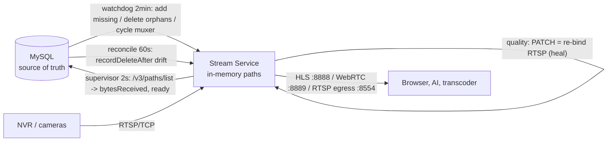
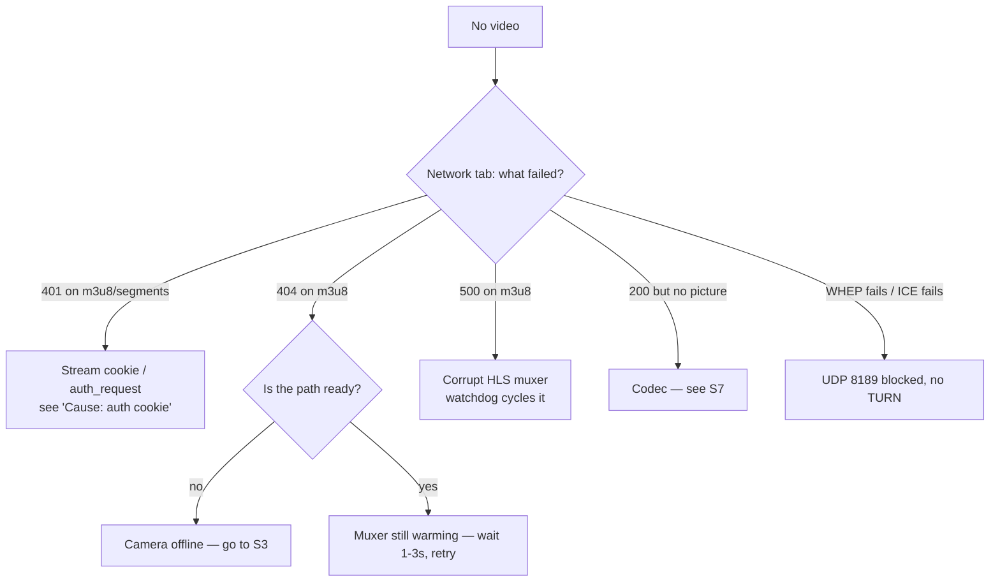

# 06 — Debugging & Operations Runbook

This is the on-call document for the Drishyam VMS monorepo. It is organised **by symptom**, because
that is how problems arrive ("the wall is black", "nobody got the alert"). For each symptom you get
what you would see, the likely causes ranked by how often they are actually the cause, the exact
commands to narrow it down, and the fix. It assumes you can run `docker` on the host and read
JavaScript and Python. Everything here was read out of the code and — where a claim was cheap to
check — verified against the running stack on 2026-08-06.

If you are looking for *how the system is designed*, read `docs/dev/04-architecture.md` and
`docs/STREAMING_PIPELINE.md` first. This document assumes it and tells you where it breaks.

---

## 1. The mental model

Three ideas make almost every failure in this system obvious. Learn these and you can derive the
rest.

### 1.1 The database is the truth; the media server is a cache of it; three loops reconcile them

The Drishyam Stream Service (MediaMTX, container `drisyam-original-stream-service`, network alias
`mediamtx`) holds **no persistent state**. Every camera path it knows about was pushed there over
its REST API by the backend. Restart it and it forgets everything. MySQL is the source of truth,
and three independent control loops continuously push the truth back into it:

| Loop | File | Period | Owns |
|---|---|---|---|
| **Watchdog** | `smart-cam-backend/src/services/recordingSync.service.js` → `runWatchdog()` | 2 min | Paths *exist* (re-adds missing, deletes orphans, cycles corrupt HLS muxers) |
| **Supervisor** | `smart-cam-backend/src/services/streamSupervisor.service.js` → `tick()` | 2 s | Camera *state* (the `pending→connecting→streaming→degraded→standby→offline→quarantined` machine, `Camera.status`, WS `stream.status` events, Prometheus gauges) |
| **Reconcile** | `smart-cam-backend/src/services/streamReconcile.service.js` | 60 s | Path *config drift*, specifically `recordDeleteAfter` retention |

A fourth loop, `streamQuality.service.js`, runs *inside* the supervisor tick and decides whether to
**heal** (PATCH the path so MediaMTX drops and re-opens the upstream RTSP).



**Almost every "camera is weird" bug is one of these loops fighting another, or one of them silently
not running.** The supervisor quarantines a flapping camera; the watchdog is written to *respect*
that quarantine (`isQuarantined()` skips both re-add and cycle) precisely because an earlier version
did not, and instantly undid the backoff.

### 1.2 Nearly everything is best-effort and fails open

Grep the services and count the `.catch(() => {})`, `catch { /* best-effort */ }` and
`logger.warn(... 'non-fatal')` sites. This is deliberate — a failed snapshot upload must not lose an
alert, and a Redis blip must not stop camera supervision. The consequence for you as a debugger:

> **The default failure mode of this codebase is "the feature silently does nothing", not "the
> process crashes".** A green health check proves the process is alive and its dependencies answer.
> It proves nothing about whether any given subsystem is running.

Two concrete examples you will hit:

* `alertEngine.claimCooldown()` and `withinBurstBudget()` both `return true` when Redis is down.
  Redis outage ⇒ every anti-flood guard disabled ⇒ mail storm (§S9).
* The `server.listen()` callback in `src/server.js` is an `async` function whose rejection nobody
  awaits. One throw inside it silently skips every initialiser after it (§S2).

### 1.3 The NVR is the scarcest resource in the whole system

Most cameras sit behind one recorder. Entry-level NVRs serve a handful of concurrent RTSP sessions.
Exceed that and the NVR's session table jams, `:554` stops answering, and **every** camera on it
goes offline at once — not just the one you were poking. This has happened in production
(`docs/SHARDA_TRIAL_WORKLOG_2026-07-29.md`; the 2026-07-06 NVR flood incident) and it is why the
code is littered with per-NVR rate limits that look paranoid:

| Guard | File | Value | Prevents |
|---|---|---|---|
| `NVR_RECONNECT_MIN_MS` | `streamQuality.service.js` | 30 s per host | A tickful of heals re-binding 18 cameras into one NVR simultaneously |
| `NVR_RESET_MIN_MS` | `recordingSync.service.js` | 30 s per host (`WATCHDOG_NVR_RESET_MIN_MS`) | Same, for watchdog muxer cycles |
| `RESET_COOLDOWN_MS` | `recordingSync.service.js` | 5 min per camera | Re-open loops on one channel |
| Exponential heal backoff + ±20 % jitter | `streamQuality.service.js` | 60 s → 15 min cap | Sibling cameras healing in lockstep forever |
| `sourceOnDemand: true` (default) | `streaming/StreamServiceEngine.js` | — | 24/7 permanent sessions; **this is why `RECORD_SUB=0`** |

The hard operating rule, written into `docker-compose.drisyam-original.yml`, is **≤ 6 concurrent
pulls per NVR, and no record-all**. If you are about to enable recording, read §S8 first.

---

## 2. Reading each service's logs

### 2.1 Where the logs are

| Service | Container | Logger | Destination |
|---|---|---|---|
| Backend API | `drisyam-original-backend` | winston, `src/config/logger.js` | `logs/error.log` (error only), `logs/combined.log` (all), **plus stdout** |
| AI (`vms_face` API) | `drisyam-original-ai` | structlog, `vms_face/core/logging.py` | stdout only |
| AI match worker | `drisyam-original-ai-worker` | structlog | stdout only |
| Journey stitch worker | `drisyam-original-journey-stitch-worker` | structlog | stdout only |
| Stream Service | `drisyam-original-stream-service` | MediaMTX native | stdout (`logLevel: info` in `stream-service.yml`) |
| MySQL / Redis / Postgres / Qdrant / MinIO / Kafka | `drisyam-original-*` | native | stdout |

Backend file logs rotate at 10 MB × 5 (`error.log`) / × 10 (`combined.log`). Because
`smart-cam-backend/` is bind-mounted into the container, **the files are on the host** at
`smart-cam-backend/logs/`. They accumulate: there are ~40 rotated `combined*.log` files there today,
about 400 MB. That is not a leak the code manages — sweep them yourself if the disk gets tight.

Two facts about backend logging that surprise people:

1. `smart-cam-backend/Dockerfile` sets `ENV NODE_ENV=development`. So in the compose stack the
   logger runs at **`debug`** level with a **colourised console transport** (`logger.js` lines 7 and
   30). `docker logs` output contains ANSI escapes — strip them with `sed -r 's/\x1b\[[0-9;]*m//g'`
   if you are grepping into a file.
2. Same flag means `server.js` runs `await sequelize.sync()` at boot (line 41). See §S1 for why that
   matters.

### 2.2 Log-line prefixes worth memorising

Grep for these; they are the heartbeat of each subsystem.

| Prefix | Emitter | Means |
|---|---|---|
| `[Supervisor] transition` | `streamSupervisor` | A camera changed state. Carries `from`, `to`, `bps`, `reason` (offline only) |
| `[Quality] heal triggered` | `streamQuality` | We PATCHed a path to force an RTSP re-bind. `healsToday` counts against the 20/24 h budget |
| `watchdog: path missing from Stream Service — re-adding` | watchdog | MediaMTX lost config (restart) or a path was deleted |
| `watchdog: cycling path (likely corrupted muxer)` | watchdog | Destructive: DELETE + ADD. Reopens RTSP on the NVR |
| `watchdog: deleted orphan path (no DB camera)` | watchdog | A `cam_*` path with no DB row was purged after 2 consecutive sightings |
| `recordingSync: uploaded` / `stitched + uploaded` | S3 sync | A clip reached 10pb object storage; local copy deleted |
| `transcoder: spawned` / `stall detected` / `at capacity` | transcoder | H.265→H.264 sidecar lifecycle |
| `reconcile: retention drift corrected` | reconcile | `recordDeleteAfter` was wrong on N paths |
| `alert push sent` / `alert emails sent` / `alert email burst cap hit` | alertEngine | Delivery decisions |
| `ZONE INTRUSION` | zoneIntrusion | A restricted zone fired |
| `forwarder:` / `alert-forwarder:` | AI (`backend_forwarder.py`, `alert_backend_forwarder.py`) | AI→backend bridges |
| `Unhandled Rejection:` | `server.js` | **Read §S2 immediately** |

### 2.3 Sample real lines (so you know what "normal" looks like)

```
# backend — supervisor bringing a camera up after boot
[Supervisor] transition {"monitor":"<24-hex>","from":"connecting","to":"streaming","bps":1469174,"server":"env-default"}

# backend — supervisor giving up on an unreachable NVR (note the reason code)
[Supervisor] transition {"monitor":"<24-hex>","from":"connecting","to":"offline","bps":0,"reason":"nvr_unreachable"}

# stream-service — the same fault, one layer down
ERR [path cam_<24-hex>] [RTSP source] dial tcp <nvr-ip>:554: i/o timeout
INF [path cam_<24-hex>] [RTSP source] stopped: timed out

# AI — the same fault, one layer up (orchestrator can't read the MediaMTX path)
error  stream open failed  camera=<24-hex> err="failed to open 'rtsp://mediamtx:8554/cam_<24-hex>': ... Invalid data found when processing input"
```

That trio is the canonical "one camera's NVR is unreachable" signature across all three services.
`GET /status HTTP/1.1 200 OK` every ~15 s in the AI log is **normal** — that is
`aiLifecycle.service.js` reconciling which cameras should be running (`AI_LIFECYCLE_RECONCILE_MS`,
default 15000).

---

## 3. The first six commands

Run these in order before forming any theory.

```bash
# 1. What is even up? (containers have fixed container_name, so no -p needed)
docker ps --format "table {{.Names}}\t{{.Status}}"

# 2. Backend: process + every dependency, in one shot
curl -s http://localhost:5000/api/health/full | jq

# 3. Media plane: how many paths, and are they ready?
curl -s -u "$STREAM_SERVICE_API_USER:$STREAM_SERVICE_API_PASS" \
  "http://localhost:9997/v3/paths/list?itemsPerPage=1000" \
  | jq '{count:.itemCount, notReady:[.items[]|select(.ready==false)|.name]}'

# 4. AI posture (auth mode, redis, how many orchestrators are running)
curl -s http://localhost:8001/healthz | jq

# 5. Anything that silently died at boot
docker logs drisyam-original-backend 2>&1 | grep -E "Unhandled Rejection|Uncaught Exception"

# 6. Confirm every boot initialiser actually ran (see §S2 for the list)
docker logs drisyam-original-backend 2>&1 | grep -E "s3Retention:|zoneIntrusion|aiLifecycle: started|reconcile: started" | tail -8
```

`/api/health/full` never returns 5xx by design — it is a *diagnostic*, not a routing signal. Read
the `components` object:

```json
{"components":{"db":{"ok":true,"latencyMs":6},"redis":{"ok":true,"latencyMs":7},
 "mediamtx":[{"name":"default","ok":true,"paths":38}],"aiService":{"ok":true}}}
```

`"name":"default"` means the `stream_servers` table is empty and the backend fell back to the
single env-configured server (`envDefaultServer()` in the supervisor,
`checkStreamServers()` in `health.controller.js`). That is the normal single-box configuration, not
an error.

**There is no `curl` or `wget` inside the backend container** (`node:20-bookworm-slim` + ffmpeg
only). Probe from the host against the published ports, or use `docker exec … node -e 'fetch(…)'`.
`ffmpeg` and `ffprobe` *are* present in the backend container — use them for RTSP debugging.

---

## 4. Metrics: which ones are real

`GET /api/metrics` serves the registry from `src/services/metrics.service.js` (52 metric families
today, mostly `prom-client` defaults). **Not every declared metric is wired.** Before you build a
dashboard on one, check this table — it was produced by grepping every `metrics.` call site in
`smart-cam-backend/src`.

| Metric | Incremented by | Status |
|---|---|---|
| `drisyam_camera_state{monitor_id,state}` | `streamSupervisor.tick()` | **Live** — but see the trap below |
| `drisyam_camera_bps_in{monitor_id}` | `streamSupervisor.tick()` | Live — the single best "is video flowing" signal |
| `drisyam_camera_transitions_total{from,to}` | `streamSupervisor` | Live — rate() of this is your flap detector |
| `drisyam_supervisor_is_leader` | `streamSupervisor` loop | Live |
| `drisyam_camera_jitter_ms`, `_frames_in_error_per_second`, `_readers` | `streamQuality.observe()` | Live |
| `drisyam_camera_quality_warnings_total{kind}` | `streamQuality.observe()` | Live |
| `drisyam_stream_heals_triggered_total{reason}` / `_refused_total{reason}` | `streamQuality.heal()` | Live |
| `drisyam_http_request_seconds`, `drisyam_http_requests_total` | `metrics.httpMiddleware()` in `app.js` | Live |
| `drisyam_nodejs_*`, `drisyam_process_*` | `collectDefaultMetrics` | Live |
| `drisyam_mediamtx_server_online` / `_paths_active` / `_capacity_ratio` | — | **Declared, never set** |
| `drisyam_transcoder_active{kind}` | — | **Declared, never set** |
| `drisyam_queue_depth`, `drisyam_queue_jobs_total` | — | **Declared, never set** |
| `drisyam_ai_events_ingested_total{detector,result}` | — | **Declared, never set** |
| `drisyam_bus_events_published_total` / `_consumed_total` | — | **Declared, never set** |

Two Prometheus alert rules in `observability/prometheus/alerts.yml` — `MediaMTXDown` and
`MediaMTXNearCapacity` — are built on never-set series and therefore **can never fire**. Do not
treat their silence as good news. For real media-plane health, scrape MediaMTX's own exporter
(`mediamtx:9998`, already in `observability/prometheus/prometheus.yml`).

### The `drisyam_camera_state` trap

`streamSupervisor.tick()` does:

```js
metrics.cameraState.set({ monitor_id: cam.monitorId, state: entry.state }, 1);
```

It sets the **current** state's series to 1 and never zeroes the previous one. Verified live: one
camera exports both

```
drisyam_camera_state{monitor_id="<24-hex>",state="connecting"} 1
drisyam_camera_state{monitor_id="<24-hex>",state="streaming"}  1
```

so `sum(drisyam_camera_state{state="offline"} == 1)` — exactly what the `ManyCamerasOffline` alert
uses — over-counts, permanently, for every camera that has ever been offline. Until this is fixed
(zero the old label on transition, or switch to a single gauge with a numeric state enum), count
offline cameras from the database instead:

```sql
SELECT supervisor_state, COUNT(*) FROM cameras GROUP BY supervisor_state;
```

---

## 5. Symptom index

| # | Symptom | Jump |
|---|---|---|
| S1 | Backend won't start / restarts in a loop | [→](#s1--backend-wont-start--restarts-in-a-loop) |
| S2 | Backend healthy but a feature silently does nothing | [→](#s2--backend-is-healthy-but-a-feature-silently-does-nothing) |
| S3 | One camera shows offline | [→](#s3--one-camera-shows-offline) |
| S4 | Every camera on one NVR goes offline together | [→](#s4--every-camera-on-one-nvr-goes-offline-together) |
| S5 | Camera flaps between online and offline | [→](#s5--camera-flaps-between-online-and-offline) |
| S6 | Video won't play in the browser | [→](#s6--video-wont-play-in-the-browser) |
| S7 | Black tile but the path reports ready | [→](#s7--black-tile-but-the-path-reports-ready) |
| S8 | Recordings missing or not reaching S3 | [→](#s8--recordings-missing-or-not-reaching-s3) |
| S9 | Alerts flooding | [→](#s9--alerts-flooding) |
| S10 | Alerts not arriving at all | [→](#s10--alerts-not-arriving-at-all) |
| S11 | AI detection not working | [→](#s11--ai-detection-not-working) |
| S12 | AI recognises the wrong person | [→](#s12--ai-recognises-the-wrong-person) |
| S13 | High GPU or CPU usage | [→](#s13--high-gpu-or-cpu-usage) |

---

## S1 — Backend won't start / restarts in a loop

### What you see

`docker ps` shows `drisyam-original-backend` in `Restarting (1)`, or the container is up but
`curl localhost:5000/api/health/live` refuses. The entrypoint is
`npx sequelize-cli db:migrate && (npx sequelize-cli db:seed:all || true) && npx nodemon src/server.js`,
so a failure in *any* of those three stages produces the same outward symptom.

Always start by reading the top of the log, not the tail — the useful error is at the beginning of
the crash cycle:

```bash
docker logs drisyam-original-backend 2>&1 | head -60
```

### Cause 1 — env validation refused to boot (most common on a fresh checkout)

`src/config/env.js` validates `process.env` with Joi and calls `process.exit(1)` on any failure,
printing:

```
❌ Environment validation failed:
  - "JWT_SECRET" length must be at least 32 characters long
```

Required with no default: `DB_NAME`, `DB_USER`, `JWT_SECRET` (≥32), `JWT_REFRESH_SECRET` (≥32),
`STRIPE_SECRET_KEY`, `STRIPE_WEBHOOK_SECRET`, `RAZORPAY_KEY_ID`, `RAZORPAY_KEY_SECRET`,
`RAZORPAY_WEBHOOK_SECRET`. The payment keys are required even if you never touch billing — that is
a wart, but it is the contract. Copy `.env.example` and fill them with placeholders locally.

A second guard, `src/config/prodSecretGuard.js`, refuses to boot in production with dev-default or
weak secrets:

```
❌ Refusing to start in production with insecure config:
```

Rotate the named variables in the environment. Never work around it by flipping `NODE_ENV`.

### Cause 2 — half-applied migration

`sequelize-cli db:migrate` is not transactional per-migration on MySQL DDL. If a migration dies
half-way (container OOM-killed, MySQL restarted, you Ctrl-C'd it), the `SequelizeMeta` row may be
absent while some of its DDL landed. The next boot replays the migration, hits
"column already exists" or "duplicate key name", and exits non-zero — a clean crash loop.

Diagnose:

```bash
# What does the DB think it has applied?
docker exec drisyam-original-mysql mysql -uroot drishyamvms \
  -e "SELECT name FROM SequelizeMeta ORDER BY name DESC LIMIT 5;"

# What is on disk?
ls smart-cam-backend/migrations | tail -5
```

If `SequelizeMeta` stops at `027-...` but `028-...` exists on disk and its columns are already in
the table, the migration ran but did not record. Fix by making the migration idempotent (the good
ones already are — see `migrations/022-add-ai-events-alert-indexes.js`, which uses
`addIndexIfMissing` and swallows `duplicate|exists`), **or** by hand-inserting the meta row once you
have confirmed the schema really is complete:

```sql
INSERT INTO SequelizeMeta (name) VALUES ('028-add-subscription-features.js');
```

Do this only after diffing the actual schema against the migration. Prefer fixing idempotency.

### Cause 3 — too many keys / duplicate indexes (MySQL's 64-key limit)

This took a production system down on 2026-07-29 (`docs/SHARDA_TRIAL_WORKLOG_2026-07-29.md`, B2).
The symptom is a boot-time crash with `Too many keys specified; max 64 keys allowed`.

The mechanism: `server.js` calls `sequelize.sync()` when `config.env === 'development'` — and the
Dockerfile sets `NODE_ENV=development`, so **it runs in the compose stack**. Historically this was
`sync({ alter: true })`, and MySQL's `ALTER` path made Sequelize re-create the `email` and
`username` unique indexes **on every boot**, each with an auto-suffixed name. Enough restarts and
you cross 64.

The residue is still in the live database. Verified:

```bash
docker exec drisyam-original-mysql mysql -uroot drishyamvms -e \
 "SELECT table_name, COUNT(DISTINCT index_name) idx FROM information_schema.statistics
  WHERE table_schema='drishyamvms' GROUP BY table_name ORDER BY idx DESC LIMIT 5;"
```

```
users             25      <- includes email_2..email_10 and username_2..username_10
password_resets   13
refresh_tokens    13
```

The counter stopped at `_10` and has not moved across many restarts since, which confirms plain
`sync()` (no `alter`) does not add more — but 22 of the 25 keys on `users` are dead weight eating
the budget. To clean up:

```sql
-- inspect first
SELECT index_name FROM information_schema.statistics
 WHERE table_schema='drishyamvms' AND table_name='users' ORDER BY index_name;
-- then, one per duplicate (keep exactly one unique index per column)
ALTER TABLE users DROP INDEX email_2;
```

**The rule that prevents recurrence: never add `{ alter: true }` to `sequelize.sync()`.** The
comment on `server.js:40` says so; treat it as load-bearing. Schema changes go in `migrations/`.

### Cause 4 — port conflict

`EADDRINUSE :::5000` in the log. Either another compose project is up (this repo has
`docker-compose.yml`, `docker-compose.drisyam-original.yml` and `docker-compose.deepstream.yml` —
they publish overlapping host ports), or a host-side `node src/server.js` is still running.

```bash
docker ps -a --format "{{.Names}}\t{{.Ports}}" | grep 5000
netstat -ano | findstr :5000     # Windows host
```

Ports that collide across the compose files: `5000` (backend), `3307` (MySQL), `6379` (Redis),
`5432` (Postgres), `9997`/`8554`/`8898`/`8889`/`8189-udp` (stream service), `8001` (AI), `5173`
(SPA). Bring the other stack down rather than remapping — remapping breaks the browser-facing URLs
baked into `STREAM_SERVICE_HLS_URL` / `VITE_API_BASE_URL`.

### Cause 5 — MySQL not ready

`await sequelize.authenticate()` throws and `startServer()`'s catch calls `process.exit(1)`:

```
Failed to start server: SequelizeConnectionRefusedError
```

Compose already gates this with `depends_on: mysql: condition: service_healthy`, so this only
happens if you started the backend outside compose or MySQL's data volume is corrupt. Check
`docker logs drisyam-original-mysql`.

### Cause 6 — uncaught exception at runtime

`process.on('uncaughtException')` calls `process.exit(1)` unless the error is classified transient
(`EPIPE`, `ECONNRESET`, `ETIMEDOUT`, `ENOTFOUND`, `ECONNREFUSED`, or a message matching
`/write EPIPE|socket hang up|connection reset|network socket disconnected/i`). If the container
restarts minutes *after* a healthy boot, grep for `Uncaught Exception:` and read the stack.

---

## S2 — Backend is healthy but a feature silently does nothing

This is the single most valuable section in this document, because the system is *designed* to
survive this failure and therefore will not tell you about it.

### What you see

`/api/health/live`, `/api/health/ready` and `/api/health/full` are all green. The API answers
requests normally. But one whole subsystem is inert: recordings never get pruned, restricted zones
never alert, deleting a camera leaves a zombie transcoder, retention drift never re-converges.

### The mechanism

`src/server.js` starts everything inside the `listen` callback — and that callback is `async`:

```js
server.listen(PORT, async () => {
  logger.info(`Server running on port ${PORT} in ${config.env} mode`);
  const bullmqOk = await queueWorkers.start();
  if (!bullmqOk) { recordingSync.start(); }
  await streamBus.start().catch(...);          // guarded
  streamSupervisor.start().catch(...);         // guarded
  streamReconcile.start();                     // NOT guarded
  aiLifecycle.start();                         // NOT guarded
  require('./services/zoneIntrusion.service').init();   // NOT guarded + lazy require
  aiEventRetention.start();                    // NOT guarded
  s3Retention.start();                         // NOT guarded
  bus.on(EVENTS.CAMERA_DELETED, ...);          // NOT guarded
});
```

`server.listen(port, cb)` registers `cb` as a `'listening'` event listener. EventEmitter calls it
and **discards the returned promise**. So if any un-guarded statement throws — most dangerously the
*lazy* `require('./services/zoneIntrusion.service')`, which loads a module at that moment and can
throw on a syntax error, a missing dependency, or a bad top-level `require` inside it — then:

1. The async callback's promise rejects.
2. `process.on('unhandledRejection')` logs it and **returns**. The process does not exit.
3. Every initialiser *after* the throwing line is never reached.
4. The HTTP server is already listening, the DB and Redis are fine, so all three health endpoints
   stay green forever.

Worse: if the rejection reason happens to look like a network error, `isTransientNetworkError()`
downgrades it to `logger.warn('Transient network rejection ignored:', reason)` — a `warn` in a log
full of warns.

### How to detect it in 10 seconds

Every initialiser after the guarded ones logs a distinctive line at boot. The **complete, correct**
boot tail — verified against the running stack — is:

```
Database connection established successfully.
Database models synchronized.                 (development only)
socket.io initialized
Server running on port 5000 in development mode
Redis OK — registering BullMQ workers         (or: Redis unreachable — BullMQ disabled ...)
BullMQ workers + repeatable jobs registered
reconcile: started {"intervalMs":60000,...}   (or: reconcile: disabled (RECONCILE_ENABLED=0))
aiLifecycle: started {"intervalMs":15000}
zoneIntrusion engine armed (occupancy model: enter/stay-heartbeat/clear)
ai_events retention: started {...}            (or: ai_events retention: disabled)
s3Retention: started {...}                    (or: s3Retention: disabled (set S3_RETENTION_ENABLED=1 ...))
cameraReachability: started {...}             \  these two come from streamSupervisor.start(),
streamSupervisor: started {...}               /  which is async — they legitimately arrive LAST
```

So:

```bash
docker logs drisyam-original-backend 2>&1 \
  | grep -E "Server running|reconcile:|aiLifecycle: started|zoneIntrusion|ai_events retention|s3Retention:" \
  | tail -8
```

**If the list stops early, everything after the last line you see is dead.** The one that stops is
the one that threw; `grep "Unhandled Rejection"` in the same log gives you the stack.

Note the ordering consequence: `s3Retention` is the **last synchronous initialiser**, so
`s3Retention: started` (or `disabled`) is your "boot completed" marker. `streamSupervisor: started`
appearing after it is normal, not a symptom.

### What each missing initialiser costs you

| Missing line | Silently broken |
|---|---|
| `reconcile: started` | `recordDeleteAfter` drift never corrects; retention you set in the UI silently stops applying after a Stream Service restart |
| `aiLifecycle: started` | The per-camera "AI Detection" toggle stops taking effect; orchestrators never start/stop |
| `zoneIntrusion engine armed` | Restricted zones are saved in the DB and evaluated by nothing. **The UI still looks correct** |
| `ai_events retention: started` | The MySQL `ai_events` mirror grows unbounded (lakh+ rows/day at scale) |
| `s3Retention: started/disabled` | Nothing — it is off by default — but its absence means the `bus.on(CAMERA_DELETED)` handler below it is also missing |
| (the `CAMERA_DELETED` listener) | Deleting a camera leaks its supervisor + quality state maps **and leaves its FFmpeg transcoder running**, republishing to a `cam_<id>_h264` path that the watchdog then deletes and the ffmpeg recreates |

### Fix

Fix the underlying throw, then restart. If you are touching `server.js`, the durable fix is to wrap
each initialiser the way `streamBus` and `streamSupervisor` already are:

```js
try { require('./services/zoneIntrusion.service').init(); }
catch (err) { logger.error('zoneIntrusion failed to init', { error: err.message }); }
```

That converts "everything after this is dead" into "one thing is dead and it said so".

---

## S3 — One camera shows offline

### What you see

One tile grey in the wall; `Camera.status = 'offline'`; a toast/bell notification with a human
reason string.

### First: read the reason the supervisor already computed

`offlineReason()` in `streamSupervisor.service.js` attaches a `reasonCode` to every offline
transition. It is in the log, in the WS `stream.status` payload, and in the notification.

| `reasonCode` | Meaning | Where to look next |
|---|---|---|
| `nvr_unreachable` | The TCP reachability prober cannot open `<host>:<port>` | Network / NVR power. Go to §S4 |
| `stream_stopped` | The `cam_<id>` path is **absent** from MediaMTX | Watchdog didn't re-add it — check quarantine, check `listConfiguredPaths` |
| `no_video` | The path exists and the host answers, but no frames | Camera power/cabling, wrong RTSP path, wrong channel |
| `flapping` | Quarantined after `SUPERVISOR_FLAP_LIMIT` flaps | §S5 |

```bash
docker logs drisyam-original-backend 2>&1 | grep "\[Supervisor\] transition" | grep "<monitorId>" | tail
```

### Narrow it down, in this order

```bash
# 1. Does the path exist and is it ready?
curl -s -u "$USER:$PASS" http://localhost:9997/v3/paths/get/cam_<monitorId> | jq \
  '{ready, readyTime, tracks, inboundBytes, readers:(.readers|length)}'

# 2. What does the backend think? (per-camera row, includes reason text)
curl -s -H "Authorization: Bearer $JWT" http://localhost:5000/api/cameras/health \
  | jq '.cameras[] | select(.monitorId=="<monitorId>")'

# 3. Is the host reachable at all, from inside the network the backend uses?
docker exec drisyam-original-backend node -e "
  const net=require('net'),s=new net.Socket();s.setTimeout(5000);
  s.on('connect',()=>{console.log('OPEN');s.destroy()});
  s.on('timeout',()=>{console.log('TIMEOUT');s.destroy()});
  s.on('error',e=>console.log('ERR',e.code));
  s.connect(554,'<nvr-host>')"

# 4. Can ffprobe actually pull the stream? (backend container has ffmpeg)
docker exec drisyam-original-backend ffprobe -v error -rtsp_transport tcp \
  -show_entries stream=codec_name,width,height -of default=nw=1 \
  "rtsp://<user>:<urlencoded-pass>@<host>:554/<path>"
```

### Cause: it is not actually offline — it is `standby`

This is the single most common false alarm, and it is worth understanding properly.

Cameras are added with `sourceOnDemand: true` (`StreamServiceEngine.addCamera()`). MediaMTX
therefore only dials the NVR **while someone is reading the path**. An idle, perfectly healthy
camera is `ready: false` forever. Before the `STANDBY` state existed, every unwatched camera looked
offline.

The fix — and the thing to check — is `cameraReachability.service.js`: one TCP connect per **distinct
host** every `CAMERA_PROBE_INTERVAL_MS` (25 s, 5 s timeout, port `CAMERA_PROBE_PORT` default 554).
`reduce()` consults `isReachable(host)`:

* reachable + not ready → **`standby`**, which `publicStatus()` maps to **online**;
* unreachable + not ready → `connecting` → `offline` after `SUPERVISOR_OFFLINE_AFTER_MS` (40 s).

So if a camera reads offline and the host is genuinely up, the prober is the thing that is wrong:

```bash
docker logs drisyam-original-backend 2>&1 | grep "cameraReachability: host state change" | tail
```

Common real causes: the camera row's `host`/`port` is not what actually serves RTSP (a group-level
host overrides it for the *stream* via `buildCamConfig()`, but the prober reads `Camera.host`
directly — a genuine inconsistency worth knowing about); or the NVR blocks repeated TCP connects; or
the host is a private LAN address unreachable from a cloud deployment (this exact class of failure
is documented in `docs/SHARDA_TRIAL_WORKLOG_2026-07-29.md` §F1 — the fix is an edge relay, not a VMS
change).

### Cause: the path is missing and the watchdog refuses to re-add it

Phase 1 of `runWatchdog()` skips a camera when either of these is true:

```js
if (isQuarantined(camera)) continue;
if (require('./cameraReachability.service').isReachable(camera.host) === false) continue;
```

Both are deliberate (don't poke a flapping camera; don't churn against a dead NVR). If the host is
back but the path is still missing, the prober's cached `false` is stale — it clears within one
25 s cycle. If the camera is quarantined, clear it (see §S5).

### Cause: another compose project deleted the path

The watchdog's orphan pass deletes any configured `cam_*` path with no matching DB row, after
`WATCHDOG_ORPHAN_PASSES` (2) consecutive sightings. If **two** backends point at the same Stream
Service and one of them has a smaller camera table, it will delete the other's paths every 2 minutes.
This exact failure is recorded as F5 in the Sharda worklog (manually-added MediaMTX paths kept
disappearing). Symptom: `watchdog: deleted orphan path (no DB camera)` for paths you expect to exist.
Fix: one backend per Stream Service, or allowlist via `WATCHDOG_ORPHAN_SKIP` (comma-separated
monitorId bases; defaults to `demo-entrance`), or `WATCHDOG_ORPHAN_CLEANUP=0`.

---

## S4 — Every camera on one NVR goes offline together

### What you see

A whole group flips offline within a minute of each other, all with `reason: "nvr_unreachable"`.
The stream-service log fills with `dial tcp <nvr-ip>:554: i/o timeout` for every path on that host.

### The mental model for this one

This is almost never N independent failures. One recorder serves all of them, and its RTSP session
table jammed. Once jammed, `:554` stops answering, so the reachability prober times out for the
**host**, and the supervisor correctly flips every camera behind it. The *cameras* are fine.

Ranked causes:

1. **We opened too many concurrent sessions.** Anything that makes paths always-on multiplies
   sessions by the number of cameras. The two switches that do this:
   * `RECORD_SUB=1` → `addCameraSubStream()` sets `sourceOnDemand: false` → **one permanent RTSP
     session per camera, 24/7**. The compose file sets `RECORD_SUB: "0"` with a long comment
     explaining that 18 cameras behind one recorder jammed it this way.
   * `RECORD_CONTINUOUS=1` or `SOURCE_ALWAYS_ON=1` → same on the main, full-res path. Also reverted
     in production for the same reason.
2. **A heal/reset storm.** Many cameras degraded at once, each armed a heal, and all re-bound
   simultaneously. This is what `NVR_RECONNECT_MIN_MS` (quality) and `NVR_RESET_MIN_MS` (watchdog)
   exist to prevent, keyed on `camera.host` / `camera.group.host`. If those keys are wrong (per-camera
   `host` differs from the real NVR, e.g. someone put a relay hostname on some rows) the rate limit
   buckets split and the protection evaporates.
3. **The site link is genuinely down**, or the NVR rebooted / hit its own fault.

### Narrow it down

```bash
# Is it one host or many? (group offline cameras by host)
docker exec drisyam-original-mysql mysql -uroot drishyamvms -e \
 "SELECT host, status, COUNT(*) FROM cameras GROUP BY host, status ORDER BY host;"

# How many paths on that NVR are always-on right now?
curl -s -u "$USER:$PASS" "http://localhost:9997/v3/config/paths/list?itemsPerPage=1000" \
  | jq '[.items[] | select(.sourceOnDemand==false) | .name] | {alwaysOn:length, names:.}'

# Did we storm it? (heals + watchdog cycles in the last hour)
docker logs --since 1h drisyam-original-backend 2>&1 \
  | grep -cE "\[Quality\] heal triggered|watchdog: cycling path"
```

`alwaysOn` should be **0** in the default configuration. Anything above ~6 per NVR is the bug.

### Fix

* **Immediate**: stop pulling. Set `RECORD_SUB=0` / unset `RECORD_CONTINUOUS` / unset
  `SOURCE_ALWAYS_ON`, restart the backend, and let the NVR's session table drain. Historically the
  recorder also needed a reboot (ISAPI reboot on Hikvision) before it recovered.
* **Then**: if you need recording, cap always-on paths to ≤6 **per NVR** with a per-camera flag and
  staggered reconnects — never a global default. The comment block in
  `docker-compose.drisyam-original.yml` around `RECORD_SUB` is the design note for this.
* **Verify**: `[Supervisor] transition ... to:"streaming"` for the group, and
  `cameraReachability: host state change ... reachable: true`.

---

## S5 — Camera flaps between online and offline

### What you see

`drisyam_camera_transitions_total` climbing; repeated `[Supervisor] transition` lines for one
monitor cycling `streaming→degraded→offline→connecting`; eventually
`to: "quarantined"` with `reason: "flapping"`.

### The state machine, and the debounces that exist because of past bugs

`reduce()` in `streamSupervisor.service.js` is the whole story. Three of its rules are scar tissue
and you need to know them before you "fix" a flap:

1. **Not-ready is debounced on `notReadySince`, not on time-in-state.** An earlier version compared
   `now - enteredStateAt`, so a camera that had been `streaming` for ten minutes went `offline` on
   its *first* not-ready poll (because `enteredStateAt` was already older than the threshold). That
   single-poll knockout produced most of the historical churn.
2. **Low bitrate is debounced on `lowBpsSince`.** One low sample used to demote a long-running
   stream to `degraded`.
3. **A backwards `bytesReceived` delta is ignored, not treated as 0 bps.** MediaMTX zeroes the
   counter when a path is re-added or re-bound. Reading that as a real 0-bps sample demoted the
   camera, which armed another heal, which re-bound the path, which zeroed the counter again — a
   self-sustaining loop. The code carries the previous `bpsIn` forward instead.

Flap accounting counts two things: leaving `STREAMING` for anything except `STANDBY` (going idle is
not a flap), and *entering* `OFFLINE` from any non-offline state. The second rule matters because a
camera on a saturated NVR often cycles `connecting ↔ offline` without ever reaching `streaming`, so
a STREAMING-only rule never quarantined exactly the worst-behaved cameras.

### Tunables (compose overrides the defaults)

| Env | Default | Compose value | Effect |
|---|---|---|---|
| `SUPERVISOR_POLL_MS` | 2000 | — | Tick period |
| `SUPERVISOR_MIN_BPS` | 20000 | — | Below this while `ready` counts as low |
| `SUPERVISOR_DEGRADED_AFTER_MS` | 20000 | — | Sustained low-bps before `degraded` |
| `SUPERVISOR_OFFLINE_AFTER_MS` | 40000 | — | Sustained not-ready before `offline`/`standby` |
| `SUPERVISOR_FLAP_LIMIT` | 5 | **4** | Flaps in window before quarantine |
| `SUPERVISOR_FLAP_WINDOW_MS` | 120000 | 120000 | Flap window |
| `SUPERVISOR_QUARANTINE_MS` | 300000 | **600000** | Backoff length |

The compose overrides (`4` flaps, `10 min` backoff) exist because one remote NVR jams past a few
concurrent pulls: quarantine sooner, back off longer, let its RTSP daemon recover instead of
re-crashing it.

### Narrow it down

```bash
# The transition history for one camera
docker logs --since 30m drisyam-original-backend 2>&1 \
  | grep "\[Supervisor\] transition" | grep <monitorId>

# Is the data plane actually bad, or is our threshold wrong?
curl -s -H "Authorization: Bearer $JWT" http://localhost:5000/api/cameras/<monitorId>/quality | jq
# -> jitterMs, fieRate, meanBps, readers, healsToday
```

Interpretation: `fieRate` (frames-in-error/sec from MediaMTX `inboundFramesInError`) above ~5 means
corrupt RTP — a real transport problem. `jitterMs` above 200 means network bunching; note that
`streamQuality` deliberately does **not** auto-heal on jitter, because PATCHing a path that is still
delivering frames makes it worse. `meanBps` well below `SUPERVISOR_MIN_BPS` on a camera that *is*
streaming means your camera is a genuinely low-bitrate sub-stream and the 20 kbps floor is fine, but
a 0 with `ready: true` usually means you are looking at a path nobody reads.

### Fix

* If quarantined and you have fixed the underlying cause, clear it — the supervisor persists
  `quarantine_until` so the watchdog honours it across restarts, and `rehydrateQuarantine()`
  re-seeds it on boot:

  ```sql
  UPDATE cameras SET quarantine_until = NULL, supervisor_state = 'pending'
   WHERE monitor_id = '<monitorId>';
  ```
  Then `POST /api/stream/watchdog/run` (authenticated) to re-add the path immediately.
* If the camera is flapping because its GOP is huge or its firmware is unhappy, fix it at the
  camera. A long I-frame interval (8 s+) makes every reconnect slow and is the reason
  `PIPELINE_FRAME_TIMEOUT_SEC` is 15 s on the AI side. Target ~2 s GOP in the camera's web UI.
* If you are tempted to shorten the debounces to "detect faster" — don't. Every one of them was
  lengthened to stop a real cascade.

---

## S6 — Video won't play in the browser

### What you see

The player shows an error or spins forever. Network tab shows 404/500/401 on `index.m3u8` or on
`.m4s` segments, or the WHEP `POST` to `/live/...` fails.

### Decision tree



### Cause 1 — H.265 (the big one)

Nearly every camera here publishes HEVC — verified live, a typical path reports
`"tracks":["H265","G711"]`.

H.265 is served one of two ways, and knowing which one you're on is the first diagnostic step:

* **Passthrough** — the client proved it can decode HEVC (`codecSupport.js` probes
  `MediaSource.isTypeSupported` for `hvc1`/`hev1` and sends `?hevc=1`), so the server returns the
  camera's **native** path and spawns nothing. The response has `transcoded: false` and the server
  logs `[Stream] H.265 passthrough (client decodes HEVC natively)`.
* **Transcoded** — the client can't decode HEVC (no OS/GPU decoder, or an older client that sends
  no flag), so `StreamService.startStream()` spawns an FFmpeg sidecar (`transcoder.service.js`)
  that re-encodes to H.264, republishes to `cam_<id>_h264`, and returns *that* path's URLs.

So "it plays on my machine but not on the customer's" is expected behaviour, not a bug — the two
machines took different paths. Check `transcoded` in the `/api/stream/start` response first; it tells
you which failure list below applies.

The failure modes of that handling — all of which look identical to the user:

* **Codec detection returned `null`.** `detectSourceCodec()` reads `tracks2` from
  `/v3/paths/get/cam_<id>`. On an on-demand path that has not warmed within
  `readyBudgetMs` (6 s default in `warmupHls`), the probe returns null, the H.265 branch is skipped,
  and the browser is handed the raw H.265 URL. **This is why "it works on the second try".** Slow
  NVR cold start (source-on-demand dial ≈ 6 s) is enough to trigger it.
* **Transcoder refused to spawn.** `ensurePathTranscoder()` returns
  `{spawned:false, reason:'capacity'}` at `TRANSCODER_MAX` (default **8**) concurrent FFmpegs, or
  `'source-not-ready'`. The URL still points at `cam_<id>_h264`, which never publishes → 404 forever.
  Look for `transcoder: at capacity, rejecting spawn`.
* **Transcoder crashed.** `transcoder: ffmpeg exited unexpectedly` with a `tail` of the last four
  stderr lines. After `MAX_RESTARTS` (5) it gives up permanently:
  `transcoder: giving up after repeated crashes`.

Check:

```bash
curl -s -u "$USER:$PASS" http://localhost:9997/v3/paths/get/cam_<id>      | jq '.tracks'
curl -s -u "$USER:$PASS" http://localhost:9997/v3/paths/get/cam_<id>_h264 | jq '{ready,tracks}'
docker logs --since 15m drisyam-original-backend 2>&1 | grep "transcoder:"
```

Fix: raise `TRANSCODER_MAX` only if you have the CPU/NVENC budget (see §S13), or better — configure
the camera to publish H.264 on the main stream, or rely on the sub-stream path (below).

### Cause 2 — the sub-stream preference

If the camera exposes a derivable sub-stream (`vendors.deriveSubPath()`: Hikvision `…/101→/102`,
Dahua `subtype`, Uniview `s0→s1`, Bosch `inst`, Hanwha `profile`) and that sub is **H.264**,
`startStream()` sets `preferSub = true` and serves the sub as the primary single-camera view —
including WebRTC. The comment explains why: the office uplink cannot reliably carry the full-res
main stream, but the low-bitrate sub does. Set `PREFER_MAIN_STREAM=1` to go back to main.

Consequence when debugging: the URL you get from `/api/stream/start/:monitorId` may point at
`cam_<id>_sub`, not `cam_<id>`. Always check which path the player actually requested before
concluding the main path is broken.

### Cause 3 — corrupt HLS muxer (HTTP 500 with the path `ready`)

MediaMTX can report a path ready while its HLS muxer is wedged after an RTSP reconnect — the muxer
hash prefix changes and stale segment references 500. Only a path DELETE+ADD recreates it.

The watchdog does this, with three guards so it cannot storm: the path must have been ready longer
than `COLD_START_MS` (120 s), must have `readers > 0` (never cycle an unwatched path — pure NVR
noise), and must return `RESET_AFTER_500S` (2) consecutive 500s or `RESET_AFTER_404S` (3)
consecutive 404s. Then the per-camera 5-minute and per-NVR 30-second cooldowns apply.

To force it now: `POST /api/stream/watchdog/run`. Look for
`watchdog: cycling path (likely corrupted muxer)` → `watchdog: path reset — HLS muxer recreated`.

> **Gotcha:** `probeHlsMuxer()` uses `config.streamService.internalHlsUrl`
> (`STREAM_SERVICE_INTERNAL_HLS_URL=http://stream-service:8888`), **not** the browser-facing
> `STREAM_SERVICE_HLS_URL=http://localhost:8898`. Host port-maps are unreachable from inside the
> backend container, so if the internal URL is unset every probe network-errors, `probeHlsMuxer`
> returns `null`, and the whole muxer-reset path is silently dead. Check that env var first.

### Cause 4 — the media-plane auth cookie

Off by default, but if `scripts/enable-stream-auth.sh` was run in your environment, media requests
are gated:

* backend `/api/stream/start/:monitorId` mints an HMAC token and sets cookie `st_<monitorId>`
  (`httpOnly`, `sameSite: 'Lax'`, `path: '/'`, TTL `STREAM_URL_TTL_SEC` default 3600);
* nginx `auth_request /_stream_auth` on `/hls/` and `/live/` sub-requests
  `/api/stream/verify`, which reads `X-Original-URI`, extracts the monitorId with
  `/cam_([a-f0-9]{8,})/i`, and verifies the cookie.

Symptoms of it going wrong: **401 on segments while the m3u8 was fine** (cookie expired mid-session
— nothing re-mints it, the player must call `/stream/start` again); or 401 on everything because the
browser is on a different origin than the cookie (`sameSite: Lax` + cross-site iframe), or because
`STREAM_URL_SECRET` differs between backend replicas.

Verify the feature is even on: `streamToken.enabled()` requires `STREAM_URL_SECRET.length >= 16`.
With it unset, `/api/stream/verify` returns 204 for everything.

### Cause 5 — WebRTC ICE fails, HLS would have worked

WHEP needs UDP `8189` reachable (published in compose as `8189:8189/udp`) plus
`webrtcAdditionalHosts` in `stream-service.yml` naming a host the browser can actually reach.
Corporate networks block this. `/api/turn/credentials` returns 204 and the SPA falls back to
STUN-only unless `TURN_URI` + `TURN_SHARED_SECRET` are configured — see `docs/COTURN-DEPLOYMENT.md`.
If HLS plays and WebRTC does not, it is ICE, not the camera.

### Cause 6 — nginx dropping the `/hls` prefix on a redirect

Not present in this repo's `nginx.conf`, but it bit us in production: MediaMTX answers some HLS
requests with a 302 whose `Location` is an absolute URL without the `/hls` prefix, so the browser
follows it into the SPA fallback and gets `index.html` instead of a manifest. The production fix was
`absolute_redirect off;` plus `proxy_redirect` inside `location /hls/`. If manifests come back as
HTML, this is why.

---

## S7 — Black tile but the path reports ready

`ready: true` means MediaMTX has an RTSP session with tracks. It does **not** mean the browser can
render it. Work through these in order.

| # | Check | Command / signal | Meaning |
|---|---|---|---|
| 1 | Are bytes actually flowing? | `drisyam_camera_bps_in{monitor_id="…"}`, or `inboundBytes` growing between two `paths/get` calls | `ready` with flat bytes = frozen source |
| 2 | What codec? | `.tracks` from `paths/get` | `H265` on a path the browser was handed directly → §S6 cause 1 |
| 3 | Which path did the player request? | Browser network tab | `cam_<id>_h264` that is not ready → transcoder never published |
| 4 | Does the sub URL exist but not stream? | see below | Player silently on a dead sub |
| 5 | Frames-in-error? | `/api/cameras/<id>/quality` → `fieRate` | Sustained >50/s = corrupt RTP; a heal is armed |
| 6 | Is the HLS manifest actually 200? | `curl -s -o /dev/null -w "%{http_code}" "http://localhost:8898/cam_<id>/index.m3u8"` | 500 → §S6 cause 3 |

**#4 deserves its own paragraph, because it is a deliberate trade-off that bites.** In
`stream.service.js`:

```js
// Even if the native sub didn't finish warming synchronously above, hand the
// player its URL whenever a sub channel exists — the player warms/retries the
// sub manifest itself and falls back to main only if it truly fails.
if (!hlsSubUrl && subRtspPath && (quality === 'low' || quality === 'auto')) {
  hlsSubUrl = streamingService.getHlsSubUrl(monitorId);
}
```

This was added because an on-demand sub that needed more than ~2 s to warm returned
`hlsSubUrl = null`, so a per-camera "Sub" quality choice silently played the *main* stream. The cost
is the mirror image: if the camera has a derivable sub path that its firmware does not actually
serve, the player is handed a URL that will never work, and a grid tile can sit black. Confirm with:

```bash
curl -s -u "$USER:$PASS" http://localhost:9997/v3/paths/get/cam_<id>_sub | jq '{ready,tracks}'
```

If the sub genuinely does not exist for that camera model, the derivation in
`src/services/vendors/` is wrong for it — fix the vendor driver rather than special-casing the camera.

Finally: `readers` on the transcoded path drives the transcoder's **idle shutdown**
(`IDLE_TIMEOUT_MS` 60 s). A tile that goes black after ~1 minute of nobody looking at it, then works
on click, is idle shutdown working as designed — `transcoder: idle shutdown (no viewers)`.

---

## S8 — Recordings missing or not reaching S3

### Start here: recording is OFF by default, on purpose

Read `StreamServiceEngine.addCamera()`:

```js
const continuous = process.env.RECORD_CONTINUOUS === '1';
const alwaysOn   = continuous || process.env.SOURCE_ALWAYS_ON === '1';
const pathConfig = { source: rtspUrl, sourceOnDemand: !alwaysOn, sourceProtocol: 'tcp',
                     record: continuous, recordPath: RECORD_PATH,
                     recordSegmentDuration: RECORD_SEGMENT, recordDeleteAfter: '0s' };
```

With `RECORD_CONTINUOUS` unset — the shipped configuration — **`record: false`**. And the sub-stream
path only records when `RECORD_SUB=1`, which compose explicitly sets to `"0"`. So in the default
stack, **nothing is recorded at all**, and "no recordings" is the correct behaviour, not a bug.

That default is not laziness: recording forces `sourceOnDemand: false`, which is one permanent RTSP
session per camera and is exactly what jammed a customer's NVR (§S4). See the long comment block in
`docker-compose.drisyam-original.yml` and in `addCameraSubStream()`.

Verify what is actually configured:

```bash
curl -s -u "$USER:$PASS" "http://localhost:9997/v3/config/paths/list?itemsPerPage=1000" \
  | jq '[.items[]|select(.record==true)|{name,recordDeleteAfter,sourceOnDemand}]'
```

### If recording IS on but files never appear

The pipeline is: MediaMTX writes MP4 segments → `recordingSync.runSync()` (every 5 min) finds them,
probes, optionally stitches, uploads to 10pb S3, deletes the local copy.

```bash
# 1. Are segments on disk? Note the path INSIDE the container.
docker exec drisyam-original-backend ls -R /recordings | head -40

# 2. Is the sync loop running at all?
docker logs drisyam-original-backend 2>&1 | grep "recordingSync:" | tail -20
```

Ranked causes when segments exist but nothing uploads:

1. **The `MIN_AGE_MS` gate.** Files younger than 2 minutes are skipped (still being written). If
   your segment duration is 10 minutes (`RECORDING_SEGMENT_DURATION` default `10m0s`), the newest
   clip is legitimately invisible for a while.
2. **`ffprobe` cannot read the file.** `probeDurationSec()` returns null → the segment is **deleted**
   with `recordingSync: dropping unreadable segment`. If you see many of these, the recorder is
   producing corrupt MP4s (usually an RTSP reconnect storm).
3. **The camera has no group or no user.** `runSync()` skips silently:
   `if (!group || !user) continue;`. An orphaned camera row never uploads. Check
   `SELECT id,name,group_id,user_id FROM cameras WHERE group_id IS NULL OR user_id IS NULL;`.
4. **S3 credentials/endpoint wrong.** `s3.service` throws; the local file is **not** deleted (the
   `unlink` is after the upload), so it retries next cycle. Look for
   `recordingSync: streamed upload failed`. Note the deliberate rule: a file larger than
   `RECORDING_MAX_BUFFER_MB` (256 MB) will **not** fall back to a buffered upload — it is left to
   retry rather than risk an OOM.
5. **Wrong bind-mount.** This one is easy to miss. `docker-compose.drisyam-original.yml` mounts
   recordings from a directory **outside this repo**:
   `c:/Users/systo/Desktop/drisyam-clean/drisyam/mediamtx-recordings:/recordings`. The repo's own
   `./mediamtx-recordings` is *not* what the running stack uses. If you are staring at an empty
   folder, check you are looking at the right one — and always inspect via
   `docker exec … ls /recordings`, which cannot be wrong.

### Retention: two independent enforcers

| Copy | Enforced by | Config |
|---|---|---|
| Local NAS | MediaMTX `recordDeleteAfter`, pushed by `recordingRetention.applyRetention()` and re-converged by `streamReconcile` | Camera → Group → Site → `DEFAULT_RETENTION_DAYS` |
| Durable 10pb S3 | `s3Retention.service.js` sweep | `S3_RETENTION_ENABLED=1`, deletes only with `S3_RETENTION_DELETE=1` |

`s3Retention` is **off by default and dry-runs even when enabled**. That is intentional — it deletes
surveillance evidence. It refuses to touch a key whose `{YYYY-MM-DD}` segment does not strictly
parse, applies `S3_RETENTION_GRACE_DAYS` (1) on top of the retention, skips cameras with
`retentionDays <= 0`, and stops at `S3_RETENTION_MAX_DELETE_PER_RUN` (20000). Before enabling
deletion, run it in dry-run and read the `s3Retention: camera has expired recordings` lines.

If retention "keeps reverting", that is the reconcile loop doing its job — a path that was re-added
by the watchdog defaults to `recordDeleteAfter: '0s'`, and either `applyRetention()` (on re-add) or
`streamReconcile` (within 60 s, or immediately via `requestReconcile('watchdog-readd')`) restores it.
Watch for `reconcile: retention drift corrected`.

---

## S9 — Alerts flooding

### What you see

Dozens of near-identical emails; the bell/toast stream unusable; `ai_events` growing fast.

### The intended design (read this before changing a threshold)

The canonical doctrine is `docs/DETECTION_LOGGING_ALERTING_POLICY.md`: **alert on debounced state
transitions, not on detections.** Four mechanisms implement it, at three different layers:

| Layer | File | Mechanism |
|---|---|---|
| AI → backend (persisted) | `alert_backend_forwarder.py` | Only `kind ∈ {alert, unknown}` forwarded — routine `match` events never persist. Per-`(user, camera, kind, subject)` cooldown |
| AI → backend (display) | `backend_forwarder.py` | Overlay boxes go to the **ephemeral** `/api/internal/ai/overlay`, never `/ai/events`. Per-camera throttle |
| Backend delivery | `alertEngine.js` | Stable identity subject + per-channel cooldown + per-user burst cap |
| Zone engine | `zoneIntrusion.service.js` | Occupancy model: one alert on ENTER, heartbeat every 5 min while occupied, reset after `ZONE_CLEAR_MS` |

`alertEngine`'s three guards, with their env knobs:

```js
const subject = subjectFor(evt);          // personId | matchedName | the single token "unknown"
const base = `${evt.userId}:${evt.monitorId}:${cat}:${subject}`;
const pushOk          = await claimCooldown(`alert:push:${base}`,  COOLDOWN_SEC);        // 90s
const emailCooldownOk = await claimCooldown(`alert:email:${base}`, EMAIL_COOLDOWN_SEC);  // 600s
// ...and a rolling per-user cap: ALERT_EMAIL_MAX_PER_WINDOW (8) / ALERT_EMAIL_WINDOW_SEC (600)
```

`subjectFor()` keys on **identity**, deliberately never on `trackId`. Keying on trackId was the
original flood: an unknown person re-tracks under a new id on every slight movement, so dedup never
engaged. Every unknown now collapses to the single token `"unknown"` per camera.

### Ranked causes

1. **Redis is down.** `claimCooldown()` and `withinBurstBudget()` both `return true` when
   `getClient()` returns null or the command throws — they fail *open*. Redis outage ⇒ zero
   throttling on any channel. This is by far the most likely cause of a sudden flood with no code
   change. Check `curl -s localhost:5000/api/health/full | jq .components.redis` and
   `docker logs drisyam-original-backend 2>&1 | grep "Redis: giving up"`.
   Note `config/redis.js` sets `_failed = true` after 3 failed connects and **never retries** — so a
   Redis blip at boot disables caching and cooldowns for the whole process lifetime until you
   restart the backend.
2. **A detector is producing `warning`/`critical` for routine events.** Only `warning` and
   `critical` alert (`PUSH_SEVERITIES`); `info` never does. If something is mis-classifying, fix the
   severity at the source rather than raising cooldowns. Check what is arriving:
   ```sql
   SELECT event_type, severity, COUNT(*) FROM ai_events
    WHERE ts > NOW() - INTERVAL 1 HOUR GROUP BY event_type, severity ORDER BY 3 DESC;
   ```
3. **Zone dwell is 0 / the zone is drawn too large.** A "strict zone" with `dwellSec: 0` still
   respects `CONFIRM_MS` (800 ms), but a zone covering a corridor plus the `ZONE_CLEAR_MS` (8 s)
   reset means constant enter/clear cycles. Widen `ZONE_CLEAR_MS` or shrink the polygon.
4. **Detection false positives.** Phantom tracks from a low `INSIGHTFACE_DET_THRESHOLD` produce real
   `unknown` events. Compose sets `0.7` (up from the 0.5 default) precisely because textured walls
   and foliage were being promoted to phantom tracks — "empty room showing 16 people".

### Fix

Confirm the throttles are engaging before you tighten them:

```bash
docker logs --since 30m drisyam-original-backend 2>&1 \
  | grep -cE "alert emails sent|alert email burst cap hit — suppressing"
docker exec drisyam-original-redis redis-cli --scan --pattern 'alert:*' | head
```

Seeing `alert:email:<user>:<cam>:<cat>:<subject>` keys with TTLs means dedup is working. Seeing none
during a flood means Redis is the problem, not the thresholds.

---

## S10 — Alerts not arriving at all

Walk the chain end to end; each hop has a distinct failure signature.

```mermaid
sequenceDiagram
  participant W as match_worker
  participant R as Redis vms.alerts
  participant F as alert_backend_forwarder
  participant B as backend /api/internal/ai/events
  participant E as alertEngine
  participant D as Expo push / SMTP
  W->>R: XADD (every detection: match | unknown | alert)
  R->>F: consume group "backend-alert-forwarder"
  F->>F: drop kind=="match"; dedup per (user,cam,kind,subject)
  F->>B: POST X-Service-Token
  B->>B: AIEvent.create + emit AI_EVENT_DETECTED (WS)
  B->>E: maybeAlert(row)
  E->>D: push (90s cooldown) / email (600s + burst cap)
```

| Hop | Failure | How you know | Fix |
|---|---|---|---|
| match worker | Container not running | `docker ps` has no `drisyam-original-ai-worker` | Start it. Detection keeps working, **recognition and alerts die silently** — this has happened |
| forwarder off | `BACKEND_URL` or `SERVICE_TOKEN` unset | AI log: `alert forwarder OFF: BACKEND_URL / SERVICE_TOKEN not set — watchlist/unknown alerts will not reach the phone` | Set both in `smart-cam-ai/.env` |
| forwarder off | `cache_backend == "local"` | `alert forwarder disabled (cache_backend=local, no Redis)` | Point it at Redis |
| camera map empty | Camera not in `/api/internal/cameras` | `alert-forwarder: camera map empty on start` and events silently dropped (`if not user_id: continue`) | The map refreshes every `backend_forward_camera_refresh_sec`; a brand-new camera is invisible until then |
| service auth | Token mismatch | `alert-forwarder: event rejected status=401` | `SERVICE_TOKEN` must be identical in backend and AI env. Unset in the backend ⇒ `serviceAuth` fails **closed with 500** and logs `SERVICE_TOKEN env var not set — internal routes disabled` |
| severity gate | Event is `info` | Row exists in `ai_events`, nothing delivered | Only `warning`/`critical` alert |
| push | No device tokens | `push.notifyUser` returns `{sent:0,devices:0}` silently | `SELECT * FROM device_tokens WHERE user_id=? AND disabled=0`. Expo `DeviceNotRegistered` auto-disables tokens — look for `disabled dead push tokens` |
| email | No recipients / priority gate | Nothing in the log | `SELECT email,min_severity,event_types,disabled FROM alert_emails WHERE user_id=?`. A recipient with `min_severity='critical'` will not get `warning`s; `event_types` (JSON array) additionally filters by category (`watchlist|unknown|weapon|fire|crowd|intrusion|other`) |
| email | SMTP not configured | Dev: `📧 [DEV EMAIL] (SMTP not configured) would send:`. Prod: throws `SMTP not configured — set it in Admin → Email settings.` | Configure SMTP in Admin → Email settings (a `MailConfig` row, password encrypted at rest) or the `EMAIL_*` env vars. DB config wins |

Two useful probes:

```bash
# Does the internal ingest accept our token? (should be {"ok":true,...})
curl -s -H "X-Service-Token: $SERVICE_TOKEN" http://localhost:5000/api/internal/health

# Is the AI producing anything at all onto the alerts stream?
docker exec drisyam-original-redis redis-cli XLEN vms.alerts
docker exec drisyam-original-redis redis-cli XINFO GROUPS vms.alerts
```

`XINFO GROUPS` showing a large and growing `pending` for `backend-alert-forwarder` means the
forwarder is consuming but its POSTs are failing (it ACKs in a `finally`, so pending should stay
small in normal operation).

**A subtlety worth knowing:** `alertEngine.maybeAlert()` is fire-and-forget
(`alertEngine.maybeAlert(pushed).catch(() => {})`) and its own body is wrapped in a try/catch that
logs `alertEngine.maybeAlert failed (non-fatal)` at **warn**. A systematic delivery failure shows up
only as repeated warns, never as an error or a failed request.

---

## S11 — AI detection not working

### First, know which failure you have

There are three different "AI is broken" states and they need different fixes:

| State | Boxes on video? | Names on boxes? | Alerts? | Broken piece |
|---|---|---|---|---|
| Orchestrator not running | no | no | no | `aiLifecycle` / `/set-camera` |
| Orchestrator running, bridge dead | no | no | maybe | `backend_forwarder` (overlay bridge) |
| Bridge fine, match worker dead | yes | no | no | `drisyam-original-ai-worker` |

### The diagnostic endpoint

Use `/streams/debug`, **not** `/status`. `/status` reports `running` from the API process's
`_RUNNING` registry and a cached snapshot; `/streams/debug` calls `orchestrator.stats()` and shows
you every stage of the chain in one response:

```bash
curl -s http://localhost:8001/streams/debug | jq '.streams[] | {camera_code,
  stream: .stream, decode: .decode, detection: .detection,
  publish: .publish, degraded: .runtime.detector_degraded_to_cpu, task_done, task_exception}'
```

Read it as a funnel — the first stage that is zero is your bug:

| Field | Zero/stuck means |
|---|---|
| `stream.frames_ingested_total` | RTSP never opened. Check `stream open failed` in the AI log |
| `decode.decode_success_pct` low | Corrupt frames — usually UDP instead of TCP, or a bad source |
| `decode.frames_dropped_old` high | The orchestrator is slower than line rate (GPU saturated) — see §S13 |
| `detection.observations_total` | Frames arrive but SCRFD finds no faces. `INSIGHTFACE_DET_THRESHOLD` too high, faces too small/blurry, or the motion gate is skipping |
| `tracker.active_tracks` | Detections found but never promoted to tracks |
| `publish.candidates_published_total` | Nothing reaching `vms.detections` → the match worker has no input |
| `runtime.detector_degraded_to_cpu: true` | **CUDA fell back to CPU** — see §S13 |
| `task_done: true` with `task_exception` | The orchestrator task died; the stream is registered but doing nothing |

### Cause: the camera was never started

`aiLifecycle.service.js` reconciles every 15 s: for each camera it compares
`settings.ai.enabled && settings.ai.mode !== 'off'` **and** the owner's plan entitlement
(`getAiEntitledUserIds()`) against the AI's `/status` `running` flag, then calls `/set-camera` or
`/stop-camera`. Two silent stoppers:

* If `/status` is unreachable, `getRuntime()` returns `null` and `reconcile()` **returns early** —
  no camera is ever started. Log: `aiLifecycle: AI status unavailable`.
* If the owner's plan does not include AI, the camera is treated as AI-off even when
  `settings.ai.enabled` is still true. That is intentional (a downgrade must stop detection) but it
  looks like a bug from the UI.

### Cause: the overlay bridge is off

Detection can be perfectly healthy while **no box ever reaches the player**, because those are two
different channels. `backend_forwarder.py` subscribes to `vms.cam.state:*` on Redis and POSTs whole
frames to `/api/internal/ai/overlay`, which the backend fans out as socket.io `ai.live`. It disables
itself, loudly, in three cases:

```
backend forwarder disabled (backend_forward_enabled=false)
backend forwarder disabled (cache_backend=local, no Redis)
backend forwarder OFF: BACKEND_URL / SERVICE_TOKEN not set — the live overlay will have no boxes
```

Healthy start line: `backend forwarder started (ephemeral overlay) pattern=vms.cam.state:* backend=…`.

Two things this channel is deliberately *not*: it is never persisted (an earlier version POSTed one
`ai_events` row per box and flooded the alerts panel), and the backend strips the heavy base64
person crops (`snap`) before the socket fan-out — the crops exist only so `zoneIntrusion` can attach
a snapshot to a zone alert.

### Cause: the RTSP path the AI reads does not exist

The AI pulls from `MEDIAMTX_RTSP_TEMPLATE` = `rtsp://mediamtx:8554/cam_{monitor_id}` — the **main**
path. For an H.265 camera the browser gets `cam_<id>_h264`, but the AI still reads the H.265 main
path (correct — OpenCV/FFmpeg decode HEVC fine). But if the camera is offline or on-demand and
nobody is reading, the AI's open fails:

```
error  stream open failed  camera=<id> err="failed to open 'rtsp://mediamtx:8554/cam_<id>': ... Invalid data found when processing input"
```

That is the AI reporting an upstream problem, not an AI problem. Go to §S3.

`PIPELINE_FRAME_TIMEOUT_SEC` is 15 s in compose, deliberately: source-on-demand dial is ~6 s and some
cameras have an 8 s+ GOP, so the first `read_frame()` after `open()` can legitimately wait ~9 s. A
tighter value produces a "read timeout → reopen → read timeout" loop. If you need to raise it above
15, fix the camera's GOP instead — verify with
`python -m vms_face.tools.probe_rtsp rtsp://mediamtx:8554/cam_<id>`.

### Cause: the match worker container is not running

`drisyam-original-ai-worker` runs `python -m vms_face.workers.match_worker`. Without it,
`vms.detections` accumulates and nothing is ever matched, persisted, or alerted — while boxes keep
appearing on the video because the overlay rides a different channel. This has happened in
production and it presents as "detection works but nobody is ever recognised".

```bash
docker ps | grep ai-worker
docker exec drisyam-original-redis redis-cli XLEN vms.detections
docker exec drisyam-original-redis redis-cli XLEN vms.detections.dlq   # poison messages
```

---

## S12 — AI recognises the wrong person

### The three knobs that decide a match

All are set in `docker-compose.drisyam-original.yml` and **must be identical between
`smart-cam-ai` and `smart-cam-ai-worker`** — the compose file duplicates them for exactly this
reason, with a comment saying so. Drift between the two produces "the API says one thing, the worker
does another".

| Env | Compose value | Default | Effect of raising |
|---|---|---|---|
| `INSIGHTFACE_DET_THRESHOLD` | `0.7` | 0.5 | Fewer phantom detections; misses small/far faces |
| `INSIGHTFACE_REC_THRESHOLD` | `0.45` | 0.62 | **Fewer false identities**, more "unknown" |
| `MATCH_MIN_FACE_PX` | `15` | 80 | Rejects tiny crops (the main source of garbage embeddings) |
| `MATCH_MIN_QUALITY` | `0.25` | — | Rejects low-quality crops |
| `MATCH_MIN_BLUR_VAR` | `8.0` | — | Rejects motion-blurred crops |
| `TRACK_MIN_HITS_TO_MATCH` | `2` | 3 | Faster name pop-in, more chance of an early wrong name sticking |

The reasoning behind the loosened values is in the compose comments: CCTV-quality faces match a
studio-shot gallery at cosine 0.30–0.50, so the stock 0.62 rejected almost every true match. 0.45 is
a middle ground. **The correct long-term fix is not to loosen the threshold further** — it is to
enrich the gallery with auto-learned CCTV-quality enrollments (the `face_learning_samples` review
flow), then tighten `INSIGHTFACE_REC_THRESHOLD` back up.

### Ranked causes of a confident wrong name

1. **Threshold too low for the gallery you have.** At 0.45 with a small, studio-only gallery, two
   different people can both clear the bar and the nearest wins. Raise to 0.5–0.55 and confirm the
   wrong matches stop before you blame anything else.
2. **`TRACK_MIN_HITS_TO_MATCH=2` locking in an early bad frame.** The track-level vote is what makes
   this robust; 2 hits is a thin vote. Raise to 3 for accuracy-critical cameras.
3. **Wrong tenant.** Face galleries are per-organization. The backend mints a per-org JWT and the AI
   scopes queries from it. If a camera was registered under the wrong AI tenant, it matches against
   the wrong gallery entirely — and the 403s on snapshot fetches are the giveaway. This is B5 in the
   Sharda worklog.
4. **Tiny/blurred crops.** `MATCH_MIN_FACE_PX=15` is very permissive. A 15 px face produces an
   embedding that is essentially noise. If wrong matches cluster on one far-away camera, raise this
   for the deployment.
5. **Camera placement.** `docs/CAMERA_PLACEMENT_DETECTION_SPECS.md` states how close, frontal and
   lit a subject must be. No threshold rescues a ceiling-mounted camera looking at the tops of heads.

### Verify a specific match

```bash
# Recent detections and their similarity scores
docker exec drisyam-original-ai-postgres psql -U vms -d vms_face -c \
 "SELECT occurred_at, camera_id, kind, person_id, similarity
    FROM detection_events ORDER BY occurred_at DESC LIMIT 20;"

# How big is the enrolled gallery? (a 3-face gallery will mis-assign everything)
curl -s http://localhost:6333/collections/vms_enrolled | jq '.result.points_count'
```

---

## S13 — High GPU or CPU usage

### Identify the consumer first

```bash
nvidia-smi                                              # which PID, how much VRAM, encoder/decoder load
docker stats --no-stream                                # per-container CPU/RAM
docker top drisyam-original-backend | grep ffmpeg       # transcoder sidecars
curl -s http://localhost:5000/api/metrics | grep drisyam_nodejs_eventloop_lag_p99_seconds
```

`drisyam_nodejs_eventloop_lag_seconds` above ~0.2 s is the canary for "the backend is drowning" —
it is what the `BackendEventLoopLag` alert watches, and it is real (unlike the MediaMTX alerts).
Healthy idle on this box is ~0.01 s.

### Cause 1 — the AI silently fell back to CPU

`FaceRuntime` (`infra/insightface_runtime.py`) remembers whether CUDA was originally requested and
latches a CPU fallback. When it degrades you get 100 % of several cores per camera instead of ~nothing.

```bash
curl -s http://localhost:8001/streams/debug | jq '.streams[].runtime.detector_degraded_to_cpu'
curl -s http://localhost:8001/healthz | jq .pipeline
docker logs drisyam-original-ai 2>&1 | grep -i "cpu\|cuda\|provider" | head
```

Usual triggers: `NVIDIA_VISIBLE_DEVICES` / `gpus: all` not actually reaching the daemon (the
`face-reconstruct` service carries a comment about exactly this — without `gpus: all`, compose sends
no DeviceRequests and `torch.cuda` returns False while the env vars look right), a driver/CUDA
mismatch, or another process holding all the VRAM.

### Cause 2 — software H.264 encoding in the transcoder

`transcoder.service.js` only probes for hardware encoders when `TRANSCODER_ALLOW_HW === 'true'`
(compose sets it). Otherwise it goes straight to `libx264`. Cost, from the module header: **~5–10 %
of one core per 1080p H.265 stream with libx264, <1 % with h264_nvenc.** Eight concurrent
(`TRANSCODER_MAX`) is most of a core.

There is a second, sneakier path to CPU encoding: runtime demotion. If the hardware encoder crashes
within 10 s of starting twice (`RUNTIME_FAILURE_WINDOW_MS`, `RUNTIME_FAILURE_THRESHOLD`), the
encoder is **permanently demoted for the process lifetime**:

```
transcoder: encoder demoted after repeated runtime failures {"failed":"h264_nvenc","demoted":["h264_nvenc"]}
transcoder: using software encoder libx264
```

So CPU can jump hours after boot with no config change. Grep for `encoder demoted`.

```bash
# What is running and on which encoder?
curl -s -H "Authorization: Bearer $JWT" http://localhost:5000/api/cameras/health \
  | jq '[.cameras[]|select(.transcoder!=null)|{name,transcoder}]'
```

### Cause 3 — too many cameras transcoding at once

Every H.265 camera someone opens spawns an FFmpeg. The guards: `MAX_CONCURRENT` (8), idle shutdown
after 60 s with zero readers, and the BullMQ TRANSCODE queue which dedups by
`jobId: transcode:<monitorId>:<variant>` so a thundering herd of viewers coalesces into one spawn.
If you are at capacity constantly, the answer is to make the cameras publish H.264, not to raise the
cap.

### Cause 4 — GPU-heavy AI settings

`INSIGHTFACE_DET_SIZE: 960` is already large (the default in `docs/` discussions is 640; production
was raised to 1280 for small/far faces on some deployments). Detection cost scales roughly with area,
so 960→1280 is ~1.8× the GPU work per frame. Also check `PIPELINE_PERSON_DETECTION_ENABLED` (a
second YOLO model per frame) and `PIPELINE_PERSON_DETECT_EVERY_N_FRAMES`.

`decode.frames_dropped_old` in `/streams/debug` rising means the orchestrator cannot keep up with
line rate. That is not a fault — the reader thread drops old frames on purpose to preserve
freshness — but it is your signal that the GPU is saturated.

### Cause 5 — the journey stitch worker

`journey-stitch-worker` runs `libx264` on CPU by design, and the compose comment is explicit:
**keep one replica on this host** so it cannot starve the live GPU pipeline's CPU. If a large stitch
job is running, high CPU is expected and temporary.

### Cause 6 — nodemon polling

`CHOKIDAR_USEPOLLING: "true"` is set for both the backend and the SPA because Docker-on-Windows
cannot deliver inotify events through a bind mount. Polling a `node_modules`-adjacent tree costs
real CPU, and every save restarts the backend. That is a dev-only cost — do not ship it.

---

## 6. How do I…

### …force a watchdog pass right now

```bash
curl -s -X POST -H "Authorization: Bearer $JWT" http://localhost:5000/api/stream/watchdog/run
docker logs -f drisyam-original-backend 2>&1 | grep "watchdog:"
```

Fire-and-forget; watch `watchdog: cycle complete {pathsAdded, orphansPurged, muxerResets, statusUpdates}`.

### …heal one camera manually

```bash
curl -s -X POST -H "Authorization: Bearer $JWT" \
  http://localhost:5000/api/cameras/<monitorId>/heal | jq
```

`manualHeal()` still honours the per-camera cooldown, the 24 h budget (`HEAL_BUDGET_24H`, 20) **and
the per-NVR rate limit**. A response of `{"healed":false,"reason":"nvr-rate-limited"}` is the system
protecting a shared recorder — wait 30 s, do not loop.

### …see exactly what the supervisor thinks about a camera

There is no dedicated endpoint; `/api/cameras/health` surfaces the same data per camera:

```bash
curl -s -H "Authorization: Bearer $JWT" http://localhost:5000/api/cameras/health \
  | jq '.cameras[]|select(.monitorId=="<id>")|{status,reason,supervisorState,bpsIn,ready,
        readSinceSec,codec,jitterMs,fieRate,healsToday,flapCount,transcoder}'
```

> **Gotcha:** `computeHealth()` calls `/v3/paths/list` **without pagination params**, so it sees only
> MediaMTX's default first 100 items. Each camera owns 2+ paths (`cam_<id>`, `cam_<id>_sub`, plus
> `_h264` variants), so past roughly 40–50 cameras the health table starts showing `standby`/`unknown`
> for cameras that are actually streaming. The supervisor and the engine's own list helpers page
> correctly (`_listAllPages`, `PATHS_PER_PAGE = 1000`) — this one call does not.

### …turn recording on for a few cameras without killing an NVR

1. Confirm how many always-on paths that NVR already has (§S4 command).
2. Keep the total ≤6 per recorder.
3. Prefer the **sub-stream** (`RECORD_SUB=1` is the sub-stream switch) over full-res — a fraction of
   the bitrate for the same uplink.
4. Set a `recordDeleteAfter` (env `RECORD_DELETE_AFTER`, default `168h` on the sub path). The main
   path's legacy `'0s'` means *never delete* and is only safe because it does not actually record.
5. Verify: `record: true` in `/v3/config/paths/list`, then files under `/recordings/cam_<id>/` inside
   the container, then `recordingSync: uploaded` within ~5 minutes.

### …check what codec a camera is really publishing

```bash
curl -s -u "$USER:$PASS" http://localhost:9997/v3/paths/get/cam_<id> | jq '.tracks2'
# or, straight from the source (backend container has ffprobe):
docker exec drisyam-original-backend ffprobe -v error -rtsp_transport tcp \
  -select_streams v:0 -show_entries stream=codec_name,width,height,avg_frame_rate \
  -of default=nw=1 "rtsp://mediamtx:8554/cam_<id>"
```

### …get out of a stuck quarantine

See §S5 — clear `quarantine_until` and `supervisor_state` in the DB, then run the watchdog. Do not
just restart the backend: `rehydrateQuarantine()` reads the persisted window back into memory
precisely so a restart cannot be used to bypass the backoff.

### …trace one alert end to end

```bash
# 1. Did the AI publish it?
docker exec drisyam-original-redis redis-cli XREVRANGE vms.alerts + - COUNT 5
# 2. Did the forwarder POST it?
docker logs --since 10m drisyam-original-ai 2>&1 | grep "alert-forwarder"
# 3. Did the backend persist it?
docker exec drisyam-original-mysql mysql -uroot drishyamvms -e \
 "SELECT id,event_type,severity,ts FROM ai_events ORDER BY ts DESC LIMIT 5;"
# 4. Did the engine deliver it?
docker logs --since 10m drisyam-original-backend 2>&1 | grep -E "alert push sent|alert emails sent|burst cap"
```

---

## 7. Before you change anything in production

Work down this list. It is short because each item has cost someone a day.

1. **Know which stack is actually running.** Container names are pinned (`drisyam-original-*`), but
   the repo carries three compose files with overlapping ports, and the running stack bind-mounts
   recordings from a directory **outside this repo**. Confirm with
   `docker inspect drisyam-original-backend --format '{{json .Mounts}}' | jq` before you edit a file
   and expect it to take effect.
2. **Capture the "before".** Save `/api/health/full`, `/v3/paths/list`, and the camera status
   histogram (`SELECT supervisor_state, COUNT(*) FROM cameras GROUP BY supervisor_state`). You
   cannot prove you fixed anything without a baseline.
3. **Back up the database before any migration.** `scripts/backup-databases.sh`. Migrations here
   include index drops and column widenings; MySQL DDL is not transactional.
4. **Count concurrent NVR pulls before touching recording, `sourceOnDemand`, or anything that opens
   RTSP.** ≤6 per recorder. This is the rule that, when broken, takes an entire site dark.
5. **Never add `{ alter: true }` to `sequelize.sync()`.** See §S1 cause 3.
6. **Do not delete and recreate a camera in the UI to "reset" it.** It mints a new `monitorId`,
   which orphans the MediaMTX paths, the AI camera registration, the restricted zones, the recording
   prefix in S3 and the retention config. Edit in place. (P1 in the Sharda worklog — it broke the
   wiring repeatedly.)
7. **Restart the backend rather than hot-editing when a boot initialiser is involved**, and then
   **verify the boot tail** (§S2). A restart that silently skips half the initialisers looks
   identical to a healthy one.
8. **Roll out media-plane changes behind their existing feature flags.** `STREAM_URL_SECRET`,
   `S3_RETENTION_DELETE`, `RECORD_SUB` and `RECONCILE_ENABLED` all exist so a change can be staged.
   `enable-stream-auth.sh` deliberately does not restart anything — it edits config and hands you
   the verification steps.
9. **Enable `s3Retention` in dry-run first and read the log.** It deletes surveillance evidence;
   `S3_RETENTION_ENABLED=1` without `S3_RETENTION_DELETE=1` reports exactly what it *would* remove.
10. **Watch for 10 minutes after the change.** The loops run at 2 s / 60 s / 2 min / 5 min; a
    regression in the watchdog or reconcile will not show up in the first 60 seconds.

---

## 8. Gotchas

The traps that cost someone a day.

**`drisyam_camera_state` never zeroes the old label.** One camera exports `state="connecting"} 1`
*and* `state="streaming"} 1` simultaneously. Every "count cameras by state" panel and the
`ManyCamerasOffline` alert over-count permanently. Count from MySQL instead. (§4)

**Five declared Prometheus metrics are never set**, and two alert rules are built on them. Silence
from `MediaMTXDown` and `MediaMTXNearCapacity` means nothing at all. (§4)

**The `server.listen()` callback is async and un-awaited.** One throw kills every initialiser after
it while all three health endpoints stay green. `s3Retention: started|disabled` is your boot-complete
marker. (§S2)

**Health checks pass when features are dead.** `/ready` checks DB + Redis + at least one Stream
Service. It knows nothing about whether the supervisor, watchdog, reconcile, zone engine or alert
forwarders are running.

**No `curl` or `wget` in the backend container.** `node:20-bookworm-slim` + ffmpeg only. Probe from
the host. `ffmpeg`/`ffprobe` *are* there and are the right tool for RTSP debugging.

**`NODE_ENV=development` is baked into the backend Dockerfile.** That means debug-level logging, a
colourised console transport (ANSI codes in `docker logs`), and `sequelize.sync()` on every boot.

**`ready: false` is the normal, healthy state for an idle camera.** Everything is `sourceOnDemand`.
The `STANDBY` state and the TCP reachability prober exist entirely to stop that looking like an
outage. If you write new code that treats `ready` as liveness, you will reproduce the "all cameras
offline" bug.

**`probeHlsMuxer` must use the *internal* HLS URL.** With `STREAM_SERVICE_INTERNAL_HLS_URL` unset it
falls back to the browser-facing `http://localhost:8898`, which is unreachable from inside the
container — every probe network-errors, and the entire muxer-reset recovery path is silently dead.

**`/api/cameras/health` reads only the first 100 MediaMTX paths.** Cameras beyond ~40–50 show
`standby`/`unknown` regardless of reality. The supervisor pages correctly; this endpoint does not.

**Each backend boot enqueues one extra, non-deduped S3-sync (+30 s) and watchdog (+60 s) job.** The
*repeatable* schedules are deduped by `jobId: repeat:<jobName>`, but the "first-run kick" jobs are
not. Under nodemon, every file save adds another watchdog run — and the watchdog is the loop that
re-adds paths and cycles muxers against the NVR. If you are debugging camera churn while editing
backend files, you are part of the cause.

**`RECORD_SUB=1` means one permanent RTSP session per camera, 24/7.** Recording requires the source
held open, so it flips `sourceOnDemand` to false for every camera. This is documented in
`addCameraSubStream()` as the exact configuration that jammed a customer's Hikvision.

**alertEngine fails open on Redis.** No Redis ⇒ no cooldown, no burst cap, on any channel. And
`config/redis.js` gives up permanently after 3 failed connects (`_failed = true`, never retried), so
a Redis blip at boot disables cooldowns for the process lifetime.

**Overlay boxes and persisted alerts are different channels.** `/api/internal/ai/overlay` is
ephemeral and never persisted; `/api/internal/ai/events` is persisted and can alert. An earlier
version pushed overlay boxes through the events path and flooded the alerts panel with thousands of
rows. Never "simplify" them back together.

**The AI's dedup and the backend's dedup are independent.** `alert_backend_forwarder` dedups the
*persisted row*; `alertEngine` dedups the *delivery*. Both are needed — removing either brings the
flood back through a different door.

**`SERVICE_TOKEN` unset makes internal routes fail with 500, not 401.** `serviceAuth` fails closed
on misconfiguration and logs `SERVICE_TOKEN env var not set — internal routes disabled`. Every AI→
backend bridge dies at once and the AI-side log only says "event rejected".

**MediaMTX list endpoints paginate at 100 by default.** A truncated list is *worse* than an
incomplete one: the watchdog treats an unseen path as missing and re-adds it every cycle, and each
re-add tears down and re-opens the RTSP source. That is a permanent reconnect storm against the NVR.
`_listAllPages()` and `fetchServerPaths()` exist because of this; any new caller must page too.

**Sub-stream URLs are handed out optimistically.** `startStream()` returns `hlsSubUrl` even when the
sub never warmed, on the theory that the player will retry. For a camera whose firmware does not
actually serve the derived sub path, that is a URL that can never work — and a permanently black
grid tile.

**Duplicate `email_2..email_10` / `username_2..username_10` indexes are still in the live `users`
table** (25 indexes, of which 22 are dead weight) — residue from the era of `sync({alter:true})`.
Harmless today, but they eat into MySQL's hard 64-key limit.

**Editing a camera in the console can overwrite `host`.** In relay/edge deployments where `host` was
deliberately set to a proxy hostname, a UI edit resets it to the private IP and breaks the loopback
(P2 in the Sharda worklog). It also breaks the reachability prober, which reads `Camera.host`
directly while the *stream* config prefers the group-level host via `buildCamConfig()` — the two can
legitimately disagree.

**`docs/09-troubleshooting.md` is Shinobi-era and largely obsolete.** It references
`/dev/shm/streams`, `drisyam-shinobi` and PM2 — none of which exist in the current stack. This
document supersedes it for anything stream-related.
