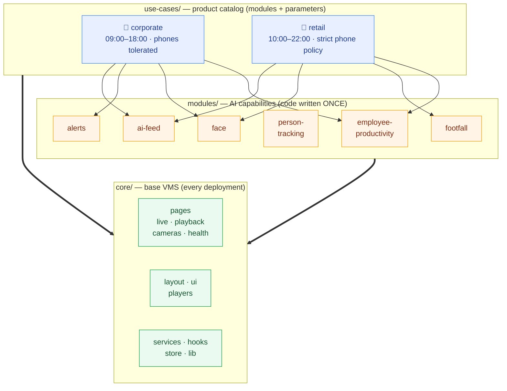
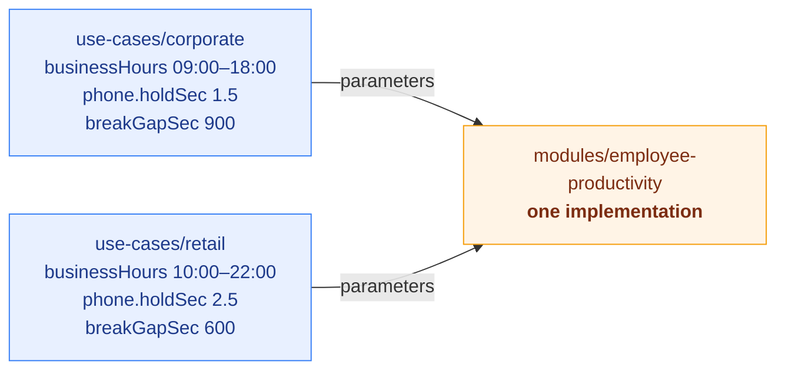

# smart-cam-app — Source Architecture

The web console is built in **three layers**. Read this once and the folder tree
explains itself.

| Layer | Folder | Answers the question | Changes when… |
|-------|--------|----------------------|---------------|
| **Base VMS** | `core/` | "What does *every* customer get?" | rarely — it's the platform |
| **AI capabilities** | `modules/` | "What can the AI *do*?" | you build a new detector/feature |
| **Product catalog** | `use-cases/` | "What does *this vertical* get, and with what settings?" | you sell to a new vertical |

Everything imports via the `@/` alias (→ `src/`).

---

## At a glance



*Read top-to-bottom: a **use-case** picks **modules** and gives them parameters;
both sit on top of the shared **core**.*

---

## The golden rule

> **Module code is written once. Verticals only change parameters.**

The *same* Employee Productivity module runs for a corporate office and a retail
floor — what differs is business hours, break tolerance, how strict phone usage
is, etc. So the code lives in `modules/`, is never forked, and each vertical in
`use-cases/` just supplies its own numbers.



---

## Layer 1 — `core/` (base VMS)

Everything every deployment needs, regardless of vertical.

| Folder | What's in it |
|--------|--------------|
| `core/pages/` | Home, Dashboard, Live View, Playback, Monitor Wall, Camera Health / Setup / Groups, Sites, Map, Timeline, Gallery, auth (Login/Register/Reset), Settings, Help |
| `core/layout/` | App shell — Sidebar, Topbar, NotificationBell, AIToastHost, ProtectedRoute, ErrorBoundary |
| `core/ui/` | Design-system primitives — button, card, dialog, table, tabs… |
| `core/players/` | Video players + overlays — HLS, WebRTC, DirectStream, AIOverlay, ZoomIndicator |
| `core/components/` | Shared VMS widgets — CameraCard, StreamHealthPanel, TalkBackPanel, dialogs |
| `core/services/` `hooks/` `lib/` `context/` `config/` `store/` | Cross-cutting code shared by everything |

## Layer 2 — `modules/` (AI capabilities)

Each folder is one capability. Code is written here **once**.

| Module | Pages |
|--------|-------|
| `employee-productivity/` | Attendance Report, Event Log *(+ phone-usage / activity)* |
| `face/` | Face Learning, Watchlist, Personnel Search |
| `ai-feed/` | Live AI event feed |
| `footfall/` | Customer footfall counter |
| `person-tracking/` | Person Tracker, Journey Map, Camera Mapping |
| `alerts/` | AI alerts |

## Layer 3 — `use-cases/` (product catalog)

A vertical = **which modules + what parameters**.

| File | Role |
|------|------|
| `use-cases/index.js` | Registry + helpers: `getUseCase`, `moduleParams`, `hasModule` |
| `use-cases/employee-productivity.params.js` | Default tunables for that module |
| `use-cases/corporate/index.js` | Corporate office preset |
| `use-cases/retail/index.js` | Retail floor preset |

---

## Recipes

**➊ Add a new vertical** (e.g. warehouse) — no module code changes:
```js
// use-cases/warehouse/index.js
import { productivityDefaults } from '../employee-productivity.params'
export default {
  key: 'warehouse', label: 'Warehouse',
  modules: ['employee-productivity', 'alerts'],
  params: { 'employee-productivity': { ...productivityDefaults, businessHours: '06:00-23:00' } },
}
// then register it in use-cases/index.js
```

**➋ Read the active parameters inside a module:**
```js
import { moduleParams } from '@/use-cases'
const p = moduleParams(activeUseCase, 'employee-productivity')
//  → p.businessHours, p.breakGapSec, p.phone.holdSec …
```

**➌ Add a new AI capability** — create `modules/<name>/`, add its page, then list
it in whichever `use-cases/*` should ship it.

---

## Full tree

```
src/
├── core/                     # base VMS — every deployment
│   ├── pages/                #   live, playback, cameras, health, auth, settings…
│   ├── layout/               #   sidebar, topbar, notifications, route guards
│   ├── ui/                   #   design-system primitives
│   ├── players/              #   video players + overlays
│   ├── components/           #   shared VMS widgets
│   └── services/ hooks/ lib/ context/ config/ store/
├── modules/                  # AI capabilities (code once)
│   ├── employee-productivity/#   attendance + event log
│   ├── face/                 #   learning, watchlist, personnel search
│   ├── ai-feed/              #   live AI event feed
│   ├── footfall/             #   footfall counter
│   ├── person-tracking/      #   tracker, journey, camera mapping
│   └── alerts/               #   AI alerts
├── use-cases/                # product catalog — modules + parameters
│   ├── index.js              #   registry + helpers
│   ├── employee-productivity.params.js
│   ├── corporate/            #   corporate preset
│   └── retail/               #   retail preset
├── App.jsx  main.jsx  assets/
├── ai-analytics/             # ⟵ separate module system (left as-is)
└── admin/                    # ⟵ admin sub-app (left as-is)
```

## Kept separate on purpose

| Folder | Why |
|--------|-----|
| `ai-analytics/` | Its own self-contained module system (ANPR, Weapon, Crowd, Productivity hub…) with its own conventions. Not merged. |
| `admin/` | The admin sub-app — different audience, own routing. |
| `assets/` | Shared static files (logo, video). |

## Import convention

All app imports use the `@/` alias → `src/`. Examples:
`@/core/services/ai` · `@/core/ui/button` · `@/modules/face/Watchlist` · `@/use-cases`
