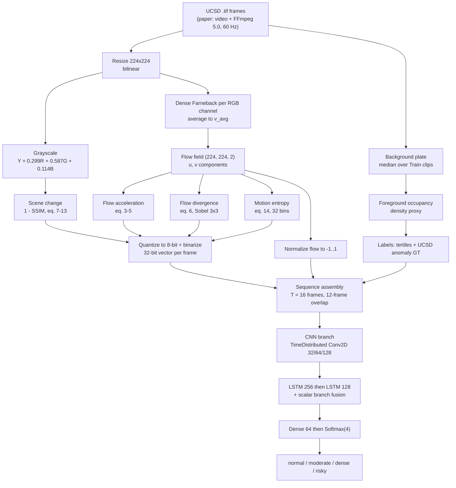

# Stampede Detection Pipeline (as specified in the paper)

Reconstruction of the processing pipeline from:

> Bhola, G., Srivastava, S., Nidhan, H. R. & Kathed, S.
> *Stampede detection and crowd analysis using CNN-LSTM and Farneback optical flow.*
> Scientific Reports (2026) 16:16155 — https://doi.org/10.1038/s41598-026-45262-1

Everything below is what the paper states. Ambiguities and internal contradictions in the
source are called out in **[Gap]** notes — those are the places where an implementer has to
make a decision the paper does not make for them.

This repository implements the pipeline over the **UCSD Anomaly Detection Dataset only**.
Where the paper's setup depended on datasets this project does not use, the section says so
and states what replaced it. Everything else below is the paper's own spec.

---

## 0. Pipeline at a glance



---

## 1. Datasets

The paper trains on a hand-annotated set of 10,000 frames drawn from UCSD and Agoraset, and
tests zero-shot on UMN. **This project uses UCSD alone** — for training, validation and
evaluation.

| Role | Paper | This project |
|---|---|---|
| Train + validation | UCSD + Agoraset, 10,000 hand-labelled frames | UCSD, 18,462 flow frames from 98 clips |
| Zero-shot test | UMN, 10 sequences | not run — there is no second dataset |

- Four-tier label taxonomy, kept as the paper defines it:

| Class | Definition (paper's wording) |
|---|---|
| `normal` | low density, free movement |
| `moderate` | medium density, slight congestion |
| `dense` | high density, restricted movement |
| `risky` | critical density, potential stampede conditions |

- **The paper's annotation is unpublished**, so this project rebuilds the four classes from
  UCSD's own content: `risky` is UCSD's native frame-level anomaly annotation verbatim, and
  the other three are tertiles of a foreground-occupancy density proxy over the non-anomalous
  frames. Derivation and caveats: [TRAINING.md](TRAINING.md) "Labels"; code:
  `src/ucsd_labels.py`.

> **[Gap]** The paper's annotation protocol — single vs. multiple annotators, agreement,
> per-class density thresholds — is not described anywhere in it. Reference 24, cited as the
> Agoraset source, is a YouTube link to *Calgary Stampede 2012 Centennial Highlights*, not
> the Agoraset dataset publication.

## 2. Frame extraction and preprocessing

| Step | Setting |
|---|---|
| Extraction tool | FFmpeg 5.0 |
| Temporal sampling rate | 60 Hz |
| Resize | 224 x 224, bilinear interpolation |
| Grayscale conversion | Luminosity method: `Y = 0.299R + 0.587G + 0.114B` |

Purpose of grayscale conversion, per the paper: eliminate chromatic variation that would
inject noise into motion analysis.

**Not applicable here:** UCSD ships pre-extracted `.tif` frames, not video, so there is no
FFmpeg step and no temporal resampling — every frame the dataset provides is used, in order.
UCSD's frames are also already grayscale, which has one consequence for the flow stage below.

> **[Gap]** Section 4.1 says all frames are converted to grayscale and *then* Farneback is
> applied. Section 4.2 says Farneback is run on **all three RGB channels** and averaged.
> These contradict each other. The multi-channel version is claimed as novel contribution #2,
> so treat 4.2 as the operative spec and use the grayscale frames only for the SSIM
> scene-change feature (SSIM in eq. 7 is explicitly defined over grayscale frames `I_t`).
>
> On UCSD the contradiction is moot: the source frames are grayscale, so the three channels
> are identical and eq. (2)'s average over them returns the single-channel flow exactly.
> `farneback_multichannel()` detects this and computes the field once instead of three times
> — an exact reduction, not an approximation, and a 3x saving on the pipeline's dominant cost.
> Colour input still takes the full three-channel path.

---

## 3. Optical flow extraction — multi-channel dense Farneback

Dense Farneback (ref. 25, polynomial-expansion two-frame motion estimation) is computed
independently on each colour channel of consecutive frames `I_t`, `I_t+1`:

**Eq. (1)** — per-channel flow field:

```
v_c(x, y) = [ u_c(x, y),  v_c(x, y) ]^T        c in {R, G, B}
```

**Eq. (2)** — channel average:

```
v_avg(x, y) = (1/3) * SUM_{c in {R,G,B}}  v_c(x, y)
```

Output: **two-channel matrices** (horizontal + vertical displacement) at **224 x 224**,
spatially aligned with the input frames. This flow tensor — not the RGB frame — is the
primary model input.

**Why Farneback and not Lucas-Kanade** (paper's stated rationale):

1. Per-pixel displacement across the whole frame captures collective motion in ultra-dense
   scenes where individual keypoints are occluded or unavailable.
2. Rich local motion distributions make the flow-derived descriptors (acceleration,
   divergence, entropy) computable.
3. No explicit individual tracking, so the pipeline stays simple.

Lucas-Kanade (ref. 26) with Shi-Tomasi corners (ref. 27) is rejected because it assumes small,
locally-constant displacement and sparse trackable keypoints.

> **[Gap]** No Farneback parameters are given — `pyr_scale`, `levels`, `winsize`, `iterations`,
> `poly_n`, `poly_sigma`. OpenCV defaults are the obvious fallback but reproduction will vary.

---

## 4. Scalar feature extraction (4 features per frame)

### 4.1 Flow acceleration

**Eq. (3)** — per-pixel:

```
a_t(x, y) = || v_t(x, y) - v_t-1(x, y) ||_2
```

**Eq. (4)** — velocity as the temporal flow gradient:

```
v_t(x, y) = d v_c(x, y) / dt
```

**Eq. (5)** — frame-level mean:

```
a_mean_t = (1 / (H*W)) * SUM_{x=1..H} SUM_{y=1..W}  a_t(x, y)
```

Captures sudden changes in crowd movement.

### 4.2 Flow divergence

**Eq. (6)** — quantifies crowd expansion vs. contraction:

```
div(v_t) = d u_t / dx  +  d v_t / dy
```

Partial derivatives computed with **Sobel operators, 3 x 3 kernel**.
`u_t` = x-direction flow component, `v_t` = y-direction flow component.

### 4.3 Scene change via SSIM

Detects abrupt scene transitions that may signal an emergency. Computed on **grayscale**
frames `I_t`, `I_t+1`.

**Eq. (7)**:

```
SSIM(I_t, I_t+1) = [ (2*mu_t*mu_t+1 + c1) * (2*cov_t,t+1 + c2) ]
                   / [ (mu_t^2 + mu_t+1^2 + c1) * (var_t + var_t+1 + c2) ]
```

- **Eq. (8)** mean intensity — `mu_t = (1/N) * SUM_{x,y} I_t(x, y)`
- **Eq. (9)** variance — `var_t = (1/(N-1)) * SUM_{x,y} (I_t(x, y) - mu_t)^2`
- **Eq. (10)** covariance — `cov_t,t+1 = (1/(N-1)) * SUM_{x,y} (I_t(x,y) - mu_t) * (I_t+1(x,y) - mu_t+1)`
- **Eq. (11-12)** stabilizing constants — `c1 = (k1*L)^2`, `c2 = (k2*L)^2`

**Eq. (13)** — the feature itself:

```
Change_t = 1 - SSIM(I_t, I_t+1)
```

> **[Gap]** `k1`, `k2` and dynamic range `L` are not specified. Standard SSIM values are
> `k1 = 0.01`, `k2 = 0.03`, `L = 255` for 8-bit. Window size / Gaussian weighting also unstated.

### 4.4 Motion entropy

**Eq. (14)** — randomness/chaos in the movement pattern:

```
H_t = - SUM_{i=1..N}  p_i * log2(p_i)
```

`p_i` = probability distribution of optical-flow magnitudes, obtained by **histogram
normalization with 32 bins**.

> **[Gap]** Eq. (14) is printed in the paper without the leading minus sign. Shannon entropy
> requires it; implement with the minus.

---

## 5. Quantization and binarization of scalar features

| Feature | Source range | Target |
|---|---|---|
| Flow acceleration | 0 – 1 | 8-bit |
| Flow divergence | 0 – 1 | 8-bit |
| Scene change (1 - SSIM) | 0 – 1 | 8-bit |
| Motion entropy | 0 – 4 | 8-bit |

Ranges were determined empirically from the combined dataset. Each 8-bit value is then written
out as its binary representation, giving a **32-bit feature vector per frame** (4 features x 8 bits).

Stated objectives: (1) a low-bandwidth alternative to float feature vectors, and (2) a compact
representation that still resolves the threshold distinctions between classes. The paper claims
this reduces computational complexity and helps prevent overfitting.

> **[Gap]** Clipping behaviour for out-of-range values is unspecified, as is whether the 32 bits
> enter the network as 32 separate `{0,1}` inputs (the natural reading) or are packed.

---

## 6. Sequence assembly

| Parameter | Value |
|---|---|
| Temporal window `T` | **16 frames** |
| Overlap between windows | **12 frames** (i.e. stride 4) |
| Flow tensor shape per sequence | `(T, H, W, 2)` = `(16, 224, 224, 2)` |
| Scalar tensor per sequence | `(16, 32)` |
| Flow normalization | scaled to **[-1, 1]** for stable convergence |

Rationale for 16/12: captures short bursts of acceleration and divergence that precede
structural collapse, while overlapping windows maximize temporal density without inflating the
number of sequences processed at inference.

---

## 7. Network architecture — hybrid CNN-LSTM

Two branches: a TimeDistributed CNN over the flow maps, and a scalar-descriptor branch; both
feed the LSTM stack. ReLU on every conv layer.

### 7.1 CNN branch (Table 1 in paper) — applied per frame via TimeDistributed

| Layer | Parameters | Output shape |
|---|---|---|
| Conv2D | 32 filters, 3 x 3, ReLU | (224, 224, 32) |
| BatchNormalization | — | (224, 224, 32) |
| MaxPooling2D | 2 x 2 | (112, 112, 32) |
| Conv2D | 64 filters, 3 x 3, ReLU | (112, 112, 64) |
| MaxPooling2D | 2 x 2 | (56, 56, 64) |
| Conv2D | 128 filters, 3 x 3, ReLU | (56, 56, 128) |
| BatchNormalization | — | (56, 56, 128) |
| MaxPooling2D | 2 x 2 | (28, 28, 128) |
| Flatten | spatial to 1D | 28 x 28 x 128 = **100,352** |

### 7.2 Temporal / classification head (Table 2 in paper)

| Layer | Parameters | Output shape |
|---|---|---|
| LSTM 1 | 256 units, `return_sequences=True` | (16, 256) |
| Dropout | 0.3 | (16, 256) |
| LSTM 2 | 128 units, `return_sequences=False` | (128) |
| Dropout | 0.3 | (128) |
| Dense | 64 units, ReLU | (64) |
| BatchNormalization | — | (64) |
| Output | 4 units, **softmax** | (4) |

### 7.3 Fusion

The paper says only: *"The concatenated features from both branches are processed through
LSTM layers."*

> **[Gap]** This is the least-specified part of the pipeline. The natural reading is
> per-timestep concatenation of the 100,352-d CNN vector with the 32-bit scalar vector, giving
> `(16, 100384)` into LSTM 1.
>
> **[Gap — practical]** A 100,384-d input into a 256-unit LSTM is
> `4 * (100384 + 256 + 1) * 256` ~= **103 M parameters in LSTM 1 alone**. That is implausible
> for the reported RTX 4070 12 GB training and the 0.078 s/frame CPU inference. A working
> implementation almost certainly needs a `Dense` bottleneck (e.g. 128–512 units) or
> `GlobalAveragePooling2D` in place of `Flatten` before the LSTM. Table 1 lists no such layer.
>
> **[Gap]** Table 2's caption in the paper reads "Layer-wise architecture of CNN branch" — a
> copy of Table 1's caption. It is the LSTM branch.

Design justification given: this avoids end-to-end 3D CNNs and transformers, which need far
more compute and memory and restrict edge deployment. The scalar branch supplies
low-dimensional complementary signals, improving interpretability and reducing the burden on
the sequence model.

---

## 8. Training configuration

| Parameter | Value |
|---|---|
| Framework | TensorFlow 2.x + Keras, CUDA |
| GPU | NVIDIA RTX 4070, 12 GB, memory growth enabled |
| Batch size | 8 sequences |
| Optimizer | Adam (ref. 28) |
| Learning rate | 0.001 |
| Loss | Categorical cross-entropy |
| Metric | Classification accuracy |
| Sequence length | 16 frames |
| Total epochs trained | 40 |
| Early stopping | patience 10 on validation accuracy; best weights restored from **epoch 30** |
| Seed | fixed across all experiments |

Dynamic GPU memory allocation is used to prevent OOM.

> **[Gap]** Train/validation split ratio is never stated. The validation set is 260 samples
> (Table 7 support column: 37 + 73 + 71 + 79), which is sequences, not frames — and it is not
> class-balanced despite the frame-level set being balanced. Whether the split is by scene or
> random across overlapping windows is unstated; random splitting of 12-frame-overlapping
> windows leaks between train and validation and would inflate the reported accuracy.

---

## 9. Reported results

### In-domain (Table 4 / Table 5, as reported by the paper)

| Metric | Value |
|---|---|
| Training accuracy | 99.751 % |
| Validation accuracy | 99.231 % |
| Training loss | 0.0443 |
| Validation loss | 0.0073 |
| Best epoch | 30 of 40, restored by early stopping |

Confusion matrix: **258 / 260** correct. Both errors sit on the `moderate` / `risky` boundary;
**no** `normal` / `risky` confusion.

| Class | Precision | Recall | F1 | Support |
|---|---|---|---|---|
| Normal | 1.00 | 1.00 | 1.00 | 37 |
| Moderate | 1.00 | 0.99 | 0.99 | 73 |
| Dense | 0.99 | 1.00 | 0.99 | 71 |
| Risky | 0.99 | 0.99 | 0.99 | 79 |
| **Accuracy** | | | **0.99** | 260 |

One-vs-rest ROC AUC: **1.000** for normal, moderate, dense; **0.9994** for risky.

> These are the paper's numbers against the paper's unpublished labels. This project's own
> numbers are measured against labels derived from UCSD by a documented rule, so they are not
> directly comparable — see [TRAINING.md](TRAINING.md) "What to expect".

### Inference latency (Table 8)

| Metric | Value |
|---|---|
| Time per 16-frame sequence | 0.173 s |
| Time per frame | 0.078 s |
| Effective throughput | 12.77 FPS |
| Scope measured | optical flow + feature extraction + inference (end-to-end) |
| Device | CPU (24-thread), batch size 8 |

Dense optical flow extraction is identified as the dominant bottleneck, not model inference.

### Cross-dataset (UMN, zero-shot) — not run here

The paper reports, over 10 UMN sequences at a Youden's J threshold of 0.5512: 4/5 abnormal
and 3/5 normal sequences correct.

This project has no second dataset, so there is no zero-shot transfer result. The closest
equivalent it can produce is `evaluate.py --anomaly`, which applies the same protocol —
collapse the softmax to risky-vs-rest, pick the operating point by Youden's J — to held-out
UCSD clips scored against UCSD's own published frame-level annotation. That measures the
model against real ground truth rather than against this project's density proxy, but it is
in-domain, and it is not evidence of cross-dataset generalization.

> **[Gap]** The paper's n = 10 sequence sample is too small to support a generalization
> claim, and the paper itself frames it as a qualitative assessment.

## 10. Inference / deployment path described

1. Camera feed feeds a lightweight preprocessing module that buffers short video sequences.
2. Flow + scalar features extracted per frame batch.
3. Inference-ready batches go to the CNN-LSTM.
4. Only **risk labels / alerts** are sent to the cloud — raw frames stay local, cutting
   bandwidth and preserving privacy.
5. Deployable as an inference-optimized container at surveillance fleet hubs.
6. One process per feed enables multi-camera parallelism; the paper estimates an RTX 4070
   could serve 8–11 near-real-time streams with shared queues and batch scheduling.

Privacy position: the model never detects or tracks individuals, so it carries less
surveillance risk; on-device / flow-only inference and federated learning are proposed as
further mitigations.

---

## 11. Claimed contributions

1. **Four-class density classification** instead of binary anomaly flags, enabling progressive
   intervention (notification, then crowd direction, then partial evacuation).
2. **Multi-channel optical flow integration** — per-RGB-channel Farneback with averaging.
3. **Hybrid feature fusion** — spatial flow features + scalar temporal descriptors via a
   dual-input architecture.
4. **Quantized binary feature representation** for the scalar descriptors.

---

## 12. Comparative context (Table 9)

| Method | Architecture | Dataset(s) | Acc. (%) |
|---|---|---|---|
| Cob-Parro et al. 2025 (ref. 18) | CNN + dense optical flow | Multi-crowd stampede datasets | 99.53 |
| Altowairqi et al. 2026 (ref. 19) | C3D + LSTM + attention | Benchmark crowd datasets | 99.4 |
| Altowairqi et al. 2024 (ref. 20) | SIFT/FAST/AKAZE + sparse tracking + PCA/autoencoder + NN | UMN Scene 1 | 99.5 |
| " | " | UMN Scene 2 | 96.1 |
| " | " | UMN Scene 3 | 99.0 |
| " | " | Violence in Crowds | 88.5 |
| **This paper** | CNN + LSTM + Farneback optical flow | UCSD + Agoraset | **99.75** |

> **[Gap]** Table 9 as printed has misaligned rows (method labels shifted against architectures
> and datasets); the table above is the corrected reading. Note also that no two rows share a
> dataset, so the accuracy column is not a like-for-like comparison.

---

## 13. Limitations the paper acknowledges

- Execution time is high; needs pruning, quantization, operator fusion, hardware-aware design,
  weight sharing, low-rank factorization, knowledge distillation, or lightweight backbones
  (GhostNet, ShuffleNet).
- 12.77 FPS is below frame-level real time (30 FPS).
- 10,000 frames is a modest dataset; larger sets would improve generalization.
- Not tested across varied lighting, weather, or camera angles.
- Decision boundary is partially dataset-dependent; CORAL alignment, adversarial feature
  adaptation, or self-supervised fine-tuning are proposed.
- Ultra-dense, heavily occluded scenarios remain challenging.

---

## 14. Additional inconsistencies to be aware of

- **Table 6** reports a 99.75 % `risky` confidence on the test clip, but the surrounding text
  describes it as "a clear predominance of **moderate**-risk features." The 99.75 % figure also
  coincidentally equals the reported training accuracy.
- The training-curve narrative states *"the trained loss does not decrease; therefore, the
  network's parameters' optimization is stable"* — self-contradictory, and it describes
  validation fluctuation at epochs 20–22 while Table 5 gives best epoch 30 of 40.
- Batch size is "8 sequences" in Table 3 but "batch size of 8 frames" in the latency section.
- No code or trained weights are released; data availability is "from the corresponding author
  on reasonable request." Reproduction means reimplementing from these tables.

---

## 15. Minimum decisions needed to implement this

Ordered by how much they affect the outcome:

1. **Bottleneck between Flatten and LSTM 1** — required; 100,352-d is not trainable as written.
2. **Train/val split policy** — split by scene/video, not by random window, or the 12-frame
   overlap leaks between splits.
3. **Farneback parameters** — start from OpenCV defaults
   (`pyr_scale=0.5, levels=3, winsize=15, iterations=3, poly_n=5, poly_sigma=1.2`).
4. **Per-class annotation thresholds** — the paper's four class definitions are qualitative
   and its own annotation is unpublished; pick concrete density criteria and document them.
   Done in `src/ucsd_labels.py`: UCSD's anomaly annotation supplies `risky`, and tertiles of
   a foreground-occupancy density proxy supply the other three.
5. **SSIM constants** — `k1 = 0.01`, `k2 = 0.03`, `L = 255`.
6. **Scalar clipping** — clamp to the stated ranges before 8-bit quantization.
